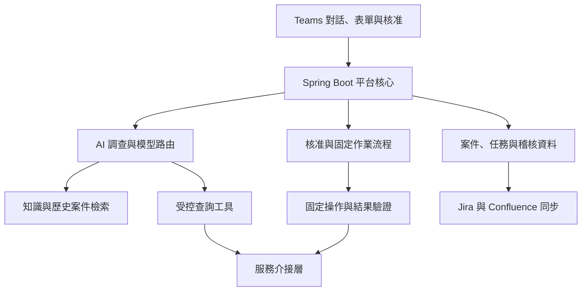

# DevOps AI 機器人平台：需求與架構討論結論

> 歷史來源說明：本討論稿已整合至 SRS／SA／SD 0.40，後續確認的 D01～D11 決策以 SRS-10 為準；本文保留作為來源追溯，不是現行實作規格。請參閱[文件索引](../README.md)。

- 文件日期：2026-10-17（Asia/Taipei）
- 版本：0.1
- 文件性質：需求基線與架構建議，供團隊評估；非已核准的實作規格。
- 範圍：彙整本次對話中的平台、知識庫、工具整合與 PostgreSQL 評估。
- 狀態標記：「已確認」為使用者明確需求；「建議」為討論提出的設計；「待確認」為尚未定案事項。

## 1. 核心結論

平台目標是建立常駐 Teams 的 DevOps 機器人，能對話、在授權範圍內調查、分析證據、提出解法，並在 DevOps 人員核准後執行既定操作。平台也要處理標準申請，將每次處理記錄到 Jira 與 Confluence，並持續累積可重用的知識。

建議以 Spring Boot 作為平台核心，Spring AI 整合模型與工具，PostgreSQL 儲存案件及任務狀態，GitLab 管理正式知識與固定作業版本。pgvector 可作為語意檢索元件。

Dify 與 RAGFlow 均為可選元件。是否引入，應以能省下的開發工作及新增維護成本決定，不預設必須部署。

## 2. 已確認需求與現況

| 項目 | 需求或現況 |
| --- | --- |
| 使用入口 | Teams 中可對話、提出需求與接收結果 |
| 調查能力 | 在團隊設定的範圍內查詢服務、分析證據與提出解法 |
| 已知問題 | 必須符合已定義的問題及固定解法，執行前取得 DevOps 人員審核 |
| 標準流程 | 建立 Jenkins pipeline、建立 DB table、新進人員加入測試環境並建立 DB user |
| 處理紀錄 | 每次處理必須記錄到 Jira／Confluence |
| 模型 | 公司內部自建大模型為主要模型 |
| 外部模型 | 複雜問題需保留足夠 API endpoint，讓外部商用模型介入調查 |
| 知識成長 | 團隊自行維護，隨問題處理逐步擴增 |
| 既有工具 | GitLab、Confluence、自架 PostgreSQL、MariaDB 11.8 |
| 文件工具變更 | Confluence 預計兩年內由其他工具取代 |

服務範圍：PostgreSQL、MariaDB、Jenkins、GitLab、Jira、Confluence、Nexus、Graylog、Rancher、VM management。

「外部商用模型介入」依本次最新需求納入設計；不代表已選定供應商或允許所有內部資料外傳。

## 3. 三種工作模式

| 模式 | AI 責任 | 平台責任 |
| --- | --- | --- |
| 調查與診斷 | 選擇查詢工具、分析結果、提出假設及建議 | 限制服務與資料範圍、查詢量、時間與權限 |
| 已知問題修復 | 辨識候選 Runbook、整理適用證據 | 驗證前提、核准、執行固定命令、檢查結果 |
| 標準服務申請 | 理解需求、補齊表單、說明結果 | 欄位驗證、變更預覽、核准及固定流程執行 |

AI 可以提出未知問題的處理建議；未納入核准作業目錄的解法，不直接轉成任意命令執行。交由人工處理或先完成 Runbook 建立與審查。

## 4. 建議架構



| 模組 | 責任 |
| --- | --- |
| Teams 介接 | 對話、表單、核准卡片、進度通知；實際程式常駐後端 |
| 案件管理 | 追蹤案件、申請人、服務、環境、狀態與關聯文件 |
| AI 調查 | 檢索知識、調用工具、分析證據與產生可驗證的判斷摘要 |
| 權限及政策 | 由後端驗證查詢範圍、操作範圍與核准人資格 |
| 作業執行 | 執行固定且有版本的流程，管理失敗與結果不明情況 |
| 知識管理 | 保存原文、版本、適用條件、來源與索引 |
| 系統介接 | 優先使用合適的 MCP／官方 API；缺口另建受控代理 |
| 紀錄同步 | 將案件及報告同步到 Jira／Confluence，追蹤同步狀態 |

初期建議採模組化單體。先清楚區分責任，不因模組數量而立即拆成微服務。

## 5. 核准與執行規則

### 5.1 核准內容

核准必須綁定這一次的具體變更，至少包含：

- 案件 ID、申請人、目標服務與環境。
- Runbook／作業版本。
- 已驗證的適用條件與證據。
- 實際命令或變更預覽、完整操作參數。
- 預期影響、成功判定及失敗處理方式。
- 核准人、核准時間與有效期限。

目標、參數或作業版本改變時，原核准失效。執行前重新確認重要前提。

### 5.2 狀態與防重複

建議狀態包括：受理、調查中、等待補充、等待核准、已拒絕、執行中、驗證中、完成、失敗、結果不明、等待人工。

狀態須保存到資料庫，不依賴模型對話記憶。Teams 重送事件、重複點擊核准及服務重啟，不得造成重複操作。

使用案件／操作識別碼、資料庫唯一限制及目標系統現況檢查防止重複。跨系統操作不能只靠一個本地交易保證不重複。

若工具逾時，先查目標結果；不能把「沒有收到回應」視為「沒有執行」。結果不明時轉人工，不盲目重送修改命令。

補送報告與重跑維運操作是不同流程。變更操作不自動補跑；任何重試或補償策略須由該作業明確定義。

## 6. 標準流程示例

| 申請 | 必要資料示例 | 執行前檢查 | 執行後驗證 |
| --- | --- | --- | --- |
| 建立 Jenkins pipeline | 名稱、Git repository、branch、模板、環境 | 權限、命名衝突、模板版本、參數合法性 | job 存在且設定符合申請；是否觸發 build 另定 |
| 建立 DB table | DB、schema、欄位、型別、鍵與索引 | 目標環境、名稱衝突、DDL 預覽及規範 | 實際 schema 與核准內容一致 |
| 建立測試 DB user | 人員身分、DB、角色、到期日 | 人員資格、測試環境、帳號是否存在、權限範圍 | 帳號與角色正確；到期處理方式另定 |

帳密與 token 不放在聊天、知識文件及案件報告中。實際秘密交付與保存方式待確認。

## 7. 服務工具設計

以下為建議的能力介面，不代表產品已原生提供同名 API。

| 服務 | 調查工具 | 修改工具／流程 |
| --- | --- | --- |
| PostgreSQL／MariaDB | 連線、鎖、複寫、schema 查詢 | 依模板建表、建立指定角色帳號 |
| Jenkins | job 設定、build、console log | 建立 pipeline、執行已知修復 |
| GitLab | repository、pipeline、變更查詢 | 建立 MR、套用核准設定 |
| Jira／Confluence | 案件與知識搜尋 | 建立及更新案件、報告 |
| Nexus | artifact 與 repository 狀態 | 已核准的維護作業 |
| Graylog | 限定時間與來源搜尋 log | 初期以查詢為主 |
| Rancher | workload、事件、資源狀態 | 指定 workload 的既定操作 |
| VM management | VM、資源與服務狀態 | 指定服務或 VM 的既定維護 |

工具應採明確語意，例如 get_db_blocking_sessions、get_jenkins_build_log、create_test_db_user。避免以任意 SQL／shell 作為模型主要介面。

每個工具應描述參數、查詢或修改性質、權限、逾時、輸出限制及錯誤格式。回傳資料包含來源、查詢時間與環境，讓模型能判斷證據是否過時。

## 8. 內部模型與外部模型協作

### 8.1 優先建議：由內部平台呼叫外部模型

平台把必要且經過過濾的證據送給外部模型。模型提出工具呼叫後，由平台檢查權限並在內部執行，再回傳允許提供的結果。

此方式不需要把內部管理 API 直接公開到網際網路。

### 8.2 預留：外部 Agent 使用 MCP／API

若需要外部 Agent 主動介入，可提供有驗證與案件範圍限制的入口，例如：

- 取得案件摘要與證據清單。
- 查詢知識及讀取原文。
- 執行允許的診斷工具。
- 提交調查發現或方案提案。
- 查詢處理狀態。

上述能力由同一套政策與稽核管理。外部模型不獲得額外的修改權限，也不能自行核准。

交接資料包含問題描述、服務版本、已取得證據、已排除原因、已嘗試動作、未驗證假設及允許調查的範圍。保存可驗證的判斷摘要，不要求保存模型內部思考過程。

切換條件待確認：例如缺乏證據、多輪無進展、工具使用失敗或人工指定。不能只靠模型自評的信心分數決定。

## 9. 知識管理與成長

### 9.1 分開管理三類資訊

| 類型 | 內容 | 建議位置 |
| --- | --- | --- |
| 正式知識 | 已審查 Runbook、已知問題、架構與操作限制 | GitLab repository |
| 歷史案件 | 症狀、調查、成功與失敗嘗試、證據 | PostgreSQL |
| 即時狀態 | 現在的版本、監控、log、服務狀態 | MCP／API 即時查詢 |

正式知識是主要依據；歷史案件是參考證據；即時查詢確認本次是否適用。檢索命中相似案例不等於證明根因相同。

### 9.2 知識生命週期

處理案件 → 保存證據及結果 → 查重 → 產生新知識或更新草稿 → 人工審查 → 發布 → 更新索引。

每案都留紀錄，但不把所有對話自動發布為正式知識。草稿、正式、過期、撤回及被替代的內容應可區分。

Runbook 至少包含：

- 穩定的 knowledge_id、版本、負責人及最後驗證日期。
- 症狀、錯誤特徵、服務、環境與適用版本。
- 診斷步驟及必要前提。
- 固定操作、參數規格、所需權限。
- 成功判定、失敗處理及可行的回復方式。
- 相關案件、來源與已知不適用條件。

文字說明和可執行作業要建立版本關聯。不能僅從檢索到的文字片段直接執行命令。

### 9.3 檢索設計

排障流程由程式保證先執行知識檢索，並記錄查詢及命中文件。模型可在調查過程追加檢索。

結合關鍵字、語意及 metadata 條件。錯誤碼和 Exception 名稱需精準比對；中文描述需要實測斷詞與語意效果。

回傳原文片段、來源、版本及日期。切分文件時保留前提、命令及驗證方式的關聯。查無適用知識時，明確標記，不杜撰已知解法。

## 10. Jira、Confluence 與未來搬遷

建議以一個案件為紀錄單位，後續對話及操作更新同一案件；實際粒度待團隊確認。

- Jira：申請、負責人、核准、狀態與結果。
- Confluence：診斷證據、處理報告與整理後的知識。
- 平台資料庫：原始案件事件、操作紀錄、外部文件 ID 與同步狀態。

建議透過持久化待送紀錄確保同步可恢復。外部系統不可用時先落地，恢復後補同步。使用穩定案件 ID 關聯，避免重複建立 ticket／頁面。

需另外定義 Jira／Confluence 不可用時，是否仍允許執行變更；本次討論尚未定案。

Confluence 不作為唯一知識來源。knowledge_id 與案件 ID 由平台管理，Confluence page ID 僅作為外部對照。保留原文及可匯出的結構化 metadata，以便更換文件平台。

## 11. 技術選型評估

| 選項 | 價值 | 代價與建議 |
| --- | --- | --- |
| Dify | 視覺化調整提示詞、AI 應用、工作流程與知識處理 | 與自建 Spring 流程可能重疊；有明確視覺化維護需求再導入 |
| RAGFlow | 文件解析、分段、檢索管理及複雜文件處理 | 增加部署元件與資源；大量 PDF／表格或不想自建知識介面時做 PoC |
| Spring AI＋PostgreSQL／pgvector | 與案件、權限及工具流程直接整合 | 需要自行做同步、審核、引用與管理介面；作為初步建議方向 |
| MariaDB 11.8 Vector | 可沿用團隊既有資料庫技能 | 列為候選，實測向量查詢、備份與複寫；並非已被排除 |

Dify 與 RAGFlow 都有 agent／工作流能力，不能只按名稱分類。比較重點是能否省下你們實際需要的工作。

對話模型與 embedding 模型是不同能力。內部模型提供聊天 API，不代表已提供適用的 embedding 服務。embedding 模型變更時，通常需要重新建立向量索引。

## 12. PostgreSQL 版本與部署要求

以下整理自本次對話已查閱的官方文件；部署時需依選定的 PostgreSQL、pgvector、Spring AI 發行版再次核對。

| 項目 | 結論 |
| --- | --- |
| 一般案件與核准資料 | 不需要 pgvector |
| pgvector | 本次查閱官方文件的最低支援為 PostgreSQL 13+ |
| 新建平台 | 建議評估 PostgreSQL 17／18 的最新修補版，尚未定版 |
| 既有 PostgreSQL 16／17 | 可先評估沿用，不必只為知識檢索升主版本 |
| Spring AI PgVectorStore | 本次查閱文件列出 vector、hstore、uuid-ossp；實際以採用版本為準 |
| Docker | 一般 PostgreSQL image 不保證內含 pgvector，需安裝相符套件或建立映像 |
| 被管理的 DB | 不必與機器人平台資料庫同版本 |

最低技術相容性不等於仍受官方維護。正式部署必須確認支援期限。

先在資料庫主機或映像安裝 extension 檔案，再於指定 database 啟用。Java dependency 不能取代伺服器端安裝。正式環境建議由部署／migration 帳號安裝，執行帳號使用必要的最小權限。

唯讀盤點 SQL：

```sql
SHOW server_version;

SELECT name, default_version, installed_version
FROM pg_available_extensions
WHERE name IN ('vector', 'hstore', 'uuid-ossp');
```

vector 未出現代表安裝環境尚未提供；installed_version 為 NULL 代表目前 database 未啟用。

索引另有向量型別與維度限制，必須與 embedding 模型共同選定。不要把某種索引的限制當成整個 PostgreSQL 儲存能力的限制。

## 13. 建議 MVP 與驗收

第一階段完成三個案例：

1. Jenkins 問題調查：檢索 SOP、查 build 與 log、提供有來源的建議。
2. 已知問題修復：確認前提、Teams 核准、固定操作、驗證與報告。
3. 測試 DB 帳號申請：表單補齊、權限驗證、核准、建立與驗證。

三個案例共同涵蓋 Teams、案件狀態、工具權限、知識檢索、紀錄同步與外部模型交接。

| 驗收面向 | 必須驗證的行為 |
| --- | --- |
| 知識品質 | 找對文件與版本；無資料時明確回報 |
| 查詢範圍 | 無法查詢未授權服務或取得秘密 |
| 核准 | 未核准不執行；修改參數後舊核准失效 |
| 防重複 | 重複訊息與點擊不造成重複變更 |
| 失敗處理 | 逾時先核對結果，結果不明轉人工 |
| 紀錄同步 | 每案有紀錄；故障後補同步且不重複建檔 |
| 外部模型 | 使用相同工具政策，僅取得允許的證據 |
| 知識累積 | 先產生草稿，通過審核後才進入正式知識 |

建議以 20～30 個真實案例做初步評測，記錄文件命中、錯誤版本套用、工具選擇、拒答／轉人工及處理結果。數量是 PoC 建議，不是驗收門檻。

## 14. 待確認事項

- PostgreSQL 版本、部署方式、pgvector 安裝條件及是否使用獨立 instance。
- Spring Boot／Spring AI 版本，以及內部模型的 tool calling、結構化輸出與 embedding 能力。
- Teams app 安裝、身分驗證、群組與核准人資格的對應方式。
- 正式知識是否接受 GitLab MR 維護，或第一版就需網頁編輯介面。
- Jira／Confluence 是 Cloud 或自架版本、API 權限、紀錄粒度與同步故障政策。
- 外部模型供應商、可提供的資料範圍、接入方式及觸發條件。
- 標準表單欄位、模板版本、核准層級、失敗／補償規則。
- VM management 的實際產品、API 與網路限制。
- 各服務的工具清單、資料敏感範圍及憑證管理方式。
- Dify／RAGFlow 是否進入 PoC，以及管理介面需求是否足以抵銷維護成本。

## 15. 官方參考資料

以下為本次討論查閱的官方來源；功能及相容性會隨版本變動。

- [Spring AI：MCP](https://docs.spring.io/spring-ai/reference/api/mcp/mcp-overview.html)
- [Spring AI：Tool Calling](https://docs.spring.io/spring-ai/reference/api/tools.html)
- [Spring AI：PGvector](https://docs.spring.io/spring-ai/reference/api/vectordbs/pgvector.html)
- [Spring AI：MariaDB Vector](https://docs.spring.io/spring-ai/reference/api/vectordbs/mariadb.html)
- [pgvector 官方 repository](https://github.com/pgvector/pgvector)
- [PostgreSQL 版本支援政策](https://www.postgresql.org/support/versioning/)
- [Dify：Knowledge](https://docs.dify.ai/en/cloud/use-dify/knowledge/readme)
- [Dify：Knowledge Pipeline](https://docs.dify.ai/en/cloud/use-dify/knowledge/knowledge-pipeline/knowledge-pipeline-orchestration)
- [RAGFlow：HTTP API](https://ragflow.io/docs/http_api_reference)
- [RAGFlow：FAQ](https://ragflow.io/docs/faq)
- [GitLab：Wiki API](https://docs.gitlab.com/api/wikis/)
- [Teams：Adaptive Cards Universal Actions](https://learn.microsoft.com/microsoftteams/platform/task-modules-and-cards/cards/universal-actions-for-adaptive-cards/overview)
- [Atlassian Rovo MCP：Cloud 整合](https://developer.atlassian.com/cloud/rovo-mcp/)

