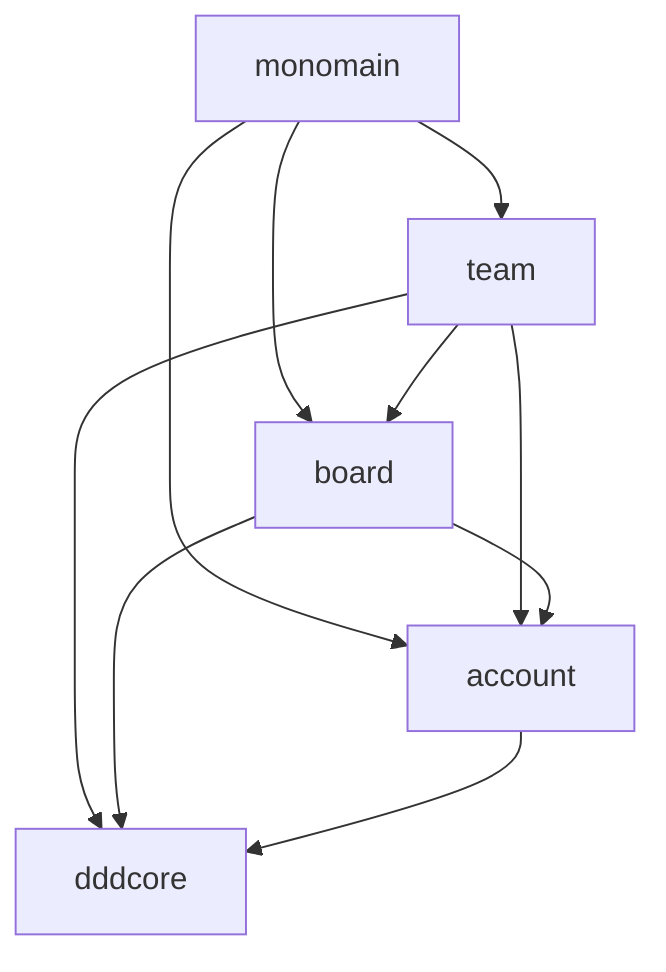

# dddcleankanban 架構分析

分析日期：2026-10-21（Asia/Taipei）。來源：[TeddyChen/dddcleankanban](https://gitlab.com/TeddyChen/dddcleankanban)，讀取 master commit `9bd34d03a32f266d705313b5347479cd3fad6972`。本次實際讀取 build、領域、use case、adapter、組裝及代表性測試原始碼；未執行該專案或驗證它的外部資料庫。

## 1. 整體結構

原專案是 **DDD／Clean Architecture 的 Maven 多模組應用**。根 POM 宣告 dddcore、account、board、team、monomain；model／usecase／adapter 多數是各業務 module 內的 package，並非三個獨立 build modules。board 的 `port/in`、`port/out` 與 `service` 分界最明確，其他 module 的命名仍有差異。

| Maven module | 實際職責 | 內部專案依賴 |
|---|---|---|
| dddcore | Entity、ValueObject、AggregateRoot、DomainEvent、UseCase、Repository、EventBus 等基礎抽象；亦包含 adapter | 無其他業務 module |
| account | User aggregate、註冊／查詢／取消註冊、持久化與 REST | dddcore |
| board | Board、Workflow、Card、Lane／Stage 等模型、案例及 adapters | dddcore、account |
| team | Team／Project 等模型、案例和團隊事件接入 | dddcore、account、board |
| monomain | 組裝 account／board／team，配置 Spring、資料來源及 event subscriptions | account、board、team |

箭頭表示編譯依賴。這些模組可以組裝到單一部署，但不代表每一項跨模組依賴都值得直接複製到我們的系統。

## 2. 可重用的設計原則

| 原則 | 原始碼證據 | 對 ai-devops-platform 的採用方式 |
|---|---|---|
| Rich Domain Model | Board 擁有 rename、commitWorkflow、member 等行為；狀態和事件一起改變 | Work／Resource／Workflow 規則由 aggregate 管理，不堆在 Controller |
| Aggregate／Value Object | dddcore 的 AggregateRoot、Entity、ValueObject；Workflow 的 WipLimit | 核心用純 Java 型別、immutable contracts，重要值在建立時驗證 |
| Inbound use-case ports | CreateBoardUseCase extends Command，輸入 CreateBoardInput | service 暴露案例 interface；web 呼叫 interface |
| Outbound ports／依賴反轉 | BoardRepository 由 BoardRepositorySpringJpaAdapter 實作 | service 定義持久化／授權／連線需求，adapter 實作 |
| Application service | CreateBoardService 注入 repository 和 bus，呼叫 domain 行為 | Use case 協調 domain、policy 與 transaction；不包含 SDK 細節 |
| 資料模型隔離 | BoardData／BoardMapper 將 persistence data 和 Board 分開 | DB entity、MCP response、HTTP DTO 不穿透成 domain model |
| Command／Query 分離 | dddcore 的 Command／Query；建立與查詢不同 interfaces | 可採輕量 CQS；不因此引入兩套 DB 或 Event Sourcing |
| Domain events／通知協作 | AggregateRoot 收集事件，NotifyBoard adapter 呼叫 NotifyBoard interface | 用事實通知投影與非關鍵協作；CHANGE 必須維持中央流程 |
| Composition root | MonoMain 掃描模組、排除各別 Main 並註冊 listeners | 只有 web 負責 Spring Boot 啟動及組裝 |
| 行為測試 | BoardDomainEventTest 驗證動作產生的事件 | 單元測試驗證規則、狀態、事件；整合測試集中 web |

## 3. 一條具體的控制路徑

`CreateBoardController` 依賴 `CreateBoardUseCase`，轉換 HTTP 內容為 input；`CreateBoardService` 建立 Board、加入成員、呼叫 repository save，然後 event bus postAll。`BoardRepositorySpringJpaAdapter` 將 domain 轉成 BoardData，再交給 Spring repository。Workflow 事件則由 `NotifyBoardGoogleEventBusAdapter` 接收，轉成 `NotifyBoard` 案例呼叫。

這呈現 ports/adapters 與 domain-driven 的核心精神，但沒有證明「資料提交與事件投遞」具備跨失敗的一致性。

## 4. 不直接沿用的部分

1. **沒有可靠 Outbox 保證。** 讀到的 CreateBoardService 是 save 後 publish；GoogleEventBusAdapter.postAll 先清 aggregate 的 events 再 publish。不能據此宣稱 crash recovery、durable messaging 或 exactly-once。
2. **事件仍耦合發送方 domain 型別。** 例如 team adapter import board 的事件。需要獨立部署時應建立版本化 integration contracts；本期保持單體，不假裝已有跨程序協定。
3. **基礎核心含技術 adapter。** dddcore 包含 Guava event bus adapter；我們將 framework-free model 與 adapter 明確分開。
4. **測試層級有混合。** 部分 use-case tests 繼承 AbstractSpringBootJpaTest，不是純 unit tests。我們將啟動 Spring／DB 的驗證放 web integrationTest。
5. **測試失敗不能忽略。** 參考 POM 的 testFailureIgnore=true 不採用；我們的 build 由測試失敗直接阻擋。
6. **範例不等於完整產品。** team 的 NotifyTeam handlers 尚有 To be handled；MonoMain 排除 security auto-configuration 的作法也不代表符合本平台 LDAP／RBAC。
7. **不搬舊技術版本。** 參考專案使用的 Java 8、Spring Boot 2.x、Maven 與 Guava 不是本平台的新版本基準；沿用目前 Java 21、Boot 4.1.1、Gradle 9.8.1。

## 5. 原始碼定位

- [根模組宣告](https://gitlab.com/TeddyChen/dddcleankanban/-/blob/9bd34d03a32f266d705313b5347479cd3fad6972/pom.xml)
- [AggregateRoot](https://gitlab.com/TeddyChen/dddcleankanban/-/blob/9bd34d03a32f266d705313b5347479cd3fad6972/dddcore/src/main/java/ntut/csie/sslab/ddd/model/AggregateRoot.java)
- [DomainEventBus](https://gitlab.com/TeddyChen/dddcleankanban/-/blob/9bd34d03a32f266d705313b5347479cd3fad6972/dddcore/src/main/java/ntut/csie/sslab/ddd/usecase/DomainEventBus.java)
- [GoogleEventBusAdapter](https://gitlab.com/TeddyChen/dddcleankanban/-/blob/9bd34d03a32f266d705313b5347479cd3fad6972/dddcore/src/main/java/ntut/csie/sslab/ddd/adapter/gateway/GoogleEventBusAdapter.java)
- [Board aggregate](https://gitlab.com/TeddyChen/dddcleankanban/-/blob/9bd34d03a32f266d705313b5347479cd3fad6972/board/src/main/java/ntut/csie/sslab/kanban/board/entity/Board.java)
- [CreateBoardUseCase](https://gitlab.com/TeddyChen/dddcleankanban/-/blob/9bd34d03a32f266d705313b5347479cd3fad6972/board/src/main/java/ntut/csie/sslab/kanban/board/usecase/port/in/create/CreateBoardUseCase.java)
- [CreateBoardService](https://gitlab.com/TeddyChen/dddcleankanban/-/blob/9bd34d03a32f266d705313b5347479cd3fad6972/board/src/main/java/ntut/csie/sslab/kanban/board/usecase/service/CreateBoardService.java)
- [Repository adapter](https://gitlab.com/TeddyChen/dddcleankanban/-/blob/9bd34d03a32f266d705313b5347479cd3fad6972/board/src/main/java/ntut/csie/sslab/kanban/board/adapter/out/repository/BoardRepositorySpringJpaAdapter.java)
- [事件 adapter](https://gitlab.com/TeddyChen/dddcleankanban/-/blob/9bd34d03a32f266d705313b5347479cd3fad6972/board/src/main/java/ntut/csie/sslab/kanban/board/adapter/in/eventbus/NotifyBoardGoogleEventBusAdapter.java)
- [Domain events 測試](https://gitlab.com/TeddyChen/dddcleankanban/-/blob/9bd34d03a32f266d705313b5347479cd3fad6972/board/src/test/java/ntut/csie/sslab/kanban/board/entity/BoardDomainEventTest.java)
- [Use-case 測試](https://gitlab.com/TeddyChen/dddcleankanban/-/blob/9bd34d03a32f266d705313b5347479cd3fad6972/board/src/test/java/ntut/csie/sslab/kanban/board/usecase/CreateBoardUseCaseTest.java)
- [組裝入口](https://gitlab.com/TeddyChen/dddcleankanban/-/blob/9bd34d03a32f266d705313b5347479cd3fad6972/monomain/src/main/java/ntut/csie/sslab/ezkanban/main/springboot/web/MonoMain.java)

本平台的實體模組、事件及測試決策見 [Gradle 六角形架構](gradle-hexagonal-architecture.md)。
