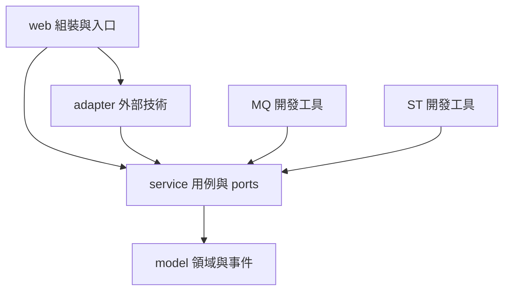
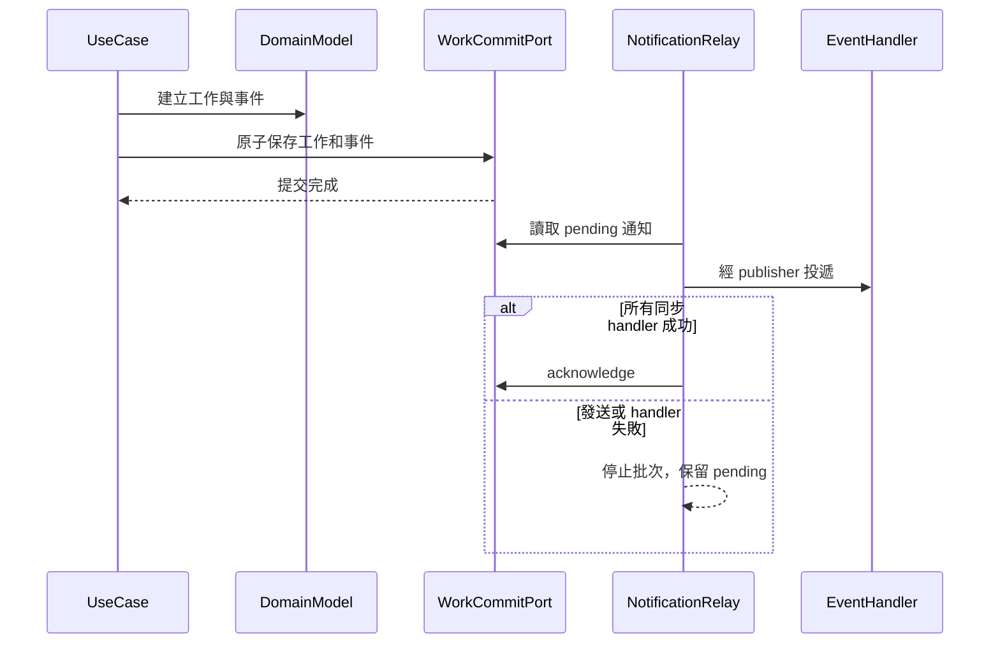

# Gradle 多模組、六角形架構與 Domain Model

版本 1.0｜2026-10-21（Asia/Taipei）｜需求與分析基準 SRS／SA 0.40；對應 SD-15（SD 0.41）。

## 1. 決策與完成範圍

採用 **六角形架構＋以 Domain Model 為核心的設計＋事件通知**，維持模組化單體、一個對外 Bot、單一 Spring Boot web 可執行包。使用者的 model → service → web 表示由內往外建立層次；實際程式依賴為 **web → service → model**。額外抽出 adapter，避免外部技術滲入核心。

本次交付可建置的模組與初始行為範例，不是完整 Jenkins 工作流。所有公司連線與原規格的真實 MQ／ST 案例仍待實作和驗證。參考來源分析見 [dddcleankanban 架構分析](dddcleankanban-architecture-analysis.md)。

## 2. 六個實體 Gradle modules

| Module | 責任與資料 | Production dependencies | 測試 |
|---|---|---|---|
| `model` | 純 Java aggregate、value/snapshot、domain events；初始 WorkRequest | JDK only | src/test：不變量、停止與事件 |
| `service` | Inbound use cases、outbound ports、授權順序、原子提交契約、通知協調 | model（api） | src/test：fake ports、拒絕、提交失敗、ack 順序 |
| `adapter` | 目前 Spring event bridge；日後 PostgreSQL、MCP、API、VM gateway、Qwen 等實作 | service（implementation）、Spring Context | src/test：轉接行為；src/testFixtures：InMemoryWorkJournal |
| `web` | Spring Boot entry point、composition root；日後 REST／Teams ingress | service、adapter、Web MVC、Actuator | src/test：ArchUnit；src/integrationTest：完整組裝／HTTP／跨模組 |
| `model-quality-evaluation` | MQ evaluator interface、結果分類契約；後續 datasets／runner／grader | service；不被正式應用依賴 | src/test：harness 狀態不冒充模型品質 |
| `solution-tool-testing` | ST runner interface、隔離測試情境契約；後續 fault fixtures／assertions | service；不被正式應用依賴 | src/test：拒絕正式環境、模式契約 |



箭頭代表 compile dependencies，不是事件流向。Gradle api／implementation 決定公開類型的可見性；service 的 port signatures 使用 model types，因此對 model 使用 api。

`adapter:testFixtures` 只被測試來源集依賴，與 `adapter` 正式 JAR 分開。web 不依賴 MQ、ST；新增整合測試需它們時只能用 integrationTestImplementation。

## 3. 規格中的業務模組如何映射

不將 SD-01.5／14.1 的每個邏輯元件都做成空 Gradle module。先在 model／service 內按領域 package 封裝，再由具體工作逐步實作；下表除了 work 初始骨架，皆為責任配置而非已完成的 class 清單。

| 邏輯邊界 | model 責任 | service／port | adapter／web |
|---|---|---|---|
| access | 可信 actor／role／permission 契約 | Authorization、Identity ports | LDAP adapter；web session／CSRF |
| case／work | 案件、工作、狀態、關聯及事件 | CaseCoordinator、work use cases、WorkCommitPort | PostgreSQL transaction／web ingress |
| catalog／service-request | 發布版本、命令分類、表單及計畫 | CatalogReader、FormRegistry、TemplatePlanner | GitLab／設定來源 adapters |
| resource／health | 可信資源參照、綁定、健康 snapshot | ResourceResolver、ExecutionGate | 固定 probe、資源 repository |
| workflow／execution | 固定步驟、approval、permit、hold、結果 | WorkflowService、唯一 CommandDispatcher、TimeoutCheckCoordinator | MCP／API／公司 VM gateway |
| reasoning／knowledge | 安全 context、候選與知識版本契約 | AnalysisPort、KnowledgeSearch、Review | Spring AI／Qwen、GitLab／全文搜尋 |
| evidence／audit | 不可覆寫證據、來源、完整性及存取記錄 | EvidenceStore、Audit ports | PostgreSQL／受控儲存 |
| reporting／records | 安全報告、紀錄義務與版本 | ReportProjector、RecordSyncWorker | Jira／Confluence API |
| external-assist | 逐案 export grant／安全投影 | ExportPolicy、Investigation use cases | 外部模型 adapter／web API |
| Teams | ingress contract，不成為領域模型依賴 | 相同可信 application requests | Teams adapter／web 入口 |

日後某 bounded context 需要獨立 ownership 或部署時，再按其公開 API／events 拆出 modules。不能讓所有模組共同使用一個無邊界的 common service 或直接跨表更新。

## 4. Interface 與 Domain Model 規則

- `service.port.in`：RegisterQueryUseCase、DomainEventHandler 等 inbound interfaces。Request／Receipt 是不可變資料契約。
- `service.port.out`：QueryAuthorization、WorkCommitPort、NotificationOutbox、DomainEventPublisher。
- `service.work`／`service.event`：案例實作，只依賴 port interfaces／model／JDK。
- `adapter.event`：Spring 對上述介面的實作；不依賴 RegisterQueryService 等實作。
- `web.config`：唯一組裝位置，可引用 concrete constructors；其他呼叫者依賴 interface。目前僅組裝 event bridge。
- `model.work.WorkRequest`：管理 receiveQuery 與 stop 不變量、產生 WorkReceived／WorkStopped；尚不提供完整 EXECUTING／VERIFYING 流程。

不為每個 record 建 interface；「模組以 interface 溝通」約束的是可執行服務和外部能力。Aggregate 仍是具有行為的具體模型。HTTP DTO、JPA entity、MCP SDK、Spring AI response 必須在 adapter 轉換。

## 5. 事件架構與失敗語意

DomainEvent 是已發生的事實，含 eventId、aggregateId、correlationId、occurredAt。現有 WorkReceived／WorkStopped 不包含原始對話、秘密、raw evidence 或任意命令。



圖中的儲存端由 WorkCommitPort／NotificationOutbox 兩個介面代表；目前只有 testFixtures 裡的 InMemoryWorkJournal 實作，**沒有 production durable outbox**。

事件的處理規則：

1. `WorkCommitPort.create` 契約要求工作與事件同一交易、全成全敗。測試 fixture 用同步區塊模擬，未驗證 PostgreSQL 的 isolation／lock／unique constraints。
2. NotificationRelay 不直接執行 Jenkins 操作，不帶 scheduler、不自動重試；應用預設未建立 relay／RegisterQueryService bean。只有整合測試注入 fake authorization 和 journal。
3. Spring bridge 使用預設同步發布，handler 例外向上傳遞；不可加 @Async 後仍以 publish 返回作成功確認。
4. publish 後、ack 前中斷可能重複投遞。consumer 必須去重；測試 projection 使用記憶體 Set 示範，正式去重需與 consumer effect 同交易持久化。
5. 目前 listener 在沒有匹配 handler 時拋出例外，避免無人處理卻 ack。正式化前仍要有 consumer registry／required subscriptions、consumerId＋eventId ledger，並確認全部必要訂閱者的交付狀態。
6. PostgreSQL adapter 實作前補 schemaVersion、aggregate sequence／causation、claim／owner fencing、排序、容量、metrics、retention、故障處理契約。只有這些門檻通過後才能啟用常駐 worker。

### 三種派送通道不可混用

| 通道 | 內容 | 重送／恢復政策 |
|---|---|---|
| 工作通知 | 已提交的事實、安全投影 | 僅冪等通知；目前無自動 worker |
| execution_outbox | 維運首次派送 | 不因 fault／restart 自動重播 CHANGE；一次逾時唯讀查核仍受 SD-14.2 限制 |
| record_outbox | Jira／Confluence 紀錄義務 | 按 SD-14.7 有界補送；遠端效果未知先查核，獨立 RecordGate |

現有 NotificationRelay 只示範第一類，不取代後兩類。刪除的授權、確認、備份 hash 核對、唯一派送、VERIFY 維持中央同步決策順序。事件驅動不等於 Event Sourcing，也不要求 Kafka／RabbitMQ。

## 6. 測試與建置

所有 modules 都有 unit tests；應用整合測試只位於 web。測試工具自身的 src/test 驗證 harness 契約，不表示公司 MQ/ST 案例已執行。

```bash
./gradlew projects
./gradlew clean build
./gradlew test
./gradlew :web:integrationTest
./gradlew :web:bootRun
./gradlew :web:bootJar
java -jar web/build/libs/ai-devops-platform-0.0.1-SNAPSHOT.jar
```

Windows 用 `.\gradlew.bat`。`build` 包含所有 modules 的 unit／architecture tests 及 web integrationTest；單獨 `test` 不跑 integrationTest，單獨 bootJar 不跑測試。

首次實作驗證：共 **27 tests**，model 4、service 6、adapter 5、web unit/architecture 5、web integration 3、MQ harness 2、ST harness 2。通過項目包括健康 HTTP 200/UP、Spring 跨模組事件協作、ack-gap 重播去重、授權拒絕零提交及提交失敗不回 receipt。可執行 JAR 已確認包含 model／service／adapter、排除 MQ／ST／testFixtures，並實際啟動驗證健康 HTTP 200／UP。

未測：公司 Qwen 品質、真 LDAP／RBAC、PostgreSQL 交易／競態、Jenkins MCP／備份／刪除、Jira／Confluence、所有真實外部契約。文件原有 actual_result／NOT_RUN 不回填。

## 7. 下一個開發切片

1. LDAP／Role config／web identity boundary，為 QueryAuthorization 提供 production implementation。
2. ResourceContext 與 QUERY schema 的真實 binding、safe evidence 契約。
3. PostgreSQL WorkCommitPort／通知 outbox，web integrationTest 驗證 rollback、唯一鍵、重複投遞和 required consumer。
4. Jenkins 查詢的 AnalysisPort、catalog、唯一 Dispatcher、MCP adapter；最後再開放受驗證的 Web API。
5. 刪除 schema 1.1、backup／read-back／approval／permit 與真實隔離測試通過後，開放 CHANGE。

## 8. 可重用 Skills

版本化來源位於根目錄 `skills/`，可供團隊或個人載入：

| Skill | 用途 |
|---|---|
| design-hexagonal-gradle-modules | 實體模組、依賴方向與組裝 |
| model-domain-invariants | Domain Model、不變量與狀態事件 |
| implement-use-case-ports | Use cases、ports、授權與交易順序 |
| design-safe-domain-events | 事件、outbox、去重與失敗政策 |
| test-modular-spring-apps | Unit／integration／architecture／MQ／ST 分工 |

Skills 是開發指引，不是服務操作權限；不能取代需求決策或真實測試。每個 skill 附來源與適用限制。

官方 build／test 參考：[Gradle Multi-project](https://docs.gradle.org/current/userguide/multi_project_builds.html)、[Spring Boot Gradle plugin](https://docs.spring.io/spring-boot/gradle-plugin/reacting.html)、[ArchUnit](https://www.archunit.org/userguide/html/000_Index.html)。
