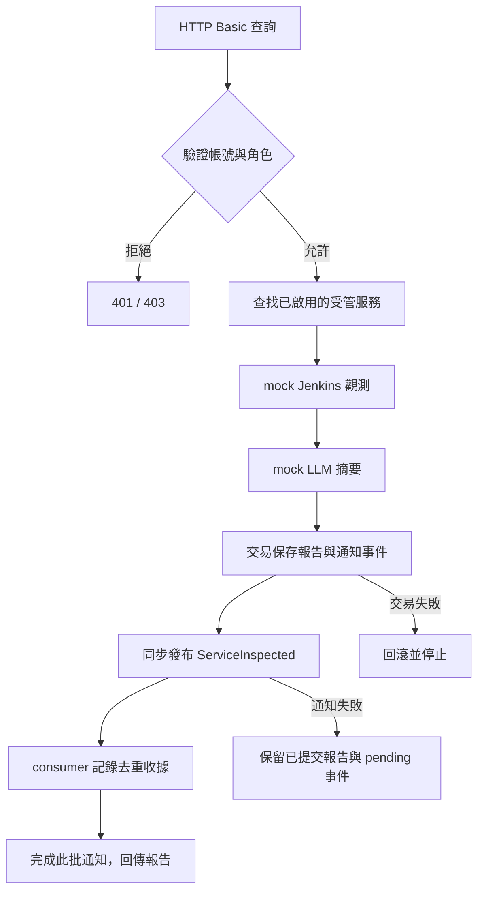

# 受管服務查詢 Demo：初始化、設定與完整切片

版本 1.0｜2026-10-21｜對應 SD 0.42 / SD-16

## 1. 已實作的 use case

**使用者登入 → 列出受管服務 → 查詢 Jenkins 狀態 → mock LLM 摘要 → DB 保存報告與事件 → 事件 consumer 確認 → 回傳報告。**

此案例是可執行的開發示範，使用明確啟用的 `demo` profile。LDAP、Jenkins、LLM 為 mock；DB 使用真正的 H2 記憶體資料庫及 JDBC transaction，作為 PostgreSQL 的開發替身。沒有連線公司 LDAP、Qwen、Jenkins、MCP 或 PostgreSQL。這不是 Jenkins Job 內容查詢／刪除方案的正式驗收。

| Module | 此案例的實際責任 |
|---|---|
| model | ManagedService、Observation、InspectionReport、ServiceInspected；狀態由觀測決定，LLM 不改寫狀態 |
| service | ManagedServiceQueryUseCase；先授權，再找資源、probe、摘要、提交、通知；全程透過 ports |
| adapter | YAML catalog／角色、mock directory／Jenkins／LLM、H2 報告及通知 outbox、Spring event bridge |
| web | Demo 組裝、HTTP Basic 身分邊界、REST DTO、所有應用 integration tests |
| model-quality-evaluation | ServiceSummaryEvaluator 經相同 ServiceSummaryPort 驗證 mock 摘要，結果只可 HARNESS_ONLY 或 FAIL |
| solution-tool-testing | ManagedServiceScenarioRunner 經相同 use-case interface 驗證 OFFLINE 查詢和報告讀回 |

前四個模組參與應用執行；MQ／ST 在 `web:integrationTest` 驗證同一套組裝，只有 integrationTestImplementation 依賴，不加入可執行應用的 runtime。測試工具不會在每次使用者查詢時執行。



## 2. 三種設定分開

| 檔案 | 管理內容 | 改動方式 |
|---|---|---|
| `config/system-demo.yml` | 系統 DB／LDAP／LLM，catalog 與 roles 檔案位置 | 環境變數覆寫或指定外部檔案；重新啟動 |
| `config/managed-services.yml` | 被監控／管理的 Jenkins 等服務清單 | 編輯清單、重新啟動；不是 Spring Boot infrastructure properties |
| `config/roles.yml` | 已驗證帳號的角色映射 | 編輯映射、重新啟動；不放密碼 |

`application-demo.properties` 必須匯入 system-demo.yml；設定遺失／錯誤會啟動失敗，不使用內建的寬鬆 fallback。未指定 demo profile 時不載入 demo 帳號、DB、catalog 或業務 controller；健康端點仍可使用。

| 系統項目 | 預設值／環境變數 | 現階段語意 |
|---|---|---|
| DB mode | `h2-mock` | 僅允許 H2 記憶體 DB |
| DB URL | `PLATFORM_DB_URL`，預設 `jdbc:h2:mem:devops_demo;DB_CLOSE_DELAY=-1` | 必須符合受限 H2 URL 格式；不可改成 postgres URL 後期待自動連接 |
| DB 帳密 | `PLATFORM_DB_USERNAME` / `PLATFORM_DB_PASSWORD` | 預設 sa／空字串，僅此記憶體 DB |
| LDAP mode | `mock` | 用合成帳號驗證，不執行 LDAP bind |
| LDAP 連線欄位 | `PLATFORM_LDAP_URL` / `PLATFORM_LDAP_BASE_DN` / `PLATFORM_LDAP_BIND_DN` / `PLATFORM_LDAP_BIND_PASSWORD` | 預留真 adapter 接線用；mock 不使用 |
| Demo 帳號密碼 | `DEMO_ADMIN_PASSWORD` / `DEMO_NORMAL_PASSWORD` | admin / demo-admin；normal / demo-normal |
| LLM mode | `mock` | 確定性的摘要 adapter，不呼叫 Qwen |
| LLM 連線欄位 | `PLATFORM_LLM_BASE_URL` / `PLATFORM_LLM_API_KEY` | 預留真 adapter 接線用；mock 不使用 |
| LLM 名稱 | `PLATFORM_LLM_MODEL`，預設 qwen-mock | 會反映在報告 modelName，不代表實際模型已載入 |
| 服務來源 | catalog.mode=`yaml`，`MANAGED_SERVICES_CONFIG` | 預設 ./config/managed-services.yml |
| 角色來源 | `ROLE_CONFIG` | 預設 ./config/roles.yml |
| 系統設定來源 | `PLATFORM_SYSTEM_CONFIG` | 預設 file:./config/system-demo.yml；可指定絕對 file: URI |

路徑以執行時 working directory 為準；Gradle bootRun／integrationTest 已固定為專案根目錄。system-demo.yml 由 Spring 展開環境變數；catalog／roles 是獨立的嚴格 YAML，不展開 `${...}`。

需要私人設定時可複製為 `config/system-local.yml`、`config/managed-services-local.yml`、`config/roles-local.yml`，並用上述環境變數指定；這些 `*-local.yml`／`*-local.yaml` 已忽略版控。真密碼／token 用環境變數或秘密管理系統，不填入受管服務清單。

## 3. 受管服務欄位與 DB 選擇

```yaml
schema-version: 1
services:
  - id: jenkins-demo
    name: Demo Jenkins
    kind: JENKINS
    environment: TEST
    enabled: true
    connection:
      transport: MOCK
      endpoint: https://jenkins.invalid
      # credential-ref: secret-reference-only
    health-profile: jenkins-basic-v1
    timeout-seconds: 5
```

- id：穩定資源識別，1～64 個英數字、點、底線或連字號；不可重複。
- name／kind／environment：顯示名稱、服務類型、環境。此版 kind 只實作 JENKINS。
- enabled：是否允許此 use case 查詢。停用服務不列出，直接查詢回 404。
- connection：連線方式、端點、秘密引用。endpoint 需 http(s)，不能有內嵌帳密、query 或 fragment。此版不對 endpoint 發送任何請求。
- health-profile：此版 jenkins-basic-v1 只示範狀態和版本，不代表核心健康閘門或真實 Jenkins probe 已完成。
- timeout-seconds：1～300 的預留連線預算；mock 無外部 IO，此版不以此值實作真 Connector timeout。

模型預留 MCP／API／VM_GATEWAY transport，但 demo composition 只接受 **TEST + MOCK + jenkins-basic-v1**；改為真 transport 會啟動失敗。沒有任何直接 SSH 能力，也不在失敗時自行切換 transport。未來連線選擇仍遵循 MCP → API → 公司 VM gateway。

**本版 catalog 以 YAML 為唯一權威來源，不自動複製到 DB。** 優點是開發者可填欄位並 code review；資料量小時不需建立管理 UI。報告／事件是另一類資料，已寫 DB，與 catalog 來源沒有衝突。

當需要 UI 編輯、多位管理者、審批、歷史版本或大量資源時，新增 `ManagedServiceRepository` 的 PostgreSQL adapter，透過 composition root 選擇唯一來源。建議資料模型：

| 表 | 建議欄位 |
|---|---|
| managed_service | id、name、kind、environment、enabled、health_profile、timeout_seconds、owner_team、row_version、created_at、updated_at |
| service_connection | service_id、transport、endpoint、credential_ref；一個有效 binding／資源 |
| service_dependency | service_id、related_service_id、relation_type |
| service_config_history | service_id、revision、actor_id、change_reason、approved_by、approved_at、safe_config_snapshot |

這些 catalog 表是後續設計，**本版沒有建表或 DB 管理 API**。切換採明確匯入／驗證／核准後一次切換，避免每次啟動以 seed 覆寫 DB，也不雙寫 YAML 與 DB。DB 自身連線參數仍必須保留在外部系統設定，不能依賴尚未連上的 DB 取得。

## 4. 啟動及試用

在專案根目錄使用 JDK 21：

```bash
./gradlew clean build
./gradlew :web:bootRun --args='--spring.profiles.active=demo'
```

或執行 build 產生的 JAR，working directory 同樣使用專案根目錄，保留外部 config 目錄：

```bash
java -jar web/build/libs/ai-devops-platform-0.0.1-SNAPSHOT.jar --spring.profiles.active=demo
```

Demo 預設綁定 127.0.0.1:8080；HTTP Basic 用於本機示範。正式 LDAP／session／TLS 與 CSRF 設計依主規格另外實作；本版維持 CSRF 防護，不提供變更端點。

```bash
curl http://127.0.0.1:8080/actuator/health
curl -u normal:demo-normal http://127.0.0.1:8080/api/v1/managed-services
curl -u normal:demo-normal http://127.0.0.1:8080/api/v1/managed-services/jenkins-demo/status
# 將上一個回應的 reportId 填入：
curl -u admin:demo-admin http://127.0.0.1:8080/api/v1/reports/REPORT_ID
```

status API 每次建立新觀測／報告；外部服務為唯讀，內部有 DB 紀錄。回應 no-store，GET report 則只讀已存資料，不重新觀測。兩種角色均可讀這些非敏感結果，身分來自已驗證 Principal，不接受 request body 或自訂角色 header 宣告權限。未實作 admin 的 CHANGE／raw evidence 功能。

預定 status 回應如下（UUID／時間每次不同）：

```json
{
  "reportId": "a2ddc6b0-4412-4fef-ae9e-4c3380d64da2",
  "correlationId": "8ee3017e-28c6-42ef-a6fd-d0797e3327c3",
  "serviceId": "jenkins-demo",
  "serviceName": "Demo Jenkins",
  "status": "UP",
  "version": "mock-jenkins-1",
  "observedAt": "2026-10-21T00:00:00Z",
  "summary": "[MOCK] jenkins-demo 狀態：UP；版本：mock-jenkins-1。此為合成觀測，未連線實際 Jenkins 或 Qwen。",
  "modelName": "qwen-mock",
  "probeMocked": true,
  "modelMocked": true
}
```

API 不回傳設定密碼、token、原始對話、actorId 或 credential_ref。此版內容都是合成資料；這不等於完成真實 LLM 輸出的通用敏感資料遮罩。正式 adapter 需加上資料分級與遮罩測試。

## 5. 交易、事件和失敗行為

H2 schema 位於 `adapter/src/main/resources/demo/inspection-schema.sql`：

- demo_inspection：觀測、摘要、模型名稱及 mock 來源旗標。
- demo_notification_outbox：ServiceInspected 識別／關聯與待通知狀態，與報告同一 transaction。
- demo_event_receipt：固定 consumer 的處理收據，event_id 唯一鍵用於重複投遞去重。

提交完成才經 Spring 同步事件 bridge 發送，consumer 記錄收據後 outbox 才能 ack。此示範只有一個必要 consumer，收據本身就是處理效果；增加其他 consumer 時必須擴充訂閱／交付 ledger，不能用單一收據宣稱全部完成。

| 情境 | 可觀察結果 |
|---|---|
| 無密碼、密碼錯誤、帳號無角色 | HTTP 401，不執行 use case |
| 核心授權拒絕 | HTTP 403，零 probe／LLM／提交 |
| 未知或停用資源／不存在報告 | HTTP 404 |
| 非法參數 | HTTP 400 |
| probe／摘要失敗 | 停止，不保存成功報告；不自動重試 |
| DB 交易失敗 | 報告和事件一起回滾，HTTP 503 |
| 通知／handler 失敗 | HTTP 503；報告已提交，事件保留 pending，不能宣稱全部完成 |
| 重複事件 | 同一 event_id 只保留一張收據 |
| 重啟 JVM | 記憶體 DB、報告、outbox 和去重資料全部清除 |

每次成功保存後同步處理最多 100 筆 pending 通知；可能包含前次未交付事件，積壓超過批次上限時本次事件可留待下批，報告的 UP 僅代表服務觀測狀態，不代表所有事件交付完畢。沒有排程／背景重試 worker。NotificationRelay 的 synchronized 只限單一 JVM；不是多實例鎖或 production durable outbox。事件不驅動 Jenkins CHANGE，也不替代 execution_outbox 或 record_outbox。

## 6. 測試及正式化順序

執行 `./gradlew clean build`，或單跑 `./gradlew :web:integrationTest`。每模組 src/test 驗證自己的責任；HTTP、Spring 組裝與 H2 transaction tests 都在 web/src/integrationTest。

- 正向：normal 列清單／查狀態，admin 讀回同一報告；確認 modelName 設定生效、mock 旗標、通知完成。
- 拒絕：未登入、錯誤密碼、沒有角色、停用／不存在資源；非法 YAML、未知欄位、缺檔、非法 provider mode。
- 故障：probe／摘要／提交／通知失敗的停止順序；第二筆事件 insert 失敗時報告 rollback；無收據不 ack、重複收據冪等。
- MQ-DEMO-001：測同一 summary port 的合成摘要，HARNESS_ONLY，不計入 REAL_QWEN 成績。
- ST-DEMO-001：測同一 use-case interface 的 OFFLINE 查詢／報告讀回；TEST_SERVICE／PRODUCTION 不可由這個 runner 冒充。

原 `doc/testing/` 正式 MQ／ST 案例維持 NOT_RUN。接真環境時依序補：LDAP adapter 與身份安全整合 → PostgreSQL migration／transaction／持久 outbox → 受管服務 binding、唯一 Dispatcher、MCP query → Spring AI/Qwen adapter、safe context 與遮罩 → 真環境 MQ／ST。修改 URL/key 本身不會產生尚未實作的 adapter；provider mode 的拒絕行為是為了讓狀態明確。

本版驗證：53 項 unit／architecture／integration tests 全數通過、無跳過；其中 web integration tests 10 項。H2 報告與事件欄位保存奈秒精度，讀回與原始回應一致。
