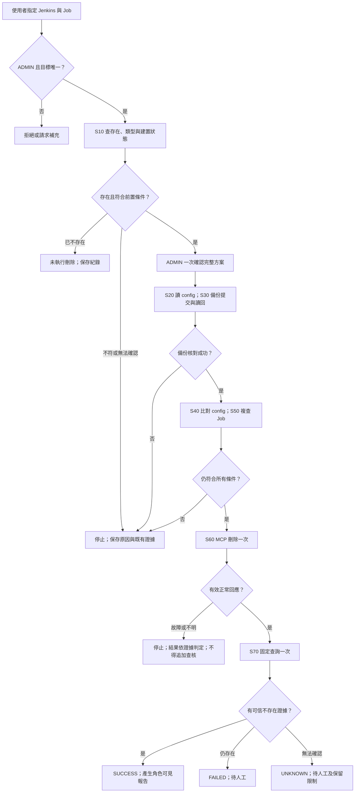

# Jenkins Job 刪除：方案與命令 Schema 第一版

> 此目錄從原始 v1 套件解出，供查閱與版本比對；屬 DRAFT／歷史基線，並非已發布能力。現行規格請見[文件索引](../../README.md)。套件內的靜態驗證紀錄只代表當時 schema 檢查，不代表已通過 Qwen、MCP 或 Jenkins 整合測試。 刪除流程須按 SD-14.2 完成 schema 1.1 升版。

版本 1.0.0｜2026-09-29｜對應 SRS／SA 0.31、SD 0.32

狀態：設計基準與可驗證範例。方案及命令範例均為 DRAFT；不是已發布能力，尚未連接公司 Qwen、MCP 或 Jenkins。JSON Schema 採 Draft 2020-12；這些檔案是本應用的契約，不是 Spring AI 內建格式。

## 1. 已確認範圍

| 項目 | 第一版決策 |
|---|---|
| 目的 | ADMIN 明確要求備份並刪除單一 Jenkins Job，屬 MAINTENANCE_REQUEST；不需先診斷事故或填入根因。 |
| 支援目標 | 單一明確指定的 Freestyle 或一般 Pipeline Job。可位於一般 Folder 內，但不刪 Folder、Multibranch 容器或其分支 Job；不接受批次或萬用字元。 |
| 權限 | LDAP 驗證；後端以當前 Role config 判斷。ADMIN 一次確認整份具體方案；NORMAL_USER 刪除要求直接拒絕，不建立送審。 |
| 備份 | 完整 config.xml 存 Bot DB；提交成功後以新讀取核對長度與 SHA-256，一致才可刪除。僅 ADMIN 可讀原文。 |
| 建置狀態 | 有執行中／排隊中建置，或不能完整確認時停止；不取消、不等候後續跑。 |
| 已不存在 | 刪除前取得可信不存在證據時，回報本次未刪除。初查即不存在時不建立 config 備份；後續複查才不存在時保留已建立的備份。 |
| 再檢查 | 備份後重讀 config 比對，再查 Job 類型、目標、執行中及排隊狀態；不符即停止。 |
| 通道 | 查詢、讀設定、刪除均為 MCP；缺能力停止，不在執行途中換 API。 |
| 刪除與驗證 | 只發送一次刪除。有效正常回應後，固定查詢一次確認不存在；故障後不再查核或重送。 |
| 保存 | 備份自成功建立起保留 90 天，可配置；UNKNOWN 或待人工處理的工作之備份不自動清除。 |
| 範圍限制 | 設定備份不包含 build history、artifacts 或完整 Job 還原；本版沒有還原命令、回滾或補償。 |
| 已接受限制 | Bot 互斥只約束經 Bot 派送的同目標工作，不能鎖住 Jenkins UI、其他工具或外部觸發。分開查核與刪除仍有競態，亦不能保證辨識同路徑刪除後重建的同內容 Job。 |

首次驗收不再要求 Jenkins error → detect／survey → 根因與修正。此事故流程及原快取／JDK 合成案例保留為後續已知方案擴充。

## 2. Bot 處理流程

圖中 S50 若可信回覆已不存在，轉「未執行刪除」並保留已有備份。任何階段新技術故障均停止；DB 無法寫入依既有故障日誌機制記錄，不假稱資料已提交。報告使用固定模板，不因需要收尾再呼叫 Qwen。UNKNOWN 後人員的新查核屬新工作，原結果不可覆寫為曾經成功。

## 3. 檔案與版本分工

| 檔案 | 用途 |
|---|---|
| schemas/solution-definition.schema.json | 本次 JENKINS_JOB_DELETE_V1 固定方案結構與政策。 |
| schemas/command-definition.schema.json | 四個邏輯命令、類型、能力、角色與派送門檻。 |
| schemas/contracts.schema.json | IntentCandidate、Target、查詢結果、config 結果、刪除受理回應、報告等共同 DTO。 |
| schemas/connector-binding.schema.json | 公司 MCP 實際工具與本地 capability 的版本化對應。 |
| definitions/jenkins-job-delete.solution.json | DRAFT 方案，固定引用命令版本 1.0.0。 |
| definitions/commands.json | 四個 DRAFT 命令定義的陣列；逐筆用 command schema 驗證。 |
| examples/connector-binding.template.json | 待填工具名稱、schema hash、參數映射、parser 及連線／憑證參照；enabled=false。 |
| examples/resource-mapping.template.json | 沿用 SD-05 資源表的最小填寫範例，不是新增替代版資源 schema。 |
| examples/*.json | 合成輸入輸出；不是真實 MCP 原始協定或實測成功紀錄。 |
| tests/cases.json | MQ／ST 的刪除案例、輸入條件與預期結果；actual_result=null、status=NOT_RUN。 |
| tests/validate_schema.py | 本地 schema／範例靜態驗證；不代替工作流、資料庫交易或服務測試。 |

v1 刻意採固定 workflow_profile，不實作可執行任意程式的條件 DSL。steps、result_gate、input_bindings 均為封閉集合，沒有 eval、shell、任意 URL 或模型自訂 JSONPath。新增工作種類時新增有版本的 profile、handler、schema、MQ／ST 案例，再測試發布；共用 Dispatcher、權限及證據模型可延續至未來其他 Bot。

IntentCandidate 僅包含意圖、候選方案／版本、未可信的目標提示、待補欄位與說明；不含 role、authorization 或可派送工具。App 再解析 target 及驗證權限。schema 的 schemas.example.invalid 識別字只供離線解析，不是實際連線位址。

定義版本、資源映射版本、Connector／parser 版本與 policy snapshot 都納入 plan digest；DRAFT／TESTED 不可執行。PUBLISHED 不能只靠修改 JSON 狀態取得，發布流程需驗證測試證據、核准者、完整 binding 及 schema 相容性。範例並未通過此發布程序。S20 之後的備份 ID／hash 等執行輸出附於 runtime evidence，不修改已確認的 plan digest；其輸出綁定規則已在方案內固定。

## 4. 方案與命令欄位

| 層次／欄位 | 語意與來源 |
|---|---|
| solution_id／version／status | 固定能力及版本生命週期，由可信 catalog 提供，不能取自使用者自稱或模型隨意值。 |
| workflow_profile／steps | 固定 S10～S70 順序及既定停止分支；模型不可增刪或改序。 |
| input_contract／plan.target | resource resolver 解析唯一 target 後建立；需同時對應 controller、job resource 與完整名稱。 |
| authorization | ADMIN 整份確認，綁定 plan ID／version／digest、actor、根 execution、授權時間／有效期。每步仍查當前角色。 |
| backup_policy | DB、config-only、讀回核對、retention、保護未結案與 ADMIN-only。 |
| execution_policy | 零重試／換路徑／續跑／回滾、一次刪除、一次 VERIFY、時間及資料上限。 |
| command_id／command_type | 邏輯命令及 QUERY／CHANGE／VERIFY 分工；MCP 工具描述不直接定義可執行權限。 |
| capability_id／transport | 本地 allowlist 能力；本案例固定 MCP，實際工具另由已驗證 binding 對應。 |
| required_guards | 每次派送由程式檢查，schema 裡列出名稱不代表已落實安全控制。 |
| input／output_contract | 受控 adapter 與 workflow 之間的標準化 DTO；實際 MCP 回應必須先完整保存、驗證與解析。 |

| Step | 邏輯命令／內部行為 | 前置與輸出判定 |
|---|---|---|
| S10 PREPARE | CMD-JENKINS-JOB-INSPECT | 已認證 ADMIN、唯一目標、核心正常、可查能力已發布。不存在則跳過；支援類型且非分支、active=0、queued=0 才建立待確認方案。 |
| 確認點 | WHOLE_PLAN_ONCE | 展示實例與完整名稱、步驟、刪除影響、config-only 備份限制、90 天保存與不自動還原；一次確認。 |
| S20 EXECUTE | CMD-JENKINS-JOB-CONFIG-READ | 取得完整 config，驗證大小、表示法、XML 可解析及完整性；任何失敗停止。 |
| S30 EXECUTE | BACKUP_COMMIT_AND_READBACK | 程式內部持久化，非遠端 CHANGE 命令；提交後由獨立新讀取核對原始 bytes、長度及 hash，成功標 VERIFIED。 |
| S40 EXECUTE | CMD-JENKINS-JOB-CONFIG-READ | 與 S30 已驗證內容同表示法、長度及 hash；不一致則 BLOCKED_STATE_CHANGED。 |
| S50 EXECUTE | CMD-JENKINS-JOB-INSPECT | 再確認同目標、同允許類型／非分支、所有執行中及排隊建置皆為零；無法完整證明則停止。 |
| S60 EXECUTE | CMD-JENKINS-JOB-DELETE | 角色／授權、plan／catalog／resource／binding 版本、健康、hold／owner、備份 VERIFIED、S40／S50 新鮮度皆通過；持久化唯一派送許可後發送一次。 |
| S70 VERIFY | CMD-JENKINS-JOB-VERIFY-ABSENT | 僅 S60 有效正常回應且未發生停止事件時執行；沿用 inspect capability，可信 ABSENT 才成功。 |

S10 與 S50 是不同固定步驟，S20 與 S40 亦然；不是失敗重試。S10 取得證據後釋放準備階段的短交易；ADMIN 等候期間不持有 DB 長交易。開始執行後依既有 owner／hold 與目標互斥控制到終止，不跨遠端 I/O 持有 DB 長交易。

命令門檻包含 CURRENT_ROLE、PUBLISHED_VERSIONS、RESOURCE_MAPPING_VERSION、FRESH_CORE_AND_DEPENDENCY_HEALTH、NO_EXECUTION_HOLD、VALID_OWNER、PLAN_STEP_ALLOWED、UNIQUE_DISPATCH_PERMIT。CHANGE 再加 ADMIN_PLAN_CONFIRMATION、VERIFIED_BACKUP、FINAL_PRECHECKS_MATCH。執行狀態與命令結果沿用 SA-04；phase 只是 workflow 的局部階段，不新增另一套業務狀態機。

## 5. MCP 最低能力與語意驗證

| capability | 公司提供端必須能完成 | 無法完成時 |
|---|---|---|
| jenkins.job.inspect | 精確 target；可信存在／不存在；Job 類型／是否為 Multibranch 分支；完整執行中與排隊建置計數，含必要分頁及並行建置。 | UNKNOWN、權限不足、部分回應、缺欄位都不能假設 idle／absent；停止或禁止發布能力。 |
| jenkins.job.config.read | 完整設定內容，無摘要或截斷；可追蹤資料來源與表示法。 | 不建立可用備份、不送刪除。 |
| jenkins.job.delete | 單一 exact target，一次請求；有效正常回應可被 parser 判讀；底層 SDK／代理不得透明重試寫入。 | 效果不明則 UNKNOWN＋hold；不可 fallback 或追加查核。 |

這三個 ID 是本應用抽象能力，不是假定公司 MCP 存在同名 tool。VERIFY 是第四個邏輯命令，仍使用第一項 inspect，沒有多要求第四個 MCP tool。

authoritative=true 必須由受控 adapter 依已驗證的服務契約產生；禁止信任模型或使用者傳入。只有能區分「不存在」與「無權讀取／入口錯誤／錯 controller」的正常回覆才可轉成 ABSENT。單獨的 HTTP 404、空陣列或 MCP error 均不足以證明不存在。若公司 MCP 無法提供必要判別能力，刪除方案不可發布，不能臨場加一條 API 備援。

同一次 inspect 可能由 MCP Server 內部查 Job 與 queue；必須揭露 scope_complete 與 observation 語意，不能把局部查詢標成完整快照。Bot 不宣稱這是 Jenkins 端原子快照。resource_id 是 Bot 身分，並非 Jenkins Job 的不可變 instance ID。

對查詢結果，App 必須核對 target 三欄、觀測時間、raw evidence 關聯、類型／分支、全量計數及 parser version；schema 合法不代表這些內容可信。S50 與 S10 類型／分支變動也停止。

## 6. 備份資料與保留

沿用 evidence 儲存原文，新增 job_config_backup 中繼資料；設定本文存 DB blob／分段 bytes，不放一般 application log 或 prompt。以下為邏輯表欄位，實際 DDL 隨公司 DB 選型落實。

| 欄位 | 型別／要求 |
|---|---|
| backup_id | UUID，主鍵。 |
| work_id／plan_id／plan_version／root_execution_id／backup_step_id | 必填關聯；對 root_execution_id＋backup_step_id 唯一，重複請求不得另生不同備份後續刪。 |
| controller_resource_id／job_resource_id／job_full_name | 精確備份目標；與 plan.target 一致，原始識別僅 ADMIN 可讀。 |
| source_evidence_id／content_evidence_id | MCP 原回應與完整 config bytes 的受保護 DB evidence 關聯；可同一儲存物件但不可因刪一份 metadata 留下可下載原文副本。 |
| representation／content_encoding | SOURCE_BYTES 或 UTF8_FROM_TOOL_TEXT；若 MCP 僅傳文字，保存收到的文字以 UTF-8 編碼，不能聲稱與 Jenkins 磁碟 bytes 一致。 |
| byte_length／sha256 | App 計算，讀回重新計算；不直接相信 MCP 提供的 checksum。hash 相同不等於遠端 Job 身分相同。 |
| capture_status | COMPLETE 才可作刪除備份；截斷／部分原文仍依證據規則留存，但不可標 VERIFIED。 |
| backup_status | COMMITTED／VERIFIED／INVALID／PURGED；只有 VERIFIED 可放行 S60。 |
| actor_principal_id／authorization_id | 請求者與一次確認關聯，不能讓模型填入可信 actor。 |
| source_observed_at／created_at／verified_at | UTC 時戳；UI 可轉時區。created_at 為成功備份交易時間，90 天從此起算。 |
| retention_days_snapshot／retain_until | 預設 90；當次保存 snapshot，配置調整只影響新備份，不默默縮短既有保留日。 |
| protection_reason／protection_refs | UNKNOWN、PENDING_HUMAN、其他未結案工作或人工保留；查無法判定時不清理。 |
| purged_at／purge_actor／purge_reason／row_version | 受控清理紀錄、並行檢查；hash 與稽核摘要保留，原文清除狀態可追溯。 |

備份成功條件：完整內容通過安全 XML 解析（禁止 DTD／外部實體）→ evidence 與 metadata 同交易提交 → 從 DB 以新讀取取得已提交內容 → byte length 及 SHA-256 一致 → 保存 VERIFIED。不能用記憶體物件互相比對冒充讀回，不能在未提交交易內自我讀取就發送刪除。

清理器使用固定程式及資料列版本／鎖，在刪內容的同一交易重新確認到期、無保護且工作已結案；所有尚未終止或 PENDING_HUMAN 工作均保護，不能只檢查 result=UNKNOWN。人工另建查核工作不自動解除舊備份保護；須記錄人工結論及解除原因。若人工解除時原 90 天已過，備份可在下一次清理被清除，操作畫面應顯示此事。

相同 config 若同時存在 MCP 原文、evidence、備份或其他引用，依最長保留／保護規則處理；有未解除引用時不清除共享內容。稽核只保留必要中繼資料，不藉此永久保留 XML 副本。資料庫災難備份的保留與清除屬部署政策，另行填入，不能宣稱線上清除等於所有歷史媒體即時抹除。

## 7. 執行結果與報告

| 情境 | CommandResult／reason 範例 | 刪除派送／後續行為 |
|---|---|---|
| NORMAL_USER、未確認、未發布、目標類型不允許 | REJECTED／ROLE_NOT_ALLOWED 等 | 0；不因角色拒絕額外查詢敏感目標。 |
| 刪除前可信不存在 | SKIPPED_ALREADY_APPLIED／JOB_ALREADY_ABSENT | 0；文字「Job 已不存在，本次未執行刪除」。初查缺目標時不要求 config。 |
| 執行中、排隊中或 config／類型已變 | BLOCKED_STATE_CHANGED／JOB_BUSY 或 CONFIG_CHANGED | 0；停止並保留已取得證據及已有備份。 |
| S60 前必要工具／核心不可用 | BLOCKED_SERVICE_UNAVAILABLE／PRECHECK_UNAVAILABLE | 0；PENDING_HUMAN。無 remote CHANGE，不能記成刪除結果不明。 |
| 備份核對失敗／內容不完整 | FAILED／BACKUP_INTEGRITY_FAILED 或 CONFIG_INCOMPLETE | 0；不可因部分本地備份成功回報刪除 PARTIAL。 |
| S60 正常、S70 可信不存在 | SUCCESS／DELETED_AND_VERIFIED_ABSENT | 1；結果與備份、驗證證據一併保存成功才可回報。 |
| S60 正常、S70 有效證據顯示仍存在 | FAILED／JOB_STILL_PRESENT | 1；停止，不再刪除或輪詢；存在同名重建可能時不推測原 Job 是否被刪。 |
| S60 明確拒絕且有可信「未執行」證據 | FAILED／REMOTE_REJECTED_NO_EFFECT | 1 次呼叫；保存拒絕，不追加驗證。不能僅從通用錯誤碼推論無副作用。 |
| S60 逾時／中斷／回應破損，或 S70 失敗 | UNKNOWN／DELETE_TIMEOUT 或 VERIFY_UNAVAILABLE | 已跨發送界線最多 1；hold＋人工；所有後續工具為 0。 |
| 派送後程序崩潰／結果寫入失敗 | UNKNOWN／DISPATCH_OR_RESULT_UNCERTAIN | 不重播；保留故障日誌與 hold，人工新工作處理。 |

DELETE 的 ACKNOWLEDGED 不是 CommandResult.SUCCESS。回應已記錄 ACK 但 Qwen、DB 或其他核心在 VERIFY 前故障，仍停止且結果 UNKNOWN。UNKNOWN 必須 PENDING_HUMAN、requires_human_review=true。正常成功、已不存在及明確拒絕可 COMPLETED；執行失敗、狀態變動或必要技術故障轉 PENDING_HUMAN。

只有一個遠端變更效果，本 profile 不使用 PARTIAL 表達「備份成功但未刪除」。全系統的 PARTIAL 仍保留給其他多效果方案。未開始的子步驟用 SKIPPED_NOT_RUN（步驟紀錄原因，不新增 CommandResult enum），不能假造子命令成功。取消沿用既有 CANCELLED／取消過晚規則，取消紀錄 result 可空，故不使用本檔的 completed report schema。

ADMIN 報告可含 exact target、備份 hash／ref、操作者、時間線與受保護下載連結；NORMAL_USER 僅能看已開放資源的安全 alias、狀態分類與遮罩摘要，不暴露 XML、路徑、IP、hostname、token 或可繞過授權的證據連結。XML 不交給 Qwen；config 中若包含秘密亦須受保護。實际 secret 值不寫入範本。

## 8. 設計初值與非 Schema 檢查

| 設定 | 本 profile 的初值 | 性質 |
|---|---|---|
| 確認有效期 | 300 秒；從確認起至 S60 派送仍需有效 | 可版本化設計值，不是新業務待確認事項。 |
| 整體執行期限 | 確認後 180 秒，不含等待使用者確認 | 逾期停止；若已可能發送刪除則 UNKNOWN。 |
| VERIFY 總期限 | 45 秒，自 S60 發送界線起算 | settle_delay=0、poll_interval=null、required_success_count=1、observation_duration=0；仍受 180 秒整體期限限制。 |
| QUERY／CHANGE／VERIFY timeout | 15／30／10 秒 | 沿用既有類型初值；所有 retry=0。 |
| S40／S50 證據最大年齡 | 各 30 秒，到 S60 派送時核對 | 過期停止，不臨場新增重查；仍不能消除最後競態。 |
| 最大 config | 10 MiB | 超過就停止並記缺口；不截斷後刪除。 |
| MCP 呼叫上限 | S10、S20、S40、S50、S60、S70 共 6 次 | 正常流程；健康探測另依 SD-08，不可作為故障後業務查核。 |
| VERIFY | 1 次；無正常等待輪詢 | 即時查詢若仍存在則本方案驗證失敗，可能異步刪除的契約須先另行設計及發布。 |

JSON Schema 驗證型別、必填、固定步驟／政策及合法 enum。程式另驗：可信角色與 session；scope／exact target；路徑各段非空且不得是 . 或 ..；三個 capability 各恰一個 binding；不存在 placeholder；PUBLISHED 必填實際 connection／credential／trust 及映射；parser 支援完整性及不存在判定；所有命令與 solution 版本已發布；plan digest 不變；授權未逾期；raw 不進模型；Base64 正確解碼、byte_length／hash 重算、安全 XML；備份真正提交及讀回；時間、互斥／hold／唯一派送與保留清理交易。

schema 中 contentEncoding 與 format 的支援依 validator 設定，不能依 annotation 假設 Base64 已驗證。以 JSON Schema Draft 2020-12 validator 配合 format 檢查；MCP 原始schema只作版本釘選，不能直接執行下載所得的任意工具描述。

## 9. 測試規劃與待填值

MQ-DEL 系列測 Qwen 意圖／缺參數／歧義／權限說明／注入／結果忠實性，不持有 Jenkins 寫入能力。ST-DEL 系列使用固定模型回覆，測正式 Workflow、DB 交易、Dispatcher、MCP adapter 與故障停止。完整案例各自追加在既有兩份獨立測試案例集，機器可讀摘錄見 tests/cases.json。

離線先驗固定分支、錯誤 DTO 與並行／崩潰等控制；有實作後使用隔離 DB，不以純記憶體 stub 代替提交與讀回。取得公司 MCP 後，使用專用測試 Jenkins 及可刪測試 Job 做真實契約與效果測試；正常 Freestyle 與 Pipeline 各一例。測試資源由測試人員獨立準備，工作流不因此取得建立／還原 Job 能力。Qwen 實測與 Jenkins 實測分開，最後用同一候選版本完成整合。

尚待公司提供：Qwen model／URL／key、LDAP 與初始角色、MCP endpoint／transport／auth／TLS、真實 tool names／schema／錯誤語意／底層重試行為、專用 Jenkins 與可刪目標、資源 owner／alias、公司遮罩規則、DB 選型／容量與稽核及災難備份保留政策。這些不影響先實作 schema、固定工作流與 stub；不足時不得啟用真實刪除。

## 10. 本次交付的驗證界線

本次僅進行文件、JSON Schema 與合成資料的靜態一致性驗證，結果另見 tests/static-validation-result.json。沒有測得 Qwen 品質、MCP 相容性、Jenkins 刪除效果或 DB 執行交易；MQ／ST 業務案例仍全部 NOT_RUN。不得將範例 report-success.json 當作實際執行紀錄。

## 本地靜態驗證方式

在獨立 Python 環境安裝 requirements.txt 後執行 `python tests/validate_schema.py`。所有 schema 以離線 Registry 解析，驗證器不連線 Qwen、MCP 或 Jenkins。static-validation-result.json 是靜態結果；tests/cases.json 的實際業務結果仍為 NOT_RUN。
