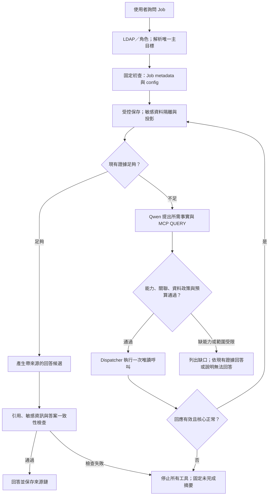

# Jenkins Job 內容查詢：方案、命令與自主唯讀調查

> 此目錄從原始 v1 套件解出，供查閱與版本比對；屬 DRAFT／歷史基線，並非已發布能力。現行規格請見[文件索引](../../README.md)。套件內的靜態驗證紀錄只代表當時 schema 檢查，不代表已通過 Qwen、MCP 或 Jenkins 整合測試。

版本 1.0.0｜2026-09-29｜依據 SRS／SA 0.32、SD 0.33

狀態：設計與合成範例；DRAFT，尚未接通實際 Qwen、MCP 或 Jenkins。這是第二個案例，第一個 Job 備份刪除案例仍保留固定變更流程。

## 1. 本次決策與適用範圍

使用者詢問指定 Jenkins Job 的內容，Bot 讀取設定、理解問題、透過 MCP 補查與驗證，再回答。config 無法說明的部分不直接猜測，也不僅因 config 資料不足就轉人工。

| 項目 | 本版規則 |
|---|---|
| 目標 | 一次一個明確 Freestyle 或一般 Pipeline，可位於一般 Folder；不以 Folder、Multibranch 容器或分支 Job 為本案例主目標。目標歧義先詢問。 |
| 建置狀態 | 執行中／排隊中也可查，不要求 idle，不取消或等待建置。 |
| 可讀資訊 | 為回答與驗證所需的已接入服務非敏感資訊；ADMIN 與 NORMAL_USER 相同，不再以一般使用者角色遮罩所有技術識別。 |
| 自主補查 | Qwen 可選擇已發布、已驗證的 MCP QUERY 能力及合法參數，依新證據追加相關讀取；不需要每次向使用者確認。 |
| 可擴及來源 | Jenkinsfile、SCM 檔案、共用函式庫、Job 引用的相關設定、必要建置 metadata／日誌／artifact metadata 或文字內容；前提是具備相應已接入 MCP 唯讀能力。 |
| 敏感例外 | 認證用帳號與密碼、token、API key、Authorization、Cookie、私鑰、連線字串秘密及對話內容不得成為 Agent 補查／回覆目標；同時保護組織明確標記的敏感欄位。 |
| 回答方式 | 一般提問給結構摘要，特定設定只回答相關問題；附來源／版本／取得時間，區分設定事實、執行觀測、推測與未驗證範圍。 |
| 變更界線 | 不啟動／重跑 build、不執行 Pipeline／Groovy／shell、不調用任意 Script Console、不修改設定、不下載後執行 artifact。若需變更，離開本查詢工作，另由 ADMIN 採用固定已發布方案。 |
| 既有保護 | LDAP／Role config、服務端 ACL、憑證隔離、資源解析、工具發布、健康、故障停止及稽核繼續適用；不以 Bot 查詢政策繞過來源 401／403。 |

本次明確取代先前第二案例的「不讀 Git Jenkinsfile、不查歷史建置／console／artifacts」限制，也取代正常查詢「所有步驟必須事前固定」與「normal_query_enabled 才可看非敏感資源」規則。允許調查未知資訊，仍不允許產生新的修正方案／命令或將經驗自動固化為流程。

「查詢不限資訊範圍」表示不因角色或預先列死的來源清單排除非敏感資訊；不表示已接通所有服務、可任意連 URL、可搜尋全組織無關資料或可以無限重複呼叫。相應 MCP 能力隨需求接入，未提供的能力明示缺口，不捏造結果。

## 2. 查詢流程

圖中初查任一步故障也進 X；目標不唯一進 NEEDS_INPUT，不開始工具。Job 可信不存在時回答不存在，不繼續擴查。初查不讀建置計數作門檻，也不重用刪除方案 S10 的 idle 判斷。

每個追加讀取必須記錄「要釐清什麼事實、為何現有證據不足、哪一筆已取得證據或使用者指定來源支持這個新目標」。來源中的自然語言指令不是授權；合法 SCM 引用等由可信 parser／ResourceResolver 建立關聯，不能直接相信模型生成的 URL。

## 3. 兩種執行模式

| 模式 | 步驟如何決定 | 授權方式 |
|---|---|---|
| FIXED_CHANGE | 事先發布的完整固定方案；包含其固定 QUERY／CHANGE／VERIFY | ADMIN 一次確認；執行中不可插入 Agent 查詢。第一案例維持此模式。 |
| ADAPTIVE_READ | 固定初查後，由 ReadPlanner 依事實缺口動態選擇已發布 QUERY；所有動作受 ReadPolicyGate／Dispatcher 檢查 | 已登入 ADMIN／NORMAL_USER 的這次查詢請求即授權；無變更確認、無逐次工具核准。 |

本模式中的「驗證」是以 QUERY 比對證據，不等於變更後的 CommandType.VERIFY，不解除第一案例 UNKNOWN 的 hold，也不讓故障工作自行恢復。故障後即使有另一個正常 MCP tool 可以查同一資料，也不能在原工作換路徑續查；人員可另開新查詢工作，依既有人工查核規則處理。

已知方案目錄新增查詢 profile，該 profile 發布的是自主讀取邊界、工具能力與停止規則，不是預先知道每個答案。Qwen 不得發明未註冊工具、任意腳本或新變更流程。

## 4. 權限與資訊分類

| 資訊 | ADMIN／NORMAL_USER 的 Bot 查詢視圖 |
|---|---|
| Job／service 名稱、repository、branch、檔案路徑、IP／hostname、無秘密 URL | 非組織明確敏感時可見；不再一律改成 alias。alias 仍可作方便顯示。 |
| Jenkins 設定、腳本、日誌、stack trace、artifact 文字 | 可取得與回答相關的淨化內容；秘密及對話片段先處理，不能把整份原文直接丟進模型。 |
| 認證帳號、password、token、API key、Cookie、私鑰、credential value | 不進模型、回答、一般搜尋索引、報告、下載或串流；以類別占位或必要的非秘密憑證用途說明替代。 |
| 其他工作／其他人的對話、歷史聊天、對話附件 | 不提供 Agent 搜尋／讀取能力，也不得從日誌／artifact 繞道取得。 |
| 本次使用者主動提供的必要問題與同工作澄清 | 可作當次 Context；與「調用工具搜尋對話內容」不同，仍需先移除使用者貼上的秘密。 |
| 組織明確標記的其他敏感資訊 | 依版本化欄位／內容政策排除；不得把所有非敏感技術資料默認回舊版 normal-only alias 規則。 |

新增 COMMON_QUERY_SAFE 視圖，適用兩種角色與模型。NORMAL_MASKED 只作舊版本相容別名，不再代表隱藏所有 technical identifiers。原始證據保存及獨立 ADMIN 稽核入口沿用既有政策；未淨化 raw 不屬 Agent 可用工具，不因本次查詢開放而對一般使用者公開。即使 ADMIN 要求 Bot 顯示 token，Agent 也不回傳。

role config 的 normal_resource_scope 改為 ALL_INTEGRATED_QUERY。資源／能力以 query_enabled 表示「此接入已完成技術發布且可查」，同時適用兩角色；normal_query_enabled 停用且不再參與授權。既有已啟用並驗證的 QUERY 按新政策提供給兩角色；未接入／未發布工具仍不可用。業務資料不因 NORMAL_USER 額外關閉；若真是敏感資料，用明確 sensitivity policy 記錄原因。

SecretFilter 在工具取得資料後、進 Context 前執行，OutputGuard 在顯示前再執行。相應 parser、欄位政策及模式偵測共同工作；不宣稱 regex 能識別所有秘密。對不能可靠判別的高風險片段先隔離，可使用其他非敏感證據；SecretFilter 本身失效則整個工作停止。相同資訊在摘要、例外訊息、引用標籤、下載 URL 與快取都必須一致保護。

## 5. Schema 與工具契約

套件提供 query-solution.schema.json、query-command.schema.json、read-decision.schema.json、query-answer.schema.json、DRAFT profile／命令、decision／answer 範例、測試 manifest 與靜態驗證器。皆為本應用契約，不是 Spring AI 自帶格式。

### 5.1 QuerySolution

| 欄位 | 意義 |
|---|---|
| solution_id／version／status | SOL-JENKINS-JOB-EXPLAIN@1.0.0，範例 DRAFT；未經測試發布不開真實功能。 |
| execution_mode | ADAPTIVE_READ；不得自動改 FIXED_CHANGE。 |
| entry_commands | 固定 JOB_METADATA_READ → JOB_CONFIG_READ_SAFE；視問題可由新版 profile 避免不必要讀取，本版固定兩步。 |
| allowed_roles／view | ADMIN、NORMAL_USER；COMMON_QUERY_SAFE。 |
| capability_policy | 已發布的 MCP QUERY、具無業務變更副作用證據、版本已釘選、目標可解析且相關、通過敏感資料政策。 |
| budgets | 工具／模型次數、總時間、返回 bytes、Context 上限等；可信程式計數，模型不可重置。 |
| stop_policy | 故障停止、零重試、無 fallback、無自動續跑；正常資料不足才允許追加查詢。 |

### 5.2 QueryCommand 與 MCP 對應

命令至少含 command_id／version／status、capability_id、固定 MCP transport、command_type=QUERY、read_only=true、外部業務副作用=false、角色、COMMON_QUERY_SAFE、input_schema_ref／output_schema_ref、parser／sensitivity policy 版本、timeout、retry=0、binding_ref 與經測試的唯讀證明參照。

MCP tool 宣告 readOnlyHint 或名字叫 get／list 不足以證明安全；需人工審閱、契約測試及來源的最小必要讀權。禁止 generic shell、SQL 任意執行、HTTP 任意 URL、Groovy eval 等看似查詢卻可變更的入口。唯讀可留下正常存取日誌、讀取快取及 Bot evidence，不得改受管服務的業務狀態。

| 抽象 capability（不是假定的真實 tool 名） | 用途／必要欄位 |
|---|---|
| jenkins.job.metadata.read | controller／Job exact 身分、類型、描述、enabled 狀態與引用；不要求 active／queued 計數，執行中可查。 |
| jenkins.job.config.read_safe | 後端讀 config，隔離原文並投影安全設定、片段與 evidence refs；不將第一案例的 ADMIN 原文讀取命令直接開給 normal。 |
| scm.file.read | repository／immutable commit／path／範圍；必須從已核對的引用解析，保留實際 commit。 |
| scm.reference.resolve | branch／tag → immutable commit；回答目前設定與某次建置使用的 commit 要分清楚。 |
| jenkins.library.config.read | 共用函式庫的設定及版本來源，去秘密；不可用它取得 credentials。 |
| jenkins.build.metadata.read | 特定 Job 的 build、commit、狀態、時間及來源；如果要選最近一次，必須因問題語意有明確理由並在回答標示所選 build。 |
| jenkins.build.log.read_safe | 明確 build、範圍／cursor、完整性與安全片段；日誌是執行觀測，不必然等於目前設定。 |
| jenkins.artifact.read_safe | 明確 build／artifact、受控大小及可解析文字；未知二進位不執行或任意解壓，標示能力缺口。 |

這些是初始能力清單，並非資訊來源的永久上限。後續已接入 MCP 的安全 QUERY 可經發布進入同一 registry；Agent 無須等待增加一條固定查詢流程，但不能自行新增／信任新工具。公司尚未提供實際 MCP，tool name、參數映射、回應 parser 及來源 ACL 待開發填入；缺能力僅顯示 CAPABILITY_UNAVAILABLE，不改走 API 或直接 SSH。

### 5.3 ReadDecision 與可驗證動作

Qwen 每回合只輸出 READ、ANSWER、NEEDS_INPUT 或 STOP；READ 必填已發布 command_id／version、缺口說明、支持關聯的 evidence refs，以及讀取目標候選。`target_ref` 為 App 建立的不可任意編造參照，`selector` 僅承載該命令 input schema 允許的 repo／commit／path／build／cursor／範圍欄位；不同命令的合法組合由相應 typed schema 檢查，不能放任意 kwargs。

外部回覆中的 URL、檔案路徑、job 名稱、repo 引用先經 Resolver 驗證公司接入與對應關係，再產生可供下一輪引用的 target_ref。模型可提出候選關聯，但可信來源只可由 parser、使用者明確目標或已登錄 resource relation 建立。發現兩個可能分支則 NEEDS_INPUT 或分別標示，不能把一個當成確定事實。

ReadPolicyGate 檢查 command 是否已發布且純讀、可信角色／session、資源關聯、sensitivity policy、當前版本、健康、工作停止與預算；Dispatcher 才可派送。每次成功讀取形成 query_step／evidence_chain，回傳給模型的只有安全投影。工具原文是資料，不可覆蓋系統指令、擴權、要求查秘密或外送。

### 5.4 QueryAnswer

answer_status 分 COMPLETE、PARTIAL、NOT_FOUND、NEEDS_INPUT、STOPPED_ERROR。這是回答完整度，不是遠端變更的 CommandResult.PARTIAL／UNKNOWN。

答案保存 summary、claims、各 claim 的 FACT／OBSERVED／INFERENCE、evidence_refs、來源的時間／版本、unresolved_items、查詢追蹤及 sensitivity_policy_version。主要結論必須有證據；推測明示不能升格已驗證。缺引用或越界內容由程式攔截，不能只依 Qwen 自評「有把握」放行。

schema 只能檢查結構。實際可信引用、語意是否足夠、SecretFilter、來源關聯、結果與時序等仍由程式／評估檢查；不能憑 schema 合法宣稱回答正確。

## 6. 何時繼續，何時停止

| 狀況 | 行為 |
|---|---|
| config 有有效外部檔案／函式庫引用，現有資訊不足 | 自動使用可用 MCP QUERY 補讀，不逐次問使用者。 |
| 發現設定與日誌矛盾，但兩份資料都正常取得 | 先區分版本／時間／build，再用相關的合法讀取比對；不把已知事實矛盾當技術故障。 |
| 動態腳本需執行才知道結果 | 可以讀程式及已有執行證據，不執行腳本或觸發 build；無法確認處明示。 |
| 敏感欄位成功隔離 | 使用其餘安全資訊繼續；敏感缺口標 WITHHELD_SENSITIVE，不揭露敏感內容或可還原片段。 |
| MCP 未提供某能力、外部檔案正常回覆不存在、資訊仍不完整 | 非技術故障時可查其他相關來源；仍無法回答則 PARTIAL，列 CAPABILITY_UNAVAILABLE／SOURCE_NOT_FOUND／INSUFFICIENT_EVIDENCE。不能宣稱完整。 |
| 權限拒絕、timeout、MCP error、parser／SecretFilter／必要核心故障 | 立即停止，後續工具及模型呼叫為零；僅以已取得安全資料產生固定 STOPPED_ERROR 摘要。 |
| 工具預算耗盡或下一步不會增加證據 | 停止迴圈並列 BUDGET_EXHAUSTED／NO_PROGRESS；不換 ID、worker 或工具重設預算。 |
| 使用者要求變更、取帳密或查對話 | 拒絕該部分；不派送相關工具。合法非敏感查詢可獨立處理。 |

正常補查不是技術故障重試。對同一 command＋target＋selector＋revision 的重複讀取，除非已有新版本／資料不一致等可驗證理由且預算允許，否則 NO_PROGRESS 停止。分頁必須有新 cursor，每頁都計入次數／bytes。

## 7. Context、時間與來源一致性設計初值

預設每工作最多 20 次 MCP QUERY（包含初查與分頁）、10 次模型呼叫、180 秒總時間；單 QUERY 15 秒，技術 retry=0，單次 config 上限 10 MiB，其他文字回應上限 1 MiB，累積原始資料 20 MiB。計數包含來源回覆與最終回答；正常流程預留一次模型回答額度，額度耗盡時只能使用既有安全資料及固定摘要。均為可版本化設計初值，可依測試調整，不是不同使用者的資訊權限或 LLM 流量配額。超限不截斷後假稱完整。

原文證據分段持久化；Context 只納入與當前問題有關的安全摘錄、摘要與引用。沿用實際 Qwen context 能力及應用 input/output reserve，未確認端點前不硬宣稱支援 32K。初值需測試後調整；schema profile 與執行快照保存 budgets，模型不能修改。

每筆 evidence 至少記 source_id、target_ref、capability／command／parser 版本、observed_at／retrieved_at、source_revision、byte range／cursor、capture_status、raw_ref、safe_projection_ref／hash、policy version、parent evidence refs。讀 branch 時先保存 resolved commit；之後的同一檔案鏈固定 commit，不將最新 branch 與歷史 build 混為一談。不同來源無法建立一致版本時明示，不能保證跨服務原子快照。

本案例是查詢證據保存，並非刪除前備份；不得誤套第一案例「config 備份 90 天」成所有查詢證據保存期限。查詢 evidence／報告／稽核保留依既有部署政策填入；對話維持隔離，不因共用 evidence search 成為全員可搜尋資料。

## 8. 回答範例（合成，非實測）

使用者：「sandbox/package-release 這個 Job 做什麼？怎麼部署？」

1. 讀 Job metadata 與安全 config，發現 Pipeline from SCM 指向 release.git／main／ci/Jenkinsfile。
2. 經已接入 MCP 解析 main → commit c1，讀取該檔；看到 deploy 呼叫來自 library ops@v2。
3. 經已提供的 library 與 SCM QUERY 定位同版函式，確認設定中有部署 stage 與目標服務資訊；不執行部署。
4. 回答：「這個 Job 的設定流程包含建置、測試與部署。依 Jenkinsfile c1 與 library v2，部署段會呼叫……。本次只驗證設定定義；尚未查實際 build 的執行結果，因此不能宣稱某次部署成功。」附 evidence refs 與時間。

若使用者問「最近一次實際部署到哪」，可依問題選定最近完成 build，保存所選 build number，讀取其版本與去敏感執行證據；若無法確認「最近」的完整範圍則明示，不能以目前 Jenkinsfile 推論歷史成功。

## 9. 測試與交付界線

MQ 測 Qwen 何時補查、工具／目標選擇、停止、來源忠實性及敏感資料誘導；ST 固定模型輸出測發布／純讀／關聯／資料政策、實際 Dispatcher、Context、版本、預算、故障停止與來源 ACL。共用核心仍要真實隔離 DB／傳輸測試；不能只看模型說「不會修改」。

新增 MQ-JQ 與 ST-JQ，詳細案例分別置於兩份獨立案例集第 11 節，套件提供 machine-readable manifest。所有業務案例 actual_result=null、status=NOT_RUN。新視圖改變的既有 alias／IP／路徑遮罩 gold 要按新 policy 版本重新評分；舊 baseline 不得當成回歸真值，也不得改寫歷史成績。

需公司於開發提供：Qwen、MCP tools／schema／唯讀證明、SCM／library／build 讀取能力、來源憑證／TLS、sensitivity policy、測試資源與正常／敏感 fixtures。未提供時可先實作 registry／policy／stub；未提供的接入不冒稱可用。本套件只提供 schema 與靜態驗證，未實作完整 Agent、未進行真實服務查詢。

## 本地靜態驗證

在獨立 Python 環境安裝 requirements.txt，執行 `python tests/validate_schema.py`。schemas.example.invalid 為離線 schema 識別字，不會連線該網址。結果只代表 schema／fixture 靜態驗證，並非 Agent、權限或敏感偵測程式已完成。
