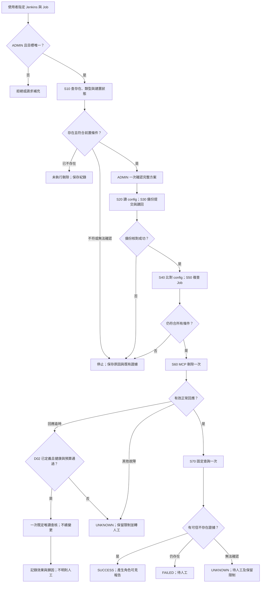
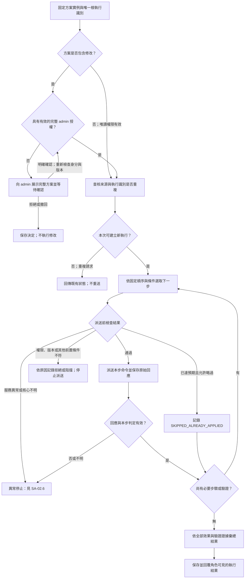
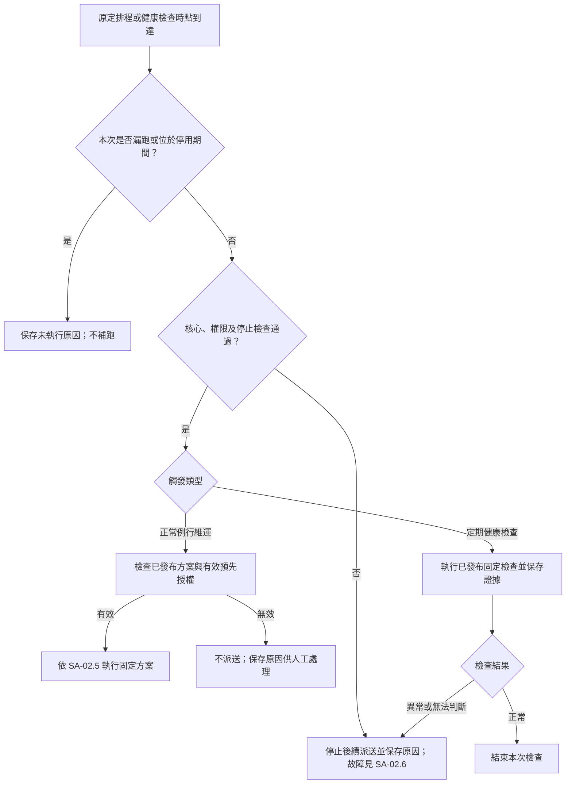
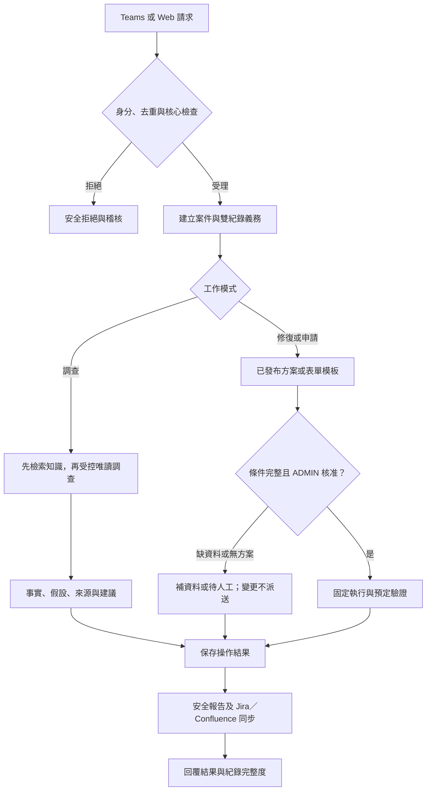
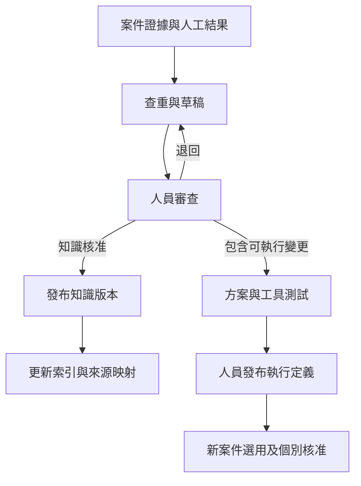

# DevOps 智慧維運應用系統分析規格書

分析設計草案｜分析版本 0.40｜依據 SRS 0.40｜2026 年 10 月 17 日（Asia/Taipei）

## 文件定位

> 2026-10-17 已確認基準：D01～11 見 SRS-10。允許受控診斷與待審草稿；NORMAL_USER 可送已開放標準申請；CHANGE 回應逾時可按 SD-14.2 執行一次有條件唯讀查核；SYSTEM_RECORD 可有界補送且不阻擋維運；Jira workflow 依映射自動同步。其他維運重試、故障復跑、任意命令與未核准外送仍禁止。本版已取代相反的歷史政策，舊 schema／封存檔須按本版升版驗證後才可使用。

> 2026-09-29 13:07 新決策：正常問答可由 Agent 自主選擇已發布的 MCP 唯讀能力補查與驗證；ADMIN／NORMAL_USER 均可查已接入服務的非敏感資訊，不再以 normal_query_enabled 或全面 alias 遮罩限制。帳密、token、對話及組織指定敏感資訊仍隔離。變更方案固定、ADMIN 確認及技術故障即停止持續有效。以下舊版「禁止動態查詢／normal 技術識別一律遮罩」條文僅適用歷史基準；現行查詢以新章節為準。

> 2026-09-29 範圍調整：首個交付案例改為「ADMIN 要求 → 權限與目標檢查 → 一次確認 → config 備份及讀回核對 → MCP 刪除 → 固定驗證 → 報告」。事故調查、根因定位、快取／JDK 修正及跨服務處理保留為後續已知方案擴充，非本次 MVP 的開發或驗收前置。共用授權、證據、停止與遮罩規則持續有效。

本文件展開需求的使用案例、流程、角色權限、狀態、業務判定與例外處理，供需求方、系統分析人員、開發與測試共同檢查。功能範圍與業務驗收以 SRS 為準；資料欄位、秒數、設定檔及技術實現以 SD 為準。

SA 使用狀態名稱及命令類型描述可觀察行為，並不指定資料庫 DDL。沿用的工作／事件／方案概念是分析模型；實際持久化、唯一派送與角色設定另見 SD-03～SD-07。本版整合平台需求：允許受控調查、未核准建議與待審草稿，維持固定變更、兩角色及故障停止；差異與待確認政策見 SRS-08／10、SA-11。

| 使用案例 | 參與者 | 主要輸出 |
|---|---|---|
| UC-01 唯讀查詢及調查 | ADMIN／NORMAL_USER | 目標可識別、受控補查、有來源的事實／假設及角色可見結果。 |
| UC-02 採用既有解法 | ADMIN | 首例為單一 Job 備份刪除；完整方案一次確認、修改、獨立驗證及報告。 |
| UC-03 無匹配或技術故障 | 使用者／系統 | 無匹配不得變更，可受控調查；技術故障停止並留人工待辦，兩者不混用。 |
| UC-04 維護已知能力 | ADMIN | 事先測試並發布的方案、命令及相應資源／檢查條件。 |
| UC-05 發布、通知及正常排程 | ADMIN／已授權背景元件 | 模組啟用後遵守同一授權、資料與停止規則。 |

每個使用案例都保留原始請求者與實際確認者；AI 不作為第三種有管理權限的使用者。

三份配套文件：

- [DevOps_智慧維運應用需求規格書_草案.md](DevOps_智慧維運應用需求規格書_草案.md)
- [DevOps_智慧維運應用系統分析規格書_草案.md](DevOps_智慧維運應用系統分析規格書_草案.md)
- [DevOps_智慧維運應用系統設計規格書_草案.md](DevOps_智慧維運應用系統設計規格書_草案.md)

## 章節導覽

| 章節 | 內容 |
|---|---|
| SA-01 | 角色、操作責任與使用案例 |
| SA-02 | Jenkins 最小循環與 Bot 流程 |
| SA-03 | 固定調查、方案及確認規則 |
| SA-04 | 工作、事件與執行狀態分析 |
| SA-05 | 資訊關係與角色可見資料 |
| SA-06 | 異常停止、防重複及人工接管規則 |
| SA-07 | 按模組啟用的擴充使用案例 |
| SA-08 | 分析驗證案例 |
| SA-09 | 模型品質與方案工具兩模組的驗證流程 |
| SA-10 | 自主查詢 Jenkins Job 內容 |
| SA-11 | 平台三模式、Teams、外部協助、知識與每案紀錄 |

# SA-01 角色、操作責任與使用案例

對應 SRS-03、FR-04、FR-08。以下矩陣是兩角色的分析契約；LDAP bind、session 與設定檔由 SD-03 實現。

## SA-01.1 最小權限矩陣

| 功能／permission code | ADMIN | NORMAL_USER |
|---|---|---|
| `QUERY_EXECUTE` 已發布 MCP 唯讀能力／自主問答 | 已接入服務的非敏感資料 | 相同非敏感資料範圍，不依 normal_query_enabled 另限 |
| `REPORT_READ_MASKED` 查詢遮罩報告／工作狀態 | 可 | 可讀授權查詢範圍 |
| `EVIDENCE_READ_RAW` 原始日誌、請求、回應、附件與未遮罩細節 | 可；每次存取稽核 | 禁止，包括匯出、API、下載連結與歷史對話 |
| `CHANGE_CONFIRM_EXECUTE` 採用、確認及執行完整修改方案 | 可；仍須有效方案與健康門檻 | 禁止直接執行／核准；僅可提交已開放標準申請 |
| `SERVICE_REQUEST_SUBMIT` 已開放標準申請 | 可 | 可提交、補資料與查進度；不可核准 |
| `CONFIG_MANAGE` 方案、命令、資源、連線、健康／遮罩規則設定 | 可 | 禁止 |
| `ROLE_CONFIG_MANAGE` 角色設定 | 可；初始管理員由部署設定 | 禁止 |
| `SCHEDULE_MANAGE` 正常排程及預先授權 | 可；啟用該模組後 | 禁止 |
| `INCIDENT_MANAGE` 認領、關聯、結案與限制解除 | 可；須附證據 | 僅查詢遮罩後狀態 |
| `RECORD_POLICY_MANAGE`／`RECORD_RECONCILE` | 設定每案雙目的地政策、人工查核／補送 | 禁止管理；可查看安全紀錄完整度 |
| `EXTERNAL_ASSIST_START` | 核准 provider／資料政策下啟動本案調查 | 不得啟動外部資料傳送 |
| `KNOWLEDGE_REVIEW_PUBLISH` | 審查、測試及發布；不可繞過流程 | 僅查詢可見正式知識 |

normal user 的查詢可建立工作、證據與調查紀錄；P1 的 SYSTEM_RECORD 另依平台政策寫安全 Jira／Confluence 紀錄，這不授予 normal 外部 CHANGE。normal user 查到既有解法時，只呈現安全摘要；ADMIN 可從該調查另建處置工作並確認，兩者原始發起人與責任人分開。

## SA-01.2 授權與結果判定摘要

| 發起來源 | 一般查詢 | 修正與重啟 |
|---|---|---|
| DevOps user | 可查詢、唯讀調查及查看授權資料。 | 禁止執行、確認或透過 Agent／排程間接修改；僅已開放標準表單可送審，無任意命令送審。 |
| DevOps admin | 可查詢及唯讀調查。 | 確認完整方案後執行，單一或跨系統皆一次確認全部子命令；不再要求另一層核准。 |
| AI Agent | 正常問答可依 ADAPTIVE_READ 自主選擇已發布 MCP QUERY；變更內的查詢仍固定。 | 僅使用適用的已發布方案，並須 admin 已確認或明確預先授權；不生成可直接執行的新流程或自我授權；建議／草稿依 SA-11。 |
| 已發布正常排程／規則 | 核心正常、無停止限制且在授權範圍內執行。 | 只執行已授權的正常維運；故障事件不觸發修復，user 不可管理或觸發修改。 |

上述「直接執行」仍須依 User RBAC 檢查身分、環境與目標權限、命令前置條件及互斥狀態。admin 確認時與每個變更派送前，均檢查該授權及必要 admin 權限仍有效。命令發出或 API 回覆已接受均不構成驗證成功。

變更前檢查可產生 `SKIPPED_ALREADY_APPLIED`（已達預期而略過）或 `BLOCKED_STATE_CHANGED`（狀態已變更而停止）；兩者都須記錄實際證據及通知發起人，且不得當作本次變更執行成功。若變更前狀態無法取得，記錄 `UNKNOWN` 並停止執行。

| 驗證狀態 | 後續處理 |
|---|---|
| 驗證成功 | 留存證據；依服務規則觀察或結案。 |
| 驗證失敗 | 記錄證據並停止所有後續工具，轉待人工；技術故障或結果不明同樣停止。僅有有效證據的預期 STARTING 可按正常規格取樣。 |
| 結果不明 | 凍結原變更流程；已送 CHANGE 回應逾時且符合 D02 時僅一次既定唯讀查核，否則轉人工；不重送或續變更。 |

## SA-01.3 現行分工與未來多 Bot 協作邊界

依 SRS-02，本版保留單一對外 DevOps Bot。Qwen 協助理解需求、匹配已知方案及解釋證據；中央流程依已發布定義控制步驟，各服務模組提供固定查詢、操作及解析。服務模組不各自決定跨服務修正，也不互相委派新工作。

- 同一個跨服務問題沿用共同工作、調查、方案及證據關聯；admin 一次確認完整方案，各服務步驟經同一授權與派送機制執行。
- 若固定方案允許獨立唯讀步驟平行執行，可由程式安排；這不增加自主 Agent 協作能力。必要子步驟出現新異常時停止整份相關工作的後續派送，在途結果依既有規則保存。
- 未來可按 CI/CD、資料庫或基礎設施等專業分析任務加入專門 Bot；是否採每服務一個 Bot、如何分工與部署，留待實際案例評估，不作首版預設。
- 未來專門 Bot 的輸出應為可追溯的發現、證據引用、未確認事項與既有方案候選。其輸出不是修改授權，委派不得擴大原使用者的資料或工具權限。
- 多 Bot 架構的可能性不改變 normal 查詢與標準申請提交、admin 完整確認、raw／遮罩、僅已知方案及異常停止的現行規則。未來若要改變這些規則，須另行修訂需求與分析；本版新增的受控調查與建議依 SA-11，不增加 Bot 間自主委派。

原有固定變更流程持續有效，平台分流見 SA-11.3；技術上的介面預留見 SD-01.2，無新增首版 Bot 間通訊或協作驗收情境。

# SA-02 Jenkins 最小循環與 Bot 流程

對應 FR-01～FR-05；最小循環先讀本章 Jenkins 角色分流圖，其餘圖為共用規則。每一步必要授權與健康檢查持續適用。

## SA-02.1 首版交付範圍

本版最小循環：使用者指定 Jenkins 與完整 Job 名 → 後端判權限及唯一目標 → 固定初查 → ADMIN 一次確認 → 備份 config 至 Bot DB 並讀回核對 → 複查 → MCP 刪除一次 → 正常回應後驗證不存在 → 固定報告。

僅支援單一 Freestyle 或一般 Pipeline；可位於一般 Folder 中，但 Folder、Multibranch 容器及分支 Job、批次及萬用字元均排除。NORMAL_USER 刪除要求直接拒絕，另行查詢可看已接入服務的非敏感資訊。LDAP、Role config、Qwen 意圖候選、resource mapping、工作與證據、核心健康、唯一派送及故障停止仍為必要共用能力。

首版不是事故處理，不要求 root cause、build number 或其他服務資料。調查表的不適用欄位填 null 加 NOT_APPLICABLE 原因；若執行發生實際操作異常，再依 SA-04 建立／關聯 Issue。Jira、Confluence、通知、排程、VM 與跨服務維運隨方案擴充。

| 情況 | 固定行為 |
|---|---|
| 缺 controller／完整 Job 名或有多個匹配 | 請求補充；不猜目標或 latest。 |
| 初查可信不存在 | SKIPPED_ALREADY_APPLIED；不建立 config 備份、不刪除，保存查詢與稽核。 |
| 執行中／排隊中或不支援類型 | 停止；不取消建置或等待後續跑。 |
| 狀態無法完整確認 | 停止；null／權限不足不等於不存在或零建置。 |
| 備份成功 | DB 提交後新讀取，長度／SHA 核對一致；原文 ADMIN-only。 |
| 複查設定／類型／建置狀態變動 | 停止，保留既有備份；不自動重新備份或續刪。 |
| 刪除回應逾時 | D02 門檻通過則 CHECKING_AFTER_TIMEOUT，一次既定查核後提交終態；否則 UNKNOWN＋hold＋人工。不重送、不續變更。 |
| 其他破損／不明回應 | UNKNOWN＋hold＋人工，不套用回應逾時例外。 |
| 刪除正常回應 | 僅固定一次 VERIFY；可信不存在才 SUCCESS，仍存在 FAILED，無法確認 UNKNOWN。 |
| 備份到期 | 預設 90 天；執行中、UNKNOWN 或待人工未結案受保護，清理保留稽核。 |

三項 MCP 必要能力為 inspect、config read、exact delete；inspect 若經驗收符合 D02 可提供一次逾時查核；不足不可發布，故障不切 API。config 備份不包含 build history／artifacts，也不提供首版自動還原。查核與刪除是不同呼叫，仍有外部變動競態；Bot 互斥不是 Jenkins 全域鎖。

## SA-02.2 後續事故方案：已知失敗與新故障的區別

本節只在未來啟用已知事故方案時適用，不是本次 Job 刪除的第一個案例。

- 人員指定的歷史 build `FAILURE`／`UNSTABLE`／`ABORTED` 是待調查的業務結果，不直接等於 Jenkins API、MCP 或 Bot 核心故障。保存 `baseline_failure`、build 身分及證據後，可在正常連線與固定方案內繼續 detect／survey。
- 調查期間新增的連線逾時、認證失敗、工具錯誤、必要資料不可取得或 Bot 核心失效，立即依 SA-06.3 停止；已知失敗基準不能豁免這些新故障。
- 原失敗 build 的結果不可改寫為成功。若發布方案明列建立新的驗證 build，須保存新 queue/build ID 與原 build 的關聯，且是 admin 明確授權的新操作；不得將自動重跑原 build 當成通用解法。若首個方案不需觸發新 build，就驗證其明列的實際修正效果。
- 後續事故 production solution 的錯誤特徵、固定修正命令與成功驗證仍由實際 Jenkins 案例填入並測試；規格不憑空指定清目錄、重啟、重建或改權限。缺少這三項時可驗收查詢／報告與模擬閉環，但不可宣稱已驗收真實修正。

## SA-02.3 Jenkins Job 刪除與角色分流

圖中 S50 若可信回覆已不存在，轉「未執行刪除」並保留已有備份。任何階段新技術故障均停止；DB 無法寫入依既有故障日誌機制記錄，不假稱資料已提交。報告使用固定模板，不因需要收尾再呼叫 Qwen。UNKNOWN 後人員的新查核屬新工作，原結果不可覆寫為曾經成功。

## SA-02.4 受理、分類及模式分流

所有入口先驗證帳號、權限、去重、核心健康與案件範圍，再依 SA-11.3 分流。P0 為 Jenkins 問答及刪除；P1 起含三種平台模式。

INVESTIGATION 先檢索知識，再於 ADAPTIVE_READ 內取得必要資料；無 Runbook 可說明缺口、假設及非可執行建議。KNOWN_REMEDIATION／SERVICE_REQUEST 的變更只接受適用已發布方案或模板，參數不齊先追問，NORMAL_USER 非標準申請的修改直接拒絕。模型候選不直接派送。

案件與工作分開，調查轉修復須由 ADMIN 明確另建變更 work 並確認。原工作技術故障後不能藉模式分流繼續查核。

## SA-02.5 完整方案確認、固定步驟與驗證

本圖處理 SA-02.4 已匹配的方案實例，亦供 SA-07.6 已有有效預先授權的正常排程使用。完整方案的命令、順序、條件分支、驗證及目標範圍均來自已發布定義。

- 派送前檢查包含核心健康新鮮度、停止限制、來源方案有效性、當前合法步驟、RBAC／admin 授權、目標與參數、互斥、狀態基準及唯一發送許可；每個命令及每次正常驗證取樣都重新檢查。
- admin 一次確認全部子命令及預定分支；已有有效確認或正常維運預先授權時不重複詢問。user 不能進入修改確認流程；單次確認不會發布新方案或放行臨場組合。
- `CHANGE` 的受理回應不能直接判成功，仍須完成方案明列的獨立 `VERIFY`。圖中的步驟迴圈包含必要驗證及規格允許的正常取樣，不能用於失敗重試、改選方案或追加未知問題調查。
- 「已達預期而略過」只適用規格允許且有有效證據的步驟；該變更未送出，不計為本次變更成功。方案最終結果依 SA-03.3／SA-04 彙總，保留部分完成與不明效果。
- Jira／Confluence 每案依 RecordPolicy 建立／更新；暫時故障依 D03 有界補送，未知先查核；Jira workflow 依 D10 配置映射同步，不由 Jira 反向觸發維運。

## SA-02.6 無匹配、故障停止及人工後續

NO_MATCH 是沒有適用的已知變更方案，並非工具故障。在健康的調查工作中，可依原範圍與預算補充唯讀證據、提出假設及待審建議；在固定變更工作中則不派送、不換方案。缺輸入詢問人員；最終無解時保存缺口並轉人工。

任何實際模型／工具／核心技術故障，依 SA-06 停止原維運流程；僅 CHANGE 回應逾時可按 D02 一次有條件唯讀查核，SYSTEM_RECORD 另按 D03 補送。不重送維運命令、不改通道、不切外部模型。遠端效果不明使用 UNKNOWN 及 hold。只用已存證據產生固定摘要。

人工可明確發起新調查／已發布方案，保存與原案關聯。新方案發布、服務恢復或舊核准均不恢復原工作；實際新方案須另經審查、測試及發布，不能因 ADMIN 同意建議就直接執行。

# SA-03 固定調查、方案及確認規則

## SA-03.1 對話與調查

- 提供 DevOps 對話介面，支援服務狀態查詢、建立或接續調查、選擇既定方案、要求執行及查詢結果。各入口先建立工作，由 Qwen 依 SA-04 節判斷為「維運需求」或「異常處理」，保存分類理由；工作與事故分開追蹤。

- 自然語言指令須解析成結構化請求，服務分類可多選或暫無關聯，仍可先建立事件與調查需求。真正執行命令前須確認具體目標集合或授權查詢範圍；操作目標、環境或方案不明時要求補充，不把未選服務解讀為全部服務。

- 正常問答依 SA-10 的 ADAPTIVE_READ：Qwen 可選擇已發布 MCP QUERY 補足事實，App 驗證純讀、資料敏感性、目標關聯及預算。固定變更方案內仍僅執行明列步驟與分支；新修正建議只能形成未發布草稿。

- Qwen 依固定方案及實際結果，說明觀測事實、匹配依據與未確認事項；下一步可引用已發布方案，或將新假設／處理建議明標為未核准、不可執行；模型回覆不得代替 App 的適用條件檢查或驗證結果。

- 跨服務調查使用已發布唯讀能力、已登錄資源關係與案件 scope；新線索不授權存取未登錄目標。固定變更內則只執行方案明列步驟；每項結果保留實際來源、目標實例、時間窗、方案及命令版本，避免混用不同環境或不同時間的證據。

- 對話須關聯 Issue、報告版本與命令執行紀錄，使 Teams 與應用介面能接續同一事件。

## SA-03.2 事故、建議與 Admin 確認

- 事故應記錄觸發來源、零到多個相關服務 labels、環境資訊、時間線、監控證據、調查紀錄、處置、核准與驗證結果。尚未辨識服務或確認沒有服務關聯時也可建立事件；內部身分與取號均獨立於服務，依 SD-04 節處理。

- 發現服務異常時使用固定事件格式保存已取得證據與未確認事項，交人工處理；不自動啟動 Qwen 調查、命中規則修復或下一個工具。人員明確發起的新調查依 SA-06.3 節執行。

- DevOps 可認可、退回、選擇已發布方案、補充 Context 後要求適用的固定唯讀查證，或轉人工處理。報告修訂關聯原始證據與 Context 版本，保留原報告及修訂理由；不能以重做分析為由重送修正或接續故障工作。人工新工作仍受 SA-06.3／SA-03.6 約束。

- Qwen 無法解釋或證據不足時保存缺口；健康調查可於既定範圍內補查，無法解決則轉人工。沒有完整已發布方案時不得變更。App 可保存非可執行新解法草稿，但拒絕擴權、臨場派送命令或未經驗證的成功宣告。單一命令已發布不代表任意組合可執行。

- 每次 admin 確認關聯具體報告、完整方案版本／摘要及唯一 PLAN 根 execution ID；一次確認涵蓋全部明列子命令，單一或跨系統皆沿用 SA-04 的相同規則，不另設逐命令核准。

- User RBAC 明訂 user 可使用非敏感唯讀調查、查看結果及提交已開放標準申請；修改執行、設定維護、排程／規則管理、資源限制解除及手動事件管理由具相應範圍的 admin 處理。人員與 AI 提出的修改均統一由 admin 確認，提供標準申請送審，仍只有 ADMIN 核准；不新增多審核者或逐階段核准。保存原始請求者、admin 確認者、Agent、執行元件及實際服務帳號，不混為同一身分。系統為唯讀查詢保存工作／證據屬內部紀錄，不授予 user 外部寫入權。

## SA-03.3 處置命令與自動化

- 命令需事先定義目標與參數、前置條件、權限、併發與重試限制、逾時、執行步驟、驗證方式及失敗處理。命令定義及執行身分不綁定單一服務；執行可有零到多個相關服務 labels，以及多個明確操作目標。

- 命令以 `CommandType` Enum 分類。user、admin 及 Agent 可在授權範圍內使用唯讀查詢；遇到服務、連線或工具異常不自動重試，正常驗證取樣依 SA-04.7 節。所有受管服務修改／重啟，不論人員或 AI 提出、涉及單一或多個系統，都由 admin 確認完整方案後執行；user 不可直接修改，但可依 D05 提交標準申請。排程與正常維運規則僅可使用 admin 明確授予的指定版本、目標、命令、時段及有效期；故障事件自動修復停用，任何異常停止條件優先於預先授權。所有路徑仍通過前置檢查、防重複及 VERIFY，單次確認不授予未來自動執行權。

| CommandType Enum | 語意 | 授權與重試 |
|---|---|---|
| `QUERY` | 唯讀調查與取得狀態，不改變受管系統。 | 無須 admin 確認，但須通過核心健康門檻；異常立即停止，不自動重試或換工具補查。 |
| `CHANGE` | 建立／調整權限、修改設定、部署或重啟等會改變系統狀態的命令。 | admin 一次確認完整方案，或使用正常維運的有效預先授權；user 禁止修改。服務異常時停止且不重試、回滾或補償；SYSTEM_RECORD 另依 D03 有界補送，不屬此維運命令。 |
| `VERIFY` | 預定義的唯讀驗證，檢查變更後的實際目標狀態。 | 隨所屬操作執行；不授予額外變更權限。 |

命令類型由已審核的命令目錄指定，不依 MCP 工具名稱、HTTP method 或模型判斷。若驗證必須使用具副作用的高權限工具，不得標成 `VERIFY` 來規避 admin 授權，須另定義授權與執行方式。

P1 的 Jira／Confluence 紀錄寫入採 SYSTEM_RECORD 的政策授權、固定程序、稽核及讀回驗證，與受管服務 CHANGE 的核准來源分開；暫時故障依 D03 有界補送，未知效果先查核，權限／內容衝突轉人工，詳 SD-14.7。

命令的執行階段依 SA-04.2 節 `CommandExecutionStatus` 保存，COMPLETED 時以 `CommandResult` 表示最終結果；等待 admin 確認、排隊、執行中及待驗證不能寫入結果欄位。確認未送出而取消時使用 CANCELLED，result 為空並記錄原因，不增設假成功或以拒絕冒充取消。

| CommandResult Enum | 判定條件 | 後續處理 |
|---|---|---|
| `SUCCESS` | COMMAND 的 QUERY 回應有效、VERIFY 通過，或 CHANGE 執行且獨立驗證通過；PLAN 根執行須整份方案必要效果與驗證均通過。 | 留存證據；對變更依情境進入觀察或結案。 |
| `FAILED` | 已有明確失敗證據或必要驗證未通過。 | 停止當次所有後續工具並轉人工；QUERY、VERIFY、CHANGE 均不因失敗而重試。 |
| `UNKNOWN` | 逾時、連線中斷、證據矛盾或無法判定命令是否生效。 | 最終 UNKNOWN 轉人工，不重送或推定未生效；D02 查核必須在終態之前的 CHECKING_AFTER_TIMEOUT 完成，不能復活已終止 UNKNOWN。 |
| `PARTIAL` | 所有必要效果均已查明，且多步驟僅部分生效。 | 保存已生效步驟並停止所有後續工具、轉人工；仍有不明效果時使用 UNKNOWN。 |
| `SKIPPED_ALREADY_APPLIED` | 執行前查得目標已達提案預期狀態，未送出變更。 | 記錄查證結果並通知發起人；不記為本次執行成功。 |
| `BLOCKED_STATE_CHANGED` | 執行前基準已變，原提案不再適用，本子命令未送出變更。 | 停止原提案後續派送；未使用核准失效，已使用授權保留歷史，交 DevOps 新提案。根結果另依整體已生效範圍判定。 |
| `REJECTED` | 權限、admin 授權、目標或命令前置條件不符，未送出命令。 | 留下拒絕原因；如需繼續須修正提案或權限。 |
| `BLOCKED_SERVICE_UNAVAILABLE` | App 核心門檻不通過、目標／依賴服務異常或相關停止限制生效，且可證明本子命令未送出。 | 保存阻擋原因並轉人工，不列入等待恢復後補跑。根結果依已送出步驟的完整證據另判。 |

實際子命令必須保存 `CommandType`、最終 `CommandResult` 及執行／驗證證據；每個 attempt 另存技術回應、發送記錄與時間，不能把單次接受回應當成父執行成功。PLAN 根執行只做流程與結果彙總，不直接呼叫工具或冒用 CommandType；資料關係依 SA-04 節。`CHANGE` 的 `SUCCESS` 必須附有對應 `VERIFY` 通過紀錄，部分完成與不明狀態不能轉成一般失敗後自動重試。

- 完整方案及命令規格須事前定義，經人員測試、審核、版本化並發布。Qwen 僅能匹配既有方案及填入允許參數；可另存處理建議與 Runbook 草稿，但不進執行目錄；不得把既有命令臨場組合成可執行新解法。

- Qwen 可推薦適用的已發布方案並解釋匹配依據；App 僅派送該方案明列的命令。修改仍須 admin 確認或有效預先授權，模型不持有獨立 admin 權限；admin 單次確認也不能放行未發布的新流程。

- 每個 `CHANGE` 在流程正常且核心門檻仍通過時觸發獨立 `VERIFY`，不能以 API 接受或模型文字宣告成功。一旦符合 SA-06.3 停止條件，不再啟動一般驗證工具；僅 D02 可用獨立一次查核許可；記錄未驗證及原因，效果不明則 UNKNOWN，由人工後續另發起查證。

- 每個 `CHANGE` 命令在取得目標互斥權後、實際執行前，須使用已定義的唯讀命令重新取得目標狀態，並與提案時的基準及預期狀態比較。若已達預期狀態，記錄「已達預期而略過」，不再送出變更；若基準狀態已被其他人或系統改動且無法確認原提案仍適用，記錄「狀態已變更而停止」，停止原提案後續派送並交 DevOps 檢視；未使用核准標示失效，已使用授權保留歷史快照。支援版本前置條件的目標系統應在送出變更時再次使用版本比對，避免檢查與修改之間的競態；不得因狀態已變更而盲目覆寫或重送。

- 驗證結論區分成功、失敗與結果不明，最終 CommandResult 依客觀證據判定。僅規格明列且有有效證據的預期 STARTING 可繼續原定唯讀取樣；工具錯誤、服務異常、核心故障、證據不足或矛盾依 SA-06.3 立即停止，不等待恢復、不追加任意查核、不重試，也不自動啟動另一個修正。

- 正常例行維運規則在 App 核心正常且無故障停止限制時可依預先授權執行；服務異常事件一律先轉人工，既有修復命令僅供 admin 在人工介入後採用，不再自動觸發。

- 人員事先維護的已知方案須經測試及 admin 發布；AI 可由案件產生待審草稿；人員審查、必要測試及發布仍為門檻，自動發布／執行列未來。發布只代表可供選用，不授予事故自動處置或中斷工作恢復權。

## SA-03.4 情境規格與命令目錄

> 適用性更新：正常問答改依 ADAPTIVE_READ／COMMON_QUERY_SAFE；固定變更工作及故障停止仍依本節，不能在 CHANGE 流程臨場插入查詢。

- 每個可執行情境須對應完整已發布的已知方案，定義適用／排除條件、必要 Context、輸入參數、固定檢測／修正／驗證命令、順序、相依、條件分支、判斷依據、授權及停止條件。方案與命令分別版本化；方案固定引用命令版本。方案目錄及本次執行實例的區別依 SA-03.6 節。

- App 依方案事前定義的判定欄位與條件選擇固定分支，Qwen 說明結果及匹配依據；不得新增步驟、重排順序、改判斷條件，或生成任意 SQL、shell、API、Kubernetes 指令。既定分支未涵蓋、無匹配方案或證據矛盾時，保存既有資料並轉人工，不繼續探索。

- VM 調查由 App 呼叫公司 VM 連線服務的固定唯讀 action，驗證 gateway target、參數、主機與路徑範圍；Bot／Agent 不取得 SSH 私鑰或任意 shell。變更須公司服務已提供經驗收的固定 CHANGE action，且 admin 確認後才可派送；不能因查詢失敗改高權限或另開 SSH。

- VM 變更完成且流程正常時，以公司 VM 服務提供的獨立唯讀 action／應用健康 API 驗證；記錄 gateway task ID、執行身分、目標、命令與方案版本、確認者及原始回應。若必要驗證能力未提供，該 CHANGE 不可發布。原始／遮罩視圖依 SD-03.3，不在 Bot 內管理 SSH key。

- App 由匹配的已發布方案實例化 SA-04 節的 execution_plan，展開允許的具體目標、參數、子命令及預定分支，保留來源方案／命令版本、Context／證據及驗證規格。admin 一次確認整份執行實例，user 僅查詢。合法目標／參數調整形成新實例版本並重新確認；新增／替換步驟、順序、分支或驗證規則，須先由人員測試發布新的方案定義，不能僅靠當次 admin 確認放行。

- App 在核心正常且無停止限制時依固定方案取得憑證與派送，正常回應才觸發 VERIFY；Qwen 只在流程正常時解釋當次角色可見的結果。服務／工具異常依 SA-06.3 停止原流程；只有 D02 可作一次既定查核，不再自動分析或任意查證。

## SA-03.5 Admin 一次確認完整修改方案

不論修改建議由 DevOps 人員或 Qwen 提出，單一系統與跨多系統的 CHANGE 都交由 admin 確認。user 可查詢、唯讀調查、查看結果及提交已開放標準申請，不得執行修改、批准方案或透過 Agent／排程取得間接修改權；user 直接要求管理命令時拒絕；已開放標準表單可送 ADMIN 核准。其唯讀調查報告可供 admin 查看，admin 採用建議後以自己的身分確認固定方案。

admin 一次確認涵蓋整份固定版本執行實例的全部明列子命令、預定分支及必要驗證；各分支的條件、步驟與最大全部目標均須可查閱，由 App 依既定條件選擇。沒有按系統、階段或子命令再次批准的流程；每步前置檢查及驗證仍是 App 自動管控。來源方案須已發布，單次確認不能取代新方案的事前測試與發布。

admin 確認時必須能查閱：

| 展示項目 | 必要內容 |
|---|---|
| 目的及分類 | 維運需求或異常處理、原請求、關聯事故、Qwen 判斷依據及未確認事項。 |
| 跨系統範圍 | 全部環境、服務／實例、VM、URL／IP、resource ID、相依關係、影響範圍及預期中斷，不只列服務名稱。 |
| 全部子命令 | 固定命令／版本／類型、業務參數、身分類別、順序、相依與受限制的輸出綁定；連線秘密值仍使用憑證參照。 |
| 前置及預期效果 | 各步前後狀態、已達標時略過規則，以及哪些變化會停止原方案。 |
| 驗證與停止 | 固定 VERIFY、健康門檻、期限／查詢預算、部分完成或不明時停止規則。 |
| 確認依據 | 已發布 solution ID／版本、本次 execution_plan 版本／摘要、匹配證據、Context 版本、授權有效期與前版差異。 |

- Web、對話與 Teams 使用同一個「admin 確認執行」動作，驗證身分、完整目標權限及版本。user 即使能看到或取得按鈕內容，後端也拒絕其提交；只有對話中自稱 admin 不構成權限。
- 同一位具完整目標權限的 admin 確認後，根執行可排隊，子命令依既定順序執行；不再指派確認者、檢查審核人數或形成自審／他審分支。
- 合法目標／參數改動須新執行實例版本並由 admin 重新確認；命令、順序、分支或驗證規則改動須先完成人員測試發布新方案定義。同版本已確認子步驟不重複詢問。有效期約束尚未送出的變更，已送出操作仍依既定驗證與停止規則處理。
- 發生失敗、部分完成或不明時停止後續自動變更並交 admin 處理，不能因整份確認而自動重試、回滾或跳到另一個修正。
- 重複點擊、過期表單及多入口回覆只處理一次有效授權，不產生第二份根執行；與 SD-07.1 的去重及唯一發送許可共用規則。
- admin 對排程／規則的明確預先授權依 SA-04.5 執行；超出範圍則回到 admin 確認，不由 user 或 AI 補足授權。
- P1 起 Jira／Confluence 為每案紀錄義務，依 ADMIN 維護的 RecordPolicy 授權，不再逐案詢問。紀錄通道不可用是否阻擋新變更依 D06；外部紀錄故障不阻擋已核准操作，詳 SA-11.8。

## SA-03.6 調查、建議與固定變更邊界

0.40 取代原「所有未知分析／新建議皆禁止」限制。INVESTIGATION 允許受控唯讀調查、假設、非可執行建議及待審 Runbook 草稿；FIXED_CHANGE 僅執行完整已發布方案，不能臨場生成／串接命令。正式知識發布與執行定義發布分開，ADMIN 個案確認不取代兩者。SA-06 技術故障停止規則維持；未知原因、NO_MATCH、缺知識不自動等同技術故障。

## SA-03.7 已知方案與執行實例

- 「已知方案」是由人員事先定義、測試、核准並發布的完整固定流程。除了修正方案，也包含單一唯讀查詢、有限步驟的辨識／檢測、驗證及正常例行維運；單一步驟可構成方案，不必為簡單查詢製造多步流程。
- `solution_definition` 至少保存穩定 solution ID、版本、名稱、處理的固定問題／目的、適用與排除條件、必要證據與 Context、允許環境／資源類型、輸入型別及範圍、固定步驟與分支、命令版本、輸出綁定、驗證及停止規則、步數／時間上限、發布者及有效狀態。僅已發布且未停用的版本可建立新執行。
- `execution_plan` 是將該方案套用到本次目標與合法參數的實例；需保留來源方案版本與完整快照。參數化及選擇預定分支不屬於生成新解法；新增命令、順序、分支、目標解析方式或驗證條件則屬方案定義變更，須先由人員另行測試發布。
- 一次工作可包含多個明確要求的固定操作；每個操作須對應既有方案。跨系統相依、輸出傳遞及多步修正必須已由同一發布方案明列，不允許 Qwen 把數個方案串成新的處置流程。互不相依的額外目的依 SA-04 分開追蹤。
- 新方案發布與本次執行確認是不同責任：前者維護已知能力，後者授權特定實例。admin 按下執行確認，不得讓未發布或 AI 臨場組合的流程變成合法方案。

## SA-03.8 匹配、參數與固定分支

> 適用性更新：正常問答改依 ADAPTIVE_READ／COMMON_QUERY_SAFE；固定變更工作及故障停止仍依本節，不能在 CHANGE 流程臨場插入查詢。

- Qwen 根據請求與授權可見資料，提出候選 solution ID／版本、匹配理由、證據及參數；App 驗證方案有效性、目標、型別、範圍、必要前置條件及引用版本。不以 Qwen 自述信心或文件文字代替可檢查條件。
- 匹配紀錄保存 `MATCHED`（條件完整且適用）、`NEEDS_INPUT`（缺少可由人員補充的必要資料或有多個待選候選）或 `NO_MATCH`（無適用方案、條件不符、既定流程未涵蓋或證據矛盾），並記錄理由、候選及證據。這是方案適配結果，不是命令的 `CommandResult.UNKNOWN`。
- NEEDS_INPUT 透過對話／表單釐清，工作可為 AWAITING_DECISION，不任選候選或派送變更。需要讀取目標才能判別時，先由人員發起適用的已發布固定唯讀檢測方案；其查詢及分支須事前明列，不能以「尋找方案」為由無限追加工具。
- 固定分支由 App 依已定義欄位及規則判定，Qwen 可解釋選擇結果；不讓模型臨場發明分支條件。所有可能的修改步驟、條件與目標在 admin 確認時揭露，沿用整份方案一次確認。
- 派送前檢查命令確實屬於本次來源方案及當前合法步驟，並驗證參數與綁定。即使命令本身已發布、操作者是 admin 或模型宣稱必要，也不能跨越方案邊界。方案停用或執行前條件不再符合時，阻擋未送出步驟並交人工，不改選其他方案接續。

## SA-03.9 未知或未涵蓋問題

- 調查模式保存已知事實、矛盾、假設、已排除原因、可見來源與待補證據。模型不能把推測標為 CONFIRMED 或把新建議標為可執行方案。
- 若原 scope／預算與健康允許，可選已發布 QUERY 驗證未知資訊；沒有合適能力或超界就停下並提出缺口，不生成任意 shell／SQL／URL。
- 固定變更 NO_MATCH 時不派送變更，保存原因、轉待人工。另行調查或新方案須明確新工作，不能自動逃離固定流程。
- 新解法可保存為 DRAFT，查重、人員審查及必要測試後才發布；原工作不因新版本出現而續跑。一般文件／歷史案例不直接成為命令授權。
- 告警只記錄並轉人工，不自動修復。故障後不重送維運命令、補跑、回滾或補償；D02 的一次查核不授權續變更；建議能力不改變這些限制。

# SA-04 工作、事件與執行狀態分析

## SA-04.1 工作與事故分開管理

每個使用者請求、排程觸發或告警處理入口先建立 `work_request`，以獨立 UUID 與 `REQ-0000001234` 類型的全域流水號識別；取號沿用 SD-04.2 節原則，不包含服務、環境、日期或分類。一次請求可以包含多個子命令；工作與事故為不同紀錄，日常維運不必為了執行而建立事故。

| RequestType | 顯示名稱 | 判斷依據 |
|---|---|---|
| `MAINTENANCE_REQUEST` | 維運需求 | 目的為例行查詢、計畫性重啟、帳號／權限設定或其他正常維運；目前沒有證據顯示是在處理實際異常。 |
| `INCIDENT_HANDLING` | 異常處理 | 請求描述或取得的有效證據顯示，需要調查／處理故障、部署失敗、效能退化等異常。 |
| `UNCLASSIFIED` | 待釐清 | 無足夠資料分辨目的或描述矛盾；不得猜成一般維運以跳過異常流程。 |

- Qwen 依請求、觸發來源、已載入 Context 與證據判斷需求類型，回傳分類、理由、引用證據及未確認事項；App 驗證格式並保存模型／提示版本與分類歷程。一般維運在清單、對話及方案詳情頁明確標註「維運需求」。分類不等於服務 label，也不參與業務身分或冪等鍵。
- 子命令繼承工作目的；查詢亦可能屬異常處理，CHANGE 亦可能屬一般維運。分類不取代 CommandType、RBAC 或 admin 授權；user 直接工具呼叫都只開放唯讀；標準申請執行另須 ADMIN 核准，Agent 不能因分類、報告或工具回應改用 CHANGE。
- 排程／固定規則可在發布時由 Qwen 判斷用途並由人員確認，後續觸發沿用該版本的用途與分類依據；任務目的或條件不符時須重新分類，不能自行沿用。Qwen 不可用即核心門檻不通過，包含已送出命令的後續 VERIFY 也停止；保留未完成分類及未確認效果，轉人工。
- UNCLASSIFIED 先透過對話補齊資料；僅在 scope 明確且有已發布唯讀能力時可受控釐清，不猜目標或擴權。分類與目標未確認前不送變更。DevOps 可更正分類並保存理由與操作者，但分類更正不清除事故、人工接管或資源限制。
- 異常處理須先建立或關聯內部 Issue，才進入正式處置；同一事故可關聯多個工作。一般維運可沒有 issue ID，但仍有工作、授權、執行、證據與人工待辦。
- 維運過程發現實際異常、已送出的 CHANGE 失敗／部分完成／結果不明，或留下未完成的必要變更效果時，建立或關聯事故並停止後續自動變更，保留原維運目的與分類歷程。事故內容須區分操作異常與受管服務故障，不能因建立 Issue 就宣稱服務不可用。單純提案被拒、取消、缺少參數或未送出的權限錯誤只記工作原因，不自行宣稱受管服務故障；一般查詢技術失敗亦須先區分連線問題與實際服務異常。
- 一個請求若包含互不相關的維運與事故目的，分成可獨立分類的工作並保留同一來源關聯；不得將未釐清的額外變更混入同一核准。

`RequestStatus` 保存工作本身進度，與 IncidentStatus、命令結果分開：

| RequestStatus | 意義 |
|---|---|
| `RECEIVED` | 已保存請求，等待分類、釐清或安排。 |
| `INVESTIGATING` | 依已發布固定唯讀方案取得證據、解釋匹配結果及確認目標。 |
| `AWAITING_DECISION` | 等待資料補充或唯讀調查指示；涉及修改時只等待 admin 確認完整方案。 |
| `EXECUTING` | 正在執行已授權方案中的步驟。 |
| `VERIFYING` | 方案進入最終驗證；逐步驗證可發生在 EXECUTING 期間。 |
| `COMPLETED` | 此工作要求的調查／操作與交付結果已完成，保留實際執行結果；不代表關聯事故或 Jira 已結案。 |
| `PENDING_HUMAN` | 無適用已知方案、固定流程未涵蓋、必要分析無法完成或執行失敗／不明，停止本工作並等待人工。 |
| `CANCELLED` | 工作已由授權人員撤回，所有在途操作均已收尾且無不明效果；不抹除已執行的紀錄。 |

允許轉移：RECEIVED → INVESTIGATING／AWAITING_DECISION；App 核心正常且分類、方案及授權完整時可進 EXECUTING；正常唯讀調查／報告完成可 COMPLETED；正常修改 EXECUTING → VERIFYING → COMPLETED；RequestStatus 在專用查核期間仍為 VERIFYING，execution_phase=CHECKING_AFTER_TIMEOUT，命令狀態則用同名新值。服務或 App 異常停止；D02 合格逾時的子命令可進 CHECKING_AFTER_TIMEOUT 一次查核，其餘轉 PENDING_HUMAN。SYSTEM_RECORD 狀態獨立。因故障或 NO_MATCH 停止的工作不得回 EXECUTING／VERIFYING 或自動恢復 INVESTIGATING；人工後續查證／修改須匹配已發布方案，使用新工作關聯原 request，原工作僅可記人工處理結論或在查明無在途效果後取消。無異常的一般資料釐清可回 INVESTIGATING；方案全部已達標且交付完成時可 COMPLETED／SKIPPED_ALREADY_APPLIED。COMPLETED／CANCELLED 不重開，不能以空報告結束尚未完成的分析。

## SA-04.2 流程狀態 Enum 與轉移規則（R02）

本節定義 App 的內部狀態。事故、命令執行、修正確認、外部發布決策及資料同步各自保存；Jira 只按配置映射投影平台狀態，不作內部狀態權威。`CommandType` 與 `CommandResult` 沿用 SA-03.3 節；尚未得到最終結果時，result 欄位為空，不填入等待或執行中等流程值。以下狀態轉移均由 App 驗證條件後執行，Qwen 僅能提出建議。

## SA-04.3 IncidentStatus 與 IncidentClosureReason

| IncidentStatus | 中文 | 意義 |
|---|---|---|
| `NEW` | 已建立 | 已持久化事件，尚未啟動正式調查或處置。 |
| `INVESTIGATING` | 固定檢測中 | 依受控唯讀能力蒐集證據並分開事實／假設；變更仍須適用已發布方案。 |
| `AWAITING_DECISION` | 待方案決定 | 已有報告／提案，等待 DevOps 選擇方案、修正確認或補充指示。 |
| `REMEDIATING` | 處置中 | 已通過授權及前置檢查，正在執行修正方案。 |
| `VERIFYING` | 驗證中 | 以固定唯讀程序確認已執行處置、人工修正或服務自行恢復的效果。 |
| `OBSERVING` | 觀察中 | 已通過必要驗證，但尚須完成情境規定的穩定觀察期。 |
| `RESOLVED` | 已確認恢復 | 必要目標與驗證條件均已滿足，等待 DevOps 完成內部結案。 |
| `PENDING_HUMAN` | 待人工介入 | 失敗、部分完成、結果不明、無適用已知方案或必要分析無法完成，停止本次所有後續工具。 |
| `CLOSED` | 已結案 | 授權 DevOps 已確認結案理由與紀錄；不代表 Jira 已關閉。 |

`IncidentClosureReason` 在進入 `CLOSED` 時必填，其餘狀態為空；歷次結案與重開保留於歷程中。

| IncidentClosureReason | 結案依據 |
|---|---|
| `RESOLVED` | 已取得事件必要範圍的恢復驗證，且完成設定的觀察條件；根因未查明可明確記為未確認。 |
| `FALSE_POSITIVE` | 人員確認誤報或非事故，附判斷證據，不偽稱曾修復服務。 |
| `DUPLICATE` | 人員確認屬另一既有事件，必須關聯保留追蹤的事件 ID。 |
| `WITHDRAWN` | 人員撤回尚未確認為實際事故的調查需求；不能用於隱藏仍存在的已確認異常。 |

| 允許的事件轉移 | 觸發者及必要條件 |
|---|---|
| NEW → INVESTIGATING | 核心正常且人員明確發起授權調查；自動發現異常則先 PENDING_HUMAN，不自行展開調查。 |
| NEW／INVESTIGATING → AWAITING_DECISION | App 已保存分析／提案，需要人員決策。 |
| NEW／INVESTIGATING／AWAITING_DECISION → REMEDIATING | 人工已選定新完整提案，admin 確認，核心及資源檢查通過；故障事件不能只憑排程／規則預先授權自動修復。 |
| AWAITING_DECISION → INVESTIGATING | DevOps 補充資料或要求適用的已發布固定檢測；僅限尚未因故障或無匹配方案而停止的工作。 |
| REMEDIATING → VERIFYING | 正常 ACK 開始固定 VERIFY；D02 合格逾時可進此事故階段，子命令用 CHECKING_AFTER_TIMEOUT；其他故障轉人工。 |
| INVESTIGATING／AWAITING_DECISION／PENDING_HUMAN → VERIFYING | 核心正常，人員明確發起新的唯讀驗證並提供人工修正／恢復證據；不是舊故障工作恢復。 |
| VERIFYING → OBSERVING／RESOLVED | App 確認事件所需目標全部通過，依情境是否要求觀察決定。 |
| OBSERVING → RESOLVED | App 確認觀察條件已完成。 |
| 任一未結案狀態 → PENDING_HUMAN | 服務、工具、App 核心故障，或效果失敗／部分／不明、分析無法完成時立即轉人工；不等待重試或故障自行恢復。僅有有效證據的預期 STARTING 依 SA-04.7 正常取樣。 |
| PENDING_HUMAN → INVESTIGATING | DevOps 明確發起新工作且已選定適用的已發布唯讀方案；原工作不復跑，保留變更停止限制。 |
| PENDING_HUMAN → REMEDIATING | admin 確認新的完整處置方案並通過資源限制檢查，以新的執行 ID 啟動；user 或 AI 不能解除停止條件或自行接續修改。 |
| RESOLVED → CLOSED | 具內部結案權限的 admin 確認結論，理由為 RESOLVED。 |
| NEW／INVESTIGATING／AWAITING_DECISION／PENDING_HUMAN → CLOSED | 具結案權限的 admin 提供 FALSE_POSITIVE／DUPLICATE／WITHDRAWN 的有效依據；不得存在未查明的服務變更或未收尾的執行。 |
| CLOSED → INVESTIGATING／PENDING_HUMAN | 具重開權限的 admin 確認原事件誤結案或仍未處理完，記錄理由與歷程；不恢復舊命令或舊核准。 |

- 進入 PENDING_HUMAN 後保存 execution_hold 及必要 resource_hold，停止本次所有後續工具。人員認領、服務恢復或重新告警不解除限制；僅能在核心正常後由人員另發起新工作，事故可關聯新調查，但原執行不可恢復。
- 事件狀態依當前有效處置方案的整體進度判定，個別查詢或子命令回應不能直接覆寫事件狀態。固定多步方案可在 RUNNING／REMEDIATING 期間執行已定義的步驟及階段驗證，並保存子執行紀錄；進入整體 VERIFYING 後只做最終唯讀驗證，不再返回執行變更。
- 修正命令成功不必然代表整個跨服務事件恢復；必須核對事件所需的所有目標與健康條件。單一查詢失敗也不直接代表服務修正失敗，App 依證據區分。
- 本節 Incident 的最終 CLOSED 仍由具權限的 DevOps 觸發（與 Case 處理完成及 Jira 配置 transition 分開），保存結案摘要、證據與理由；未取得恢復證據不得使用 `RESOLVED` 理由。仍在執行、查核中或結果不明的服務變更須先收尾，不能靠結案解除資源鎖。
- Jira／Confluence 待同步、待查核或待人工不自動改寫服務處置結果；內部結案須有人工決定及證據。新一輪已確認不同事故另建事件；重開不恢復舊命令。

## SA-04.4 CommandExecutionStatus 與執行停止

| 狀態 | 意義與允許轉移 |
|---|---|
| CREATED | 固定方案實例已建立；可進 AWAITING_ADMIN_CONFIRMATION 或合法唯讀 QUEUED |
| AWAITING_ADMIN_CONFIRMATION | 等待 ADMIN；NORMAL_USER 標準申請可到此，不能自行解鎖 |
| QUEUED | 授權完整且健康；可進 PRECHECKING，不是故障恢復佇列 |
| PRECHECKING | 檢查權限、owner、scope、版本、基準、hold，通過才 RUNNING |
| RUNNING | 已取得唯一發送許可並可能送達；正常 CHANGE 回應可進 VERIFYING |
| VERIFYING | 正常固定驗證，成功／失敗／不明後 COMPLETED |
| CHECKING_AFTER_TIMEOUT | D02 唯一例外：已送 CHANGE 回應逾時，核心／通道正常且已有固定查核；只准一次 QUERY，不可續 CHANGE |
| COMPLETED | 最終 CommandResult 已保存；不可回排隊、續跑或重送 |
| CANCELLED | 能證明未派送而取消；不填最終結果，仍保留原因 |

RUNNING 的 CHANGE timeout 先保存不可改寫的 transport_result=TIMEOUT。符合 D02 才進 CHECKING_AFTER_TIMEOUT，此非終態不提前填 final CommandResult；不符合直接 COMPLETED／UNKNOWN、PENDING_HUMAN 及 hold。QUERY timeout、VERIFY 技術失敗、核心故障、程序重啟均不能進此例外。

一次查核完成後必須 COMPLETED：可歸因本次操作且全部必要效果有可信證據時 SUCCESS 並標 verification_mode=AFTER_TIMEOUT；能證明未生效且遠端已結束時 FAILED；只觀察到目標狀態、無法排除其他操作者／晚到副作用或查核失敗時 UNKNOWN。保留所有 timeout／查核證據。其餘已生效／未完成效果依根方案規則彙總，不把單一步驟成功當整案成功。任何查核結果都不啟動剩餘 CHANGE。

非上述例外的技術故障停止，依已知證據記 FAILED／PARTIAL／UNKNOWN；未送出門檻失敗可 REJECTED／BLOCKED_STATE_CHANGED／BLOCKED_SERVICE_UNAVAILABLE／SKIPPED_ALREADY_APPLIED。取消與派送競態以發送證據判定，不能假稱遠端已取消。

COMPLETED 的結果不可覆寫。稍後人工查證另建工作與 execution_resolution；舊 UNKNOWN 不復跑。查核中程序中斷即人工，不能由新 worker 補做第二次。限制解除見 SD-14.2／SD-07.6。

## SA-04.5 Admin 授權紀錄與 AuthorizationSource

命令執行不採逐階段／逐命令／多審核者制度；NORMAL_USER 可提交已開放標準申請，但執行仍由 ADMIN 一次確認。修正方案由 admin 確認，App 保存 `admin_authorization` 作為可追溯的執行授權；移除原修正審核狀態表。一般查詢由 RBAC 直接判斷，不需建立 admin 確認紀錄。

- 單次授權保存 authorization ID、admin 身分、確認來源／時間、plan ID／版本／摘要、唯一 PLAN 根 execution ID、全部子命令與目標範圍、有效期限、首次使用時間及撤銷／失效原因。子命令引用同一根授權，無個別確認階段。
- 是否有效由固定版本、admin 當前角色／目標權限、有效期、撤銷紀錄及前置狀態共同決定，不由 AI 填寫「已核准」文字取得授權。記錄確認、拒絕、撤回及失效事件，不建置多層審核狀態機。
- admin 明確確認目前可查閱的完整方案，即可授權執行；不再要求另一位人員核准 admin。若其原指令已完整指向固定方案版本並明確要求執行，可作為該次確認，不額外重複詢問。
- 方案或必要條件改變時，原授權不可用於後續派送。過期、拒絕或失效的未送出執行依原因結束為 REJECTED／BLOCKED_STATE_CHANGED；已達預期則 SKIPPED_ALREADY_APPLIED。明確撤回且確定未送出時可 CANCELLED，已送出部分遇異常依 SA-06.3 留存；僅 D02 合格逾時可一次查核，其他轉人工。
- 已使用授權保存不可覆寫的快照，撤銷只影響未送出的步驟；新的修正方案須有新的根執行及 admin 授權。資源隔離、停止旗標與不重試規則不因 admin 確認而解除。

| AuthorizationSource | 適用來源 |
|---|---|
| `READ_ONLY` | user、admin 或 Agent 在當次 RBAC／任務範圍內使用 QUERY／VERIFY。 |
| `ADMIN_CONFIRMATION` | admin 對完整固定修改方案的單次確認，含單一及跨系統方案。 |
| `APPROVED_SCHEDULE` | admin 已明確發布並授權的排程，僅在指定版本、目標、命令、時段及有效期內觸發。 |
| `APPROVED_RULE` | admin 預先授權的正常維運規則；不含故障自動修復，異常停止條件優先。 |
| `SYSTEM_RECORD_POLICY` | ADMIN 維護的紀錄政策，授權安全內容及配置的 Jira transition；無受管服務變更權。 |
| `TIMEOUT_CHECK` | 原核准方案明列的一次唯讀查核；需即時 D02 gate，不授權 CHANGE 或解除其他 hold。 |

- 標準申請提交不是執行授權來源；人員或 Qwen 提出變更都須上述 ADMIN 授權。Agent 不是 admin 身分，不能自行確認自己的建議。
- 排程／自動規則的預先授權與單次方案授權分開：前者保存 admin、發布版本、範圍與有效期，各次觸發保存固定方案及來源證據，不消費或重用別次的單次授權。user 不可新增、啟用、修改或手動觸發變更型排程／規則。
- 每次派送仍檢查授權有效性及 admin 所需權限；跨系統時須由具完整必要範圍的一位 admin 確認，不組合多階段或多人的部分核准。範圍不足時停止，交由具權限的 admin 處理。
- PUBLICATION_DECISION／ExternalPublicationDecision 僅保留歷史。新案依 SYSTEM_RECORD_POLICY 產生紀錄義務，與個別維運核准分開。

## SA-04.6 每案紀錄政策與同步狀態

每個已受理案件依 RecordPolicy 建立 Jira／Confluence 紀錄義務，不再逐案選擇是否發布。舊 ExternalPublicationDecision 僅保留歷史；新案用政策版本、目的地、投影與服務身分授權。case／目的地義務與每次同步 attempt 分開。

| ExternalSyncStatus | 行為 |
|---|---|
| PENDING | 有效政策下等待首次或已允許的重送 |
| SENDING | 持有單一領取與派送記錄；IN_PROGRESS 舊值遷移成 SENDING |
| RETRY_WAIT | 確認未生效的暫時故障，等待有界補送 |
| RECONCILING | 可能已生效，先有界查核既有 ID／固定 marker，不直接重建 |
| SYNCED | 該版本內容／必要 workflow transition 及驗證完成 |
| PENDING_HUMAN | 不明、權限錯誤、內容／版本衝突、超次數／期限 |
| CANCELLED／SUPERSEDED | 明確未生效的 attempt 被取消／新版本取代；不取消每案紀錄義務 |

D03 授權 SYSTEM_RECORD 在核心健康且政策有效時自動補送；D06 使外部紀錄故障不停止維運工作。兩個目的地各自狀態，業務結果獨立。重啟可恢復 record_outbox，但不恢復 execution_outbox 的維運命令；災難還原仍先人工核對。

不確定建立結果必須先查核；搜尋空結果不足以證明未建立。無法查明則人工，不重複建檔。後續 resolution 保留原 attempt 的 timeout／失敗事實。細節、初值與 Jira transition 見 SD-14.7。

## SA-04.7 驗證等待、健康判定與觀察規則（R04）

本節分開判斷查詢技術結果、目標健康、本次操作效果及事故恢復。固定驗證僅在 App 核心正常且當次流程未發生 SA-06.3 停止事件時執行；一般服務／工具異常後不啟動新查核；D02 的一次專用查核另依 SA-04.4，其餘即使有剩餘預算也轉人工。判定由 App 依證據執行，不由 Qwen 宣告通過。

## SA-04.8 查詢結果與 HealthStatus

每次驗證取樣保存兩個不同面向：

| 面向 | 保存內容 | 判讀 |
|---|---|---|
| 查詢技術結果 | `probe_result` 沿用 CommandResult 的 SUCCESS／FAILED／UNKNOWN 子集合，另存錯誤分類、查詢時間與證據參照。 | SUCCESS 代表取得來源、目標、格式與時間窗均有效的資料；服務不健康時查詢本身仍可 SUCCESS。明確存取拒絕或解析錯誤可為 FAILED；逾時、連線中斷等無法取得可信結論時為 UNKNOWN。 |
| 健康判定 | `health_status` 使用下列 HealthStatus。 | 依有效資料與已發布條件判定；查詢失敗、資料過期或缺漏時不能推定服務故障或健康。 |
| 操作與驗證結論 | 效果證據、通過的條件／目標、未通過或未確認項目；流程仍用 CommandExecutionStatus，最終結果仍用 CommandResult。 | 一次取樣不是整次 VERIFY 的最終結果；尚可等待時，父執行維持 VERIFYING 且最終 result 為空。 |

| HealthStatus | 意義 |
|---|---|
| `HEALTHY` | 當次有效證據符合該目標的必要健康條件；不單獨證明本次變更已完成。 |
| `STARTING` | 有明確啟動／收斂證據，符合規格允許等待的情境；不能只因連不上或仍在等待期就使用此值。 |
| `UNHEALTHY` | 有效證據顯示必要健康條件不滿足，依 SA-06.3 停止並轉人工；不得以尚有預算為由繼續查詢。人工明確發起、以已知故障為目標的調查依 SA-06.5 保存既知基準。 |
| `UNKNOWN` | 查詢故障、必要資料不足／過期、來源矛盾或無法確定健康狀態；不可當作 STARTING、HEALTHY 或已證實故障。 |

- 必要取樣為 UNKNOWN 或技術查詢失敗時，保存不確定原因並立即停止；不自動重查、不改用另一工具。查詢可用性與目標健康分開記錄，UNKNOWN 不等於確認目標故障。
- 權限不足、憑證失效、工具規格不符或必要驗證不可執行，不能靠重複查詢解決；停止自動處置並轉人工。無法取得驗證證據時，操作結果為 UNKNOWN，不宣稱服務已故障，也不能以原命令回應成功代替驗證。
- 連續成功只計入所有必要條件通過且時間窗一致的有效取樣；有效 STARTING 可在正常預算內等候並重置連續成功數。UNHEALTHY、必要 UNKNOWN、資料缺漏／矛盾或工具錯誤立即停止，不重新累積成功來掩蓋故障。
- 每個必要目標及檢查項目保留獨立結果。已知異常與未知項目同時存在時兩者都顯示，不能只用單一摘要遮蔽未知範圍，也不能把部分健康等同部分變更已生效。

## SA-04.9 最終判定與 R02 銜接

| 條件 | App 判定及後續 |
|---|---|
| 等待／驗證期限內，目標仍在合法啟動或收斂過程，未觸及明確失敗條件 | 維持 VERIFYING，只依規格唯讀輪詢；不重啟、不補送、不改用其他修正。 |
| 當次查詢失敗、逾時或必要證據 UNKNOWN | 記錄技術結果與未知範圍，停止後續所有工具並轉人工；不重查，不假定目標一定故障。 |
| 本次效果已確認，所有必要操作條件與健康檢查均達到連續成功門檻 | VERIFY 為 SUCCESS，對應 CHANGE 可為 COMPLETED／SUCCESS；事故仍須核對整體範圍，再進 OBSERVING 或 RESOLVED。 |
| 已符合明確失敗條件，或驗證期限到且新鮮完整證據確認未達預期 | VERIFY 為 FAILED；CHANGE 依完整效果證據判為 FAILED 或 PARTIAL，事故 PENDING_HUMAN，停止後續自動變更。期限到仍有明確 STARTING 證據而未完成，可判為未於期限內達標，不必謊稱服務已停止。 |
| 必要證據缺漏、過期、互相矛盾、無法確認操作效果，或預算耗盡仍不足以得出結論 | 最終為 UNKNOWN，保存已知結果與缺口，事故 PENDING_HUMAN；仍有不明效果的資源不得解除隔離或重送修正。 |
| 所有受影響範圍均已查明，僅部分預期步驟／目標生效 | CHANGE 為 PARTIAL，保存完整逐步結果並轉人工；只要仍有必要範圍不明，就不能用 PARTIAL 掩蓋 UNKNOWN。 |
| 操作前已達預期，未送出變更 | 維持 SKIPPED_ALREADY_APPLIED，保存當次前置查證；若用來判定事故恢復，仍須滿足事故層級的健康與觀察要求。 |

- VERIFY 的查詢成功、CHANGE 的效果成功及 Incident 的恢復為不同結論。服務健康但無本次操作效果證據，不足以判定重啟成功；授權設定存在但缺少情境要求的有效存取驗證，也不能宣告使用者已可正常使用。
- OBSERVING 僅在核心正常且無停止事件時依既定計畫觀察；有效異常、查詢故障或必要證據缺漏即轉人工，不補查、不延長、不自動重新觀察。
- 觀察期間出現問題不覆寫已完成命令的歷史結果，另記新的證據與事故狀態；若屬同一未解決事件，不能藉重新告警或另開執行繞過停止自動修正限制。
- Qwen 為本階段主要功能依賴；不可用時 App 核心門檻不通過，立即停止所有新工具與 VERIFY，僅保存既有資料並轉人工。不能以驗證不需要模型為由繼續；恢復後也不接續原工作。
- 報告與通知須分列操作效果、查詢可用性、健康判定、驗證門檻／時間、觀察狀態及 AI 分析是否完成。不得以「已發送」「查詢成功」或「模型認為正常」概括為已恢復；通知仍僅限 DevOps。

# SA-05 資訊關係與角色可見資料

| 分析實體 | 業務意義 | 主要關係 |
|---|---|---|
| 工作 | 一次可追蹤的使用者需求 | 可有調查及方案；只有異常處理必須關聯事件。 |
| 事件 | 要交人工追蹤的問題 | 可跨多服務、調查與人員工作，不以服務名稱作身分。 |
| 方案定義／執行實例 | 已知方法／本次填入目標與參數的方案 | 定義先發布，實例再確認；不能由實例反向發明方法。 |
| 資源／關係 | VM、服務實例、job 與依賴 | 多對多，定位依時間與環境；不是文字標籤。 |
| 調查／證據 | 人員問題、觀測及來源 | 原文不變，推論與更正可追溯；根因有未確認與已確認之分。 |
| 報告／發布決策 | 角色可見結論與外部分享選擇 | 報告依角色投影；外部寫入需各別同意。 |

欄位的必填、型別、唯一性及表單輸入範本見 SD-04～SD-06；本節不把概念關係重複實作成另一份資料表。

## SA-05.1 事件與命令的服務關聯

- 一件事件、一筆命令執行及依紀錄政策建立的 Jira Task 均可關聯零個、一個或多個服務；服務欄位採可多選集合，空集合是合法值。不能要求先指定主要服務才能建立事件、保存命令請求或取得編號，也不建立「未知服務」的假服務資料來填補必填欄位。
- 服務是可增減的分類關聯，不是事件或命令的身分。Issue、命令定義、命令執行、報告、同步需求及關聯表都使用獨立主鍵；不得把 service ID、服務名稱、服務集合、環境或 labels 組入其主鍵、業務編號或事件／執行冪等識別。服務目錄自身仍有獨立 service ID，僅透過外鍵與查詢關聯使用。
- 服務標籤表示「相關服務」，不代表每個被查詢的服務都已故障或為根因。受影響、僅供調查及根因是否確認，須由證據與報告另行說明。服務是目錄中的實際管理項目，例如 Jenkins CI、Rancher 平台或某個 App；服務類型與環境實例另有 metadata，不可只靠「Jenkins」類型推定實際操作對象。
- 事件與命令執行的服務集合分開保存。單一事件可有多筆執行，每筆只標示與該次命令相關的服務；不能把事件全部 labels 直接當作每次命令的執行目標。
- 服務集合為空時，須能區分「尚未辨識」及「確認無服務關聯」。建議使用 `ServiceAssociationState`：`UNCLASSIFIED`（尚未辨識）、`NONE`（確認無關聯）、`ASSIGNED`（至少一個服務）。新建且未選服務時預設尚未辨識，確認無關聯須有人工決定或明確規則依據。狀態與服務標籤集合須一致更新並記錄異動；調查後新增或移除服務不改變原事件 ID、編號、Jira Task 或 Confluence 事件頁面。
- 服務關聯與實際操作目標分開：沒有服務 label 的命令仍可能操作 VM、平台或其他明確資源。真正執行前必須具備已授權的具體目標或明確的唯讀查詢範圍；空的服務集合不能解讀為全部服務，也不能豁免授權。

## SA-05.2 表單結構

介面提供一份「調查紀錄」詳情，包含基本資料、發生位置、Jenkins／部署資訊、觀測時間線、根因判定、方案與驗證、備註及證據附件。儲存採主表加多筆資源／證據／時間線／方案紀錄，避免以單一 vm 或 related_service 字串遺失跨服務關係。未知欄位保持 null 並填 `missing_reason`，不要求 Qwen 補猜；每欄可追溯來源／更新者與時間。

## SA-05.3 第一版表單與角色視圖

- ADMIN 表單：可看資源對應原值、detail／memo、完整錯誤及 raw evidence，能補充人工結論；自動採集欄位的原始值不可覆寫，只能新增更正紀錄。
- NORMAL_USER 查詢視圖採 COMMON_QUERY_SAFE：非敏感 Job／repo／path／IP／hostname 可見，帳密、token、對話及組織指定敏感內容隔離；不再只有 alias。原始稽核入口仍 ADMIN-only。
- 兩角色均由可信 ResourceResolver 解析 exact target；模型可看非敏感定位資訊，但不能靠模型生成的 URL／IP 直接連線，仍須驗證已接入目標與關聯。
- 未提供的相關服務、根因、commit 或 VM 資訊均明示未知；查不到資料與確認根因為不存在是不同結果。新增服務可用帶 schema_version 的 extensions 擴充，常用欄位經設計後提升為正式欄位。

# SA-06 異常停止、防重複及人工接管規則

## SA-06.1 防重複與連鎖效應控制

完整識別、發送、互斥及故障恢復依 SD-07.1 節；以下為共同原則。

- 先以穩定來源事件／請求識別排除重送，再依資源關係、證據、異常類型及時間窗的關聯規則判斷是否屬同一 Issue；服務相同或服務集合為空都不是充分合併條件。已確認同一跨服務事故時共用 Issue，以及有依紀錄政策建立的 Jira Task 與報告，服務 labels 可隨調查增減；相依服務的次生告警關聯原事故，避免重複處置。

- 每次命令建立不含服務的唯一操作識別，依標準資源 ID、目標集合與影響範圍建立互斥限制；多服務、多通道對同一資源的衝突變更共用互斥機制，不以服務 labels 當鎖定依據。排程、對話、Teams 與自動規則的重複請求回傳既有操作狀態；鎖定仍須處理相關命令間的衝突。

- 同一事故與目標保留去重、冷卻及資源限制；故障、失敗或不明結果一律停止當次處理並交人工，不以冷卻到期或再次告警恢復調查／修復。

- 上游故障、維護時段或監控來源故障引發的大量異常，應聚合、抑制次生處置並通知 DevOps；抑制不能刪除原始檢查證據。

- 操作識別與執行狀態須持久化；程序中斷或服務異常後，不接管、補跑或自動查詢遠端狀態。恢復只整理已有紀錄及待人工清單，原執行不重新派送；不明效果的資源保持隔離。

- 排程、對話、Teams 與正常維運規則共用防重複與故障停止；撞期依工作設定，漏跑及停止期間觸發一律不補跑，admin 重新啟用後僅未來時點可執行。

## SA-06.2 人工介入與值班交接

- 工作或 Issue 轉待人工時建立僅供 DevOps 的待辦，保存認領與處理歷程；核心及通知正常時可發固定提醒，提醒失敗不重試。App 核心異常時依 SA-06.3 停止外部通知，使用獨立監控；認領不解除任何限制。

- admin 接手後可補充 Context、另發起符合已發布方案的固定查證、確認既有方案的新執行實例，或記錄人工處理／無法處理原因。沒有適用變更方案時可在人員新發起的健康調查中受控分析與形成草稿，實際處理仍須人員或已發布方案。user 可查看及使用已授權固定唯讀查詢，不能解除限制或啟動修改；恢復、觀察與結案保留人工決策及證據，新工作不接續失敗修正。

## SA-06.3 停止規則與兩個明確例外

維運預設在技術故障後停止，不重送、換通道、回滾、補償或接管。0.40 使用者確認兩個例外：D02 是已送 CHANGE timeout 的一次有條件唯讀查核；D03 是獨立 SYSTEM_RECORD 的有界補送。它們不授權故障工作恢復變更。

App 核心、DB／稽核、身分／授權或安全投影失效時，任何例外都不能派送。Jira／Confluence 連線不作維運核心必要依賴，D06 允許先可靠保存內部義務，繼續正常且已核准的維運。細節見 SA-04.4／04.6、SD-14.2／14.7。

## SA-06.4 適用範圍與停止行為

- 業務工具、必要服務、Qwen 或核心技術故障，停止原維運流程；不再自動分析、不重送 QUERY／VERIFY／CHANGE、不改通道或模型。歷史 build FAILURE／知識零命中不是技術故障。
- 已送 CHANGE 的回應逾時只在 D02 所有門檻成立時進 CHECKING_AFTER_TIMEOUT；一次查核後結束，不續變更。其他不明結果 UNKNOWN＋hold＋人工。
- SYSTEM_RECORD 使用獨立政策、狀態、預算及 worker；暫時錯誤補送，可能生效先查核，不明／權限／內容衝突轉人工。紀錄故障不牽連正常維運；DB／稽核故障則全域停止。
- 故障只停止尚未派送請求，不能保證撤銷遠端操作。已在途回應保存來源與時間；晚到資料不重啟工作。原結果終態不覆寫，後續結果另存 resolution。
- 通知可用固定安全摘要，不需模型；一般通知失敗不換渠道重送，與已授權的紀錄補送分開。核心故障使用獨立監控。
- 未知或部分完成的資源保持必要 hold；已成功子步驟保留。解除限制不能重用已消耗的派送許可，也不能恢復原流程。

## SA-06.5 人工介入與新工作

- 異常工作不回到 QUEUED／RUNNING／VERIFYING；服務恢復、冷卻到期、租約到期、晚到成功回應、admin 舊確認、排程新觸發或 Agent 新建 ID 都不能使其復跑。事故自動修復停用，AI 只可在新的人員請求中解釋或推薦適用的已發布方案。
- App 核心正常後，user 可明確發起授權的唯讀調查；admin 可確認新的完整修改方案。新工作須有可驗證的人員操作、新 request／execution、原事件關聯、目前狀態及必要授權，不能從故障佇列或 AI 自行衍生。
- 人員已知的故障可作為新固定檢測／修正的明確對象，不要求先修好目標服務才能人工查證；查詢須有適用已發布唯讀能力；變更仍須匹配適用已發布完整方案，不能把「人員知道故障存在」當成「系統已有解法」。保存故障基準與來源方案；此基準不代表驗證通過、不解除未知副作用的 resource_hold，也不允許失效工具重試。固定變更無匹配、額外技術故障、工具失敗或 App 核心異常時停止；健康調查的無知識命中依 SA-11。
- execution_hold 用於禁止自動接續與自動觸發；人工明確發起的唯讀查核可在核心正常、身分授權及限定範圍內執行，保存人工操作依據。任何 CHANGE 仍須由 admin 查明在途效果及舊 worker 狀態、解除相應 resource_hold，並確認新方案；不把人工介入當成略過互斥。
- 正常計畫性重啟中，有有效回應及明確證據的預期 STARTING，可在原規格期限內完成取樣；它不是異常補跑。逾時、連線失敗、UNHEALTHY、必要證據 UNKNOWN 或核心故障，不能被 AI 解釋為「正常等待」繼續。
- admin 可重新啟用正常例行排程，但僅未來時點執行，停用期間或當次漏跑永不追補。故障資源的重複告警只追加／關聯紀錄，不重新啟動調查或修復。

# SA-07 按模組啟用的擴充使用案例

以下為已規劃的擴充情境；啟用時必須遵守，但不代表 SRS-02 要求首版完成全部整合。

## SA-07.1 首批情境需求

以下為已規劃的固定情境目錄；第一版只交付 SA-02 的 Jenkins 閉環，其餘隨 solution 依賴逐步增建。各情境須提供完整已發布方案，泛稱「部署失敗／反應變慢」不代表支援所有未知原因；SA-06.3 的人工已知基準與新異常停止、SA-03.6 的無匹配停止皆適用。

| 情境 | 固定檢測命令與所需 Context | 修正、驗證與輸出 |
|---|---|---|
| AD 帳號加入 stage／dev MariaDB | 查驗目標 AD 身分、DB 實例、既有帳號或映射、預定義角色與現有權限。App 以專用 DB 帳號操作。 | 依已確認的 AD 整合方式，選用固定的建立／映射及授權命令；驗證最終身分、角色與預期權限。授權期限及撤銷條件待定；不得自行推定權限。 |
| Jenkins job 部署失敗 | 依固定檢測方案查指定 job／build、階段與日誌；僅按事前定義的關聯查 image、cluster、namespace、Deployment、rollout、Pod 與事件。 | 比對已登錄的錯誤特徵與適用條件，命中完整已知方案才可供 admin 採用；未知錯誤、關聯缺漏或未涵蓋分支轉人工，新修正建議只能標示為待審，不能直接執行。 |
| Rancher Deployment 部署失敗 | 依固定方案查指定 Deployment、rollout、Pod、事件與限定日誌，保留時間窗及版本。 | 僅解釋已知失敗類型與方案匹配結果；命中方案後按權限執行並驗證，未命中轉人工。報告由 App 將結構化結果與證據填入安全 HTML 模板。 |
| 特定 App 反應變慢 | 人員事先定義功能／API、時間窗、固定指標、正常基準、門檻及有限分支；僅執行對應方案列出的查詢。 | 僅處理已定義的效能問題模式；未達匹配條件或沒有既有解法時保存結果並轉人工，不進行開放式瓶頸探索或提出新解法。 |
| VM 上的服務異常 | 依固定方案定位主機與服務，經公司 VM 連線服務查明列的資源、程序、服務狀態及日誌；跨系統比對須事前定義。 | 比對已知問題條件；admin 在人工介入後選用適用的已發布完整方案。核心正常且無新異常才執行，以固定 VM gateway 查詢及健康檢查驗證；未匹配或新異常即停止。 |

上述表格未指定實際 SQL、API 參數、問題特徵、異常門檻或權限角色，須由人員補齊方案並驗收發布；未完成者不列為已支援能力。新增已知情境沿用同一方案定義與發布機制，AI 可提出待審草稿，但發布者仍為人員。

## SA-07.2 排程與健康檢查

- 管理指定時區、時間、目標與啟停狀態的排程；每次觸發產生執行紀錄。

- 對上述服務及 Kubernetes Deployment 提供可擴充的檢查器；每一服務實例登錄適用的健康檢查方式，保留結果、時間、來源與證據。未配置檢查方式的服務不得假裝已受定期監控。

- VM 檢查器僅透過公司 VM 連線服務的已發布 action 取得連線、服務、程序、資源與日誌資料；條件隨命令逐步擴充，不直接呼叫 SSH。gateway 可用與 VM／應用健康分開判定。

- 區分健康、異常及無法判斷；依 SA-06.3 節保存事件並停止當次處理，故障目標後續檢查／排程也維持人工限制，避免反覆告警觸發查詢或處置。

- 定時 Deployment 重啟使用同一 image，須確認 rollout 及應用健康狀態；指令送出不等於處置成功。

## SA-07.3 Teams 主要入口與通知

P1 起 Teams 承載對話、補表、核准與案件結果；P0 Web 驗證仍保留。Teams／Web／API 共用身分、權限、案件與唯一派送，依 SA-11.4 驗證來源、LDAP 連結及卡片動作。通知只傳安全摘要，raw 與其他對話不入共用頻道。

變更展示 SA-03.5 完整預覽，由 ADMIN 一次確認；NORMAL_USER 可送已開放標準申請，但不能核准。Jira／Confluence 的紀錄由政策觸發，不再顯示逐案「是否建立」選項；Jira workflow 依 SA-07.5 同步。通知失敗記錄待人工，不重做業務操作；可選電子郵件另依公司通知範圍配置。

## SA-07.4 每案 Jira 與 Confluence 紀錄

P1 所有已受理案件，包括唯讀查詢、標準申請與事故，都保存 DB 紀錄及 Jira／Confluence 兩個義務。粒度預設一案一票一頁，同案後續更新既有映射；不逐訊息建票、不因沒有事故而省略申請紀錄。安全拒絕僅安全稽核。

RecordPolicy 明列每類案件的 project、issue type、space／parent、ACL、owner、Bot 管理欄位及安全投影；`OPS／系統異常` 只可作事故類目的地，不能硬套所有申請。ADMIN 配置並授權服務身分，不再每案選擇是否發布。

紀錄包括請求與目標、安全證據、方案／模板版本、核准、實際動作、結果、驗證、假設／缺口及人工待辦。對話全文、raw、秘密不發布；對外資料另經目的地政策。發布狀態與業務結果分開，暫時故障受控補送，不明或衝突轉人工，禁止重做維運命令。資料結構與故障策略見 SA-04.6／SA-11.8、SD-14.7。

## SA-07.5 Jira 工作流程自動同步

D10 選 B，取代舊版「Jira workflow 全由人員維護」。ADMIN 配置各案件類型的內部狀態、allowed_from、transition ID、目標狀態、必填欄位與結案條件；完成測試後啟用。Bot 更新安全內容，並依可信平台事件同步 workflow。

變更完成須有必要效果與 VERIFY／允許查核的證據；HTTP 接受、UNKNOWN、PARTIAL 不可自動轉成功。查詢案件按回答與引用驗證完成，不虛構維運成功。實際 Jira 狀態名稱、是否關閉及 resolution 值不得猜。

轉換前核對當前狀態、事件序列及合法 transition。人工變動與預期衝突轉人工，不強制改回；已達目標不重複送。timeout／暫時故障沿用紀錄同步政策，不能盲目重送 transition。Jira webhook／人工關單只記外部觀測，不反向驅動維運、核准或平台成功判定。

## SA-07.6 正常排程與健康檢查

自動發現故障即使命中已知修正方案，也只記錄事件並轉人工，不能連到 SA-02.5 自動修復。圖中的健康檢查不代表故障後持續輪詢；故障資源及相關排程維持限制。admin 重新啟用正常排程後，只執行未來合法時點，歷次漏跑均不追補。

# SA-08 分析驗證案例

P0 驗收兩個 Jenkins 案例與核心控制；P1/P2 另驗 Teams、三模式、每案外部紀錄、知識與標準申請。未啟用擴充不阻擋 P0 技術驗證，但不能以 P0 代稱平台全數完成。新增案例見 SA-11.9。

本章為分析與整合驗證的詳細情境；業務交付門檻由 SRS-07 的 AC-01～AC-10 定義。

## SA-08.1 雙紀錄、補送與 Jira 狀態驗收

- 每案兩個紀錄義務，normal 查詢與標準申請均記錄；同案更新原映射，不逐句建票。
- 建立 timeout 先查核，能證明既有紀錄則關聯，不能查明則人工；create 不重複。
- 可證明未生效的暫時故障依次數／期限補送；401／403、內容衝突與超額轉人工。
- 紀錄通道故障不阻擋已核准維運；DB／稽核失效仍阻擋。恢復 record worker 不恢復業務命令。
- Jira transition 只在有效映射與完成條件下執行；人工衝突不覆寫，webhook 不驅動維運。
- 詳 ST-PLT25～32，預期結果待隔離真實服務驗證。

## SA-08.2 模型基準與外部協助驗收

Qwen 是必要主模型，提示、模型、來源及版本均可追溯。調查無已知解法時可提出帶來源的未核准建議；變更仍只選已發布方案。外部 provider 未核准時任何外送為零；啟用後僅在 ADMIN 明確要求及 export policy 通過時提供本案最小資料。

模型／工具技術故障停止，不因有外部 provider 就自動 fallback。外部結果仍須 schema、引用、scope 與預算檢查，不直接取得工具權限。MQ 的 Qwen 與外部 profile 分列，不以外部成績取代 Qwen 驗收。

## SA-08.3 多服務、查詢與取號的驗收情境

- 事件與命令執行分別測試零、一、多個服務；零服務仍可持久化及取號，沒有服務標籤的 VM 操作仍須具備明確目標及授權。
- Jenkins／Rancher 同屬一次事故且已同意建立兩項外部紀錄時，只有一個內部事件編號、一張 Jira Task 與一份 Confluence 子頁面；每筆命令可關聯不同服務集合。後續加入 MariaDB 或移除誤標服務，只更新 labels 與報告版本，所有身分與編號不變。
- 驗證 ANY、ALL、未設定篩選、無服務與未辨識服務，以及只有一般 label 的事件；事件清單、分頁及總數不因多標籤 JOIN 而重複，權限篩選不因無服務而失效。
- 多個 App 副本同時取號時無重複；相同請求重送回傳原 ID／編號。不同服務、相同服務及未分類事件共用同一類型的流水號規則，不依服務另起序列。
- Jira 待人工期間 labels 已更新，admin 後續明確發起新發布時，最終保留最新 App 分類及人工的一般 labels；不重新建 ticket。驗證無服務狀態與服務 labels 不矛盾，只有一般 labels 的事件不被無服務查詢漏掉。
- 多目標變更缺少任一必要授權或前置條件時，不送出原提案；執行途中失敗或結果不明時，保留逐步結果並停止後續自動變更，不重試成功步驟，也不因服務 label 被移除而解除資源鎖或取得新權限。
- 兩個沒有服務的不同事故不因空集合而自動合併；不同來源的跨服務告警只有符合關聯證據與規則時才關聯同一事件。

## SA-08.4 R02 狀態與轉移驗收

- user 的 QUERY／VERIFY 在 RBAC 範圍內可執行，直接 CHANGE 及核准被拒絕；已開放標準表單可送審。無有效 admin 授權的系統／Agent 修改方案保持 AWAITING_ADMIN_CONFIRMATION；admin 一次確認後涵蓋全部明列子命令，預先授權與外部發布另驗證各自來源。
- 核准過期、提案改版、狀態變更與角色撤銷均阻止不再適用的派送；重複點擊與過期決策不觸發第二次執行。
- 取消與派送競態中，可證明未送出才 CANCELLED；可能在途且發生服務／App 異常者 UNKNOWN 並人工，不自動取消遠端、查核或重送。
- CHANGE 只回應接受不能 SUCCESS；VERIFY 尚未完成即遇異常時立即 UNKNOWN／PENDING_HUMAN，不等期限也不再查核。
- 多服務處置只有部分目標恢復時，事件不得進入 RESOLVED；已確認部分作用及不明效果分別保留，不因單一工具成功而覆寫整體結果。
- 事故進入 PENDING_HUMAN 後，認領或追加唯讀查詢不解除自動變更限制；只有人員明確選定並授權的新提案可產生新執行。
- 事件以 RESOLVED 理由結案須有驗證證據；誤報、重複與撤回使用各自理由。內部重開不重啟舊執行或復用舊核准，恢復後的新事故另取事件 ID。
- 發布未決定或不建立時不派送；撤回且確定未送出者取消。任何同步異常皆 PENDING_HUMAN，狀態機不存在自動 RETRY_WAIT／RECONCILING 路徑。
- 同步工作舊版被新版取代時，保留版本與映射；未知外部效果不能直接標記 SUPERSEDED。已同步或已結束的執行不可因 App 重啟而回到派送。
- 任一非法狀態轉移或過期資料列版本被拒絕且留下安全紀錄；Enum 以字串保存，未知代碼不能被解讀為核准或成功。Jira 人工狀態不驅動任何內部轉移。

## SA-08.5 R04 驗證等待與健康判定驗收

- 服務仍在規格允許的啟動期時，顯示 STARTING／VERIFYING 並持續有限次唯讀查詢；修正只送出一次，不能因第一個未就緒結果轉為最終 FAILED。
- 查詢取得有效的不健康資料時，probe_result 為 SUCCESS、health_status 為 UNHEALTHY；模擬逾時、無權限、格式錯誤或過期資料時不得據此判定服務已故障。
- 第一次 QUERY／VERIFY 逾時就停止並轉人工，即使稍後服務恢復也不得再查；SDK、MCP、API、VM_GATEWAY 均不能暗中重試。UNKNOWN 不虛構目標故障。
- 未達連續成功輪數、只有變更前的快取、部分必要目標缺資料或跨來源時間窗不符時，不得判定成功；失敗／未知取樣不能計為成功或重置總期限。
- 期限到仍有新鮮完整的不健康／未達標證據時為 FAILED；無法確認必要效果時為 UNKNOWN；全部效果已查明而僅部分生效時為 PARTIAL。三者均停止自動變更並通知 DevOps。
- 等待期內發現規格定義的明確失敗條件時，不需等到期限才轉人工；健康取樣正常但無本次重啟證據時，不得以此宣告本次重啟成功。
- 等待或正常驗證期間 App／worker 中斷時，保存原時間與已知結果供人工查閱，恢復不接續輪詢、不重新計時、不改派另一 worker。
- 多目標／多步驟方案中，前一步必要驗證尚未通過時不送出下一個變更；個別目標完成不能使整個事故提前 RESOLVED。查詢預算不足不自動產生新的驗證執行以接續輪詢。
- 通過命令驗證後進入 OBSERVING；觀察期間再次出現有效異常證據或資料空窗超限時，事故轉人工而原命令結果不覆寫；不自動重啟或無限延長觀察。
- Qwen 中斷時確認全域命令門檻關閉，停止任何新查詢與驗證；已在途回應僅留存。畫面顯示核心異常及待人工，不顯示驗證成功。
- 驗證規格缺少必要參數、時間／次數不足以滿足成功門檻或沒有固定 VERIFY 時不得發布；各服務正式採用的秒數與門檻須在情境上線驗收前補齊。

## SA-08.6 第一手資料、Admin raw 與 Normal user 遮罩驗收

> 適用性更新：正常問答改依 ADAPTIVE_READ／COMMON_QUERY_SAFE；固定變更工作及故障停止仍依本節，不能在 CHANGE 流程臨場插入查詢。

- 模擬含 IP、hostname、帳號、token、URL query、stack trace、detail／memo 與附件的來源，確認 raw 分段入庫可還原已取得原文；ADMIN 才可查 raw，且每次讀取／下載都有稽核。
- NORMAL_USER 從對話、表單、API、匯出、SSE／WebSocket、歷史報告與下載連結均不能取得 raw；只取得 alias、安全結構化值與 masked 摘要。猜 evidence ID、轉用 admin URL 或要求模型原樣列出都須拒絕。
- normal 任務送入 Qwen 的請求、知識、歷史及工具資料均為 masked 視圖；後端仍能由 resource_ref 正確解析實際執行目標。遮罩導致必要資訊不足時明示缺口，不把資料丟棄後宣稱判斷完整。
- admin 降權後清除／重建 Context 與快取，舊 raw history 不向 normal 顯示；切換角色或跨事件查詢不能串用 raw 快取。
- 遮罩規則／renderer 失效或未知自由文字無法安全轉換時，normal／共用輸出被阻擋，僅回固定狀態；raw 保存仍可完成，不回退原文。未知二進位附件不提供 normal 原檔下載。
- Jira／Confluence、通知、標題、labels、URL 及附件描述均使用 masked 內容；raw 只可連回 App 的 ADMIN 受控檢視，不能產生可公開存取的原檔連結。
- 模型推論、解析、masked 內容及報告保留 source evidence／policy／版本，不能覆寫 raw。部分取得的來源保持 PARTIAL 與缺口，不假裝已完整保存。

## SA-08.7 工作分類與 Admin 整份方案確認驗收

- 「加入 dev DB 帳號」與計畫性重啟由 Qwen 分類為維運需求；「部署失敗調查」分類為異常處理，保存理由與 Context／模型版本。目的不清時可唯讀釐清但不送變更，分類不影響既有 user／admin 權限。
- 一般維運可沒有事故而仍有 REQ 編號、方案、admin 確認、執行與結果；維運變更失敗／部分／不明時建立或關聯事故並轉人工，保留原工作目的。單純未送出的權限拒絕不虛構服務故障。
- 單一及跨多系統方案均由一位具完整目標權限的 admin 一次確認全部子命令，沒有逐步、逐系統或多人審核；詳情保留目標、參數、順序、身分、影響及驗證。任何必要範圍不在該 admin 權限內時不派送。
- 同一 admin 確認在 Web／Teams 重複提交只解鎖一個 PLAN 根執行，user 偽造／轉送相同按鈕或 API 呼叫仍遭拒；子命令不能挪用授權到另一方案或新增變更。
- user 查詢匹配到既有修正方案時，僅呈現該方案、適用依據與固定檢查結果；user 修改指令、工具呼叫、規則觸發、設定異動或發布要求皆不得啟動寫入。admin 採用建議時，以自己的身分確認固定方案，完整保存原調查與新授權關聯。
- admin 已完整明確指定目前固定方案並要求執行時，可記為該次確認，不再另外要求另一人或每個階段批准；資訊不完整時只釐清必要範圍。
- admin 預先授權的正常排程／規則僅在核心正常且無停止限制時運作；事件命中已發布修復規則仍只留事件並轉人工，不自動修復。user 不可觸發修改。
- Jira／Confluence 依 RecordPolicy 每案同步；一般使用者只提交標準申請或查詢，不取得紀錄服務寫入權；原文／安全投影持續隔離。
- 核准後更動合法目標／參數，須新實例版本與新授權；順序、步驟、分支或驗證規則變更須先由人員測試發布新方案定義。僅重新按確認不得放行未發布流程，每步重查有效期、方案狀態及當前條件，歷史授權不覆寫。
- 子命令成功、失敗、已達標、部分及不明混合時，保留各自結果並正確彙總；一個不明效果不能被其他成功掩蓋，第一個變更失敗後不送出後續變更。
- PLAN 根執行不直接呼叫工具；正常 VERIFY 依固定計畫取樣，任何查詢錯誤後不增加重試 attempt。CHANGE 只有一次發送機會，故障不得換 request／execution 由 Agent 自行續跑。

## SA-08.8 Context 與 VM／服務唯一性驗收

- App 啟動載入公司服務 Context、VM 表、URL／IP、工具及授權設定並保存版本；必要資料缺漏的目標不可變更，有效且不受影響的資源仍可運作。
- 同 VM 的不同 port／路徑可對應不同服務實例；不同環境／網路中的相同 IP 不混為同一 VM。名稱或 labels 相同不作為唯一資源依據。
- 明確登錄的多個 URL 別名解析到同一 instance／resource ID；僅 DNS／IP 相同而無關聯證據時不得自動合併。
- 負載平衡 URL 關聯多台後端 VM，入口與成員保留不同身分；共用 URL 下未提供足夠路由資訊時，拒絕任選實例。
- 同一資源透過 MCP、API、VM_GATEWAY 請求變更時，共用相同資源互斥與停止限制；更換 URL 別名不能取得第二個操作機會。
- VM 改 IP 且身分可靠延續時保留 vm ID；IP 重用／新資產不得繼承舊執行及核准。原始 IP／URL 與當時 Context 仍可追溯。
- Context 更新後，既有方案保留舊快照；若目前解析目標、必要能力或影響範圍已改變，停止待送步驟而非悄悄轉向新目標。既有維運分類與 labels 不能略過這項檢查。

## SA-08.9 防重複、故障停止與人工處理驗收

- 同一來源、排程時點、admin 確認或佇列訊息重送只回傳原紀錄；原工作停止後不以相同或新 ID 自動續跑。
- 多 worker 競爭只有唯一派送；任何 worker 異常後不由其他 worker 接管原查詢、變更或驗證。所有工具技術重試關閉。
- 發送許可取得後、網路呼叫前中斷，或遠端已生效但回應遺失，皆保留原 dispatch ID 並人工處理；無法證明未送出時為 UNKNOWN；僅仍在運作中的 CHANGE 回應逾時可依 D02 一次查核，程序中斷不適用。
- 多資源鎖未齊、舊 worker 是否終止不明、資源副作用未查明時均不新派送；租約到期、晚到回應及事件結案不解除限制。
- 回應已保存、VERIFY／父結果未完成時 App 重啟，只展示現有證據與待人工，不恢復驗證或下一步。
- DB 故障立即停止 QUERY／VERIFY／CHANGE，既有回應僅寫有界本地日誌；日誌也不可用時明示紀錄缺口。既有資料匯入不觸發 AI、工具、通知或外部發布。
- 還原舊備份後全域禁止派送，由人工核對歷程及效果；舊 QUEUED 不得被自動當作未執行工作。
- 人工查核使用新工作與 resolution，原 UNKNOWN／FAILED／PARTIAL 不覆寫；新修改須 admin 確認並處理全部 hold。
- 使用新事件、別名、服務 labels、不同 adapter、正常排程或 admin 舊授權均不能繞過故障停止。
- 執行一次核心健康檢查後，於第二子命令前模擬核心失效，第二命令必須被阻擋；停止與發送競態無法證明未送出時保留可能在途。

## SA-08.10 核心健康門檻與不補跑驗收

- App STARTING／UNAVAILABLE／UNKNOWN 均無受管系統命令；只有 READY、健康證據新鮮、授權及停止檢查通過才可首次派送。單純 HTTP 存活不能通過核心門檻。
- 分別模擬流程 DB、Qwen、RBAC、發送／互斥、憑證、事件保存功能異常，確認全域停止；核心仍正常的獨立目標故障只停止相關完整工作與依賴資源。
- 調查 Jenkins 時遇 Rancher 故障，即使有預定義修正程序，也不呼叫下一個工具／Qwen 分析，只留現有證據及待人工。其他無關且核心正常工作不被誤判為故障。
- 正常重啟有有效 STARTING 證據時按固定規格取樣；查詢逾時、UNHEALTHY 或必要 UNKNOWN 則停止，不能把故障包裝成等待。
- 服務恢復至 READY 後，global／target 停止限制及舊工作仍有效；admin 解除只開放新的合法工作，舊執行不重新排隊。
- 停用期間跨過多個排程時點，記錄各時點未執行原因，不追補；admin 重新啟用後只允許未來時點。
- 人員在核心正常後可針對已知故障新發起適用的已發布查詢方案，admin 可確認既有修正方案的新執行實例；每一個新工具故障仍停止，不能形成 Agent 自行重試鏈。
- Jira／Confluence 暫時故障按 D03 有界補送及查核；一般通知失敗不連鎖切渠道。已完成維運結果保留，紀錄補送不重做操作。
- App／主機整體停止時，以獨立監控及既有持久日誌交叉確認中斷；不宣稱機器人可在完全當機時自行完整記錄。恢復只匯入已有證據及人工待辦。

## SA-08.11 僅使用已知方案處理固定問題的驗收

> 適用性更新：正常問答改依 ADAPTIVE_READ／COMMON_QUERY_SAFE；固定變更工作及故障停止仍依本節，不能在 CHANGE 流程臨場插入查詢。

- 已支援請求能匹配正確的 solution ID／版本，保存理由、證據及合法參數；App 從已發布方案實例化，所有實際工具可追溯到固定步驟。
- 單一唯讀查詢與多步跨系統方案均可使用；跨系統方案須已發布完整步驟、相依及分支，admin 一次可看清並確認全部修改範圍。
- 同一固定問題在不同合法目標或參數下可重用方案；不新增步驟或改變判斷規則，成功與否仍依獨立 VERIFY。
- 多候選或必要參數缺漏時為 NEEDS_INPUT，詢問人員且不猜測派送；未知錯誤、條件不符、證據矛盾或未涵蓋分支時為 NO_MATCH，保存原因並轉 PENDING_HUMAN。
- FIXED_CHANGE 無方案時不追加工具或生成可執行流程；可保存未核准建議，另行健康調查／草稿流程依 SA-11。無命令派送則不偽造 CommandResult.UNKNOWN 或服務故障。
- Qwen 提出目錄外命令，或把兩個各自已發布的命令／方案臨場串接、重排、加入隱藏查詢或新分支，App 必須拒絕；admin 單次確認亦不能放行未發布流程。
- App 按固定條件選擇分支；錯誤型別、越界參數、未允許的輸出綁定及擴大目標均阻擋，模型文字不可改寫分支規則。
- 報告發布、結案或檢索不自動新增可執行方案；AI 草稿須依 SA-11.7 經人員審查、測試及發布，不能自動固化執行。
- 人員新發布方案後，原 NO_MATCH／故障工作仍停止；必須明確新建工作、重新確認適用條件與必要 admin 授權，且不能重複既已完成的變更。
- 方案已停用、目標狀態變更或執行途中發生服務／App 異常時，停止後續步驟；不換方案、不重試、不補跑。自動告警命中已知方案也不自動修復。

## SA-08.12 Jenkins MVP、LDAP、資源表與健康擴充驗收

- 公司 Qwen URL／API key 未提供時可在開發 stub 上驗證契約，但 production 不派送真實命令；提供後用實際 model 驗證工具呼叫、格式與固定案例。不得因每日累積 token／請求量觸發本 App 的供應商流量配額。
- 本次刪除三項能力固定 MCP，缺少任一項不發布；其他後續方案才適用提供同能力優先 MCP、無 MCP 選 API。派送後 MCP 故障不切 API、API 故障不切 VM_GATEWAY；公司 VM 服務無 CHANGE 能力時只能查詢。Bot／Qwen 不可直接建立 SSH 連線或取得 SSH 私鑰。
- LDAP 正確帳密且有 Role config 的人員才能登入；錯誤密碼只拒絕該次登入，LDAP 服務故障才影響 CORE_IDENTITY。未列角色、已停用帳號、偽造 role 欄位與 normal 的修改要求均拒絕。
- ADMIN 對已登錄資源可查 raw、管理設定及確認既有方案；NORMAL_USER 可對已接入服務使用已發布 QUERY，正常問答允許自主補查；敏感資料隔離。修改 Role config 後下一次請求／派送生效，舊 session／已核准方案不能保留被撤銷的權限。
- 依 SD-05 欄位填入 controller、job、connection 與 capability 即能解析 Jenkins 目標；跨 VM 的服務、同 VM 的不同服務、相同 IP 位於不同 network_scope、多個相關目標均可正確關聯。缺必填、無效引用、衝突 locator、任意 URL 或未替換 placeholder 時不發布。
- ADMIN 對單一測試 Job 完成初查、整份確認、完整 config 備份／讀回、設定與狀態複查、MCP delete 一次與可信 absence VERIFY；原請求、設定內容、hash、版本、確認與驗證可追溯。兩個支援類型都需實測。
- NORMAL_USER 直接發起刪除時拒絕且不查敏感目標，不進 CHANGE 或送審；其另行合法查詢只取得開放資源的遮罩狀態／報告。
- 初查不存在只回報本次未刪除；401／403／無證明的 404、timeout、部分計數／config、解析錯誤或核心故障都停止，不能當不存在、idle 或備份成功。
- 不支援類型／分支、active／queued 非零、config 變動或必要能力不足都不送刪除；不產生新解法或額外等待。detail／memo／附件亦不得洩入 normal 視圖。
- 首例保存 controller、Job 完整名稱／類型、actor、config 備份／hash／期限、逐步時間線、版本與 evidence refs 並回讀；root cause、build、commit 等不適用欄位 null 加原因。擴充事故方案後再驗全調查表資料。
- 核心 READY 要求全部已啟用必要 check 新鮮；分別使 DB、LDAP、role config、Qwen、遮罩、證據保存或派送控制失效，確認全域停止。未啟用的 Jira／Confluence／VM profile 不影響 Jenkins MVP；已啟用且當次必需依賴失效則停止相關工作。
- 新增一項服務能力時，以同一 Health Profile 契約加入 parser、判定條件、TTL、停止範圍與遮罩欄位，再發布新 solution；不能只新增 resource row 就宣稱該服務完整可操作。
- 本刪除 profile 固定一次 VERIFY，不採 STARTING 等候；其他有發布等待規格的方案才允許正常有限取樣；查詢故障不重試。恢復後僅供人工判讀，原工作不續跑；故障後 generate report 僅使用既有資料的固定摘要，不額外呼叫 Qwen 或外部發布。
- 內部報告是 MVP 必要產出；P1 Jira／Confluence 另驗證 API token、目的地、RecordPolicy、安全投影、有界補送與 Jira 狀態映射。不是等待十五類服務或 Teams 全部完成才驗收首個循環。

# SA-09 模型品質與方案工具兩個獨立驗證模組

本版依FR-17、FR-18新增兩個開發／驗收模組；不增加正式Bot角色、對外測試API或多Bot協作。分析流程與實際程式設定分離，詳細設計見SD-11，案例各自存放。

| 使用案例 | 參與者及前置 | 主流程 | 完成／例外 |
|---|---|---|---|
| QA-MQ 模型品質評估與回歸 | 開發／測試人員；固定資料、gold與版本，實際品質需公司Qwen | 載入資料→組裝或載入合法Context→呼叫Qwen→schema／事實／引用／候選核對→人工覆核→與前版比較 | 產生MQ報告；缺端點未測／環境阻擋，stub只驗證測試器，不計模型準確率。 |
| QA-ST 方案與工具測試 | 開發／測試人員；固定模型回覆、隔離環境、有效測試角色及方案 | 設定起始狀態→注入固定答案／故障→經正式workflow及Dispatcher→stub或測試服務→驗證呼叫、狀態、證據及效果 | 產生ST報告；不連正式服務；Qwen未參與不能宣稱模型品質通過。 |

Context跨兩模組但不形成第三模組：MQ評回答品質與必要資訊保留；ST評授權／遮罩／隔離／超限／停止的強制效果。原案例可拆成兩個斷言，但各自保留origin_case_id，不將控制擋住算模型答對。

測試結果分PASS、FAIL、BLOCKED_ENV、NOT_RUN、NOT_APPLICABLE；目前全部預期結果待驗證。預期故障被正確攔截可使測試PASS，但被測業務結果仍是拒絕／停止／未知，不能被改成SUCCESS。當次模型真正逾時或輸出錯誤按品質FAIL；測試尚未具備環境不假造失敗率或通過率。

開發順序：合成fixture與gold → 離線ST及MQ工具檢查 → 真實Qwen的MQ → 測試Jenkins的ST契約／效果 → 原Bot受控MVP整合驗收。Qwen模型回歸和Connector版本回歸可獨立執行；正式發布需要同一候選版本的必要MQ、ST及真實閉環證據。

驗收要點：兩模組可分別啟動及產生報告；共用正式核心程式；gold不進模型；停用／未知方案不被派送；負向案例能定位到預期拒絕原因；合成、真實與stub資料分開；缺真實端點及首個方案時不得宣稱正式驗收完成。具體門檻與預定案例見SD-11及兩份獨立案例文件。

版本0.30：新增SA-09與兩模組使用案例。既有SA-01～SA-08的人員、已知方案、故障停止及不續跑規則持續有效。

## SA-09.1 刪除案例的測試追溯

首版必要組為 MQ-DEL01～12 與 ST-DEL01～32，另保留適用的共用安全／停止回歸。模型與工具層成績不互相替代；實際資料尚未取得，全部 NOT_RUN。完整固定方案、命令契約與結果對照見 [DevOps_Jenkins_Job刪除_方案與命令Schema_v1.md](../solutions/DevOps_Jenkins_Job刪除_方案與命令Schema_v1.md)；技術實作與預期結果在 SD-12，兩個獨立案例文件保留詳細 gold。

# SA-10 第二案例：自主查詢 Jenkins Job 內容

圖中初查任一步故障也進 X；目標不唯一進 NEEDS_INPUT，不開始工具。Job 可信不存在時回答不存在，不繼續擴查。初查不讀建置計數作門檻，也不重用刪除方案 S10 的 idle 判斷。

每個追加讀取必須記錄「要釐清什麼事實、為何現有證據不足、哪一筆已取得證據或使用者指定來源支持這個新目標」。來源中的自然語言指令不是授權；合法 SCM 引用等由可信 parser／ResourceResolver 建立關聯，不能直接相信模型生成的 URL。

## 3. 兩種執行模式

| 模式 | 步驟如何決定 | 授權方式 |
|---|---|---|
| FIXED_CHANGE | 事先發布的完整固定方案；包含其固定 QUERY／CHANGE／VERIFY | ADMIN 一次確認；執行中不可插入 Agent 查詢。第一案例維持此模式。 |
| ADAPTIVE_READ | 固定初查後，由 ReadPlanner 依事實缺口動態選擇已發布 QUERY；所有動作受 ReadPolicyGate／Dispatcher 檢查 | 已登入 ADMIN／NORMAL_USER 的這次查詢請求即授權；無變更確認、無逐次工具核准。 |

本模式中的「驗證」是以 QUERY 比對證據，不等於變更後的 CommandType.VERIFY，不解除第一案例 UNKNOWN 的 hold，也不讓故障工作自行恢復。故障後即使有另一個正常 MCP tool 可以查同一資料，也不能在原工作換路徑續查；人員可另開新查詢工作，依既有人工查核規則處理。

已知方案目錄新增查詢 profile，該 profile 發布的是自主讀取邊界、工具能力與停止規則，不是預先知道每個答案。Qwen 不得發明未註冊工具、任意腳本或新變更流程。

## SA-10.1 正常補查與停止

| 狀況 | 行為 |
|---|---|
| config 有有效外部檔案／函式庫引用，現有資訊不足 | 自動使用可用 MCP QUERY 補讀，不逐次問使用者。 |
| 發現設定與日誌矛盾，但兩份資料都正常取得 | 先區分版本／時間／build，再用相關的合法讀取比對；不把已知事實矛盾當技術故障。 |
| 動態腳本需執行才知道結果 | 可以讀程式及已有執行證據，不執行腳本或觸發 build；無法確認處明示。 |
| 敏感欄位成功隔離 | 使用其餘安全資訊繼續；敏感缺口標 WITHHELD_SENSITIVE，不揭露敏感內容或可還原片段。 |
| MCP 未提供某能力、外部檔案正常回覆不存在、資訊仍不完整 | 非技術故障時可查其他相關來源；仍無法回答則 PARTIAL，列 CAPABILITY_UNAVAILABLE／SOURCE_NOT_FOUND／INSUFFICIENT_EVIDENCE。不能宣稱完整。 |
| 權限拒絕、timeout、MCP error、parser／SecretFilter／必要核心故障 | 立即停止，後續工具及模型呼叫為零；僅以已取得安全資料產生固定 STOPPED_ERROR 摘要。 |
| 工具預算耗盡或下一步不會增加證據 | 停止迴圈並列 BUDGET_EXHAUSTED／NO_PROGRESS；不換 ID、worker 或工具重設預算。 |
| 使用者要求變更、取帳密或查對話 | 拒絕該部分；不派送相關工具。合法非敏感查詢可獨立處理。 |

正常補查不是技術故障重試。對同一 command＋target＋selector＋revision 的重複讀取，除非已有新版本／資料不一致等可驗證理由且預算允許，否則 NO_PROGRESS 停止。分頁必須有新 cursor，每頁都計入次數／bytes。

正常來源語意不足可補查；工具／核心故障後不補查。回答完整度 COMPLETE／PARTIAL／NOT_FOUND／NEEDS_INPUT／STOPPED_ERROR 與命令結果分開。查詢技術失敗是已知讀取失敗，不因沒有回答就冒用遠端變更效果 UNKNOWN；現有 hold 不自動解除。詳細 DTO、查詢預算與資料視圖見 SD-13 及 [DevOps_Jenkins_Job內容查詢_方案與命令Schema_v1.md](../solutions/DevOps_Jenkins_Job內容查詢_方案與命令Schema_v1.md)。

# SA-11 平台需求整合：Teams、三模式、知識及外部協助

## SA-11.1 基準、角色與階段

本章與經修訂的 SA-01～10 共同落實 SRS 0.40。來源 `devops-agent-platform-design.md` 0.1 的已確認需求、架構建議及待確認事項分開處理；衝突決策以 SRS-10 D01～11 為準。單一對外 Bot、中央派送與兩角色不變；外部模型是受控分析參與者，不是具有管理權的第二個 Bot。

P0 驗證兩個 Jenkins 案例；P1 建置平台共同能力；P2 驗證 Jenkins 調查、已知修復與測試 DB user；P3 擴充 pipeline／table 與其他服務。三種申請雖已納入需求，未取得模板、環境及契約前仍為 DRAFT。未啟用的服務不列成全域故障，但該服務的案例不得宣稱已驗收。

## SA-11.2 三種工作模式與使用案例

| 使用案例 | 工作模式／執行策略 | 前置條件與主要產物 |
|---|---|---|
| UC-06 Teams 受理與追蹤 | 共用入口 | 可信公司帳號、活動去重；案件、追問、進度與安全結果 |
| UC-07 問題調查與診斷 | INVESTIGATION／ADAPTIVE_READ | 已發布查詢能力與案件範圍；強制檢索、證據、假設、缺口與建議 |
| UC-08 已知問題修復 | KNOWN_REMEDIATION／FIXED_CHANGE | ADMIN、適用已發布 Runbook、完整確認；操作及 VERIFY |
| UC-09 標準服務申請 | SERVICE_REQUEST／FIXED_CHANGE | 已開放表單、合法請求者及有效模板；預覽、確認、固定建立與驗證 |
| UC-10 外部調查協助 | INVESTIGATION 的受控分析步驟 | 平台與來源健康、供應商及資料政策核准、ADMIN 明確啟動；補充發現及提案 |
| UC-11 知識成長 | 草稿／審查／發布管理 | 有來源的案件及去重結果；審查紀錄、知識版本與可選執行定義 |
| UC-12 每案外部紀錄 | SYSTEM_RECORD | 有效 RecordPolicy、明確目的地；兩個同步義務、映射及可追蹤差異 |

工作模式描述目的；ADAPTIVE_READ／FIXED_CHANGE 描述執行策略，不授予 NORMAL_USER 直接修改權；標準申請可依 D05 提交。一般查詢也是 INVESTIGATION 的輕量用法。DB table／user 建立是 SERVICE_REQUEST，不必虛構事故、error_type 或 root_cause；不適用欄位明示 NOT_APPLICABLE。

同案可以有多個 work，但每一 work 固定模式與邊界。調查提出修復後，由 ADMIN 明確建立新的 FIXED_CHANGE work；原調查結果保留。此設計不允許故障工作藉切換模式續跑。

## SA-11.3 Bot 平台處理流程

各處都受故障停止規則約束，圖中箭頭不是故障後可繼續派送的授權。工具／模型／核心技術故障只保存已有資料與固定摘要，當次未送紀錄依 D03 保存及有界補送；核心失效期間不派送。一般查詢得到歷史 build FAILURE 或檢索零結果，不等於工具技術故障。安全拒絕只寫安全稽核，不把未驗證輸入直接外送建票。

## SA-11.4 Teams 對話、核准與持久狀態

Teams 為 P1 主要入口，Web 保留帳號連結、管理及原文稽核。後端驗證 Teams 租戶／應用來源，將穩定 Teams 使用者識別連結 LDAP principal；LDAP 密碼不經 Teams 對話或卡片提交。未連結只提供安全登入引導，禁止工具查詢。

同一活動重送回傳原案件／動作；訊息相似不等於同一活動，不以文字 hash 吞掉使用者真正的新請求。核准卡片只帶後端保存的 proposal ID／nonce／版本，後端重新讀取目標、參數、方案及權限。轉寄、修改或過期卡片不授權任何操作。

核准綁定案件、請求者、資源／環境、Runbook／command 版本、證據基準、實際預覽參數、影響、VERIFY、失敗處理、確認者、時間與有效期。核准後內容改動失效；派送前再檢查權限、版本、目標及健康。正常人員回覆 AWAITING_INPUT／AWAITING_APPROVAL 是原對話的正常進展；程序故障、重啟後不自動接續在途 work，改由人工新工作處理。

Case 狀態與工作狀態分開：OPEN → ACTIVE → WAITING_INPUT／WAITING_APPROVAL → ACTIVE → RESOLVED；任何階段可轉 PENDING_HUMAN。完成業務但外部紀錄未齊仍保留 `record_completeness=INCOMPLETE`，不得顯示整案全部完成。原 work 的最終 UNKNOWN 不因同案新工作查明而被覆寫；D02 查核在最終結果形成前用 CHECKING_AFTER_TIMEOUT。P0 的 RequestStatus／CommandResult 沿用 SA-04。

頻道成員不能因看到卡片而取得其他人的對話或 raw。共用頻道只回安全案件摘要與受保護連結；原文只能在 ADMIN 稽核入口讀取。查詢非敏感服務資訊的平等規則不擴張為任意對話可見。

## SA-11.5 三種標準申請

| 申請 | 必要表單 | 核准前檢查／預覽 | 驗證與邊界 |
|---|---|---|---|
| 建 Jenkins pipeline | controller、folder／job 名稱、repo、固定 branch／revision、模板版、環境、參數 | exact path、名稱衝突、repo allowlist、模板適用；展示生成 config 的安全差異 | 讀回 type／SCM／revision／模板摘要；預設不觸發 build，build 若要執行須明列且另有已發布流程 |
| 建 DB table | DB resource、database／schema、table、columns／types／nullability／default、PK／FK／index、owner | 名稱及型別白名單、權限、重名／相依、影響；由固定模板產生 DDL 預覽 | 查 catalog 比對實際結構；禁止任意 SQL、DROP／TRUNCATE、跨環境替換；DDL 原子性依實際 DB 契約 |
| 建測試 DB user | employee principal、測試 DB、角色模板、用途／owner、到期時間 | 員工資格、TEST／UAT 範圍、名稱重複、最小權限、秘密交付與到期方案 | 驗證帳號、角色、到期設定；秘密不進 Teams、報告或知識；交付失敗不能宣稱申請完成 |

表單缺漏先詢問，不讓模型填造 DB／角色。NORMAL_USER 可提交已開放的三種標準表單並補資料；由 ADMIN 核准具體預覽後才可執行。任意管理命令與直接刪 Job 仍拒絕，不納入標準送審。已存在且完全符合時依方案略過；同名異構或權限不符時停止，不自動覆寫。

DB 帳號到期是新的正常維運動作，須另有已發布模板及明確授權；不能假定資料庫具原生自動撤權能力。秘密交付／到期契約缺任一項，帳號建立模板不得發布。故障時不自動刪除已建帳號或資料表作補償。

## SA-11.6 外部模型與外部 Agent

優先採平台主動呼叫核准外部模型：整理允許外傳的調查封包，供模型分析，再由平台檢查提議的唯讀工具。若確有外部 Agent 需求，提供受驗證的案件 API；兩者使用相同資料投影、scope、預算與稽核，不直接暴露內部 MCP、DB、Jenkins 管理端或 VM gateway。

封包包含問題、服務／版本、可分享證據引用、已嘗試且有紀錄的動作、已排除原因及依據、尚未驗證假設、明確缺口與允許調查範圍。只存可驗證摘要，不索取模型內部思考過程。敏感內容、原始對話及其他案件資料不得外傳；內部非敏感可查，不等於外傳已核准。

API 功能包含案件摘要／狀態、證據清單與安全內容、知識檢索、已發布診斷工具、提交 findings／proposal。外部身份與案件 scope 綁定、可撤銷且有期限；CHANGE、approval、raw、任意 URL／shell 及憑證升級均拒絕。

正式啟動預設由 ADMIN 在健康工作中明確要求。模型不確定可以提出外部協助建議，但不能自行發起外送。Qwen／MCP 的技術故障仍停止，不以外部模型當 fallback。交接共享原工作 deadline／步數／token 限制，不因換 provider 或新外部請求而清零。外部回覆也是低信任資料，仍須證據、schema 與來源驗證。

## SA-11.7 知識的取得、使用與成長

三層來源：GitLab 管理正式版本化知識；DB 保存歷史案件及結果；MCP／API／VM gateway 提供即時觀測。Confluence 是報告呈現及遷移中的文件來源，不作唯一知識主鍵或原文儲存。

平台在調查模型呼叫前執行知識檢索，記錄 query、metadata、索引／來源版本及結果。先以環境、服務版本、存取政策篩選，再作錯誤碼／關鍵字與可選語意檢索；Qwen 可提出後續關鍵字，不能跳過首次檢索。零結果是知識缺口，不是無限改寫查詢的理由；檢索技術故障則停止，不假冒零結果。

知識至少有 ID、版本、owner、最後驗證日、適用服務／環境／版本、症狀／錯誤碼、前提、診斷、操作、參數、權限、驗證、失敗及人工復原建議、來源案件與排除條件。操作和適用前提不能被切成互不關聯片段。正式知識中的命令仍不能直接派送，須連結同版已發布執行定義。

狀態為 DRAFT、REVIEW、PUBLISHED、EXPIRED、WITHDRAWN、SUPERSEDED；模型不能寫 PUBLISHED。一般檢索只取有效正式知識；歷史版本僅作帶警告的查考，不可選為可執行方案。草稿去重可形成既有知識的新版本，保留 provenance 與審查差異，不自動把每段聊天變成知識。withdraw／到期立即使新選用失效，索引延遲仍由查詢後狀態核驗阻擋。

## SA-11.8 每案 Jira／Confluence 紀錄與遷移

「每件事」以受理案件為單位，不以每句訊息建票。安全拒絕及未驗證請求只進安全稽核；平台正常受理的查詢、事故、申請均建立兩個紀錄義務。預設一案一 Jira、一 Confluence 報告；後續工作／報告版本更新同一映射。事件、申請與查詢的目的地由 RecordPolicy 分別配置，不把申請寫成系統異常。

同步主體是平台紀錄服務，授權來自 ADMIN 維護的政策，不來自 NORMAL_USER 的修改權或每案同意。Jira 保存需求、owner、核准摘要、平台狀態及結果；Confluence 保存安全證據摘要、調查、處理與驗證。原文與秘密不得發布；Jira workflow 依 D10 配置映射自動同步；平台狀態與驗證摘要仍保存在欄位／評論。

操作結果與同步結果分開。暫時同步失敗依 D03 次數與期限補送；效果不明先查核，不明或衝突才轉人工；不要重做服務命令，也不要因其中一個目的地已成功而清除另一個義務。自動查核／補送與管理員人工後續都沿用 case／目的地識別；結果不明先釐清映射，禁止猜未建立而再 POST。外部紀錄故障不阻擋已核准維運。

案例原始事件與報告在 DB，正式知識在 GitLab；保存外部 ID、來源版本、原文、hash、ACL、附件及連結映射，替換 Confluence 後可重建關聯。遷移不能只搬向量或自然語言摘要；操作歷史不因換頁面而變更。

## SA-11.9 例外、健康及驗收補充

| 情況 | 本版處理 |
|---|---|
| 缺必要參數／多候選 | AWAITING_INPUT，不猜目標，不派送 CHANGE |
| 健康調查找不到 Runbook | 保持受控唯讀範圍，說明 NO_MATCH；可產生假設及草稿，不授權變更 |
| 工具、模型、檢索或必要核心技術失效 | 停止當次後續工具／模型，保存固定摘要；必要核心失效全域停止 |
| 刪除等 CHANGE 逾時 | D02 通過則 CHECKING_AFTER_TIMEOUT，一次查核後終態；不通過或查核仍不明則 UNKNOWN＋hold＋人工 |
| 記錄通道不可用 | 保存內部義務並受控補送；不阻擋已核准維運；已完成結果不覆寫 |
| 外部模型未核准／不可用 | 拒絕外送；既有健康內部調查可在未啟動外部步驟前繼續；外部步驟一旦技術失敗則停止該 work |
| 索引過舊或文件失效 | 不用過期內容授權操作；顯示缺口；是否可作歷史參考需明示版本 |
| 程序重啟 | 不重播維運命令；紀錄 worker 可依 D03 恢復，可能生效者先查核；災難還原先人工核對 |

MQ-PLT01～18 檢驗三模式、建議、表單、外部交接、檢索及紀錄敘述；ST-PLT01～36 驗證入口、授權、固定模板、隔離、發布、同步與重啟。全部為規劃及合成範例；實際結果 null／NOT_RUN。P1/P2 驗收不能以僅通過 P0 或模型回覆合理替代。
