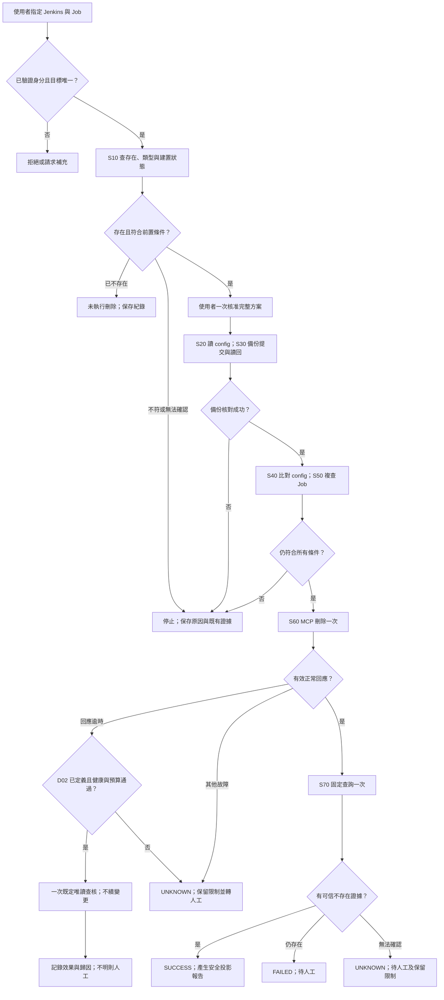
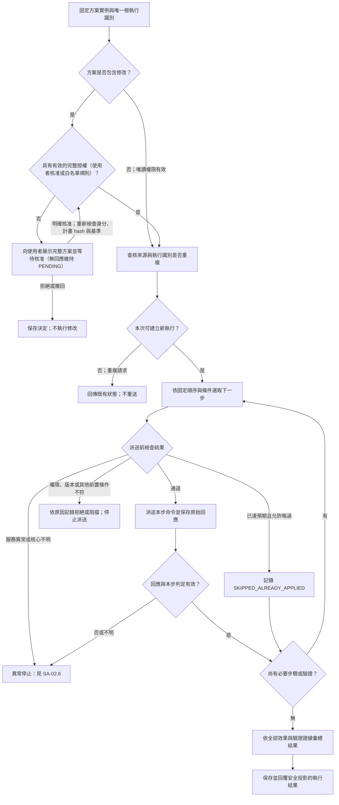
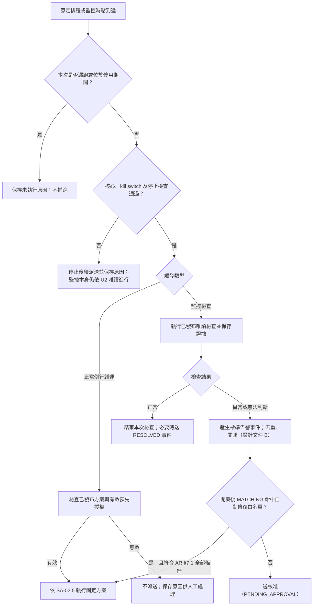
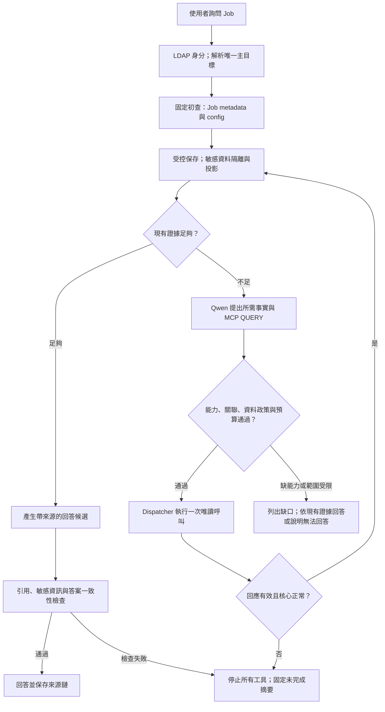
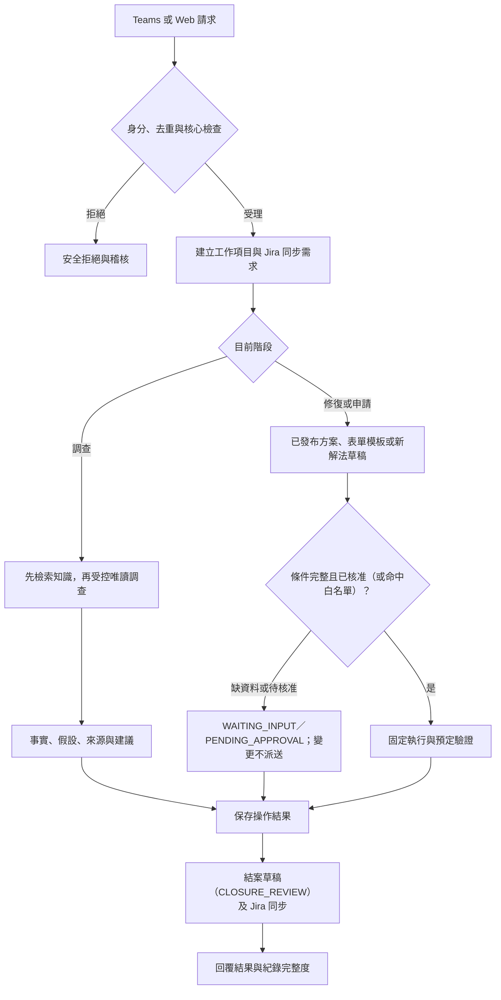
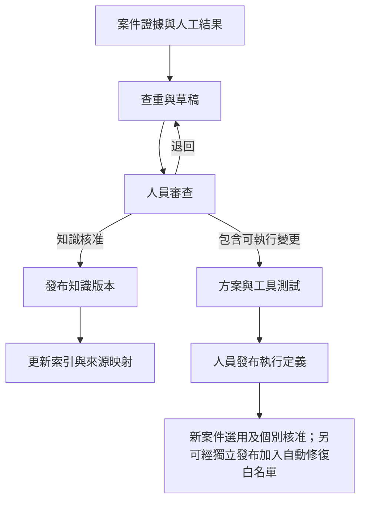

# DevOps 智慧維運應用系統分析規格書

分析設計草案｜分析版本 0.51｜依據 SRS 0.51 與已對齊需求第四版（U1～U38）｜2026 年 10 月 26 日（Asia/Taipei）

## 文件定位

本文件展開需求的使用案例、流程、身分與稽核、狀態、業務判定與例外處理，供需求方、系統分析人員、開發與測試共同檢查。功能範圍與業務驗收以 SRS 為準；資料欄位、秒數、設定檔及技術實現以 SD 為準。三份規格書與 [已對齊需求](aligned/aligned-requirements.md)（以下稱「已對齊需求」或 AR）衝突時，以已對齊需求為準；監控事件格式、去重與跨資源關聯見 [告警事件與去重設計](aligned/alert-event-and-dedup-design.md)（以下稱「設計文件 B」）。

SA 使用狀態名稱及命令類型描述可觀察行為，並不指定資料庫 DDL。所有工作項目共用 `work_item` 與一套 `WorkItemStatus`（AR §3，U7）；命令執行、外部同步、告警群組、事件候選、核准與知識各自保有獨立生命週期。目前不分角色（U13）：只有一種已驗證使用者，每個動作都寫稽核。歷次版本的決策差異改放在文末版本紀錄。

| 使用案例 | 參與者 | 主要輸出 |
|---|---|---|
| UC-01 唯讀查詢及調查 | 已驗證使用者 | 目標可識別、受控補查、有來源的事實／假設及安全投影結果。 |
| UC-02 採用既有解法 | 已驗證使用者／自動修復白名單 | 首例為單一 Job 備份刪除；完整方案一次核准（或命中白名單）、修改、獨立驗證及報告。 |
| UC-03 無匹配或技術故障 | 使用者／系統 | 無匹配轉提出解法（PROPOSING）；技術故障停止並轉待人工，兩者不混用。 |
| UC-04 維護已知能力 | 已驗證使用者 | 事先測試並發布的方案、命令、資源、檢查條件、監控來源與自動修復規則；每次變更稽核。 |
| UC-05 監控事件、通知及正常排程 | 監控來源／已授權背景元件 | 事件去重後自動開案與 Jira；關聯範圍內先整合通知；正常排程遵守同一授權、資料與停止規則。 |
| UC-15 Web 檢視工作項目 | 已驗證使用者 | 登入後看進行中工作項目與狀態，依系統／時間／狀態篩選，點選看明細與時間軸（SA-12；UC-06～14 見 SA-11.2）。 |

每個使用案例都保留原始請求者與實際核准者；AI 不作為具有核准身分的使用者。

三份配套文件：

- [DevOps_智慧維運應用需求規格書_草案.md](DevOps_智慧維運應用需求規格書_草案.md)
- [DevOps_智慧維運應用系統分析規格書_草案.md](DevOps_智慧維運應用系統分析規格書_草案.md)
- [DevOps_智慧維運應用系統設計規格書_草案.md](DevOps_智慧維運應用系統設計規格書_草案.md)

## 章節導覽

| 章節 | 內容 |
|---|---|
| SA-01 | 身分、操作責任與使用案例 |
| SA-02 | Jenkins 最小循環與 Bot 流程 |
| SA-03 | 固定調查、方案及確認規則 |
| SA-04 | 工作項目與執行狀態分析 |
| SA-05 | 資訊關係與可見資料 |
| SA-06 | 異常停止、防重複及人工接管規則 |
| SA-07 | 按模組啟用的擴充使用案例 |
| SA-08 | 分析驗證案例 |
| SA-09 | 模型品質與方案工具兩模組的驗證流程 |
| SA-10 | 自主查詢 Jenkins Job 內容 |
| SA-11 | 平台工作項目、Teams、外部協助、知識、每案紀錄與監控 |
| SA-12 | Web 檢視、並行推進與資源鎖 |

# SA-01 身分、操作責任與使用案例

對應 SRS-03、FR-04、FR-08。目前不區分角色（U13，AR §12.2）；LDAP bind、Teams 帳號連結與 session 由 SD-03 實現。

## SA-01.1 已驗證使用者可執行的動作

所有已通過 LDAP 驗證並完成 Teams 帳號連結的使用者，權限相同。原本 ADMIN-only 的動作改為所有已驗證使用者可操作，但每次都寫稽核：

| 動作 | 規則 | 稽核與限制 |
|---|---|---|
| 已發布 MCP 唯讀能力／自主問答 | 已接入服務的非敏感資料 | 帳密、token、對話及組織指定敏感資訊隔離 |
| 查詢安全投影報告、工作項目狀態 | 可 | — |
| 檢視 raw evidence（原始日誌、請求、回應、附件） | Web 受控頁面（U28） | 每次存取都稽核；Teams／Jira 只顯示安全投影；秘密在任何情況都不顯示 |
| 核准完整修改方案 | 一次核准整份計畫；可自行核准，畫面標示「自行核准」（U22） | 核准時重新驗證計畫 hash 與目標基準；無回應維持 PENDING（U10） |
| 提交標準申請、補資料、查進度 | 可 | 任意命令不屬標準申請 |
| 維護方案、命令、資源、連線、健康／遮罩規則、監控來源、自動修復規則 | 可 | 版本化、可停用、寫稽核 |
| 確認事件候選、拆分、移出（U30） | 可 | 寫 case_event |
| 確認、修改或退回結案草稿（U11） | 可 | 鎖定確認的草稿版本 |
| 設定與解除 kill switch／resource_hold（U26） | 可，需填理由 | 系統自動設定的 hold 須核心恢復 READY 後才可解除 |
| 正常排程及預先授權 | 可 | 只對未來時點生效，不補跑 |
| 紀錄政策設定、人工查核與重送 | 可 | 重送時補送計數歸零並記錄 |
| 啟動外部模型 grant | 每案檢視目的與預計外傳資料後啟動 | 供應商與資料政策核准後才可用 |
| 知識審查、測試及發布 | 可 | 不可繞過 MR 審查與方案測試 |

使用者的查詢可建立工作項目、證據與調查紀錄；查到既有解法時，同一工作項目繼續進入 MATCHING／PENDING_APPROVAL（AR §4），不另建變更工作。未來若要加回角色，以「動作權限清單＋principal 對應」加入，不改狀態機與資料表。

## SA-01.2 授權與結果判定摘要

| 發起來源 | 一般查詢 | 修正與重啟 |
|---|---|---|
| 已驗證使用者 | 可查詢、唯讀調查及檢視資料（raw 經受控頁面）。 | 核准完整方案後執行，單一或跨系統皆一次核准全部子命令；不再要求另一層核准。 |
| AI Agent | 正常問答可依 ADAPTIVE_READ 自主選擇已發布 MCP QUERY；變更內的查詢仍固定。 | 只使用適用的已發布方案；新解法的可執行步驟只能引用已發布命令（AR §8.3）；須有使用者核准或命中自動修復白名單；不可自我核准。 |
| 自動修復白名單規則 | — | 只在 AR §7.1 的全部條件成立時免核准執行；失敗、PARTIAL、UNKNOWN 轉人工，不重試（U9、U16）。 |
| 已發布正常排程 | 核心正常、無停止限制且在授權範圍內執行。 | 只執行已授權的正常維運。 |

上述「直接執行」仍須檢查身分、環境與目標、命令前置條件、kill switch、resource_hold 及互斥狀態。核准時與每個變更派送前，均檢查該授權仍有效。命令發出或 API 回覆已接受均不構成驗證成功。

變更前檢查可產生 `SKIPPED_ALREADY_APPLIED`（已達預期而略過）或 `BLOCKED_STATE_CHANGED`（狀態已變更而停止）；兩者都須記錄實際證據及通知發起人，且不得當作本次變更執行成功。若變更前狀態無法取得，記錄 `UNKNOWN` 並停止執行。

| 驗證狀態 | 後續處理 |
|---|---|
| 驗證成功 | 留存證據；產生結案草稿，進 CLOSURE_REVIEW。 |
| 驗證失敗 | 記錄證據並停止所有後續變更，轉待人工；技術故障或結果不明同樣停止。僅有有效證據的預期 STARTING 可按正常規格取樣。 |
| 結果不明 | 凍結原變更流程；已送 CHANGE 回應逾時且符合 D02 時僅一次既定唯讀查核，否則轉人工；不重送或續變更。 |

## SA-01.3 單一 Bot 分工

依 SRS-02，保留單一對外 DevOps Bot；不設 bot registry 或 `bot_id`，也不為多 bot 預留資料欄位（U12）。Qwen 協助理解需求、匹配已知方案、提出解法草稿及解釋證據；中央流程依已發布定義控制步驟，各服務模組提供固定查詢、操作及解析。服務模組不各自決定跨服務修正，也不互相委派新工作。

- 同一個跨服務問題沿用同一工作項目、調查、方案及證據關聯；使用者一次核准完整方案，各服務步驟經同一授權與派送機制執行。
- 同時監控多個服務由監控來源 Connector 與中央去重處理（AR §5），不需要多個 bot。
- 若固定方案允許獨立唯讀步驟平行執行，可由程式安排；這不增加自主 Agent 協作能力。必要子步驟出現新異常時停止整份相關工作的後續派送，在途結果依既有規則保存。

# SA-02 Jenkins 最小循環與 Bot 流程

對應 FR-01～FR-05；最小循環先讀本章 Jenkins 刪除流程圖，其餘圖為共用規則。每一步必要授權與健康檢查持續適用。

## SA-02.1 Jenkins 首例範圍

本版最小循環：使用者指定 Jenkins 與完整 Job 名 → 後端驗證身分及唯一目標 → 固定初查 → 使用者一次核准 → 備份 config 至 Bot DB 並讀回核對 → 複查 → MCP 刪除一次 → 正常回應後驗證不存在 → 固定報告。

僅支援單一 Freestyle 或一般 Pipeline；可位於一般 Folder 中，但 Folder、Multibranch 容器及分支 Job、批次及萬用字元均排除。未驗證身分的刪除要求直接拒絕。LDAP 身分、Qwen 意圖候選、resource mapping、工作與證據、核心健康、唯一派送及故障停止仍為必要共用能力。

首例屬 REQUIREMENT，不要求 root cause、build number 或其他服務資料。調查表的不適用欄位填 null 加 NOT_APPLICABLE 原因；若執行發生實際操作異常，同一工作項目依 SA-04 轉 PENDING_HUMAN。Jira、Confluence、通知、排程、VM 與跨服務維運隨方案擴充。

| 情況 | 固定行為 |
|---|---|
| 缺 controller／完整 Job 名或有多個匹配 | 請求補充；不猜目標或 latest。 |
| 初查可信不存在 | SKIPPED_ALREADY_APPLIED；不建立 config 備份、不刪除，保存查詢與稽核。 |
| 執行中／排隊中或不支援類型 | 停止；不取消建置或等待後續跑。 |
| 狀態無法完整確認 | 停止；null／權限不足不等於不存在或零建置。 |
| 備份成功 | DB 提交後新讀取，長度／SHA 核對一致；原文只在 Web 受控頁面檢視並稽核。 |
| 複查設定／類型／建置狀態變動 | 停止，保留既有備份；不自動重新備份或續刪。 |
| 刪除回應逾時 | D02 門檻通過則 CHECKING_AFTER_TIMEOUT，一次既定查核後提交終態；否則 UNKNOWN＋hold＋人工。不重送、不續變更。 |
| 其他破損／不明回應 | UNKNOWN＋hold＋人工，不套用回應逾時例外。 |
| 刪除正常回應 | 僅固定一次 VERIFY；可信不存在才 SUCCESS，仍存在 FAILED，無法確認 UNKNOWN。 |
| 備份到期 | 預設 90 天；執行中、UNKNOWN 或待人工未結案受保護，清理保留稽核。 |

三項 MCP 必要能力為 inspect、config read、exact delete；inspect 若經驗收符合 D02 可提供一次逾時查核；不足不可發布，故障不切 API。config 備份不包含 build history／artifacts，也不提供自動還原。查核與刪除是不同呼叫，仍有外部變動競態；Bot 互斥不是 Jenkins 全域鎖。

## SA-02.2 後續事故方案：已知失敗與新故障的區別

本節只在未來啟用已知事故方案時適用，不是本次 Job 刪除的第一個案例。

- 人員指定的歷史 build `FAILURE`／`UNSTABLE`／`ABORTED` 是待調查的業務結果，不直接等於 Jenkins API、MCP 或 Bot 核心故障。保存 `baseline_failure`、build 身分及證據後，可在正常連線與固定方案內繼續 detect／survey。
- 調查期間新增的連線逾時、認證失敗、工具錯誤、必要資料不可取得或 Bot 核心失效，立即依 SA-06.3 停止；已知失敗基準不能豁免這些新故障。
- 原失敗 build 的結果不可改寫為成功。若發布方案明列建立新的驗證 build，須保存新 queue/build ID 與原 build 的關聯，且是使用者明確核准的新操作；不得將自動重跑原 build 當成通用解法。若首個方案不需觸發新 build，就驗證其明列的實際修正效果。
- 後續事故 production solution 的錯誤特徵、固定修正命令與成功驗證仍由實際 Jenkins 案例填入並測試；規格不憑空指定清目錄、重啟、重建或改權限。缺少這三項時可驗收查詢／報告與模擬閉環，但不可宣稱已驗收真實修正。

## SA-02.3 Jenkins Job 刪除流程

圖中 S50 若可信回覆已不存在，轉「未執行刪除」並保留已有備份。任何階段新技術故障均停止；DB 無法寫入依既有故障日誌機制記錄，不假稱資料已提交。報告使用固定模板，不因需要收尾再呼叫 Qwen。UNKNOWN 後人員的新查核屬新工作，原結果不可覆寫為曾經成功。

## SA-02.4 受理、分類及流程分流

所有入口先驗證身分、去重、核心健康與案件範圍，再依 AR §4 的目標流程在同一工作項目內連續進行：COLLECTING → MATCHING →（無固定解法）PROPOSING → PENDING_APPROVAL →（核准或命中白名單）APPLYING → VERIFYING → CLOSURE_REVIEW → CLOSED（U8）。

收集資料先檢索知識，再於 ADAPTIVE_READ 內取得必要資料。MATCHING 只接受適用的已發布方案或申請模板，參數不齊先轉 WAITING_INPUT；NO_MATCH 轉 PROPOSING，由 AI 或人員擬定解法，可執行步驟只能引用已發布命令（AR §8.3）。模型候選不直接派送。

調查與變更在同一工作項目內連續進行，不需另建變更工作；每個階段在 `work_activity` 留下活動紀錄。原工作技術故障後轉 PENDING_HUMAN，不能藉流程分流繼續派送。

## SA-02.5 完整方案確認、固定步驟與驗證

本圖處理 SA-02.4 已匹配的方案實例，亦供 SA-07.6 已有有效預先授權的正常排程使用。完整方案的命令、順序、條件分支、驗證及目標範圍均來自已發布定義。

- 派送前檢查包含核心健康新鮮度、停止限制、來源方案有效性、當前合法步驟、身分與授權（使用者核准或白名單）、kill switch、目標與參數、互斥、狀態基準及唯一發送許可；每個命令及每次正常驗證取樣都重新檢查。
- 使用者一次核准全部子命令及預定分支；已有有效核准、命中白名單或正常維運預先授權時不重複詢問。單次核准不會發布新方案；新解法的可執行步驟只能引用已發布命令與參數 schema（AR §8.3）。
- `CHANGE` 的受理回應不能直接判成功，仍須完成方案明列的獨立 `VERIFY`。圖中的步驟迴圈包含必要驗證及規格允許的正常取樣，不能用於失敗重試、改選方案或追加未知問題調查。
- 「已達預期而略過」只適用規格允許且有有效證據的步驟；該變更未送出，不計為本次變更成功。方案最終結果依 SA-03.3／SA-04 彙總，保留部分完成與不明效果。
- Jira 每案自動建立／更新（INQUIRY 依 U20）；首次失敗後補送最多 5 次，仍失敗即停止轉人工（U5、U24），未知先查核；Confluence 為可選目的地（U25）；Jira workflow 依 AR §10.4 映射同步，不由 Jira 反向觸發維運。

## SA-02.6 無匹配、故障停止及人工後續

NO_MATCH 是沒有適用的已知變更方案，並非工具故障。工作項目轉 PROPOSING：可依原範圍與預算補充唯讀證據、提出假設及解法草稿，送 PENDING_APPROVAL；已核准的計畫執行中則不換方案。缺輸入詢問人員；最終無解時保存缺口並轉人工。

任何實際模型／工具／核心技術故障，依 SA-06 停止原維運流程；僅 CHANGE 回應逾時可按 D02 一次有條件唯讀查核，SYSTEM_RECORD 另按 U5／U24 補送。不重送維運命令、不改通道、不切外部模型。遠端效果不明使用 UNKNOWN 及 hold。只用已存證據產生固定摘要。

人員可從 PENDING_HUMAN 要求重新調查、新解法或登錄已手動處理（AR §3.4 T21～T23）。新方案發布、服務恢復或舊核准均不恢復原執行；新解法須經核准，且可執行步驟只能引用已發布命令。

# SA-03 固定調查、方案及確認規則

## SA-03.1 對話與調查

- 提供 DevOps 對話介面，支援服務狀態查詢、建立或接續調查、選擇既定方案、要求執行及查詢結果。各入口先建立工作，由 Qwen 依 SA-04 節判斷 `item_type`，保存分類理由；類型可轉換且保留同一 ID。

- 自然語言指令須解析成結構化請求，服務分類可多選或暫無關聯，仍可先建立事件與調查需求。真正執行命令前須確認具體目標集合或授權查詢範圍；操作目標、環境或方案不明時要求補充，不把未選服務解讀為全部服務。

- 正常問答依 SA-10 的 ADAPTIVE_READ：Qwen 可選擇已發布 MCP QUERY 補足事實，App 驗證純讀、資料敏感性、目標關聯及預算。固定變更方案內仍僅執行明列步驟與分支；新修正建議只能形成未發布草稿。

- Qwen 依固定方案及實際結果，說明觀測事實、匹配依據與未確認事項；下一步可引用已發布方案，或將新假設／處理建議明標為未核准、不可執行；模型回覆不得代替 App 的適用條件檢查或驗證結果。

- 跨服務調查使用已發布唯讀能力、已登錄資源關係與案件 scope；新線索不授權存取未登錄目標。固定變更內則只執行方案明列步驟；每項結果保留實際來源、目標實例、時間窗、方案及命令版本，避免混用不同環境或不同時間的證據。

- 對話須關聯工作項目、報告版本與命令執行紀錄，使 Teams 與應用介面能接續同一事件。

## SA-03.2 事故、建議與核准

- 事故應記錄觸發來源、零到多個相關服務 labels、環境資訊、時間線、監控證據、調查紀錄、處置、核准與驗證結果。尚未辨識服務或確認沒有服務關聯時也可建立事件；內部身分與取號均獨立於服務，依 SD-04 節處理。

- 監控偵測到服務異常時，標準告警事件經去重後自動開案與建立 Jira（U6），並自動進入 COLLECTING 調查（AR §3.4 T02）；關聯範圍內的告警先整合成一則通知，確認後才開案（U18）。命中自動修復白名單時依 AR §7 執行。

- DevOps 可認可、退回、選擇已發布方案、補充 Context 後要求適用的固定唯讀查證，或轉人工處理。報告修訂關聯原始證據與 Context 版本，保留原報告及修訂理由；不能以重做分析為由重送修正或接續故障工作。人工新工作仍受 SA-06.3／SA-03.6 約束。

- Qwen 無法解釋或證據不足時保存缺口；健康調查可於既定範圍內補查，無法解決則轉人工。沒有完整已發布方案時不得變更。App 可保存非可執行新解法草稿，但拒絕擴權、臨場派送命令或未經驗證的成功宣告。單一命令已發布不代表任意組合可執行。

- 每次核准關聯具體報告、完整方案版本／摘要及唯一 PLAN 根 execution ID；一次核准涵蓋全部明列子命令，單一或跨系統皆沿用 SA-04 的相同規則，不另設逐命令核准。

- 不分角色（U13）：任何已驗證使用者可唯讀調查、查看結果、提交標準申請、核准修改、維護設定與排程／規則、解除資源限制及管理工作項目；每次都寫稽核。人員與 AI 提出的修改都需一次核准（或命中白名單），不新增多審核者或逐階段核准。保存原始請求者、核准者、Agent、執行元件及實際服務帳號，不混為同一身分。

## SA-03.3 處置命令與自動化

- 命令需事先定義目標與參數、前置條件、權限、併發與重試限制、逾時、執行步驟、驗證方式及失敗處理。命令定義及執行身分不綁定單一服務；執行可有零到多個相關服務 labels，以及多個明確操作目標。

- 命令以 `CommandType` Enum 分類。使用者及 Agent 可在範圍內使用唯讀查詢；遇到服務、連線或工具異常不自動重試，正常驗證取樣依 SA-04.7 節。所有受管服務修改／重啟，不論人員或 AI 提出、涉及單一或多個系統，都需使用者核准完整方案，或命中自動修復白名單（U9）後執行。排程與正常維運規則僅可使用明確授予的指定版本、目標、命令、時段及有效期；任何異常停止條件與 kill switch 優先於預先授權。所有路徑仍通過前置檢查、防重複及 VERIFY，單次核准不授予未來自動執行權。

| CommandType Enum | 語意 | 授權與重試 |
|---|---|---|
| `QUERY` | 唯讀調查與取得狀態，不改變受管系統。 | 無須核准，但須通過核心健康門檻；異常立即停止，不自動重試或換工具補查。 |
| `CHANGE` | 建立／調整權限、修改設定、部署或重啟等會改變系統狀態的命令。 | 使用者一次核准完整方案、命中自動修復白名單，或使用正常維運的有效預先授權。服務異常時停止且不重試、回滾或補償；SYSTEM_RECORD 另依 U5／U24 補送，不屬此維運命令。 |
| `VERIFY` | 預定義的唯讀驗證，檢查變更後的實際目標狀態。 | 隨所屬操作執行；不授予額外變更權限。 |

命令類型由已審核的命令目錄指定，不依 MCP 工具名稱、HTTP method 或模型判斷。若驗證必須使用具副作用的高權限工具，不得標成 `VERIFY` 來規避核准，須另定義授權與執行方式。

Jira（與可選的 Confluence）紀錄寫入採 SYSTEM_RECORD 的政策授權、固定程序、稽核及讀回驗證，與受管服務 CHANGE 的核准來源分開；首次失敗後補送最多 5 次（U5、U24），未知效果先查核，權限／內容衝突轉人工，詳 SD-14.7。

命令的執行階段依 SA-04.2 節 `CommandExecutionStatus` 保存，COMPLETED 時以 `CommandResult` 表示最終結果；等待核准、排隊、執行中及待驗證不能寫入結果欄位。確認未送出而取消時使用 CANCELLED，result 為空並記錄原因，不增設假成功或以拒絕冒充取消。

| CommandResult Enum | 判定條件 | 後續處理 |
|---|---|---|
| `SUCCESS` | COMMAND 的 QUERY 回應有效、VERIFY 通過，或 CHANGE 執行且獨立驗證通過；PLAN 根執行須整份方案必要效果與驗證均通過。 | 留存證據；對變更依情境進入觀察或結案。 |
| `FAILED` | 已有明確失敗證據或必要驗證未通過。 | 停止當次所有後續工具並轉人工；QUERY、VERIFY、CHANGE 均不因失敗而重試。 |
| `UNKNOWN` | 逾時、連線中斷、證據矛盾或無法判定命令是否生效。 | 最終 UNKNOWN 轉人工，不重送或推定未生效；D02 查核必須在終態之前的 CHECKING_AFTER_TIMEOUT 完成，不能復活已終止 UNKNOWN。 |
| `PARTIAL` | 所有必要效果均已查明，且多步驟僅部分生效。 | 保存已生效步驟並停止所有後續工具、轉人工；仍有不明效果時使用 UNKNOWN。 |
| `SKIPPED_ALREADY_APPLIED` | 執行前查得目標已達提案預期狀態，未送出變更。 | 記錄查證結果並通知發起人；不記為本次執行成功。 |
| `BLOCKED_STATE_CHANGED` | 執行前基準已變，原提案不再適用，本子命令未送出變更。 | 停止原提案後續派送；未使用核准失效，已使用授權保留歷史，交 DevOps 新提案。根結果另依整體已生效範圍判定。 |
| `REJECTED` | 身分、核准、目標或命令前置條件不符，未送出命令。 | 留下拒絕原因；如需繼續須修正提案。 |
| `BLOCKED_SERVICE_UNAVAILABLE` | App 核心門檻不通過、目標／依賴服務異常或相關停止限制生效，且可證明本子命令未送出。 | 保存阻擋原因並轉人工，不列入等待恢復後補跑。根結果依已送出步驟的完整證據另判。 |

實際子命令必須保存 `CommandType`、最終 `CommandResult` 及執行／驗證證據；每個 attempt 另存技術回應、發送記錄與時間，不能把單次接受回應當成父執行成功。PLAN 根執行只做流程與結果彙總，不直接呼叫工具或冒用 CommandType；資料關係依 SA-04 節。`CHANGE` 的 `SUCCESS` 必須附有對應 `VERIFY` 通過紀錄，部分完成與不明狀態不能轉成一般失敗後自動重試。

- 完整方案及命令規格須事前定義，經人員測試、審核、版本化並發布。Qwen 可匹配既有方案及填入允許參數；沒有固定解法時可提出新解法，其可執行步驟只能引用已發布命令與參數 schema，需要未發布命令的步驟只能列為人工步驟（`MANUAL_ACTION`），整份新解法須經使用者核准（AR §8.3）。新解法要成為固定解法，須走知識／方案審查發布。

- Qwen 可推薦適用的已發布方案並解釋匹配依據；App 僅派送該方案明列的命令。修改仍須使用者核准、命中白名單或有效預先授權，模型不持有核准身分；單次核准不能放行引用未發布命令的步驟。

- 每個 `CHANGE` 在流程正常且核心門檻仍通過時觸發獨立 `VERIFY`，不能以 API 接受或模型文字宣告成功。一旦符合 SA-06.3 停止條件，不再啟動一般驗證工具；僅 D02 可用獨立一次查核許可；記錄未驗證及原因，效果不明則 UNKNOWN，由人工後續另發起查證。

- 每個 `CHANGE` 命令在取得目標互斥權後、實際執行前，須使用已定義的唯讀命令重新取得目標狀態，並與提案時的基準及預期狀態比較。若已達預期狀態，記錄「已達預期而略過」，不再送出變更；若基準狀態已被其他人或系統改動且無法確認原提案仍適用，記錄「狀態已變更而停止」，停止原提案後續派送並交 DevOps 檢視；未使用核准標示失效，已使用授權保留歷史快照。支援版本前置條件的目標系統應在送出變更時再次使用版本比對，避免檢查與修改之間的競態；不得因狀態已變更而盲目覆寫或重送。

- 驗證結論區分成功、失敗與結果不明，最終 CommandResult 依客觀證據判定。僅規格明列且有有效證據的預期 STARTING 可繼續原定唯讀取樣；工具錯誤、服務異常、核心故障、證據不足或矛盾依 SA-06.3 立即停止，不等待恢復、不追加任意查核、不重試，也不自動啟動另一個修正。

- 正常例行維運規則在 App 核心正常且無故障停止限制時可依預先授權執行。服務異常事件命中團隊預先定義的自動修復白名單（AR §7）時可免核准執行；其他一律需核准。

- 人員事先維護的已知方案須經測試及人員發布；AI 可由案件產生待審草稿；人員審查、必要測試及發布仍為門檻，AI 不能自行發布。發布只代表可供選用；加入自動修復白名單是另一個獨立的發布動作（AR §11）。

## SA-03.4 情境規格與命令目錄

> 適用性更新：正常問答改依 ADAPTIVE_READ／COMMON_QUERY_SAFE；固定變更工作及故障停止仍依本節，不能在 CHANGE 流程臨場插入查詢。

- 每個可執行情境須對應完整已發布的已知方案，定義適用／排除條件、必要 Context、輸入參數、固定檢測／修正／驗證命令、順序、相依、條件分支、判斷依據、授權及停止條件。方案與命令分別版本化；方案固定引用命令版本。方案目錄及本次執行實例的區別依 SA-03.6 節。

- App 依方案事前定義的判定欄位與條件選擇固定分支，Qwen 說明結果及匹配依據；不得新增步驟、重排順序、改判斷條件，或生成任意 SQL、shell、API、Kubernetes 指令。既定分支未涵蓋、無匹配方案或證據矛盾時，保存既有資料並轉人工，不繼續探索。

- VM 調查由 App 呼叫公司 VM 連線服務的固定唯讀 action，驗證 gateway target、參數、主機與路徑範圍；Bot／Agent 不取得 SSH 私鑰或任意 shell。變更須公司服務已提供經驗收的固定 CHANGE action，且使用者核准（或命中白名單）後才可派送；不能因查詢失敗改高權限或另開 SSH。

- VM 變更完成且流程正常時，以公司 VM 服務提供的獨立唯讀 action／應用健康 API 驗證；記錄 gateway task ID、執行身分、目標、命令與方案版本、核准者及原始回應。若必要驗證能力未提供，該 CHANGE 不可發布。原始／遮罩視圖依 SD-03.3，不在 Bot 內管理 SSH key。

- App 由匹配的已發布方案實例化 SA-04 節的 execution_plan，展開允許的具體目標、參數、子命令及預定分支，保留來源方案／命令版本、Context／證據及驗證規格。使用者一次核准整份執行實例。合法目標／參數調整形成新實例版本並重新核准；新增／替換步驟、順序、分支或驗證規則，須先由人員測試發布新的方案定義，不能僅靠當次核准放行。

- App 在核心正常且無停止限制時依固定方案取得憑證與派送，正常回應才觸發 VERIFY；Qwen 只在流程正常時解釋當次安全投影的結果。服務／工具異常依 SA-06.3 停止原流程；只有 D02 可作一次既定查核，不再自動分析或任意查證。

## SA-03.5 一次核准完整修改方案

不論修改建議由 DevOps 人員或 Qwen 提出，單一系統與跨多系統的 CHANGE 都需任一已驗證使用者核准完整方案（U13），或命中自動修復白名單（U9）。申請人可以核准自己的提案，畫面標示「自行核准」並記錄（U22）。核准沒人回應時維持 PENDING_APPROVAL，不自動拒絕、不逾時、不升級；每個工作日 09:30（Asia/Taipei）在原頻道提醒一次（U10、U21）。

一次核准涵蓋整份固定版本執行實例的全部明列子命令、預定分支及必要驗證；各分支的條件、步驟與最大全部目標均須可查閱，由 App 依既定條件選擇。沒有按系統、階段或子命令再次批准的流程；每步前置檢查及驗證仍是 App 自動管控。

核准時必須能查閱：

| 展示項目 | 必要內容 |
|---|---|
| 目的及分類 | 維運需求或異常處理、原請求、關聯事故、Qwen 判斷依據及未確認事項。 |
| 跨系統範圍 | 全部環境、服務／實例、VM、URL／IP、resource ID、相依關係、影響範圍及預期中斷，不只列服務名稱。 |
| 全部子命令 | 固定命令／版本／類型、業務參數、身分類別、順序、相依與受限制的輸出綁定；連線秘密值仍使用憑證參照。 |
| 前置及預期效果 | 各步前後狀態、已達標時略過規則，以及哪些變化會停止原方案。 |
| 驗證與停止 | 固定 VERIFY、健康門檻、期限／查詢預算、部分完成或不明時停止規則。 |
| 核准依據 | 已發布 solution ID／版本（或新解法草稿版本與其引用的已發布命令）、本次 execution_plan 版本／摘要、匹配證據、Context 版本與前版差異。 |

- Web、對話與 Teams 使用同一個「核准執行」動作，驗證身分、計畫 hash 與版本；只有對話中自稱已核准不構成授權。
- 核准當下重新讀取 canonical plan、比對 hash、重新取得目標基準狀態；基準已變則轉 `BLOCKED_STATE_CHANGED`，提案改為 SUPERSEDED，回 PROPOSING（AR §8.2）。方案或命令版本已停用，核准也無效。
- 核准後根執行立即排隊，子命令依既定順序執行；核准與派送之間仍做 SA-02.5 的全部派送前檢查。不另指派核准者、檢查審核人數或形成自審／他審分支。
- 合法目標／參數改動須新執行實例版本並重新核准；命令、順序、分支或驗證規則改動須先完成人員測試發布新方案定義。同版本已核准子步驟不重複詢問。
- 發生失敗、部分完成或不明時停止後續自動變更並轉 PENDING_HUMAN，不能因整份核准而自動重試、回滾或跳到另一個修正。
- 重複點擊、過期表單及多入口回覆只處理一次有效授權，不產生第二份根執行；與 SD-07.1 的去重及唯一發送許可共用規則。
- 排程／規則的明確預先授權依 SA-04.5 執行；超出範圍則回到核准流程，不由 AI 補足授權。
- Jira 為每案自動建立的紀錄（INQUIRY 依 U20），不再逐案詢問；紀錄通道故障不阻擋已核准操作，詳 SA-11.8。

## SA-03.6 調查、建議與固定變更邊界

不再採「所有未知分析／新建議皆禁止」限制。調查活動允許受控唯讀調查、假設、解法草稿及待審 Runbook 草稿；FIXED_CHANGE 僅執行已核准的計畫；新解法可執行步驟只能引用已發布命令（AR §8.3），不能臨場生成任意命令。正式知識發布與執行定義發布分開，個案核准不取代兩者。SA-06 技術故障停止規則維持；未知原因、NO_MATCH、缺知識不自動等同技術故障。

## SA-03.7 已知方案與執行實例

- 「已知方案」是由人員事先定義、測試、核准並發布的完整固定流程。除了修正方案，也包含單一唯讀查詢、有限步驟的辨識／檢測、驗證及正常例行維運；單一步驟可構成方案，不必為簡單查詢製造多步流程。
- `solution_definition` 至少保存穩定 solution ID、版本、名稱、處理的固定問題／目的、適用與排除條件、必要證據與 Context、允許環境／資源類型、輸入型別及範圍、固定步驟與分支、命令版本、輸出綁定、驗證及停止規則、步數／時間上限、發布者及有效狀態。僅已發布且未停用的版本可建立新執行。
- `execution_plan` 是將該方案套用到本次目標與合法參數的實例；需保留來源方案版本與完整快照。參數化及選擇預定分支不屬於生成新解法；新增命令、順序、分支、目標解析方式或驗證條件則屬方案定義變更，須先由人員另行測試發布。
- 一次工作可包含多個明確要求的固定操作；每個操作須對應既有方案。跨系統相依、輸出傳遞及多步修正必須已由同一發布方案明列，不允許 Qwen 把數個方案串成新的處置流程。互不相依的額外目的依 SA-04 分開追蹤。
- 新方案發布與本次執行確認是不同責任：前者維護已知能力，後者授權特定實例。使用者按下核准，不會讓新解法自動成為已發布方案。

## SA-03.8 匹配、參數與固定分支

> 適用性更新：正常問答改依 ADAPTIVE_READ／COMMON_QUERY_SAFE；固定變更工作及故障停止仍依本節，不能在 CHANGE 流程臨場插入查詢。

- Qwen 根據請求與授權可見資料，提出候選 solution ID／版本、匹配理由、證據及參數；App 驗證方案有效性、目標、型別、範圍、必要前置條件及引用版本。不以 Qwen 自述信心或文件文字代替可檢查條件。
- 匹配紀錄保存 `MATCHED`（條件完整且適用）、`NEEDS_INPUT`（缺少可由人員補充的必要資料或有多個待選候選）或 `NO_MATCH`（無適用方案、條件不符、既定流程未涵蓋或證據矛盾），並記錄理由、候選及證據。這是方案適配結果，不是命令的 `CommandResult.UNKNOWN`。
- NEEDS_INPUT 透過對話／表單釐清，工作項目為 WAITING_INPUT，不任選候選或派送變更。需要讀取目標才能判別時，先由人員發起適用的已發布固定唯讀檢測方案；其查詢及分支須事前明列，不能以「尋找方案」為由無限追加工具。
- 固定分支由 App 依已定義欄位及規則判定，Qwen 可解釋選擇結果；不讓模型臨場發明分支條件。所有可能的修改步驟、條件與目標在核准時揭露，沿用整份方案一次確認。
- 派送前檢查命令確實屬於本次來源方案及當前合法步驟，並驗證參數與綁定。即使命令本身已發布、使用者已核准其他計畫或模型宣稱必要，也不能跨越方案邊界。方案停用或執行前條件不再符合時，阻擋未送出步驟並交人工，不改選其他方案接續。

## SA-03.9 未知或未涵蓋問題

- 調查模式保存已知事實、矛盾、假設、已排除原因、可見來源與待補證據。模型不能把推測標為 CONFIRMED 或把新建議標為可執行方案。
- 若原 scope／預算與健康允許，可選已發布 QUERY 驗證未知資訊；沒有合適能力或超界就停下並提出缺口，不生成任意 shell／SQL／URL。
- MATCHING 得到 NO_MATCH 時不派送變更，保存原因並轉 PROPOSING 提出新解法（AR §3.4 T10）；已核准計畫執行中不臨場換方案。
- 新解法可保存為 DRAFT，查重、人員審查及必要測試後才發布；原工作不因新版本出現而續跑。一般文件／歷史案例不直接成為命令授權。
- 告警命中自動修復白名單時可免核准執行（AR §7）；未命中一律需核准。故障後不重送維運命令、補跑、回滾或補償；D02 的一次查核不授權續變更；建議能力不改變這些限制。

# SA-04 工作項目與執行狀態分析

## SA-04.1 工作項目與類型

所有使用者請求、排程觸發、監控事件與主動調查都建立同一種 `work_item`（AR §2），以獨立 UUID 與單一流水號 `OPS-0000001234` 識別；取號沿用 SD-04.2 節原則，不包含服務、環境、日期或類型（類型可轉換）。

| item_type | 顯示名稱 | 判斷依據 |
|---|---|---|
| `INCIDENT` | 事故 | 系統異常、設定錯誤、服務失效、效能異常、log 過大、儲存不回應等；監控事件自動開案預設為此類型。 |
| `REQUIREMENT` | 需求 | 建立或修改系統需求，例如建 pipeline、建 DB table、開測試帳號、計畫性變更；固定解法即已發布申請模板。 |
| `DISCUSSION` | 問題討論 | 需要分析、比較方案或做決策，但不必然變更系統；需要變更時另開 REQUIREMENT／INCIDENT 子項。 |
| `INQUIRY` | 主動調查 | 使用者要求平台主動檢查或回答問題（U3）；發現異常時轉型為 INCIDENT。 |

- Qwen 依請求、觸發來源、已載入 Context 與證據提出類型，回傳分類、理由、引用證據及未確認事項；App 驗證格式並保存模型／提示版本與分類歷程。類型不等於服務 label，也不參與業務身分或冪等鍵。Qwen 不可用時，分類步驟暫停並標示 `blocked_reason=LLM_UNAVAILABLE`，人員可手動指定類型（U14）。
- 類型轉換（例如 INQUIRY → INCIDENT）保留同一 work_item ID 與完整歷史，寫 `ITEM_TYPE_CHANGED` 事件與理由，不另開新案。
- 子命令繼承工作項目目的；分類不取代 CommandType 或核准，Agent 不能因分類、報告或工具回應改用 CHANGE。
- 類型或目標未確認前不送變更；人員可更正類型並保存理由與操作者，但更正不清除人工接管或資源限制。
- 一個請求若包含互不相關的目的，以父子工作項目（`parent_item_id`）分開追蹤，不得將未釐清的額外變更混入同一核准。
- 維運過程中 CHANGE 失敗、部分完成或結果不明時，工作項目轉 PENDING_HUMAN 並停止後續自動變更。事故內容須區分操作異常與受管服務故障；單純提案被拒、取消或缺少參數只記工作原因。

## SA-04.2 流程狀態 Enum 與轉移規則（R02）

本節定義 App 的內部狀態。工作項目、命令執行、核准及外部同步各自保存；Jira 只按配置映射投影平台狀態，不作內部狀態權威。`CommandType` 與 `CommandResult` 沿用 SA-03.3 節；尚未得到最終結果時，result 欄位為空，不填入等待或執行中等流程值。以下狀態轉移均由 App 驗證條件後執行，Qwen 僅能提出建議。

## SA-04.3 WorkItemStatus 與 closure_reason

事故、需求、問題討論與主動調查共用一套 `WorkItemStatus`（U7）；舊 RequestStatus、IncidentStatus 與 Case 狀態均由此取代。完整狀態圖與轉換表 T01～T26 見 AR §3.3～§3.4，本節摘要分析要點。

| WorkItemStatus | 中文 | 意義 |
|---|---|---|
| `NEW` | 已建立 | 已開案、取得編號、Jira 建單請求已寫入 DB。 |
| `COLLECTING` | 收集資料 | 以已發布唯讀能力收集證據；需要時呼叫 Qwen 分析。自動開案後直接進入，不需人工啟動（T02）。 |
| `WAITING_INPUT` | 待補資料 | 必要資訊只有人能提供；等待中不派送任何變更。 |
| `MATCHING` | 查找固定解法 | 比對已發布方案、申請模板、知識庫，結果為 MATCHED／NEEDS_INPUT／NO_MATCH。 |
| `PROPOSING` | 提出解法 | 無固定解法時擬定解法草稿；DISCUSSION 在此產出結論。 |
| `PENDING_APPROVAL` | 待核准 | 等使用者核准；沒人回應就一直停在這裡，只做每日提醒（U10、U21）。 |
| `APPLYING` | 套用解法 | 依核准計畫或自動修復白名單規則派送 CHANGE。 |
| `VERIFYING` | 驗證 | 執行 VERIFY 與必要觀察期（舊 OBSERVING 併入）。 |
| `PENDING_HUMAN` | 待人工 | 失敗、PARTIAL、UNKNOWN、外部衝突或無法自行判斷；平台不自動續跑。 |
| `CLOSURE_REVIEW` | 結案草稿待確認 | 平台產生結案草稿，等使用者看過並確認（U11）。 |
| `CLOSED` | 已結案 | 終態，必填 `closure_reason`。 |

`closure_reason`：`RESOLVED`、`SELF_RECOVERED`、`FULFILLED`、`CONCLUDED`、`FALSE_POSITIVE`、`DUPLICATE`（須填 `duplicate_of`）、`WITHDRAWN`、`WONT_FIX`。舊 CANCELLED 改為 CLOSED＋WITHDRAWN，同樣經結案確認。

| 分析要點 | 規則 |
|---|---|
| 核准無逾時 | PENDING_APPROVAL 與 CLOSURE_REVIEW 無逾時轉換，不自動拒絕或結案。 |
| 失敗不續跑 | APPLYING／VERIFYING 遇 FAILED、PARTIAL、UNKNOWN、BLOCKED_* 轉 PENDING_HUMAN；CHANGE 不重送，D02 一次查核在 APPLYING 內完成。 |
| 人工後續 | PENDING_HUMAN 可由人員要求重新調查（T21）、新解法（T22）、登錄手動處理並驗證（T23）或結案（T24）；舊執行結果不覆寫。 |
| 卡住不改狀態 | kill switch、resource_hold、Qwen 不可用只設定 `blocked_reason`（`KILL_SWITCH`／`RESOURCE_HOLD`／`RESOURCE_LOCK_WAIT`／`LLM_UNAVAILABLE`／`JIRA_SYNC_PENDING`），不改狀態、不丟資料；`RESOURCE_LOCK_WAIT` 見 SA-12.5。 |
| 重開 | CLOSURE_REVIEW 期間被退回，或關聯告警在重開窗內再次 FIRING，回 COLLECTING（T26）；CLOSED 後的新告警依設計文件 B §4.5 處理。 |
| 類型限制 | DISCUSSION 不進 APPLYING／VERIFYING；INQUIRY 不進 MATCHING 以後的狀態，需要時先轉型為 INCIDENT。 |

- 進入 PENDING_HUMAN 後保存 execution_hold 及必要 resource_hold。人員認領、服務恢復或重新告警不解除限制；告警恢復只更新 `signal_state`。
- 工作項目狀態依當前有效計畫的整體進度判定，個別查詢或子命令回應不能直接覆寫。修正命令成功不必然代表整個跨服務問題恢復；必須核對所需的所有目標與健康條件。
- 結案一律經結案草稿確認（T25）；未取得恢復證據不得使用 `RESOLVED`；仍在執行、查核中或結果不明的變更須先收尾，不能靠結案解除資源鎖。
- Jira 待同步、待查核或待人工不改寫業務結果；完成業務但外部紀錄未齊保留 `record_completeness=INCOMPLETE`。
- 所有轉換以 `row_version` 樂觀鎖並寫 `case_event`（STATE_CHANGED）；work_item 相當於 EIP 過程管理器（7.12，p.219）。

## SA-04.4 CommandExecutionStatus 與執行停止

| 狀態 | 意義與允許轉移 |
|---|---|
| CREATED | 固定方案實例已建立；可進 AWAITING_APPROVAL 或合法唯讀 QUEUED；命中白名單時直接 QUEUED |
| AWAITING_APPROVAL | 等待使用者核准；無回應維持此狀態（U10） |
| QUEUED | 授權完整且健康；可進 PRECHECKING，不是故障恢復佇列 |
| PRECHECKING | 檢查身分、owner、scope、版本、基準、kill switch、hold，通過才 RUNNING |
| RUNNING | 已取得唯一發送許可並可能送達；正常 CHANGE 回應可進 VERIFYING |
| VERIFYING | 正常固定驗證，成功／失敗／不明後 COMPLETED |
| CHECKING_AFTER_TIMEOUT | D02 唯一例外：已送 CHANGE 回應逾時，核心／通道正常且已有固定查核；只准一次 QUERY，不可續 CHANGE |
| COMPLETED | 最終 CommandResult 已保存；不可回排隊、續跑或重送 |
| CANCELLED | 能證明未派送而取消；不填最終結果，仍保留原因 |

RUNNING 的 CHANGE timeout 先保存不可改寫的 transport_result=TIMEOUT。符合 D02 才進 CHECKING_AFTER_TIMEOUT，此非終態不提前填 final CommandResult；不符合直接 COMPLETED／UNKNOWN、PENDING_HUMAN 及 hold。QUERY timeout、VERIFY 技術失敗、核心故障、程序重啟均不能進此例外。

一次查核完成後必須 COMPLETED：可歸因本次操作且全部必要效果有可信證據時 SUCCESS 並標 verification_mode=AFTER_TIMEOUT；能證明未生效且遠端已結束時 FAILED；只觀察到目標狀態、無法排除其他操作者／晚到副作用或查核失敗時 UNKNOWN。保留所有 timeout／查核證據。其餘已生效／未完成效果依根方案規則彙總，不把單一步驟成功當整案成功。任何查核結果都不啟動剩餘 CHANGE。

非上述例外的技術故障停止，依已知證據記 FAILED／PARTIAL／UNKNOWN；未送出門檻失敗可 REJECTED／BLOCKED_STATE_CHANGED／BLOCKED_SERVICE_UNAVAILABLE／SKIPPED_ALREADY_APPLIED。取消與派送競態以發送證據判定，不能假稱遠端已取消。

COMPLETED 的結果不可覆寫。稍後人工查證另建工作與 execution_resolution；舊 UNKNOWN 不復跑。查核中程序中斷即人工，不能由新 worker 補做第二次。限制解除見 SD-14.2／SD-07.6。

## SA-04.5 核准紀錄與 AuthorizationSource

命令執行不採逐階段／逐命令／多審核者制度。修正方案由任一已驗證使用者核准（U13），App 保存 `approval` 作為可追溯的執行授權（AR §3.5，合併舊 admin_authorization）；一般查詢不需建立核准紀錄。

- 核准保存 approval ID、核准者身分、是否自行核准（U22）、來源／時間、plan ID／版本／hash、唯一 PLAN 根 execution ID、全部子命令與目標範圍、首次使用時間及撤銷／失效原因。子命令引用同一根授權。
- 是否有效由固定版本、計畫 hash、撤銷紀錄、目標基準及 kill switch／hold 共同決定，不由 AI 填寫「已核准」文字取得授權。核准狀態為 PENDING／APPROVED／REJECTED／WITHDRAWN／SUPERSEDED；PENDING 無逾時（U10）。
- 方案或必要條件改變時，原核准改為 SUPERSEDED，不可用於後續派送。未送出執行依原因結束為 REJECTED／BLOCKED_STATE_CHANGED；已達預期則 SKIPPED_ALREADY_APPLIED。明確撤回且確定未送出時可 CANCELLED。
- 已使用核准保存不可覆寫的快照，撤銷只影響未送出的步驟；新的修正方案須有新的根執行及核准。資源隔離、kill switch 與不重試規則不因核准而解除。

| AuthorizationSource | 適用來源 |
|---|---|
| `READ_ONLY` | 使用者或 Agent 在任務範圍內使用 QUERY／VERIFY。 |
| `USER_APPROVAL` | 使用者對完整修改方案的單次核准，含單一及跨系統方案、固定解法與新解法。 |
| `AUTO_REMEDIATION_RULE` | 命中啟用中的自動修復白名單規則（AR §7）；記錄規則 ID／版本與命中證據。 |
| `APPROVED_SCHEDULE` | 已發布並授權的排程，僅在指定版本、目標、命令、時段及有效期內觸發。 |
| `SYSTEM_RECORD_POLICY` | 紀錄政策，授權安全內容及配置的 Jira transition；無受管服務變更權。 |
| `TIMEOUT_CHECK` | 原核准方案明列的一次唯讀查核；需即時 D02 gate，不授權 CHANGE 或解除其他 hold。 |

- 標準申請提交不是執行授權來源；Agent 不是使用者身分，不能核准自己的建議。
- 排程與白名單規則的預先授權與單次核准分開：前者保存發布者、版本、範圍與有效期，各次觸發保存固定方案及來源證據，不消費或重用別次的單次核准。
- 舊 ADMIN_CONFIRMATION 遷移為 USER_APPROVAL；舊 APPROVED_RULE 的正常維運規則遷移為 APPROVED_SCHEDULE 或 AUTO_REMEDIATION_RULE。舊 publication_decision 已刪除（U6），歷史轉為 case_event 備查。

## SA-04.6 每案紀錄政策與同步狀態

每個工作項目自動建立 Jira 紀錄（U6；INQUIRY 預設不開 Jira，U20），不逐案選擇是否發布；Confluence 為可選目的地（U25）。同步需求、每次嘗試與外部對應分別保存於 `external_sync_request`、`external_sync_attempt`、`external_mapping`（AR §10），需求先寫入 DB 再送出（EIP 事務性客戶端 10.4，p.356）。

| SyncStatus | 行為 |
|---|---|
| PENDING | 等待首次送出或下一次補送 |
| SENDING | 持有單一領取與派送記錄 |
| RETRY_WAIT | 確認未生效的暫時故障，等待下一次補送 |
| RECONCILING | 可能已生效，先查核既有 ID／固定 marker，不直接重建 |
| SYNCED | 該版本內容／必要 workflow transition 及驗證完成 |
| PENDING_HUMAN | 補送用盡、不明、權限錯誤或內容／版本衝突 |
| SUPERSEDED | 被同一目的地的新版本取代 |

- 補送規則（U5、U24）：首次失敗後最多再補送 5 次，間隔 1 分、5 分、15 分、1 小時、4 小時（各加 ±20% jitter），不設總期限；仍失敗即停止並轉 PENDING_HUMAN，通知一次。人工重送時計數歸零並記錄。
- 外部紀錄故障不停止維運工作；工作項目只標示 `blocked_reason=JIRA_SYNC_PENDING` 與 `record_completeness`。重啟可恢復同步需求，但不恢復維運命令。
- 不確定建立結果必須先查核；搜尋空結果不足以證明未建立。無法查明則人工，不重複建檔。細節與 Jira workflow 映射見 AR §10.4、SD-14.7。

## SA-04.7 驗證等待、健康判定與觀察規則（R04）

本節分開判斷查詢技術結果、目標健康、本次操作效果及事故恢復。固定驗證僅在 App 核心正常且當次流程未發生 SA-06.3 停止事件時執行；一般服務／工具異常後不啟動新查核；D02 的一次專用查核另依 SA-04.4，其餘即使有剩餘預算也轉人工。判定由 App 依證據執行，不由 Qwen 宣告通過。

## SA-04.8 查詢結果與 HealthStatus

每次驗證取樣保存兩個不同面向：

| 面向 | 保存內容 | 判讀 |
|---|---|---|
| 查詢技術結果 | `probe_result` 沿用 CommandResult 的 SUCCESS／FAILED／UNKNOWN 子集合，另存錯誤分類、查詢時間與證據參照。 | SUCCESS 代表取得來源、目標、格式與時間窗均有效的資料；服務不健康時查詢本身仍可 SUCCESS。明確存取拒絕或解析錯誤可為 FAILED；逾時、連線中斷等無法取得可信結論時為 UNKNOWN。 |
| 健康判定 | `health_status` 使用下列 HealthStatus。 | 依有效資料與已發布條件判定；查詢失敗、資料過期或缺漏時不能推定服務故障或健康。 |
| 操作與驗證結論 | 效果證據、通過的條件／目標、未通過或未確認項目；流程仍用 CommandExecutionStatus，最終結果仍用 CommandResult。 | 一次取樣不是整次 VERIFY 的最終結果；尚可等待時，父執行維持 VERIFYING 且最終 result 為空。 |

| HealthStatus | 意義 |
|---|---|
| `HEALTHY` | 當次有效證據符合該目標的必要健康條件；不單獨證明本次變更已完成。 |
| `STARTING` | 有明確啟動／收斂證據，符合規格允許等待的情境；不能只因連不上或仍在等待期就使用此值。 |
| `UNHEALTHY` | 有效證據顯示必要健康條件不滿足，依 SA-06.3 停止並轉人工；不得以尚有預算為由繼續查詢。人工明確發起、以已知故障為目標的調查依 SA-06.5 保存既知基準。 |
| `UNKNOWN` | 查詢故障、必要資料不足／過期、來源矛盾或無法確定健康狀態；不可當作 STARTING、HEALTHY 或已證實故障。 |

- 必要取樣為 UNKNOWN 或技術查詢失敗時，保存不確定原因並立即停止；不自動重查、不改用另一工具。查詢可用性與目標健康分開記錄，UNKNOWN 不等於確認目標故障。
- 權限不足、憑證失效、工具規格不符或必要驗證不可執行，不能靠重複查詢解決；停止自動處置並轉人工。無法取得驗證證據時，操作結果為 UNKNOWN，不宣稱服務已故障，也不能以原命令回應成功代替驗證。
- 連續成功只計入所有必要條件通過且時間窗一致的有效取樣；有效 STARTING 可在正常預算內等候並重置連續成功數。UNHEALTHY、必要 UNKNOWN、資料缺漏／矛盾或工具錯誤立即停止，不重新累積成功來掩蓋故障。
- 每個必要目標及檢查項目保留獨立結果。已知異常與未知項目同時存在時兩者都顯示，不能只用單一摘要遮蔽未知範圍，也不能把部分健康等同部分變更已生效。

## SA-04.9 最終判定與 R02 銜接

| 條件 | App 判定及後續 |
|---|---|
| 等待／驗證期限內，目標仍在合法啟動或收斂過程，未觸及明確失敗條件 | 維持 VERIFYING，只依規格唯讀輪詢；不重啟、不補送、不改用其他修正。 |
| 當次查詢失敗、逾時或必要證據 UNKNOWN | 記錄技術結果與未知範圍，停止後續所有工具並轉人工；不重查，不假定目標一定故障。 |
| 本次效果已確認，所有必要操作條件與健康檢查均達到連續成功門檻 | VERIFY 為 SUCCESS，對應 CHANGE 可為 COMPLETED／SUCCESS；工作項目仍須核對整體範圍與觀察期，再進 CLOSURE_REVIEW。 |
| 已符合明確失敗條件，或驗證期限到且新鮮完整證據確認未達預期 | VERIFY 為 FAILED；CHANGE 依完整效果證據判為 FAILED 或 PARTIAL，工作項目 PENDING_HUMAN，停止後續自動變更。期限到仍有明確 STARTING 證據而未完成，可判為未於期限內達標，不必謊稱服務已停止。 |
| 必要證據缺漏、過期、互相矛盾、無法確認操作效果，或預算耗盡仍不足以得出結論 | 最終為 UNKNOWN，保存已知結果與缺口，工作項目 PENDING_HUMAN；仍有不明效果的資源不得解除隔離或重送修正。 |
| 所有受影響範圍均已查明，僅部分預期步驟／目標生效 | CHANGE 為 PARTIAL，保存完整逐步結果並轉人工；只要仍有必要範圍不明，就不能用 PARTIAL 掩蓋 UNKNOWN。 |
| 操作前已達預期，未送出變更 | 維持 SKIPPED_ALREADY_APPLIED，保存當次前置查證；若用來判定恢復，仍須滿足工作項目層級的健康與觀察要求。 |

- VERIFY 的查詢成功、CHANGE 的效果成功及工作項目的恢復為不同結論。服務健康但無本次操作效果證據，不足以判定重啟成功；授權設定存在但缺少情境要求的有效存取驗證，也不能宣告使用者已可正常使用。
- VERIFYING 的觀察期僅在核心正常且無停止事件時依既定計畫觀察；有效異常、查詢故障或必要證據缺漏即轉人工，不補查、不延長、不自動重新觀察。
- 觀察期間出現問題不覆寫已完成命令的歷史結果，另記新的證據；同一告警群組的重複告警只累加計數（U4），不能藉重新告警或另開執行繞過停止限制。
- Qwen 不可用時只暫停需要 AI 的步驟（分析、分類、解法草稿、結案草稿生成），標示 `blocked_reason=LLM_UNAVAILABLE`；不需要模型的固定 VERIFY、監控、去重、通知與已核准計畫照常執行（U14），模型恢復後由暫停點繼續。
- 報告與通知須分列操作效果、查詢可用性、健康判定、驗證門檻／時間、觀察狀態及 AI 分析是否完成。不得以「已發送」「查詢成功」或「模型認為正常」概括為已恢復。

# SA-05 資訊關係與可見資料

| 分析實體 | 業務意義 | 主要關係 |
|---|---|---|
| 工作項目 | 事故、需求、討論或主動調查 | 一套狀態（AR §3）；可跨多服務、可有父子項，不以服務名稱作身分。 |
| 告警群組／事件候選 | 去重後的監控訊號與開單前的關聯候選 | 一個群組最多關聯一個未結案工作項目；候選確認後最多產生一個工作項目（設計文件 B）。 |
| 方案定義／執行實例 | 已知方法／本次填入目標與參數的方案 | 定義先發布，實例再確認；不能由實例反向發明方法。 |
| 資源／關係 | VM、服務實例、job 與依賴 | 多對多，定位依時間與環境；不是文字標籤。 |
| 調查／證據 | 人員問題、觀測及來源 | 原文不變，推論與更正可追溯；根因有未確認與已確認之分。 |
| 報告／外部同步 | 安全投影結論與 Jira 紀錄 | 報告為安全投影；Jira 依紀錄政策自動同步，不逐案同意（U6）。 |

欄位的必填、型別、唯一性及表單輸入範本見 SD-04～SD-06；本節不把概念關係重複實作成另一份資料表。

## SA-05.1 工作項目與命令的服務關聯

- 一個工作項目、一筆命令執行及依紀錄政策建立的 Jira Task 均可關聯零個、一個或多個服務；服務欄位採可多選集合，空集合是合法值。不能要求先指定主要服務才能建立事件、保存命令請求或取得編號，也不建立「未知服務」的假服務資料來填補必填欄位。
- 服務是可增減的分類關聯，不是工作項目或命令的身分。工作項目、命令定義、命令執行、報告、同步需求及關聯表都使用獨立主鍵；不得把 service ID、服務名稱、服務集合、環境或 labels 組入其主鍵、業務編號或工作項目／執行冪等識別。服務目錄自身仍有獨立 service ID，僅透過外鍵與查詢關聯使用。
- 服務標籤表示「相關服務」，不代表每個被查詢的服務都已故障或為根因。受影響、僅供調查及根因是否確認，須由證據與報告另行說明。服務是目錄中的實際管理項目，例如 Jenkins CI、Rancher 平台或某個 App；服務類型與環境實例另有 metadata，不可只靠「Jenkins」類型推定實際操作對象。
- 事件與命令執行的服務集合分開保存。單一事件可有多筆執行，每筆只標示與該次命令相關的服務；不能把事件全部 labels 直接當作每次命令的執行目標。
- 服務集合為空時，須能區分「尚未辨識」及「確認無服務關聯」。建議使用 `ServiceAssociationState`：`UNCLASSIFIED`（尚未辨識）、`NONE`（確認無關聯）、`ASSIGNED`（至少一個服務）。新建且未選服務時預設尚未辨識，確認無關聯須有人工決定或明確規則依據。狀態與服務標籤集合須一致更新並記錄異動；調查後新增或移除服務不改變原工作項目 ID、編號、Jira Task 或 Confluence 頁面。
- 服務關聯與實際操作目標分開：沒有服務 label 的命令仍可能操作 VM、平台或其他明確資源。真正執行前必須具備已授權的具體目標或明確的唯讀查詢範圍；空的服務集合不能解讀為全部服務，也不能豁免授權。

## SA-05.2 表單結構

介面提供一份「調查紀錄」詳情，包含基本資料、發生位置、Jenkins／部署資訊、觀測時間線、根因判定、方案與驗證、備註及證據附件。儲存採主表加多筆資源／證據／時間線／方案紀錄，避免以單一 vm 或 related_service 字串遺失跨服務關係。未知欄位保持 null 並填 `missing_reason`，不要求 Qwen 補猜；每欄可追溯來源／更新者與時間。

## SA-05.3 表單與可見資料

- 所有已驗證使用者看到相同的表單與安全投影（U13）。資源對應原值、detail／memo、完整錯誤及 raw evidence 只在 Web 受控頁面檢視，每次存取寫稽核（U28）；Teams／Jira 只顯示安全投影。自動採集欄位的原始值不可覆寫，只能新增更正紀錄。
- 安全投影採 COMMON_QUERY_SAFE：非敏感 Job／repo／path／IP／hostname 可見，帳密、token、對話及組織指定敏感內容隔離；秘密在任何情況都不顯示。
- 由可信 ResourceResolver 解析 exact target；模型可看非敏感定位資訊，但不能靠模型生成的 URL／IP 直接連線，仍須驗證已接入目標與關聯。
- 未提供的相關服務、根因、commit 或 VM 資訊均明示未知；查不到資料與確認根因為不存在是不同結果。新增服務可用帶 schema_version 的 extensions 擴充。

# SA-06 異常停止、防重複及人工接管規則

## SA-06.1 防重複與連鎖效應控制

完整識別、發送、互斥及故障恢復依 SD-07.1 節；以下為共同原則。

- 監控事件先以 `delivery_id`／`event_id` 排除重送，再以 `alert_key`（來源＋規則＋資源）去重到同一告警群組（U4，設計文件 B §2～§4，EIP 關聯標識符 5.7，p.107）；重複告警只累加計數、更新最後時間，不重複開案或通知。可能同源的跨資源告警依 correlation_scope 先進事件候選，hold 60 秒後整合成一則通知，使用者確認同一事件才開一張單（U18、U30～U34，EIP 聚合器 7.7，p.187）。服務相同或服務集合為空都不是充分合併條件；已確認同一事件時共用工作項目與 Jira。

- 每次命令建立不含服務的唯一操作識別，依標準資源 ID、目標集合與影響範圍建立互斥限制；多服務、多通道對同一資源的衝突變更共用互斥機制，不以服務 labels 當鎖定依據。排程、對話、Teams 與自動規則的重複請求回傳既有操作狀態；鎖定仍須處理相關命令間的衝突。

- 故障、失敗或不明的執行結果一律停止當次處理並交人工，不以再次告警恢復修復；告警恢復只更新 `signal_state`，抖動依 U17 標示 FLAPPING 並抑制通知。

- 上游故障、維護時段（maintenance_window，U27）或監控來源故障引發的大量異常，應聚合、抑制次生處置並整合通知；抑制不能刪除原始檢查證據。

- 操作識別與執行狀態須持久化；程序中斷或服務異常後，不接管、補跑或自動查詢遠端狀態。恢復只整理已有紀錄及待人工清單，原執行不重新派送；不明效果的資源保持隔離。

- 排程、對話、Teams 與正常維運規則共用防重複與故障停止；撞期依工作設定，漏跑及停止期間觸發一律不補跑，重新啟用後僅未來時點可執行。

## SA-06.2 人工介入與值班交接

- 工作項目轉待人工時建立待辦，保存認領與處理歷程；核心及通知正常時可發固定提醒，提醒失敗不重試。App 核心異常時依 SA-06.3 停止外部通知，使用獨立監控；認領不解除任何限制。

- 使用者接手後可補充 Context、要求重新調查、要求新解法、登錄已手動處理並要求驗證，或決定結案（AR §3.4 T21～T24）。恢復、觀察與結案保留人工決策及證據，舊執行不接續。

## SA-06.3 停止規則與兩個明確例外

維運預設在技術故障後停止，不重送、換通道、回滾、補償或接管。兩個例外：D02 是已送 CHANGE timeout 的一次有條件唯讀查核；SYSTEM_RECORD 依 U5／U24 補送 5 次。它們不授權故障工作恢復變更。監控本身不因故障停止（U2，見 SA-06.4）。

App 核心、DB／稽核、身分服務或安全投影失效時，任何例外都不能派送。Jira／Confluence 連線不作維運核心必要依賴，D06 允許先可靠保存同步需求，繼續正常且已核准的維運。細節見 SA-04.4／04.6、SD-14.2／14.7。

## SA-06.4 適用範圍與停止行為

- 業務工具、必要服務或核心技術故障，停止原工作項目的後續派送；不重送 QUERY／VERIFY／CHANGE、不改通道或模型。Qwen 不可用只暫停 AI 步驟（U14）。歷史 build FAILURE／知識零命中不是技術故障。
- 監控與健康檢查在受管服務故障期間繼續以唯讀方式執行，維持原間隔、短於 60 秒者放寬為 60 秒（U2、U23）；同一故障不重複發出警報，只累加到既有告警群組（U4）。
- 已送 CHANGE 的回應逾時只在 D02 所有門檻成立時進 CHECKING_AFTER_TIMEOUT；一次查核後結束，不續變更。其他不明結果 UNKNOWN＋hold＋人工。
- SYSTEM_RECORD 使用獨立政策、狀態、預算及 worker；暫時錯誤補送，可能生效先查核，不明／權限／內容衝突轉人工。紀錄故障不牽連正常維運；DB／稽核故障則全域停止。
- 故障只停止尚未派送請求，不能保證撤銷遠端操作。已在途回應保存來源與時間；晚到資料不重啟工作。原結果終態不覆寫，後續結果另存 resolution。
- 通知可用固定安全摘要，不需模型；一般通知失敗不換渠道重送，與已授權的紀錄補送分開。核心故障使用獨立監控。
- 未知或部分完成的資源保持必要 hold；已成功子步驟保留。解除限制不能重用已消耗的派送許可，也不能恢復原流程。

## SA-06.5 人工介入與新工作

- 異常執行不回到 QUEUED／RUNNING／VERIFYING；服務恢復、冷卻到期、租約到期、晚到成功回應、舊核准、排程新觸發或 Agent 新建 ID 都不能使其復跑。自動修復只限白名單規則（AR §7），且同一規則失敗後不再自動觸發，直到人員處理。
- App 核心正常後，使用者可從 PENDING_HUMAN 要求重新調查或新解法並核准。新執行須有可驗證的人員操作、新 execution、原工作項目關聯、目前狀態及必要授權，不能從故障佇列或 AI 自行衍生。
- 人員已知的故障可作為新固定檢測／修正的明確對象，不要求先修好目標服務才能人工查證；查詢須有適用已發布唯讀能力；變更仍須匹配適用已發布完整方案，不能把「人員知道故障存在」當成「系統已有解法」。保存故障基準與來源方案；此基準不代表驗證通過、不解除未知副作用的 resource_hold，也不允許失效工具重試。固定變更無匹配、額外技術故障、工具失敗或 App 核心異常時停止；健康調查的無知識命中依 SA-11。
- execution_hold 用於禁止自動接續與自動觸發；人工明確發起的唯讀查核可在核心正常、身分授權及限定範圍內執行，保存人工操作依據。任何 CHANGE 仍須由使用者查明在途效果及舊 worker 狀態、解除相應 resource_hold，並核准新方案；不把人工介入當成略過互斥。
- 正常計畫性重啟中，有有效回應及明確證據的預期 STARTING，可在原規格期限內完成取樣；它不是異常補跑。逾時、連線失敗、UNHEALTHY、必要證據 UNKNOWN 或核心故障，不能被 AI 解釋為「正常等待」繼續。
- 使用者可重新啟用正常例行排程，但僅未來時點執行，停用期間或當次漏跑永不追補。故障資源的重複告警只追加到既有告警群組，不重新開案或觸發修復。

# SA-07 按模組啟用的擴充使用案例

以下為已規劃的擴充情境；各服務能力依方案逐步接入（AR §1.2），未接入的能力標示 disabled，不視為平台故障。交付排程另由開發計畫管理（U8）。

## SA-07.1 首批情境需求

以下為已規劃的固定情境目錄；SA-02 的 Jenkins 閉環為首例，其餘隨 solution 依賴逐步增建。各情境須提供已發布方案才算固定解法，泛稱「部署失敗／反應變慢」不代表支援所有未知原因；未命中時轉 PROPOSING 提出新解法並經核准（AR §4）。

| 情境 | 固定檢測命令與所需 Context | 修正、驗證與輸出 |
|---|---|---|
| AD 帳號加入 stage／dev MariaDB | 查驗目標 AD 身分、DB 實例、既有帳號或映射、預定義角色與現有權限。App 以專用 DB 帳號操作。 | 依已確認的 AD 整合方式，選用固定的建立／映射及授權命令；驗證最終身分、角色與預期權限。授權期限及撤銷條件待定；不得自行推定權限。 |
| Jenkins job 部署失敗 | 依固定檢測方案查指定 job／build、階段與日誌；僅按事前定義的關聯查 image、cluster、namespace、Deployment、rollout、Pod 與事件。 | 比對已登錄的錯誤特徵與適用條件，命中完整已知方案才可送核准；未知錯誤或未涵蓋分支轉 PROPOSING，新解法可執行步驟只能引用已發布命令，經核准後執行。 |
| Rancher Deployment 部署失敗 | 依固定方案查指定 Deployment、rollout、Pod、事件與限定日誌，保留時間窗及版本。 | 解釋失敗類型與方案匹配結果；命中方案後經核准（或白名單）執行並驗證，未命中轉 PROPOSING。報告由 App 將結構化結果與證據填入安全 HTML 模板。 |
| 特定 App 反應變慢 | 人員事先定義功能／API、時間窗、固定指標、正常基準、門檻及有限分支；僅執行對應方案列出的查詢。 | 已定義的效能問題模式走固定解法；未達匹配條件時保存結果並轉 PROPOSING，由 AI 或人員提出解法草稿送核准。 |
| VM 上的服務異常 | 依固定方案定位主機與服務，經公司 VM 連線服務查明列的資源、程序、服務狀態及日誌；跨系統比對須事前定義。 | 比對已知問題條件；使用者核准適用的已發布完整方案（或命中白名單）。核心正常且無新異常才執行，以固定 VM gateway 查詢及健康檢查驗證；未匹配或新異常即停止。 |

上述表格未指定實際 SQL、API 參數、問題特徵或異常門檻，須由人員補齊方案並驗收發布；未完成者不列為已支援能力。新增已知情境沿用同一方案定義與發布機制，AI 可提出待審草稿，但發布者仍為人員。

## SA-07.2 排程與健康檢查

- 管理指定時區、時間、目標與啟停狀態的排程；每次觸發產生執行紀錄。

- 對上述服務及 Kubernetes Deployment 提供可擴充的檢查器；每一服務實例登錄適用的健康檢查方式，保留結果、時間、來源與證據。未配置檢查方式的服務不得假裝已受定期監控。

- VM 檢查器僅透過公司 VM 連線服務的已發布 action 取得連線、服務、程序、資源與日誌資料；條件隨命令逐步擴充，不直接呼叫 SSH。gateway 可用與 VM／應用健康分開判定。

- 區分健康、異常及無法判斷；異常時以標準告警事件送入去重與開案流程（設計文件 B）。故障期間繼續唯讀監控，維持原間隔、短於 60 秒者放寬為 60 秒（U2、U23）；同一故障只累加到既有告警群組，不重複警報（U4）；恢復時更新 `signal_state`，抖動依 U17 處理。

- 監控來源支援 Prometheus／Alertmanager 與 API 輪詢（U1）；其他特殊入口日後以同一標準事件格式接入。

- 定時 Deployment 重啟使用同一 image，須確認 rollout 及應用健康狀態；指令送出不等於處置成功。

## SA-07.3 Teams 主要入口與通知

Teams 承載對話、補表、核准、通知與案件結果；Web 保留受控頁面。Teams／Web／API 共用身分、工作項目與唯一派送，依 SA-11.4 驗證來源、LDAP 連結及卡片動作。通知只傳安全摘要，raw 與其他對話不入共用頻道。

變更展示 SA-03.5 完整預覽，由任一已驗證使用者一次核准。關聯範圍內的多筆告警整合為一則通知（U18）；嚴重度升高只通知一次（U29）；待核准與結案草稿每個工作日 09:30 提醒（U21）。Jira 紀錄由政策觸發，不顯示逐案「是否建立」選項；Jira workflow 依 SA-07.5 同步。通知失敗記錄待人工，不重做業務操作；可選電子郵件另依公司通知範圍配置。

## SA-07.4 每案 Jira 與 Confluence 紀錄

所有工作項目都保存 DB 紀錄並自動建立 Jira（U6）；INQUIRY 預設不開 Jira（U20），Confluence 為可選目的地（U25）。粒度預設一案一票，同案後續更新既有映射；不逐訊息建票、不因沒有事故而省略申請紀錄。安全拒絕僅安全稽核。

RecordPolicy 明列每類案件的 project、issue type、space／parent、ACL、owner、Bot 管理欄位及安全投影；`OPS／系統異常` 只可作事故類目的地，不能硬套所有申請。由使用者配置並授權服務身分（稽核），不再每案選擇是否發布。

紀錄包括請求與目標、安全證據、方案／模板版本、核准、實際動作、結果、驗證、假設／缺口及人工待辦。對話全文、raw、秘密不發布；對外資料另經目的地政策。發布狀態與業務結果分開，失敗後補送最多 5 次（U5、U24），不明或衝突轉人工，禁止重做維運命令。資料結構與故障策略見 SA-04.6／SA-11.8、SD-14.7。

## SA-07.5 Jira 工作流程自動同步

Bot 依 AR §10.4 將單一 WorkItemStatus 映射到 Jira workflow（取代舊版「Jira workflow 全由人員維護」）。使用者配置 allowed_from、transition ID、目標狀態、必填欄位與結案條件；完成測試後啟用。Bot 更新安全內容，並依可信平台事件同步 workflow。

變更完成須有必要效果與 VERIFY／允許查核的證據；HTTP 接受、UNKNOWN、PARTIAL 不可自動轉成功。查詢案件按回答與引用驗證完成，不虛構維運成功。實際 Jira 狀態名稱、是否關閉及 resolution 值不得猜。

轉換前核對當前狀態、事件序列及合法 transition。人工變動與預期衝突轉人工，不強制改回；已達目標不重複送。timeout／暫時故障沿用紀錄同步政策（U24），不能盲目重送 transition。Jira webhook／人工關單只記外部觀測，不反向驅動維運、核准或平台成功判定。

## SA-07.6 正常排程、監控與自動修復

監控事件經去重後自動開案與建立 Jira，並自動進入調查（AR §5）；命中自動修復白名單時免核准執行，否則送核准（AR §7，U9）。白名單規則每群組 24 小時最多 1 次、每資源 24 小時最多 3 次（U16）；執行失敗、PARTIAL 或 UNKNOWN 轉人工，不重試。故障期間監控繼續、不重複警報（U2、U4）。重新啟用正常排程後，只執行未來合法時點，歷次漏跑均不追補。

# SA-08 分析驗證案例

驗收涵蓋兩個 Jenkins 案例、核心控制、Teams、統一工作項目流程、每案 Jira 紀錄、知識、標準申請、監控去重、事件候選、自動修復白名單、結案草稿與 kill switch。未接入的服務能力不阻擋已接入能力的驗收，但不能代稱平台全數完成。新增案例見 SA-11.9。

本章為分析與整合驗證的詳細情境；業務交付門檻由 SRS-07 的 AC-01～AC-22 定義。

## SA-08.1 每案紀錄、補送與 Jira 狀態驗收

- 每個工作項目自動建立 Jira（INQUIRY 依 U20，Confluence 可選）；同案更新原映射，不逐句建票。
- 建立 timeout 先查核，能證明既有紀錄則關聯，不能查明則人工；create 不重複。
- 可證明未生效的暫時故障依 1m／5m／15m／1h／4h 補送最多 5 次（U24），無總期限；401／403、內容衝突與補送用盡轉人工。
- 紀錄通道故障不阻擋已核准維運；DB／稽核失效仍阻擋。恢復同步 worker 不恢復業務命令。
- Jira transition 只在有效映射與完成條件下執行；人工衝突不覆寫，webhook 不驅動維運。
- 詳 ST-PLT25～32，預期結果待隔離真實服務驗證。

## SA-08.2 模型基準與外部協助驗收

Qwen 是必要主模型，提示、模型、來源及版本均可追溯。調查無已知解法時可提出帶來源的解法草稿；可執行步驟只能引用已發布命令，並須核准。外部 provider 未核准時任何外送為零；啟用後僅在使用者明確啟動 grant 及 export policy 通過時提供本案最小資料。

工具技術故障停止；Qwen 不可用只暫停 AI 步驟（U14），不因有外部 provider 就自動 fallback。外部結果仍須 schema、引用、scope 與預算檢查，不直接取得工具權限。MQ 的 Qwen 與外部 profile 分列，不以外部成績取代 Qwen 驗收。

## SA-08.3 多服務、查詢與取號的驗收情境

- 工作項目與命令執行分別測試零、一、多個服務；零服務仍可持久化及取號，沒有服務標籤的 VM 操作仍須具備明確目標及授權。
- Jenkins／Rancher 同屬一次事故時，只有一個工作項目編號與一張 Jira Task（啟用 Confluence 時一份子頁面）；每筆命令可關聯不同服務集合。後續加入 MariaDB 或移除誤標服務，只更新 labels 與報告版本，所有身分與編號不變。
- 驗證 ANY、ALL、未設定篩選、無服務與未辨識服務，以及只有一般 label 的工作項目；清單、分頁及總數不因多標籤 JOIN 而重複，篩選不因無服務而失效。
- 多個 App 副本同時取號時無重複；相同請求重送回傳原 ID／編號。不同服務、相同服務、不同 item_type 的工作項目共用單一流水號規則（OPS-…），不依服務或類型另起序列。
- Jira 待人工期間 labels 已更新，使用者後續人工重送時，最終保留最新 App 分類及人工的一般 labels；不重新建 ticket。驗證無服務狀態與服務 labels 不矛盾，只有一般 labels 的工作項目不被無服務查詢漏掉。
- 多目標變更缺少任一必要授權或前置條件時，不送出原提案；執行途中失敗或結果不明時，保留逐步結果並停止後續自動變更，不重試成功步驟，也不因服務 label 被移除而解除資源鎖。
- 兩個沒有服務的不同事故不因空集合而自動合併；不同來源的跨服務告警只有落在同一 correlation_scope 時才進同一事件候選，整合為一則通知，使用者確認同一事件後才開一張單（U18、U30～U34）；測試見設計文件 B 的併發測試 T1～T6。

## SA-08.4 R02 狀態與轉移驗收

- 四種 item_type 都使用同一 WorkItemStatus；類型轉換保留同一 ID 並寫 ITEM_TYPE_CHANGED；DISCUSSION／INQUIRY 的類型限制被強制。
- 監控自動開案後直接進 COLLECTING，不需人工啟動（T02）；NO_MATCH 進 PROPOSING（T10）。
- 系統／Agent 修改方案未經核准且不符白名單時保持 PENDING_APPROVAL；無人回應不逾時、不自動拒絕，只在工作日 09:30 提醒（U10、U21）。任一已驗證使用者一次核准涵蓋全部明列子命令；自行核准被標示（U22）。
- 提案改版、目標基準改變與方案停用均使核准 SUPERSEDED 並阻止派送；重複點擊與過期決策不觸發第二次執行。
- 取消與派送競態中，可證明未送出才 CANCELLED；可能在途且發生服務／App 異常者 UNKNOWN 並人工，不自動取消遠端、查核或重送。
- CHANGE 只回應接受不能 SUCCESS；VERIFY 尚未完成即遇異常時立即 UNKNOWN／PENDING_HUMAN，不等期限也不再查核。
- 多服務處置只有部分目標恢復時，工作項目不得進入 CLOSURE_REVIEW；已確認部分作用及不明效果分別保留。
- 進入 PENDING_HUMAN 後，認領或追加唯讀查詢不解除自動變更限制；只有 T21～T24 的人員動作可推進。
- 結案一律經 CLOSURE_REVIEW 草稿確認；RESOLVED 須有驗證證據，SELF_RECOVERED 須無平台變更；退回或重開窗內再次 FIRING 回 COLLECTING（T26）。
- 外部同步失敗依 U24 補送 5 次後 PENDING_HUMAN；未知外部效果先 RECONCILING，不直接標 SUPERSEDED。已同步或已結束的執行不可因 App 重啟而回到派送。
- 任一非法狀態轉移或過期 row_version 被拒絕且留下安全紀錄；Enum 以字串保存，未知代碼不能被解讀為核准或成功。Jira 人工狀態不驅動任何內部轉移。

## SA-08.5 R04 驗證等待與健康判定驗收

- 服務仍在規格允許的啟動期時，顯示 STARTING／VERIFYING 並持續有限次唯讀查詢；修正只送出一次，不能因第一個未就緒結果轉為最終 FAILED。
- 查詢取得有效的不健康資料時，probe_result 為 SUCCESS、health_status 為 UNHEALTHY；模擬逾時、無權限、格式錯誤或過期資料時不得據此判定服務已故障。
- 第一次 QUERY／VERIFY 逾時就停止並轉人工，即使稍後服務恢復也不得再查；SDK、MCP、API、VM_GATEWAY 均不能暗中重試。UNKNOWN 不虛構目標故障。
- 未達連續成功輪數、只有變更前的快取、部分必要目標缺資料或跨來源時間窗不符時，不得判定成功；失敗／未知取樣不能計為成功或重置總期限。
- 期限到仍有新鮮完整的不健康／未達標證據時為 FAILED；無法確認必要效果時為 UNKNOWN；全部效果已查明而僅部分生效時為 PARTIAL。三者均停止自動變更並通知。
- 等待期內發現規格定義的明確失敗條件時，不需等到期限才轉人工；健康取樣正常但無本次重啟證據時，不得以此宣告本次重啟成功。
- 等待或正常驗證期間 App／worker 中斷時，保存原時間與已知結果供人工查閱，恢復不接續輪詢、不重新計時、不改派另一 worker。
- 多目標／多步驟方案中，前一步必要驗證尚未通過時不送出下一個變更；個別目標完成不能使整個工作項目提前進入 CLOSURE_REVIEW。查詢預算不足不自動產生新的驗證執行以接續輪詢。
- 通過命令驗證後在 VERIFYING 內進行觀察期；觀察期間再次出現有效異常證據或資料空窗超限時，工作項目轉人工而原命令結果不覆寫；不自動重啟或無限延長觀察。
- Qwen 中斷時只暫停 AI 步驟並標示 LLM_UNAVAILABLE（U14）；固定 VERIFY、監控與已核准計畫照常；模型恢復後由暫停點繼續。
- 驗證規格缺少必要參數、時間／次數不足以滿足成功門檻或沒有固定 VERIFY 時不得發布；各服務正式採用的秒數與門檻須在情境上線驗收前補齊。

## SA-08.6 第一手資料、raw 受控檢視與安全投影驗收

- 模擬含 IP、hostname、帳號、token、URL query、stack trace、detail／memo 與附件的來源，確認 raw 分段入庫可還原已取得原文；任何已驗證使用者可在 Web 受控頁面查 raw，每次讀取／下載都有稽核（U28）；秘密欄位在任何情況都不顯示。
- Teams、Jira、通知、匯出、SSE／WebSocket 與歷史報告只取得安全投影；猜 evidence ID 或要求模型原樣列出秘密都須拒絕。
- 送入 Qwen 的請求、知識、歷史及工具資料均為安全投影；後端仍能由 resource_ref 正確解析實際執行目標。遮罩導致必要資訊不足時明示缺口。
- 遮罩規則／renderer 失效或未知自由文字無法安全轉換時，共用輸出被阻擋，僅回固定狀態；raw 保存仍可完成，不回退原文。
- Jira／Confluence、通知、標題、labels、URL 及附件描述均使用安全投影；raw 只可連回 App 受控檢視，不能產生可公開存取的原檔連結。
- 模型推論、解析、安全投影及報告保留 source evidence／policy／版本，不能覆寫 raw。部分取得的來源保持 PARTIAL 與缺口。

## SA-08.7 工作分類與整份方案核准驗收

- 「加入 dev DB 帳號」與計畫性重啟分類為 REQUIREMENT；「部署失敗調查」分類為 INCIDENT；「檢查 Jenkins 狀況」為 INQUIRY，發現異常轉型為 INCIDENT；保存理由與模型版本。
- REQUIREMENT 有 OPS 編號、方案、核准、執行與結果；變更失敗／部分／不明時同一工作項目轉 PENDING_HUMAN。
- 單一及跨多系統方案均由一位已驗證使用者一次核准全部子命令，沒有逐步、逐系統或多人審核；詳情保留目標、參數、順序、身分、影響及驗證。
- 同一核准在 Web／Teams 重複提交只解鎖一個 PLAN 根執行；子命令不能挪用授權到另一方案或新增變更。
- 查詢匹配到既有修正方案時，同一工作項目進 PENDING_APPROVAL，完整保存原調查與核准關聯。
- 自動修復白名單：符合 AR §7.1 全部條件時免核准執行並記錄 AUTO_REMEDIATION_RULE；超過每群組 1 次／每資源 3 次（24 小時）、kill switch、resource_hold 或條件不符時改送核准；失敗不重試（U9、U16）。
- 新解法可執行步驟引用未發布命令時被拒，只能列為 MANUAL_ACTION（AR §8.3）。
- Jira 依紀錄政策每案同步；原文／安全投影持續隔離。
- 核准後更動合法目標／參數，須新實例版本與新核准；順序、步驟、分支或驗證規則變更須先由人員測試發布新方案定義。
- 子命令成功、失敗、已達標、部分及不明混合時，保留各自結果並正確彙總；第一個變更失敗後不送出後續變更。
- PLAN 根執行不直接呼叫工具；任何查詢錯誤後不增加重試 attempt。CHANGE 只有一次發送機會。

## SA-08.8 Context 與 VM／服務唯一性驗收

- App 啟動載入公司服務 Context、VM 表、URL／IP、工具及授權設定並保存版本；必要資料缺漏的目標不可變更，有效且不受影響的資源仍可運作。
- 同 VM 的不同 port／路徑可對應不同服務實例；不同環境／網路中的相同 IP 不混為同一 VM。名稱或 labels 相同不作為唯一資源依據。
- 明確登錄的多個 URL 別名解析到同一 instance／resource ID；僅 DNS／IP 相同而無關聯證據時不得自動合併。
- 負載平衡 URL 關聯多台後端 VM，入口與成員保留不同身分；共用 URL 下未提供足夠路由資訊時，拒絕任選實例。
- 同一資源透過 MCP、API、VM_GATEWAY 請求變更時，共用相同資源互斥與停止限制；更換 URL 別名不能取得第二個操作機會。
- VM 改 IP 且身分可靠延續時保留 vm ID；IP 重用／新資產不得繼承舊執行及核准。原始 IP／URL 與當時 Context 仍可追溯。
- Context 更新後，既有方案保留舊快照；若目前解析目標、必要能力或影響範圍已改變，停止待送步驟而非悄悄轉向新目標。既有維運分類與 labels 不能略過這項檢查。

## SA-08.9 防重複、故障停止與人工處理驗收

- 同一來源、排程時點、核准或佇列訊息重送只回傳原紀錄；原工作停止後不以相同或新 ID 自動續跑。
- 多 worker 競爭只有唯一派送；任何 worker 異常後不由其他 worker 接管原查詢、變更或驗證。所有工具技術重試關閉。
- 發送許可取得後、網路呼叫前中斷，或遠端已生效但回應遺失，皆保留原 dispatch ID 並人工處理；無法證明未送出時為 UNKNOWN；僅仍在運作中的 CHANGE 回應逾時可依 D02 一次查核，程序中斷不適用。
- 多資源鎖未齊、舊 worker 是否終止不明、資源副作用未查明時均不新派送；租約到期、晚到回應及事件結案不解除限制。
- 回應已保存、VERIFY／父結果未完成時 App 重啟，只展示現有證據與待人工，不恢復驗證或下一步。
- DB 故障立即停止 QUERY／VERIFY／CHANGE，既有回應僅寫有界本地日誌；日誌也不可用時明示紀錄缺口。既有資料匯入不觸發 AI、工具、通知或外部發布。
- 還原舊備份後全域禁止派送，由人工核對歷程及效果；舊 QUEUED 不得被自動當作未執行工作。
- 人工查核使用 execution_resolution，原 UNKNOWN／FAILED／PARTIAL 不覆寫；新修改須核准並處理全部 hold。
- 使用新告警、別名、服務 labels、不同 adapter、正常排程或舊核准均不能繞過故障停止。
- 執行一次核心健康檢查後，於第二子命令前模擬核心失效，第二命令必須被阻擋；停止與發送競態無法證明未送出時保留可能在途。

## SA-08.10 核心健康門檻與不補跑驗收

- App STARTING／UNAVAILABLE／UNKNOWN 均無受管系統命令；只有 READY、健康證據新鮮、授權及停止檢查通過才可首次派送。單純 HTTP 存活不能通過核心門檻。
- 分別模擬流程 DB、身分服務、發送／互斥、憑證、事件保存功能異常，確認全域停止；模擬 Qwen 異常時只有 AI 步驟暫停（U14）；核心仍正常的獨立目標故障只停止相關完整工作與依賴資源。
- 調查 Jenkins 時遇 Rancher 查詢工具故障，該工作項目停止後續派送，只留現有證據及待人工。其他無關且核心正常工作不被誤判為故障。
- 正常重啟有有效 STARTING 證據時按固定規格取樣；查詢逾時、UNHEALTHY 或必要 UNKNOWN 則停止，不能把故障包裝成等待。
- 服務恢復至 READY 後，global／target 停止限制及舊工作仍有效；系統設定的 hold 須 READY 後由使用者填理由解除（U26），只開放新的合法工作，舊執行不重新排隊。
- 停用期間跨過多個排程時點，記錄各時點未執行原因，不追補；重新啟用後只允許未來時點。
- 人員在核心正常後可從 PENDING_HUMAN 要求重新調查或新解法並核准；每一個新工具故障仍停止，不能形成 Agent 自行重試鏈。
- Jira／Confluence 暫時故障按 U24 補送 5 次及查核；一般通知失敗不連鎖切渠道。已完成維運結果保留，紀錄補送不重做操作。
- App／主機整體停止時，以獨立監控及既有持久日誌交叉確認中斷；不宣稱機器人可在完全當機時自行完整記錄。恢復只匯入已有證據及人工待辦。

## SA-08.11 僅使用已知方案處理固定問題的驗收

> 適用性更新：正常問答改依 ADAPTIVE_READ／COMMON_QUERY_SAFE；固定變更工作及故障停止仍依本節，不能在 CHANGE 流程臨場插入查詢。

- 已支援請求能匹配正確的 solution ID／版本，保存理由、證據及合法參數；App 從已發布方案實例化，所有實際工具可追溯到固定步驟。
- 單一唯讀查詢與多步跨系統方案均可使用；跨系統方案須已發布完整步驟、相依及分支，使用者一次可看清並核准全部修改範圍。
- 同一固定問題在不同合法目標或參數下可重用方案；不新增步驟或改變判斷規則，成功與否仍依獨立 VERIFY。
- 多候選或必要參數缺漏時為 NEEDS_INPUT，詢問人員且不猜測派送；未知錯誤、條件不符、證據矛盾或未涵蓋分支時為 NO_MATCH，保存原因並轉 PROPOSING。
- 無固定方案時不臨場生成任意命令；新解法依 AR §8.3 只能引用已發布命令並須核准。無命令派送則不偽造 CommandResult.UNKNOWN 或服務故障。
- Qwen 提出目錄外命令，或把兩個各自已發布的命令／方案臨場串接、重排、加入隱藏查詢或新分支，App 必須拒絕；單次核准亦不能放行引用未發布命令的步驟。
- App 按固定條件選擇分支；錯誤型別、越界參數、未允許的輸出綁定及擴大目標均阻擋，模型文字不可改寫分支規則。
- 報告發布、結案或檢索不自動新增可執行方案；AI 草稿須依 SA-11.7 經人員審查、測試及發布，不能自動固化執行。
- 人員新發布方案後，原故障執行仍停止；須由人員從 PENDING_HUMAN 推進並重新核准，且不能重複既已完成的變更。
- 方案已停用、目標狀態變更或執行途中發生服務／App 異常時，停止後續步驟；不換方案、不重試、不補跑。自動告警只在命中白名單時免核准修復。

## SA-08.12 Jenkins 首例、LDAP、資源表與健康擴充驗收

- 公司 Qwen URL／API key 未提供時可在開發 stub 上驗證契約，但 production 不派送真實命令；提供後用實際 model 驗證工具呼叫、格式與固定案例。
- 本次刪除三項能力固定 MCP，缺少任一項不發布；其他方案才適用提供同能力優先 MCP、無 MCP 選 API。派送後 MCP 故障不切 API、API 故障不切 VM_GATEWAY；公司 VM 服務無 CHANGE 能力時只能查詢。Bot／Qwen 不可直接建立 SSH 連線或取得 SSH 私鑰。
- LDAP 正確帳密且完成 Teams 帳號連結的人員即可使用全部功能（U13）；錯誤密碼只拒絕該次登入，LDAP 服務故障才影響 CORE_AUTHORIZATION（身分服務可用）。已停用帳號與偽造身分欄位均拒絕。
- 已驗證使用者對已登錄資源可在受控頁面查 raw（稽核）、管理設定及核准方案；正常問答允許自主補查；敏感資料隔離。
- 依 SD-05 欄位填入 controller、job、connection 與 capability 即能解析 Jenkins 目標；跨 VM 的服務、同 VM 的不同服務、相同 IP 位於不同 network_scope、多個相關目標均可正確關聯。缺必填、無效引用、衝突 locator、任意 URL 或未替換 placeholder 時不發布。
- 使用者對單一測試 Job 完成初查、整份核准、完整 config 備份／讀回、設定與狀態複查、MCP delete 一次與可信 absence VERIFY；原請求、設定內容、hash、版本、核准與驗證可追溯。兩個支援類型都需實測。
- 初查不存在只回報本次未刪除；401／403／無證明的 404、timeout、部分計數／config、解析錯誤或核心故障都停止，不能當不存在、idle 或備份成功。
- 不支援類型／分支、active／queued 非零、config 變動或必要能力不足都不送刪除。detail／memo／附件不得洩入安全投影。
- 首例保存 controller、Job 完整名稱／類型、actor、config 備份／hash／期限、逐步時間線、版本與 evidence refs 並回讀；不適用欄位 null 加原因。
- 核心 READY 要求全部已啟用必要 check 新鮮；分別使 DB、LDAP、遮罩、證據保存或派送控制失效，確認全域停止；Qwen 失效只暫停 AI 步驟。未啟用的 Jira／Confluence／VM profile 不影響 Jenkins 首例；已啟用且當次必需依賴失效則停止相關工作。
- 新增一項服務能力時，以同一 Health Profile 契約加入 parser、判定條件、TTL、停止範圍與遮罩欄位，再發布新 solution。
- 本刪除 profile 固定一次 VERIFY，不採 STARTING 等候；查詢故障不重試。故障後報告僅使用既有資料的固定摘要。
- 內部報告是必要產出；Jira 另驗證 API token、目的地、RecordPolicy、安全投影、U24 補送與 AR §10.4 狀態映射。

# SA-09 模型品質與方案工具兩個獨立驗證模組

依 FR-17、FR-18 設兩個開發／驗收模組；不增加正式 Bot、對外測試 API 或多 Bot 協作。分析流程與實際程式設定分離，詳細設計見SD-11，案例各自存放。

| 使用案例 | 參與者及前置 | 主流程 | 完成／例外 |
|---|---|---|---|
| QA-MQ 模型品質評估與回歸 | 開發／測試人員；固定資料、gold與版本，實際品質需公司Qwen | 載入資料→組裝或載入合法Context→呼叫Qwen→schema／事實／引用／候選核對→人工覆核→與前版比較 | 產生MQ報告；缺端點未測／環境阻擋，stub只驗證測試器，不計模型準確率。 |
| QA-ST 方案與工具測試 | 開發／測試人員；固定模型回覆、隔離環境、有效測試身分及方案 | 設定起始狀態→注入固定答案／故障→經正式 workflow 及 Dispatcher→stub 或測試服務→驗證呼叫、狀態、證據及效果 | 產生ST報告；不連正式服務；Qwen未參與不能宣稱模型品質通過。 |

Context跨兩模組但不形成第三模組：MQ評回答品質與必要資訊保留；ST評授權／遮罩／隔離／超限／停止的強制效果。原案例可拆成兩個斷言，但各自保留origin_case_id，不將控制擋住算模型答對。

測試結果分PASS、FAIL、BLOCKED_ENV、NOT_RUN、NOT_APPLICABLE；目前全部預期結果待驗證。預期故障被正確攔截可使測試PASS，但被測業務結果仍是拒絕／停止／未知，不能被改成SUCCESS。當次模型真正逾時或輸出錯誤按品質FAIL；測試尚未具備環境不假造失敗率或通過率。

開發順序：合成fixture與gold → 離線ST及MQ工具檢查 → 真實Qwen的MQ → 測試Jenkins的ST契約／效果 → 原 Bot 受控首例整合驗收。Qwen模型回歸和Connector版本回歸可獨立執行；正式發布需要同一候選版本的必要MQ、ST及真實閉環證據。

驗收要點：兩模組可分別啟動及產生報告；共用正式核心程式；gold不進模型；停用／未知方案不被派送；負向案例能定位到預期拒絕原因；合成、真實與stub資料分開；缺真實端點及首個方案時不得宣稱正式驗收完成。具體門檻與預定案例見SD-11及兩份獨立案例文件。

SA-01～SA-08 的已知方案、故障停止及不續跑規則同樣適用於兩模組。

## SA-09.1 刪除案例的測試追溯

必要組為 MQ-DEL01～12 與 ST-DEL01～32，另保留適用的共用安全／停止回歸。模型與工具層成績不互相替代；實際資料尚未取得，全部 NOT_RUN。完整固定方案、命令契約與結果對照見 [DevOps_Jenkins_Job刪除_方案與命令Schema_v1.md](../solutions/DevOps_Jenkins_Job刪除_方案與命令Schema_v1.md)；技術實作與預期結果在 SD-12，兩個獨立案例文件保留詳細 gold。

# SA-10 第二案例：自主查詢 Jenkins Job 內容

圖中初查任一步故障也進 X；目標不唯一進 NEEDS_INPUT，不開始工具。Job 可信不存在時回答不存在，不繼續擴查。初查不讀建置計數作門檻，也不重用刪除方案 S10 的 idle 判斷。

每個追加讀取必須記錄「要釐清什麼事實、為何現有證據不足、哪一筆已取得證據或使用者指定來源支持這個新目標」。來源中的自然語言指令不是授權；合法 SCM 引用等由可信 parser／ResourceResolver 建立關聯，不能直接相信模型生成的 URL。

## 3. 兩種執行模式

| 模式 | 步驟如何決定 | 授權方式 |
|---|---|---|
| FIXED_CHANGE | 事先發布的完整固定方案；包含其固定 QUERY／CHANGE／VERIFY | 使用者一次核准（或命中白名單）；執行中不可插入 Agent 查詢。第一案例維持此模式。 |
| ADAPTIVE_READ | 固定初查後，由 ReadPlanner 依事實缺口動態選擇已發布 QUERY；所有動作受 ReadPolicyGate／Dispatcher 檢查 | 已驗證使用者的這次查詢請求即授權；無變更核准、無逐次工具核准。 |

本模式中的「驗證」是以 QUERY 比對證據，不等於變更後的 CommandType.VERIFY，不解除第一案例 UNKNOWN 的 hold，也不讓故障工作自行恢復。故障後即使有另一個正常 MCP tool 可以查同一資料，也不能在原工作換路徑續查；人員可從 PENDING_HUMAN 要求重新調查（T21），依既有人工查核規則處理。

已知方案目錄新增查詢 profile，該 profile 發布的是自主讀取邊界、工具能力與停止規則，不是預先知道每個答案。Qwen 不得發明未註冊工具、任意腳本或新變更流程。

## SA-10.1 正常補查與停止

| 狀況 | 行為 |
|---|---|
| config 有有效外部檔案／函式庫引用，現有資訊不足 | 自動使用可用 MCP QUERY 補讀，不逐次問使用者。 |
| 發現設定與日誌矛盾，但兩份資料都正常取得 | 先區分版本／時間／build，再用相關的合法讀取比對；不把已知事實矛盾當技術故障。 |
| 動態腳本需執行才知道結果 | 可以讀程式及已有執行證據，不執行腳本或觸發 build；無法確認處明示。 |
| 敏感欄位成功隔離 | 使用其餘安全資訊繼續；敏感缺口標 WITHHELD_SENSITIVE，不揭露敏感內容或可還原片段。 |
| MCP 未提供某能力、外部檔案正常回覆不存在、資訊仍不完整 | 非技術故障時可查其他相關來源；仍無法回答則 PARTIAL，列 CAPABILITY_UNAVAILABLE／SOURCE_NOT_FOUND／INSUFFICIENT_EVIDENCE。不能宣稱完整。 |
| 權限拒絕、timeout、MCP error、parser／SecretFilter／必要核心故障 | 立即停止，後續工具及模型呼叫為零；僅以已取得安全資料產生固定 STOPPED_ERROR 摘要。 |
| 工具預算耗盡或下一步不會增加證據 | 停止迴圈並列 BUDGET_EXHAUSTED／NO_PROGRESS；不換 ID、worker 或工具重設預算。 |
| 使用者要求變更、取帳密或查對話 | 拒絕該部分；不派送相關工具。合法非敏感查詢可獨立處理。 |

正常補查不是技術故障重試。對同一 command＋target＋selector＋revision 的重複讀取，除非已有新版本／資料不一致等可驗證理由且預算允許，否則 NO_PROGRESS 停止。分頁必須有新 cursor，每頁都計入次數／bytes。

正常來源語意不足可補查；工具／核心故障後不補查。回答完整度 COMPLETE／PARTIAL／NOT_FOUND／NEEDS_INPUT／STOPPED_ERROR 與命令結果分開。查詢技術失敗是已知讀取失敗，不因沒有回答就冒用遠端變更效果 UNKNOWN；現有 hold 不自動解除。詳細 DTO、查詢預算與資料視圖見 SD-13 及 [DevOps_Jenkins_Job內容查詢_方案與命令Schema_v1.md](../solutions/DevOps_Jenkins_Job內容查詢_方案與命令Schema_v1.md)。

# SA-11 平台需求整合：Teams、工作項目、知識、外部協助與監控

## SA-11.1 基準與範圍

本章與 SA-01～10 共同落實 SRS 0.50 與已對齊需求（U1～U34）。舊 SRS-10 D01～D11 已改對應到 U 編號（見 SRS 決策對照）；D02（CHANGE 逾時一次查核）保留。單一對外 Bot、中央派送不變；不設角色（U13），不設 bot registry／bot_id（U12）。外部模型是受控分析參與者，不是具有管理權的第二個 Bot。

需求不依分期撰寫（U8）；各服務能力依方案逐步接入。三種申請未取得模板、環境及契約前仍為 DRAFT；未接入的服務不列成全域故障，但該服務的案例不得宣稱已驗收。

## SA-11.2 工作項目類型與使用案例

| 使用案例 | item_type／執行策略 | 前置條件與主要產物 |
|---|---|---|
| UC-06 Teams 受理與追蹤 | 共用入口 | 可信公司帳號、活動去重；工作項目、追問、進度與安全結果 |
| UC-07 問題調查與診斷 | INCIDENT／INQUIRY；ADAPTIVE_READ | 已發布查詢能力與案件範圍；強制檢索、證據、假設、缺口與解法草稿 |
| UC-08 已知問題修復 | INCIDENT；FIXED_CHANGE | 適用已發布 Runbook、使用者核准或命中白名單；操作及 VERIFY |
| UC-09 標準服務申請 | REQUIREMENT；FIXED_CHANGE | 已開放表單與有效模板；預覽、核准、固定建立與驗證 |
| UC-10 外部調查協助 | 收集資料的受控分析步驟 | 平台與來源健康、供應商及資料政策核准、使用者明確啟動；補充發現及提案 |
| UC-11 知識成長 | 草稿／審查／發布管理 | 有來源的案件及去重結果；審查紀錄、知識版本與可選執行定義 |
| UC-12 每案外部紀錄 | SYSTEM_RECORD | 有效 RecordPolicy；Jira 同步（Confluence 可選）、映射及可追蹤差異 |
| UC-13 問題討論 | DISCUSSION | 分析、比較方案、產出結論；需要變更時開子項 |
| UC-14 監控自動開案 | INCIDENT（source_kind=MONITOR） | 監控來源與檢查已發布；去重、事件候選、整合通知與 Jira（AR §5） |

item_type 描述目的；ADAPTIVE_READ／FIXED_CHANGE 描述執行策略。DB table／user 建立是 REQUIREMENT，不必虛構事故、error_type 或 root_cause；不適用欄位明示 NOT_APPLICABLE。

同一工作項目可有多個 `work_activity`（調查、比對、提案、套用），活動本身不另設狀態機。調查找到修復方案後，同一工作項目進 MATCHING／PENDING_APPROVAL，不需另建工作；故障執行不能藉切換活動續跑。

## SA-11.3 Bot 平台處理流程

各處都受故障停止規則約束，圖中箭頭不是故障後可繼續派送的授權。工具／模型／核心技術故障只保存已有資料與固定摘要，當次未送紀錄依 U5／U24 保存及補送；核心失效期間不派送。一般查詢得到歷史 build FAILURE 或檢索零結果，不等於工具技術故障。安全拒絕只寫安全稽核，不把未驗證輸入直接外送建票。

## SA-11.4 Teams 對話、核准與持久狀態

Teams 為主要入口，Web 保留帳號連結、管理及原文受控檢視。後端驗證 Teams 租戶／應用來源，將穩定 Teams 使用者識別連結 LDAP principal；LDAP 密碼不經 Teams 對話或卡片提交。未連結只提供安全登入引導，禁止工具查詢。

同一活動重送回傳原案件／動作；訊息相似不等於同一活動，不以文字 hash 吞掉使用者真正的新請求。核准卡片只帶後端保存的 proposal ID／nonce／版本，後端重新讀取目標、參數、方案及計畫 hash。轉寄、修改或過期卡片不授權任何操作。

核准綁定工作項目、請求者、資源／環境、Runbook／command 版本、證據基準、實際預覽參數、影響、VERIFY、失敗處理、核准者與時間；核准無逾時（U10）。核准後內容改動使其 SUPERSEDED；派送前再檢查版本、目標、kill switch 及健康。正常人員回覆 WAITING_INPUT／PENDING_APPROVAL 是原對話的正常進展；程序故障、重啟後不自動接續在途執行，改由人員從 PENDING_HUMAN 處理。

工作項目只有一套狀態 WorkItemStatus（SA-04.3、AR §3）；舊 Case 狀態（OPEN／ACTIVE／WAITING_APPROVAL／RESOLVED）與 RequestStatus 均已取代。完成業務但外部紀錄未齊仍保留 `record_completeness=INCOMPLETE`，不得顯示整案全部完成。原執行的最終 UNKNOWN 不因後續查明而被覆寫；D02 查核在最終結果形成前用 CHECKING_AFTER_TIMEOUT。CommandResult 沿用 SA-03.3。

頻道成員不能因看到卡片而取得其他人的對話或 raw。共用頻道只回安全案件摘要與受保護連結；原文只能在 Web 受控頁面讀取並稽核（U28）。查詢非敏感服務資訊的平等規則不擴張為任意對話可見。

## SA-11.5 三種標準申請

| 申請 | 必要表單 | 核准前檢查／預覽 | 驗證與邊界 |
|---|---|---|---|
| 建 Jenkins pipeline | controller、folder／job 名稱、repo、固定 branch／revision、模板版、環境、參數 | exact path、名稱衝突、repo allowlist、模板適用；展示生成 config 的安全差異 | 讀回 type／SCM／revision／模板摘要；預設不觸發 build，build 若要執行須明列且另有已發布流程 |
| 建 DB table | DB resource、database／schema、table、columns／types／nullability／default、PK／FK／index、owner | 名稱及型別白名單、權限、重名／相依、影響；由固定模板產生 DDL 預覽 | 查 catalog 比對實際結構；禁止任意 SQL、DROP／TRUNCATE、跨環境替換；DDL 原子性依實際 DB 契約 |
| 建測試 DB user | employee principal、測試 DB、DB 權限模板、用途／owner、到期時間 | 員工資格、TEST／UAT 範圍、名稱重複、最小權限、秘密交付與到期方案 | 驗證帳號、DB 權限、到期設定；秘密不進 Teams、報告或知識；交付失敗不能宣稱申請完成 |

表單缺漏先詢問，不讓模型填造 DB／權限。任一已驗證使用者可提交已開放的三種標準表單並補資料；核准具體預覽後才可執行（可自行核准並標示，U22）。任意管理命令與直接刪 Job 仍拒絕，不納入標準送審。已存在且完全符合時依方案略過；同名異構或權限不符時停止，不自動覆寫。

DB 帳號到期是新的正常維運動作，須另有已發布模板及明確授權；不能假定資料庫具原生自動撤權能力。秘密交付／到期契約缺任一項，帳號建立模板不得發布。故障時不自動刪除已建帳號或資料表作補償。

## SA-11.6 外部模型與外部 Agent

優先採平台主動呼叫核准外部模型：整理允許外傳的調查封包，供模型分析，再由平台檢查提議的唯讀工具。若確有外部 Agent 需求，提供受驗證的案件 API；兩者使用相同資料投影、scope、預算與稽核，不直接暴露內部 MCP、DB、Jenkins 管理端或 VM gateway。

封包包含問題、服務／版本、可分享證據引用、已嘗試且有紀錄的動作、已排除原因及依據、尚未驗證假設、明確缺口與允許調查範圍。只存可驗證摘要，不索取模型內部思考過程。敏感內容、原始對話及其他案件資料不得外傳；內部非敏感可查，不等於外傳已核准。

API 功能包含案件摘要／狀態、證據清單與安全內容、知識檢索、已發布診斷工具、提交 findings／proposal。外部身份與案件 scope 綁定、可撤銷且有期限；CHANGE、approval、raw、任意 URL／shell 及憑證升級均拒絕。

正式啟動由使用者在健康工作中明確要求並稽核。模型不確定可以提出外部協助建議，但不能自行發起外送。MCP 技術故障仍停止；Qwen 不可用時 AI 步驟暫停（U14），不以外部模型當 fallback。交接共享原工作 deadline／步數／token 限制，不因換 provider 或新外部請求而清零。外部回覆也是低信任資料，仍須證據、schema 與來源驗證。

## SA-11.7 知識的取得、使用與成長

三層來源：GitLab 管理正式版本化知識；DB 保存歷史案件及結果；MCP／API／VM gateway 提供即時觀測。Confluence 是報告呈現及遷移中的文件來源，不作唯一知識主鍵或原文儲存。

平台在調查模型呼叫前執行知識檢索，記錄 query、metadata、索引／來源版本及結果。先以環境、服務版本、存取政策篩選，再作錯誤碼／關鍵字與可選語意檢索；Qwen 可提出後續關鍵字，不能跳過首次檢索。零結果是知識缺口，不是無限改寫查詢的理由；檢索技術故障則停止，不假冒零結果。

知識至少有 ID、版本、owner、最後驗證日、適用服務／環境／版本、症狀／錯誤碼、前提、診斷、操作、參數、權限、驗證、失敗及人工復原建議、來源案件與排除條件。操作和適用前提不能被切成互不關聯片段。正式知識中的命令仍不能直接派送，須連結同版已發布執行定義。

狀態為 DRAFT、REVIEW、PUBLISHED、EXPIRED、WITHDRAWN、SUPERSEDED；模型不能寫 PUBLISHED。一般檢索只取有效正式知識；歷史版本僅作帶警告的查考，不可選為可執行方案。草稿去重可形成既有知識的新版本，保留 provenance 與審查差異，不自動把每段聊天變成知識。withdraw／到期立即使新選用失效，索引延遲仍由查詢後狀態核驗阻擋。

## SA-11.8 每案 Jira／Confluence 紀錄與遷移

「每件事」以工作項目為單位，不以每句訊息建票。安全拒絕及未驗證請求只進安全稽核；平台受理的工作項目自動建立 Jira（U6；INQUIRY 預設不開，U20）；Confluence 為可選目的地（U25）。預設一案一 Jira；後續報告版本更新同一映射。關聯範圍內的事件候選確認前不開單，確認後只開一張（U18）。各 item_type 的目的地由 RecordPolicy 分別配置，不把申請寫成系統異常。

同步主體是平台紀錄服務，授權來自紀錄政策（SYSTEM_RECORD_POLICY），不來自每案同意。Jira 保存需求、owner、核准摘要、平台狀態及結果；Confluence 保存安全證據摘要、調查、處理與驗證。原文與秘密不得發布；Jira workflow 依 AR §10.4 映射自動同步；平台狀態與驗證摘要仍保存在欄位／評論。

操作結果與同步結果分開。暫時同步失敗依 U24 補送最多 5 次（1m／5m／15m／1h／4h，±20% jitter，無總期限），用盡轉人工；效果不明先查核；不要重做服務命令，也不要因其中一個目的地已成功而清除另一個義務。自動查核／補送與人工重送都沿用工作項目／目的地識別；結果不明先釐清映射，禁止猜未建立而再 POST。外部紀錄故障不阻擋已核准維運。

案例原始事件與報告在 DB，正式知識在 GitLab；保存外部 ID、來源版本、原文、hash、ACL、附件及連結映射，替換 Confluence 後可重建關聯。遷移不能只搬向量或自然語言摘要；操作歷史不因換頁面而變更。

## SA-11.9 例外、健康及驗收補充

| 情況 | 本版處理 |
|---|---|
| 缺必要參數／多候選 | WAITING_INPUT，不猜目標，不派送 CHANGE |
| 找不到 Runbook | NO_MATCH 轉 PROPOSING；可產生假設及解法草稿，核准後才變更 |
| 工具、檢索或必要核心技術失效 | 停止當次後續工具，保存固定摘要；必要核心失效全域停止；Qwen 失效只暫停 AI 步驟（U14） |
| 刪除等 CHANGE 逾時 | D02 通過則 CHECKING_AFTER_TIMEOUT，一次查核後終態；不通過或查核仍不明則 UNKNOWN＋hold＋人工 |
| 記錄通道不可用 | 保存同步需求並依 U24 補送；不阻擋已核准維運；已完成結果不覆寫 |
| 外部模型未核准／不可用 | 拒絕外送；既有健康內部調查可在未啟動外部步驟前繼續；外部步驟一旦技術失敗則停止該 work |
| 索引過舊或文件失效 | 不用過期內容授權操作；顯示缺口；是否可作歷史參考需明示版本 |
| 程序重啟 | 不重播維運命令；同步 worker 可恢復，可能生效者先查核；災難還原先人工核對 |

MQ-PLT01～18 檢驗工作項目分類、建議、表單、外部交接、檢索及紀錄敘述；ST-PLT01～36 驗證入口、授權、固定模板、隔離、發布、同步與重啟；監控去重與事件候選的併發行為由設計文件 B 的測試 T1～T6 驗證。全部為規劃及合成範例；實際結果 null／NOT_RUN。平台驗收不能以僅通過 Jenkins 首例或模型回覆合理替代。

## SA-11.10 監控、關聯、自動修復、結案草稿與 kill switch

本節彙整已對齊需求新增的分析行為；詳細規則以 AR 對應章節與設計文件 B 為準，SD-14.11、SD-07.8 為設計。

| 主題 | 分析規則 | 依據 |
|---|---|---|
| 監控來源 | Prometheus／Alertmanager 與 API 輪詢；日後特殊入口以同一標準事件格式接入。主動調查（INQUIRY）保留 | U1、U3，AR §5.1 |
| 故障期間 | 繼續唯讀監控，維持原間隔（短於 60 秒者放寬為 60 秒，恢復後回原頻率）；同一故障不重複發警報 | U2、U23，AR §5.4 |
| 去重 | `alert_key`＝來源＋規則＋資源；重複只累加計數；恢復更新 signal_state；抖動標 FLAPPING 並抑制通知 | U4、U17，設計文件 B §2～§4 |
| 跨資源關聯 | correlation_scope 內的告警先進事件候選，hold 60 秒後整合成一則通知；使用者確認同一事件才開一張單，可拆分、移出或 DISMISSED；未回應每 30 分鐘提醒 | U18、U30～U34，設計文件 B §5 |
| 嚴重度 | 升高時通知一次並更新 Jira 優先級；降級不通知 | U29，AR §5.4 |
| 維護窗 | maintenance_window 內仍接收、去重並記錄，但不開案、不通知；結束時仍 FIRING 才開案 | U27，AR §5.4 |
| 自動修復白名單 | 只對已發布方案、明列條件、環境與資源；每群組 24 小時 1 次、每資源 3 次；失敗不重試、轉人工 | U9、U16，AR §7 |
| 新解法 | 可執行步驟只能引用已發布命令，否則列 MANUAL_ACTION；整份核准 | AR §8.3 |
| 核准 | 任一已驗證使用者；可自行核准並標示；無逾時，工作日 09:30 提醒 | U10、U13、U21、U22，AR §8 |
| 結案草稿 | VERIFYING 通過、訊號自行恢復或討論有結論時產生草稿；使用者確認後才 CLOSED；無逾時 | U11，AR §9 |
| kill switch | 範圍 GLOBAL／TARGET／AUTO_REMEDIATION；任一使用者可設定或解除，須填理由；系統自動設定的 hold 須核心 READY 後才可解除；只擋新的派送，工作項目標 blocked_reason | U26，AR §13.2 |
| Qwen 不可用 | 只暫停 AI 步驟；監控、去重、開案、Jira、固定 VERIFY、已核准計畫與白名單自動修復照常 | U14，AR §13.4 |
| raw evidence | 所有已驗證使用者可在受控頁面檢視，每次稽核；秘密不顯示 | U28 |
| Jira | 自動建單；補送 5 次後轉人工；INQUIRY 預設不開；Confluence 可選 | U5、U6、U20、U24、U25，AR §10 |

# SA-12 Web 檢視、並行推進與資源鎖

對應 SRS FR-43～46、CON-09、NFR-11、AC-23～26；需求依據 AR §17～§19（U35～U38）。設計見 SD-17（Web 與技術選型）、SD-18（並行推進與資源鎖）。

## SA-12.1 使用案例 UC-15 Web 檢視工作項目

| 項目 | 內容 |
|---|---|
| 參與者 | 已驗證使用者（不分角色，U13） |
| 前置條件 | 以公司帳號密碼登入 Web（LDAP bind，SD-03.1）；帳號在登入範圍內 |
| 主要流程 | 1. 開啟 Web，未登入先導向登入頁。2. 登入後看到進行中工作項目清單。3. 調整系統／時間／狀態條件與分頁。4. 點選一筆看明細。5. 在明細內展開各區塊與時間軸 |
| 替代流程 | 從 Teams 通知連結直接開明細：未登入時先登入，登入後的導向見 AR Q22；工作項目不存在時顯示「找不到」，不透露其他資訊 |
| 例外 | session 逾時（閒置 30 分鐘、絕對 8 小時）：整頁請求導回登入頁，局部更新請求要求瀏覽器整頁導回；DB 不可用：顯示錯誤，不顯示過期快取當作現況 |
| 輸出 | 只讀畫面；不改變任何工作項目狀態。本版 Web 是否提供核准、結案確認等操作見 AR Q23 |
| 稽核 | 登入、登出、登入失敗、raw 檢視寫稽核；一般清單與明細瀏覽不逐筆寫 case_event |

## SA-12.2 清單與篩選規則

| 規則 | 內容 |
|---|---|
| 預設範圍 | status ≠ CLOSED，依最後更新時間新到舊，每頁 50 筆 |
| 系統 | 服務標籤多選，含任一（ANY）；「未分類」＝服務關聯狀態 UNCLASSIFIED；「確認無服務」＝NONE；語意同 SA-05.1、SD-04.3 |
| 時間 | 選擇依建立時間或最後更新時間；起訖以 Asia/Taipei 解讀，含起不含訖；只填一端視為開放區間 |
| 狀態 | WorkItemStatus 多選；未勾「含已結案」時 CLOSED 不出現，即使狀態欄勾了 CLOSED 也提示需要勾「含已結案」 |
| 顯示 | 狀態以中文名稱＋代碼呈現；`blocked_reason` 另以標記呈現（例如「等待資源鎖」、「AI 暫停」），不另造狀態 |
| 一致性 | 篩選條件反映在網址查詢參數，可複製分享、可重新整理；同一工作項目有多個服務標籤只出現一次 |
| 更新 | 每 15 秒重新整理目前頁；使用者正在輸入篩選時不覆蓋輸入 |

## SA-12.3 明細內容

明細區塊與資料來源依 AR §17.3。分析規則：

- 告警、證據與 payload 只顯示安全投影；raw 需另開受控頁並稽核（U28）；秘密在任何區塊都不顯示。
- 解法顯示各版本，標出目前有效版本與核准綁定的 plan 版本／hash；已取代的版本仍可看但標「已取代」。
- 核准紀錄顯示 self_approved（「自行核准」）與 authorization_source；白名單自動修復顯示規則與版本。
- 時間軸合併 case_event 與 work_activity，依發生時間排序；同一時間依寫入順序；每筆顯示操作者（使用者、系統或規則）。
- 資源鎖區塊：持有中顯示鎖住哪些資源、持有多久；等待中顯示持有者工作項目、排第幾位、等待期限。

## SA-12.4 並行推進與等待

| 規則 | 內容 |
|---|---|
| 獨立推進 | 不同工作項目各自推進；某工作項目卡住或等待，不影響其他工作項目 |
| 單一步驟 | 同一工作項目同一時間只有一個步驟在處理；Teams 與 Web 同時送出的操作以版本檢查擋下後到者並提示重新整理 |
| 等待不佔 worker | 等待核准、補資料、Qwen 回應、結案確認、資源鎖、VERIFY 取樣間隔時，保存狀態後釋放 worker；事件到達（使用者回覆、AI 回應、鎖釋放、時間到）才重新排入 |
| 可配置 | 流程推進、唯讀、修改、Qwen、紀錄同步 worker 數量各自可配置；建議預設見 AR §19.2（Q25） |
| 重啟 | 未派送的內部步驟可重新排入；可能已派送命令的步驟不接續，轉 PENDING_HUMAN（SA-06、SD-07.5） |

## SA-12.5 資源鎖等待的狀態

| 情境 | 工作項目狀態 | 根執行 | `blocked_reason` | 後續 |
|---|---|---|---|---|
| 取得全部資源 | APPLYING | PRECHECKING → RUNNING | — | 派送前檢查通過才派送 |
| 有資源被他人持有 | APPLYING | QUEUED | `RESOURCE_LOCK_WAIT` | 依到達順序排隊；不佔 worker |
| 輪到並取得 | APPLYING | PRECHECKING | 清除 | 重做派送前檢查；目標已被前一張單修好時依 SA-01.2 得 SKIPPED_ALREADY_APPLIED 或 BLOCKED_STATE_CHANGED |
| 等待逾上限（建議 30 分鐘，Q24） | PENDING_HUMAN（T18） | CANCELLED（可證明未派送） | 清除 | 通知；不自動重排；人員可依 T21～T24 後續 |
| 等待中出現 resource_hold 或 kill switch | APPLYING | QUEUED | `RESOURCE_HOLD`／`KILL_SWITCH` 優先顯示 | 依 AR §13.2；解除後不自動重排已擋下的計畫 |
| 持有者中斷且可能已派送 | 持有者 PENDING_HUMAN | 依實際結果 | 等待者維持 `RESOURCE_LOCK_WAIT` | 鎖轉 resource_hold，人員查明後解除；等待者到上限即轉人工 |

唯讀調查、QUERY、VERIFY 取樣與監控不受資源鎖限制，但不能藉唯讀通道取得變更權（SD-07.3）。

## SA-12.6 分析驗收

| 編號 | 驗證 |
|---|---|
| SA-AC-W1 | 未登入直接開清單、明細、局部更新網址都被導向登入，不回傳任何工作項目資料 |
| SA-AC-W2 | 三個條件（系統、時間、狀態）的組合與分頁結果與資料條件一致；多服務標籤不重複列；未分類／確認無服務可單獨篩出 |
| SA-AC-W3 | 明細時間軸與 case_event、work_activity 一致；頁面原始碼與局部回應都不含秘密 |
| SA-AC-W4 | 10 筆工作項目同時 PENDING_APPROVAL 時，其他工作項目照常推進；同一工作項目並送兩個操作只接受一個 |
| SA-AC-W5 | 同資源兩張單只有一張派送；另一張 `RESOURCE_LOCK_WAIT` 且 Web 看得到持有者與順位；釋放後依序取得並重做檢查；不同資源同時派送 |
| SA-AC-W6 | 等待逾上限轉 PENDING_HUMAN 且根執行 CANCELLED；持有者中斷且可能已派送時鎖轉 resource_hold，不放行等待者 |

## 版本紀錄

| 版本 | 日期 | 摘要 |
|---|---|---|
| 0.51 | 2026-10-26 | 依已對齊需求第四版 U35～U38 新增 SA-12：UC-15 Web 檢視（清單篩選、明細、時間軸）、並行推進與等待不佔 worker、資源鎖等待狀態 `RESOURCE_LOCK_WAIT`、分析驗收 SA-AC-W1～W6；SA-04.3 補 `RESOURCE_LOCK_WAIT`。Q22～Q26 建議值待確認。 |
| 0.50 | 2026-10-26 | 依已對齊需求 U1～U34 與附錄 A 改寫：移除角色分級與 bot registry；三套狀態合併為 WorkItemStatus 與 `work_item`；刪除逐案發布同意；Jira 補送 5 次；Qwen 不可用只暫停 AI 步驟；故障期間持續唯讀監控；新增監控去重、事件候選、自動修復白名單、結案草稿與 kill switch（SA-11.10）；移除分期寫法。 |
| 0.30～0.40 | — | 舊版：兩角色、雙紀錄義務、事故自動修復停用等；衝突條文已於 0.50 刪改，見已對齊需求附錄 A。 |

