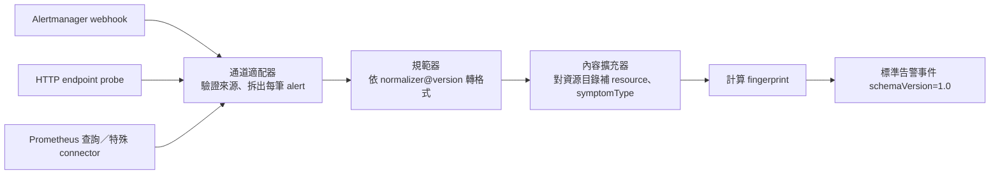
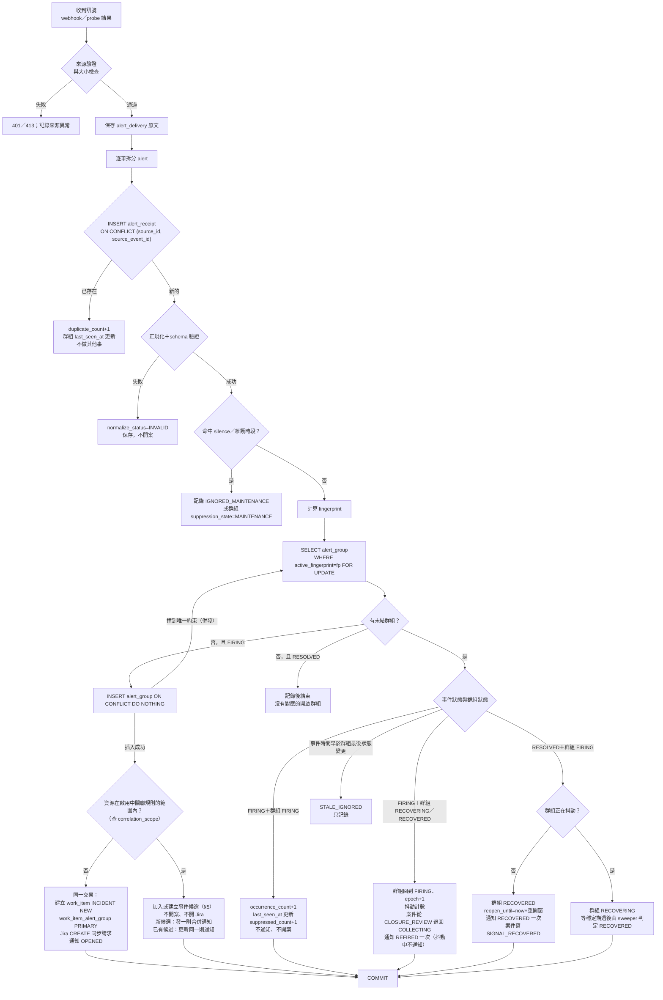
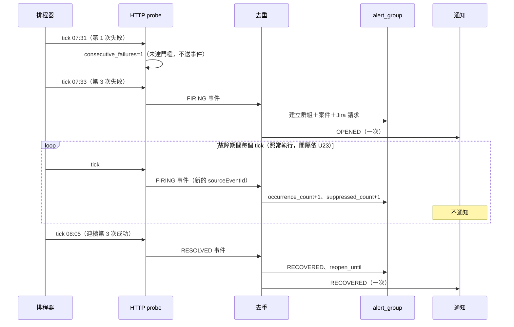
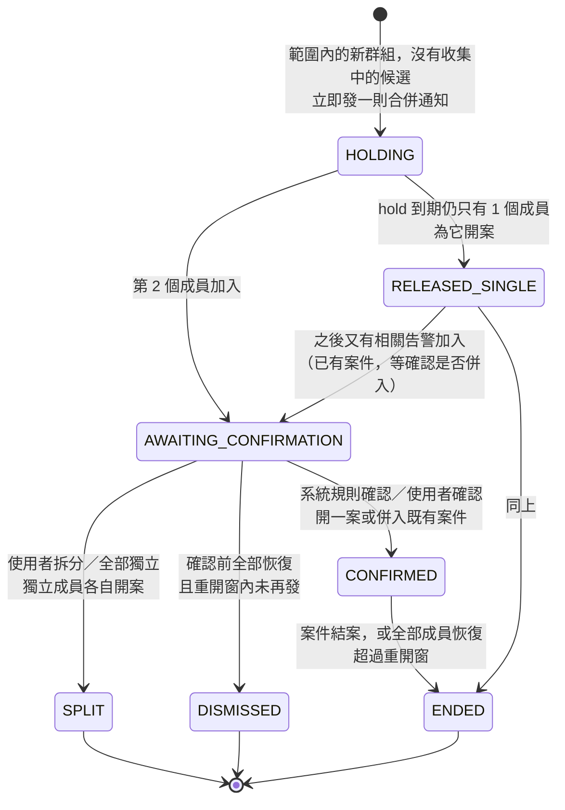

# 監控事件格式與去重設計

| 項目 | 內容 |
|---|---|
| 文件性質 | 設計草案，搭配 [`aligned-requirements.md`](./aligned-requirements.md)（下稱「需求文件」）§5 |
| 適用 | Prometheus Alertmanager webhook、Prometheus 查詢、既有 API endpoint probe、平台 health profile，以及日後加入的特殊來源 connector |
| 資料庫 | PostgreSQL 16 以上（使用 `gen_random_uuid()`、`jsonb`、`ON CONFLICT`） |
| 標示 | 所有規則與數值都已確認，以需求文件 §0 的 U 編號標示（本文件主要涉及 U4、U5、U6、U16～U19、U23、U24、U27、U29～U34）；需求文件 §16 已無待確認項目 |
| 版本 | 第三版（2026-10-26）：所有規則與數值已確認（U20～U34），不再有待確認項目。第二版：跨資源關聯改為「事件候選」設計（§5，U18），抖動／重開窗數值已確認（U17） |
| EIP 引用 | 《企業集成模式》中譯本，格式為「模式名（節號，書頁）」 |

設計目標：

1. 不論告警從哪個來源進來，都轉成同一種格式（規範數據模型 8.7，p.249），之後的去重、開案、通知、Jira 只依這種格式運作。
2. 同一筆來源訊息重送不會造成第二次處理（冪等接收者 10.11，p.389）。
3. 同一個問題（同一資源＋同一症狀）未結期間只開**一個案件**，後續重複只累計（聚合器 7.7，p.187）。
4. 故障期間持續監控但不重複告警；恢復時只通知一次；抖動不洗版。
5. 併發下仍保證只開一案，靠的是 DB 唯一約束，不是程式內的鎖或記憶體。
6. 一個上游問題造成多個資源同時告警時，**先合併成一則通知、不開案也不開 Jira；確認是同一事件後才開一個案件**（§5，U18）。

---

## 1. 標準告警事件格式（Canonical Alert Event）

### 1.1 處理管線



- 通道適配器（4.8，p.85）：每個 `monitor_source` 一個 adapter，負責認證、大小限制，以及把 Alertmanager 的批次 webhook 拆成單筆 alert。
- 規範器（8.6，p.247）：每種來源一個 normalizer，有版本（例如 `alertmanager-v4@1`），轉出相同的標準結構。
- 內容擴充器（8.3，p.236）：以 `resource_mapping_rule` 與資源目錄（SD-05）把來源的 labels 解析成平台的 `resource.resourceId`；用 `symptom_mapping` 把 `alertname` 等來源代碼對應到平台的 `symptomType`。
- 格式指示符（5.10，p.118）：`schemaVersion` 讓格式可以演進；`fingerprintVersion` 讓 fingerprint 算法可以升版而不混用。

### 1.2 欄位表

| 欄位 | 型別 | 必填 | 意義 | 範例 |
|---|---|---|---|---|
| `schemaVersion` | string | 是 | 標準事件格式版本 | `"1.0"` |
| `eventId` | string(uuid) | 是 | 平台在接收時產生的事件 ID；全平台唯一 | `"5f0c3a2e-8a7b-4c1d-9e55-2b7f0d1a9c41"` |
| `source.type` | enum | 是 | 來源類型：`PROMETHEUS_ALERTMANAGER`、`PROMETHEUS_QUERY`、`HTTP_ENDPOINT_PROBE`、`PLATFORM_HEALTH_PROFILE`、`CUSTOM_CONNECTOR`、`USER_REPORT` | `"PROMETHEUS_ALERTMANAGER"` |
| `source.sourceId` | string | 是 | 已登錄的 `monitor_source.source_id` | `"am-prod-01"` |
| `source.normalizer` | string | 是 | 使用的 normalizer 與版本 | `"alertmanager-v4@1"` |
| `source.link` | string(uri) | 否 | 回到來源的連結（Prometheus graph、probe 設定頁） | `"http://prom:9090/graph?g0.expr=..."` |
| `sourceEventId` | string | 是 | 來源中這筆訊號的穩定 ID；與 `source.sourceId` 合起來做冪等接收。算法見 §1.5 | `"a1b2c3d4e5f60718:1792999800000:firing"` |
| `sourceFingerprint` | string | 否 | 來源自己的指紋（Alertmanager `alerts[].fingerprint`）；只作追溯，**不作平台去重鍵** | `"a1b2c3d4e5f60718"` |
| `fingerprint` | string(64 hex) | 是 | 平台去重鍵；同一資源＋同一症狀＋區分維度相同就相同。算法見 §2 | `"9d4c…e1"` |
| `fingerprintVersion` | string | 是 | fingerprint 算法版本 | `"fp-v1"` |
| `resource.resourceId` | string | 是 | 平台資源目錄的穩定 ID；解析不到時為 `unresolved:` 開頭的替代鍵 | `"vm-jenkins-01"` |
| `resource.resourceType` | string | 是 | 資源類型 | `"VM"`、`"SERVICE_INSTANCE"`、`"STORAGE"` |
| `resource.resolution` | enum | 是 | `RESOLVED`（解析成功）或 `UNRESOLVED`（目錄缺資料，仍開案並標示要補目錄） | `"RESOLVED"` |
| `resource.environment` | string | 是 | 環境 | `"PROD"`、`"UAT"` |
| `resource.serviceRefs` | string[] | 否 | 相關服務 labels（零到多個） | `["svc-jenkins-ci"]` |
| `resource.displayName` | string | 否 | 顯示名稱；**不作身分** | `"Jenkins CI VM 01"` |
| `symptom.type` | enum | 是 | 平台症狀分類（§1.3） | `"DISK_USAGE_HIGH"` |
| `symptom.code` | string | 是 | 來源原始代碼（alertname、probe check ID） | `"NodeFilesystemAlmostFull"` |
| `symptom.discriminator` | object | 否 | 同一資源同一症狀下還要分開的維度（例如 mountpoint）；會納入 fingerprint | `{"mountpoint": "/var/log"}` |
| `severity` | enum | 是 | `CRITICAL`、`MAJOR`、`MINOR`、`WARNING`、`INFO`；**不納入 fingerprint**，所以升級時仍是同一群組 | `"MAJOR"` |
| `status` | enum | 是 | `FIRING` 或 `RESOLVED` | `"FIRING"` |
| `observedAt` | string(date-time) | 是 | 這次訊號的觀測時間（UTC）。Alertmanager 用 FIRING 的 `startsAt`／RESOLVED 的 `endsAt`；probe 用實際執行時間 | `"2026-10-26T07:30:00Z"` |
| `startsAt` | string(date-time) | 否 | 來源判定開始時間 | `"2026-10-26T07:30:00Z"` |
| `endsAt` | string(date-time) | 否 | 來源判定結束時間；FIRING 時通常為空 | `null` |
| `receivedAt` | string(date-time) | 是 | 平台收到時間 | `"2026-10-26T07:30:04Z"` |
| `summary` | string(≤256) | 是 | 安全摘要（經 SecretFilter）；不可含秘密 | `"/var/log 使用率 93%"` |
| `description` | string(≤4000) | 否 | 安全描述 | `"可用空間低於 10% 已持續 5 分鐘"` |
| `measurement` | object | 否 | `{name, value, unit, threshold, comparator}` | `{"name":"fs_used_ratio","value":0.93,"unit":"ratio","threshold":0.9,"comparator":">"}` |
| `labels` | object<string,string> | 是 | 來源 labels 的**安全白名單副本**（可為空物件）；原始完整 labels 在 raw payload | `{"job":"node","instance":"10.1.2.3:9100"}` |
| `annotations` | object<string,string> | 否 | 安全化後的 annotations（runbook_url 等）；內容是資料，不是指令 | `{"runbook_url":"https://..."}` |
| `evidenceRefs` | array | 否 | `[{evidenceId, kind, uri, sha256}]`；指向 evidence_record（probe 回應、查詢結果） | 見範例 |
| `rawRef` | object | 是 | 原始 payload 的位置與 hash：`{receiptId, deliveryId, payloadSha256}` | 見範例 |
| `correlationId` | string(uuid) | 否 | 入站可為空；平台歸群組後設為該群組所屬案件的 `work_item.item_id`，之後所有下游事件、Jira 同步、執行都帶這個 ID（關聯標識符 5.7，p.107） | `null` → `"0d9e…"` |
| `causationId` | string | 否 | 造成這筆事件的上一筆事件（例如 probe 排程 tick ID、POST_CHANGE 驗證） | `"tick:http-nexus-health:2026-10-26T07:31:00Z"` |
| `traceparent` | string | 否 | W3C trace context，方便串接 OpenTelemetry | `"00-…-01"` |

### 1.3 症狀分類 `symptom.type`（初版，可擴充）

`SERVICE_UNAVAILABLE`、`HEALTH_CHECK_FAILED`、`HIGH_LATENCY`、`ERROR_RATE_HIGH`、`DISK_USAGE_HIGH`、`LOG_VOLUME_HIGH`、`STORAGE_UNRESPONSIVE`、`RESOURCE_SATURATION`（CPU、記憶體、連線數）、`CERTIFICATE_EXPIRING`、`BACKUP_FAILED`、`JOB_FAILED`、`REPLICATION_LAG`、`CONFIG_DRIFT`、`MONITOR_SOURCE_UNAVAILABLE`、`OTHER`。

- 分類存在 `symptom_type` 參考表；新增分類＝加一列，不改程式。
- 對不到的來源代碼一律 `OTHER`，並強制把 `symptom.code` 放進 discriminator，避免不同的未知告警被誤併。

### 1.4 JSON Schema

```json
{
  "$schema": "https://json-schema.org/draft/2020-12/schema",
  "$id": "https://ops.example.internal/schemas/canonical-alert-event/1.0.json",
  "title": "CanonicalAlertEvent",
  "type": "object",
  "additionalProperties": false,
  "required": [
    "schemaVersion", "eventId", "source", "sourceEventId", "fingerprint",
    "fingerprintVersion", "resource", "symptom", "severity", "status",
    "observedAt", "receivedAt", "summary", "labels", "rawRef"
  ],
  "properties": {
    "schemaVersion": { "const": "1.0" },
    "eventId": { "type": "string", "format": "uuid" },
    "source": {
      "type": "object",
      "additionalProperties": false,
      "required": ["type", "sourceId", "normalizer"],
      "properties": {
        "type": {
          "enum": ["PROMETHEUS_ALERTMANAGER", "PROMETHEUS_QUERY", "HTTP_ENDPOINT_PROBE",
                   "PLATFORM_HEALTH_PROFILE", "CUSTOM_CONNECTOR", "USER_REPORT"]
        },
        "sourceId": { "type": "string", "pattern": "^[a-z0-9][a-z0-9-]{1,62}$" },
        "normalizer": { "type": "string", "pattern": "^[a-z0-9.-]+@[0-9]+$" },
        "link": { "type": "string", "format": "uri", "maxLength": 2048 }
      }
    },
    "sourceEventId": { "type": "string", "minLength": 1, "maxLength": 512 },
    "sourceFingerprint": { "type": "string", "maxLength": 128 },
    "fingerprint": { "type": "string", "pattern": "^[0-9a-f]{64}$" },
    "fingerprintVersion": { "type": "string", "pattern": "^fp-v[0-9]+$" },
    "resource": {
      "type": "object",
      "additionalProperties": false,
      "required": ["resourceId", "resourceType", "resolution", "environment"],
      "properties": {
        "resourceId": { "type": "string", "maxLength": 200 },
        "resourceType": { "type": "string", "maxLength": 64 },
        "resolution": { "enum": ["RESOLVED", "UNRESOLVED"] },
        "environment": { "type": "string", "maxLength": 32 },
        "serviceRefs": { "type": "array", "items": { "type": "string", "maxLength": 100 }, "maxItems": 20 },
        "displayName": { "type": "string", "maxLength": 200 }
      }
    },
    "symptom": {
      "type": "object",
      "additionalProperties": false,
      "required": ["type", "code"],
      "properties": {
        "type": { "type": "string", "pattern": "^[A-Z][A-Z0-9_]{1,63}$" },
        "code": { "type": "string", "maxLength": 200 },
        "discriminator": {
          "type": "object",
          "maxProperties": 8,
          "additionalProperties": { "type": "string", "maxLength": 256 }
        }
      }
    },
    "severity": { "enum": ["CRITICAL", "MAJOR", "MINOR", "WARNING", "INFO"] },
    "status": { "enum": ["FIRING", "RESOLVED"] },
    "observedAt": { "type": "string", "format": "date-time" },
    "startsAt": { "type": ["string", "null"], "format": "date-time" },
    "endsAt": { "type": ["string", "null"], "format": "date-time" },
    "receivedAt": { "type": "string", "format": "date-time" },
    "summary": { "type": "string", "minLength": 1, "maxLength": 256 },
    "description": { "type": "string", "maxLength": 4000 },
    "measurement": {
      "type": "object",
      "additionalProperties": false,
      "required": ["name", "value"],
      "properties": {
        "name": { "type": "string", "maxLength": 128 },
        "value": { "type": ["number", "string"] },
        "unit": { "type": "string", "maxLength": 32 },
        "threshold": { "type": ["number", "string", "null"] },
        "comparator": { "enum": [">", ">=", "<", "<=", "==", "!=", null] }
      }
    },
    "labels": {
      "type": "object",
      "maxProperties": 64,
      "additionalProperties": { "type": "string", "maxLength": 512 }
    },
    "annotations": {
      "type": "object",
      "maxProperties": 32,
      "additionalProperties": { "type": "string", "maxLength": 4000 }
    },
    "evidenceRefs": {
      "type": "array",
      "maxItems": 20,
      "items": {
        "type": "object",
        "additionalProperties": false,
        "required": ["evidenceId", "kind"],
        "properties": {
          "evidenceId": { "type": "string", "format": "uuid" },
          "kind": { "enum": ["PROBE_RESPONSE", "QUERY_RESULT", "LOG_EXCERPT", "METRIC_SNAPSHOT", "USER_ATTACHMENT"] },
          "uri": { "type": "string", "maxLength": 2048 },
          "sha256": { "type": "string", "pattern": "^[0-9a-f]{64}$" }
        }
      }
    },
    "rawRef": {
      "type": "object",
      "additionalProperties": false,
      "required": ["receiptId", "payloadSha256"],
      "properties": {
        "receiptId": { "type": "string", "format": "uuid" },
        "deliveryId": { "type": ["string", "null"], "format": "uuid" },
        "payloadSha256": { "type": "string", "pattern": "^[0-9a-f]{64}$" }
      }
    },
    "correlationId": { "type": ["string", "null"], "format": "uuid" },
    "causationId": { "type": ["string", "null"], "maxLength": 256 },
    "traceparent": { "type": ["string", "null"], "pattern": "^[0-9a-f]{2}-[0-9a-f]{32}-[0-9a-f]{16}-[0-9a-f]{2}$" }
  },
  "allOf": [
    {
      "if": { "properties": { "symptom": { "properties": { "type": { "const": "OTHER" } } } } },
      "then": { "properties": { "symptom": { "required": ["discriminator"] } } }
    }
  ]
}
```

### 1.5 `sourceEventId` 規則

| 來源 | `sourceEventId` | 理由 |
|---|---|---|
| Alertmanager | `{alerts[].fingerprint}:{startsAt 的 epoch 毫秒}:{status}` | Alertmanager 在 5xx 時會重送同一則通知；同一個 alert 的同一個 firing／resolved 時段，這三項固定。`repeat_interval` 的重複通知也會得到相同 ID → 只當「仍在觸發」的心跳，不算新的一次（§4.2） |
| HTTP endpoint probe | `{check_id}:{排程 tick 時間 ISO-8601}:{FIRING／RESOLVED}` | 每個 tick 只會有一筆結果；排程重入或 worker 重啟重跑同一個 tick 不會重複 |
| Prometheus 查詢 | `{check_id}:{評估時間}:{status}` | 同上 |
| 特殊 connector | 由 connector 契約定義，必須是穩定值；不能用接收時間或亂數 | 確保冪等 |
| 使用者回報 | `{item_id}:{report_seq}` | 同一案件內的回報不重複 |

### 1.6 Alertmanager webhook 欄位對照

Alertmanager webhook（`version: "4"`）結構：`version`、`groupKey`、`truncatedAlerts`、`status`、`receiver`、`groupLabels`、`commonLabels`、`commonAnnotations`、`externalURL`、`alerts[]`（每筆有 `status`、`labels`、`annotations`、`startsAt`、`endsAt`、`generatorURL`、`fingerprint`）。

| Alertmanager 欄位 | 標準事件欄位 | 轉換規則 |
|---|---|---|
| 整個 HTTP body | `alert_delivery.raw_body`、`rawRef.deliveryId` | 原樣保存，計算 sha256 |
| `version` | — | 只接受 `"4"`；其他版本進 INVALID（非法消息通道 4.5，p.77） |
| `groupKey`、`receiver`、`groupLabels` | `alert_delivery` 欄位 | 只作追溯；**不作去重**，因為 Alertmanager 的分組設定可能改變 |
| `truncatedAlerts` | `alert_delivery.truncated_alerts` | 大於 0 時寫入平台事件 `MONITOR_SOURCE_TRUNCATED`，提醒調整 `max_alerts` |
| `status`（整體） | — | 不使用；以每筆 `alerts[].status` 為準 |
| `externalURL` | `source.link` 的前綴 | — |
| `alerts[].status` | `status` | `firing` → `FIRING`；`resolved` → `RESOLVED` |
| `alerts[].fingerprint` | `sourceFingerprint`、`sourceEventId` 的一部分 | 不作平台 fingerprint |
| `alerts[].labels.alertname` | `symptom.code` | 經 `symptom_mapping` 對應 `symptom.type` |
| `alerts[].labels.severity` | `severity` | 對應表：`critical`→CRITICAL、`major`/`error`→MAJOR、`minor`→MINOR、`warning`→WARNING、`info`/`none`→INFO；缺值→WARNING |
| `alerts[].labels.instance`／`job`／`namespace`／`pod`／`service`／`env` 等 | `resource.*` | 依 `resource_mapping_rule` 解析；例如 `instance=10.1.2.3:9100` 加上 `env=prod` 對應到 `service_endpoint`，再找到 `vm-jenkins-01` |
| 其他 `alerts[].labels` | `labels`（白名單）、`symptom.discriminator`（rule 指定的 key） | 白名單外的 labels 只留在 raw |
| `alerts[].annotations.summary`／`description` | `summary`／`description` | 先經 SecretFilter；annotations 內容一律當資料 |
| `alerts[].annotations.runbook_url` | `annotations.runbook_url` | 只顯示連結，不自動抓取 |
| `alerts[].annotations.value`（若有） | `measurement.value` | 選用 |
| `alerts[].startsAt` | `startsAt`；FIRING 時也作為 `observedAt` | UTC |
| `alerts[].endsAt` | `endsAt`；RESOLVED 時也作為 `observedAt` | firing 時常是 `0001-01-01T00:00:00Z`，轉成 `null` |
| `alerts[].generatorURL` | `source.link` | — |

### 1.7 範例一：Prometheus（Alertmanager webhook）

收到的 webhook（節錄）：

```json
{
  "version": "4",
  "groupKey": "{}:{alertname=\"NodeFilesystemAlmostFull\"}",
  "truncatedAlerts": 0,
  "status": "firing",
  "receiver": "ai-devops-platform",
  "groupLabels": { "alertname": "NodeFilesystemAlmostFull" },
  "commonLabels": { "alertname": "NodeFilesystemAlmostFull", "severity": "major", "env": "prod" },
  "commonAnnotations": {},
  "externalURL": "http://alertmanager.prod.internal:9093",
  "alerts": [
    {
      "status": "firing",
      "labels": {
        "alertname": "NodeFilesystemAlmostFull",
        "severity": "major",
        "env": "prod",
        "job": "node",
        "instance": "10.1.2.3:9100",
        "mountpoint": "/var/log",
        "device": "/dev/sdb1",
        "fstype": "xfs"
      },
      "annotations": {
        "summary": "/var/log 使用率 93%",
        "description": "可用空間低於 10% 已持續 5 分鐘",
        "runbook_url": "https://gitlab.internal/ops/knowledge/-/blob/main/runbooks/disk-log-full.md"
      },
      "startsAt": "2026-10-26T07:30:00Z",
      "endsAt": "0001-01-01T00:00:00Z",
      "generatorURL": "http://prometheus.prod.internal:9090/graph?g0.expr=...",
      "fingerprint": "a1b2c3d4e5f60718"
    }
  ]
}
```

轉換後的標準事件：

```json
{
  "schemaVersion": "1.0",
  "eventId": "5f0c3a2e-8a7b-4c1d-9e55-2b7f0d1a9c41",
  "source": {
    "type": "PROMETHEUS_ALERTMANAGER",
    "sourceId": "am-prod-01",
    "normalizer": "alertmanager-v4@1",
    "link": "http://prometheus.prod.internal:9090/graph?g0.expr=..."
  },
  "sourceEventId": "a1b2c3d4e5f60718:1792999800000:firing",
  "sourceFingerprint": "a1b2c3d4e5f60718",
  "fingerprint": "3f6a1c0d9b2e4f78a5c3d1e0b9a8f7e6d5c4b3a2918070f6e5d4c3b2a1908f7e",
  "fingerprintVersion": "fp-v1",
  "resource": {
    "resourceId": "vm-jenkins-01",
    "resourceType": "VM",
    "resolution": "RESOLVED",
    "environment": "PROD",
    "serviceRefs": ["svc-jenkins-ci"],
    "displayName": "Jenkins CI VM 01"
  },
  "symptom": {
    "type": "DISK_USAGE_HIGH",
    "code": "NodeFilesystemAlmostFull",
    "discriminator": { "mountpoint": "/var/log" }
  },
  "severity": "MAJOR",
  "status": "FIRING",
  "observedAt": "2026-10-26T07:30:00Z",
  "startsAt": "2026-10-26T07:30:00Z",
  "endsAt": null,
  "receivedAt": "2026-10-26T07:30:04Z",
  "summary": "/var/log 使用率 93%",
  "description": "可用空間低於 10% 已持續 5 分鐘",
  "labels": { "job": "node", "instance": "10.1.2.3:9100", "mountpoint": "/var/log", "env": "prod" },
  "annotations": { "runbook_url": "https://gitlab.internal/ops/knowledge/-/blob/main/runbooks/disk-log-full.md" },
  "evidenceRefs": [],
  "rawRef": {
    "receiptId": "b7e2d0c4-1f3a-4e8b-9c6d-0a1b2c3d4e5f",
    "deliveryId": "c8f3e1d5-2a4b-4f9c-8d7e-1b2c3d4e5f60",
    "payloadSha256": "e3b0c44298fc1c149afbf4c8996fb92427ae41e4649b934ca495991b7852b855"
  },
  "correlationId": null,
  "causationId": null,
  "traceparent": null
}
```

（`fingerprint`、`payloadSha256` 為示意值。）

### 1.8 範例二：既有 API endpoint probe

`monitor_check`：`http-nexus-health`，`GET https://nexus.prod.internal/service/rest/v1/status/writable`，timeout 10 秒，HTTP 200 才算成功，`fail_threshold=3`、`recover_threshold=3`、interval 60 秒。連續第 3 次逾時，判定 FIRING：

```json
{
  "schemaVersion": "1.0",
  "eventId": "8a1d2e3f-4b5c-4d6e-8f70-91a2b3c4d5e6",
  "source": {
    "type": "HTTP_ENDPOINT_PROBE",
    "sourceId": "platform-http-probe",
    "normalizer": "http-probe@1",
    "link": "https://ops.example.internal/monitor-checks/http-nexus-health"
  },
  "sourceEventId": "http-nexus-health:2026-10-26T07:33:00Z:FIRING",
  "fingerprint": "7c1e9a0b3d5f4e2a8b6c0d9e1f2a3b4c5d6e7f8091a2b3c4d5e6f708192a3b4c",
  "fingerprintVersion": "fp-v1",
  "resource": {
    "resourceId": "svc-nexus-prod-01",
    "resourceType": "SERVICE_INSTANCE",
    "resolution": "RESOLVED",
    "environment": "PROD",
    "serviceRefs": ["svc-nexus"]
  },
  "symptom": {
    "type": "SERVICE_UNAVAILABLE",
    "code": "http-nexus-health",
    "discriminator": { "endpoint": "status/writable" }
  },
  "severity": "CRITICAL",
  "status": "FIRING",
  "observedAt": "2026-10-26T07:33:10Z",
  "startsAt": "2026-10-26T07:31:00Z",
  "endsAt": null,
  "receivedAt": "2026-10-26T07:33:10Z",
  "summary": "Nexus writable 檢查連續 3 次逾時（10 秒）",
  "measurement": { "name": "http_response_seconds", "value": "timeout", "unit": "s", "threshold": 10, "comparator": ">=" },
  "labels": { "check_id": "http-nexus-health", "method": "GET", "consecutive_failures": "3" },
  "evidenceRefs": [
    { "evidenceId": "e1f2a3b4-c5d6-4e7f-8091-a2b3c4d5e6f7", "kind": "PROBE_RESPONSE", "sha256": "0f1e2d3c4b5a69788796a5b4c3d2e1f00f1e2d3c4b5a69788796a5b4c3d2e1f0" }
  ],
  "rawRef": {
    "receiptId": "f0e1d2c3-b4a5-4968-8776-5a4b3c2d1e0f",
    "deliveryId": null,
    "payloadSha256": "1a2b3c4d5e6f708192a3b4c5d6e7f8091a2b3c4d5e6f708192a3b4c5d6e7f809"
  },
  "correlationId": null,
  "causationId": "tick:http-nexus-health:2026-10-26T07:33:00Z"
}
```

恢復時，連續 3 次 HTTP 200 後產生 `status=RESOLVED`、`sourceEventId="http-nexus-health:2026-10-26T08:05:00Z:RESOLVED"` 的事件，其他識別欄位相同，因此 fingerprint 相同。

---

## 2. Fingerprint 計算

### 2.1 算法 `fp-v1`

```text
fp_input = "fp-v1"
         + "\n" + upper(environment)
         + "\n" + resource_id                      -- 解析後的平台資源 ID
         + "\n" + symptom_type
         + "\n" + canonical(discriminator)         -- key 排序後 "k=v" 以 "\n" 串接；值做 NFC 正規化與 trim
fingerprint = lower(hex(sha256(utf8(fp_input))))
```

**納入**：環境、資源、症狀、discriminator。discriminator 只能包含 `symptom_mapping` 為這個症狀指定的 label key（例如磁碟用 `mountpoint`、HTTP 用 `endpoint`、Jenkins 用 `job_full_name`）；`OTHER` 一律加 `code`。

**不納入**：
- `severity`：讓 WARNING → CRITICAL 仍是同一群組（升級另外處理，見 §4.3）；
- 數值、時間、`generatorURL`、annotations；
- 每次重啟都會變的 label，例如 pod 名稱 hash、container ID、replica 序號。它們以資源目錄映射到穩定的 workload／service 資源；
- 來源 ID 與來源類型：**同一資源同一症狀，即使分別由 Prometheus 與 API probe 偵測到，也會落在同一群組**，避免重複開案。

### 2.2 資源解析不到時

- `resource_id = "unresolved:" + source_id + ":" + left(sha256(排序後的 identity labels), 16)`；identity labels 由 mapping rule 指定（例如 `instance`、`job`、`namespace`）。
- 仍然開案，案件標記 `resource_resolution=UNRESOLVED`，並在案件中提示補資源目錄。
- 補齊目錄後，**不回頭改舊群組的 fingerprint**；新事件會產生新的 fingerprint，所以要在補目錄時，把未結的 unresolved 群組以 `merged_into_group_id` 手動或自動併到新群組，案件標 `DUPLICATE`。

### 2.3 升版

改算法時建立 `fp-v2`；未結群組保留原 fingerprint 到結案為止。過渡期 normalizer 同時計算 v1 與 v2，用 v1 查找未結群組，找不到才用 v2 開新群組。

---

## 3. 資料結構（PostgreSQL DDL）

```sql
-- =========================================================
-- 0. 參考表
-- =========================================================
CREATE TABLE monitor_source (
    source_id            text PRIMARY KEY CHECK (source_id ~ '^[a-z0-9][a-z0-9-]{1,62}$'),
    source_type          text NOT NULL CHECK (source_type IN (
                           'PROMETHEUS_ALERTMANAGER','PROMETHEUS_QUERY','HTTP_ENDPOINT_PROBE',
                           'PLATFORM_HEALTH_PROFILE','CUSTOM_CONNECTOR','USER_REPORT')),
    display_name         text NOT NULL,
    endpoint_ref         text,
    credential_ref       text,                       -- 只存 secret reference
    auth_scheme          text,                       -- BEARER / BASIC / MTLS / NONE
    normalizer_ref       text NOT NULL,              -- e.g. alertmanager-v4@1
    mapping_rule_ref     text,
    enabled              boolean NOT NULL DEFAULT false,
    config_version       integer NOT NULL DEFAULT 1,
    created_at           timestamptz NOT NULL DEFAULT now(),
    updated_at           timestamptz NOT NULL DEFAULT now()
);

CREATE TABLE symptom_type (
    symptom_type         text PRIMARY KEY CHECK (symptom_type ~ '^[A-Z][A-Z0-9_]{1,63}$'),
    description          text NOT NULL,
    discriminator_keys   text[] NOT NULL DEFAULT '{}'   -- 納入 fingerprint 的 label key
);

-- =========================================================
-- 1. 原始接收（冪等接收者 10.11）
-- =========================================================
-- 一次 HTTP webhook 呼叫（Alertmanager 一次可帶多筆 alert）
CREATE TABLE alert_delivery (
    delivery_id          uuid PRIMARY KEY DEFAULT gen_random_uuid(),
    source_id            text NOT NULL REFERENCES monitor_source(source_id),
    received_at          timestamptz NOT NULL DEFAULT now(),
    body_sha256          char(64) NOT NULL,
    raw_body             jsonb NOT NULL,             -- 原文，不可修改；保存期限依 NFR-A8
    group_key            text,
    receiver             text,
    truncated_alerts     integer NOT NULL DEFAULT 0,
    alert_count          integer NOT NULL
);

-- 每一筆來源訊號一列；(source_id, source_event_id) 唯一
CREATE TABLE alert_receipt (
    receipt_id           uuid PRIMARY KEY DEFAULT gen_random_uuid(),
    source_id            text NOT NULL REFERENCES monitor_source(source_id),
    source_event_id      text NOT NULL,
    delivery_id          uuid REFERENCES alert_delivery(delivery_id),
    payload_sha256       char(64) NOT NULL,          -- 單筆 alert 正規化前內容的 hash
    raw_alert            jsonb NOT NULL,
    first_received_at    timestamptz NOT NULL DEFAULT now(),
    last_received_at     timestamptz NOT NULL DEFAULT now(),
    duplicate_count      integer NOT NULL DEFAULT 0, -- 同鍵重送次數（不算新的 occurrence）
    payload_conflict     boolean NOT NULL DEFAULT false, -- 同鍵但 hash 不同
    normalize_status     text NOT NULL DEFAULT 'PENDING'
                         CHECK (normalize_status IN ('PENDING','NORMALIZED','INVALID','IGNORED_STALE','IGNORED_MAINTENANCE')),
    normalize_error      text,
    event_id             uuid UNIQUE,                -- 標準事件 ID
    canonical_event      jsonb,                      -- 標準事件全文（schemaVersion 1.0）
    fingerprint          char(64),
    fingerprint_version  text,
    event_status         text CHECK (event_status IN ('FIRING','RESOLVED')),
    observed_at          timestamptz,
    group_id             uuid,                       -- 歸入的告警群組（FK 見下）
    CONSTRAINT uq_alert_receipt_source_event UNIQUE (source_id, source_event_id)
);
CREATE INDEX ix_alert_receipt_group ON alert_receipt (group_id, observed_at);
CREATE INDEX ix_alert_receipt_fp    ON alert_receipt (fingerprint, observed_at);

-- =========================================================
-- 2. 告警群組（聚合器 7.7）
-- =========================================================
CREATE TABLE alert_group (
    group_id             uuid PRIMARY KEY DEFAULT gen_random_uuid(),
    fingerprint          char(64) NOT NULL,
    fingerprint_version  text NOT NULL,
    -- 未結時 = fingerprint，CLOSED 時設為 NULL；唯一約束保證同一 fingerprint 只有一個未結群組
    active_fingerprint   char(64),
    environment          text NOT NULL,
    resource_id          text NOT NULL,
    resource_resolution  text NOT NULL CHECK (resource_resolution IN ('RESOLVED','UNRESOLVED')),
    symptom_type         text NOT NULL REFERENCES symptom_type(symptom_type),
    discriminator        jsonb NOT NULL DEFAULT '{}',
    status               text NOT NULL
                         CHECK (status IN ('FIRING','RECOVERING','RECOVERED','CLOSED')),
    is_flapping          boolean NOT NULL DEFAULT false,
    suppression_state    text NOT NULL DEFAULT 'NONE'
                         CHECK (suppression_state IN ('NONE','SUPPRESSED_OPEN','MAINTENANCE','SILENCED')),
    group_epoch          integer NOT NULL DEFAULT 1,  -- 每次 RECOVERED → FIRING 重開 +1
    severity_current     text NOT NULL,
    severity_max         text NOT NULL,
    first_seen_at        timestamptz NOT NULL,
    last_seen_at         timestamptz NOT NULL,        -- 最後一次收到任何相關訊號（含重送心跳）
    last_firing_at       timestamptz NOT NULL,
    last_resolved_at     timestamptz,
    last_state_change_at timestamptz NOT NULL,        -- 用來判斷亂序事件
    recovering_since     timestamptz,
    recovered_at         timestamptz,
    reopen_until         timestamptz,                 -- RECOVERED 後的重開窗截止
    occurrence_count     bigint NOT NULL DEFAULT 1,   -- 不同 sourceEventId 的 FIRING 次數
    duplicate_count      bigint NOT NULL DEFAULT 0,   -- 同鍵重送／重複通知次數
    suppressed_count     bigint NOT NULL DEFAULT 0,   -- 因群組未結而未通知的次數
    flap_window_start    timestamptz,
    flap_transitions     integer NOT NULL DEFAULT 0,  -- 窗內 FIRING↔RESOLVED 切換次數
    source_ids           text[] NOT NULL DEFAULT '{}',-- 偵測到此問題的來源
    item_id              uuid,                        -- 主要關聯案件（work_item）
    previous_group_id    uuid REFERENCES alert_group(group_id), -- 結案後復發，連到前一個群組
    merged_into_group_id uuid REFERENCES alert_group(group_id),
    candidate_id         uuid,                        -- 目前所屬的事件候選（§5）；FK 在 §3 第 6 段加上
    created_at           timestamptz NOT NULL DEFAULT now(),
    closed_at            timestamptz,
    row_version          bigint NOT NULL DEFAULT 0,
    CONSTRAINT uq_alert_group_active_fp UNIQUE (active_fingerprint),
    CONSTRAINT ck_active_fp CHECK (
        (status =  'CLOSED' AND active_fingerprint IS NULL AND closed_at IS NOT NULL) OR
        (status <> 'CLOSED' AND active_fingerprint = fingerprint))
);
CREATE INDEX ix_alert_group_resource ON alert_group (resource_id, status);
CREATE INDEX ix_alert_group_item     ON alert_group (item_id);
CREATE INDEX ix_alert_group_sweep    ON alert_group (status, recovering_since, reopen_until)
    WHERE status IN ('RECOVERING','RECOVERED');

ALTER TABLE alert_receipt
    ADD CONSTRAINT fk_receipt_group FOREIGN KEY (group_id) REFERENCES alert_group(group_id);

-- 群組的狀態變化歷史（只追加；重複的 FIRING 不寫這裡，只累計計數）
CREATE TABLE alert_group_event (
    group_id             uuid NOT NULL REFERENCES alert_group(group_id),
    seq                  integer NOT NULL,
    kind                 text NOT NULL CHECK (kind IN (
                           'OPENED','SEVERITY_ESCALATED','RESOLVED_SIGNAL','RECOVERED','REFIRED',
                           'FLAPPING_STARTED','FLAPPING_ENDED','STALE_IGNORED','CANDIDATE_JOINED',
                           'CANDIDATE_CONFIRMED','CANDIDATE_SPLIT_OUT','CANDIDATE_DISMISSED',
                           'MERGED','SILENCED','CLOSED')),
    group_epoch          integer NOT NULL,
    receipt_id           uuid REFERENCES alert_receipt(receipt_id),
    detail               jsonb NOT NULL DEFAULT '{}',
    occurred_at          timestamptz NOT NULL DEFAULT now(),
    PRIMARY KEY (group_id, seq)
);

-- =========================================================
-- 3. 案件連結（work_item 為需求文件 §3.5 的合併主表，這裡只列相關欄位）
-- =========================================================
CREATE TABLE work_item (
    item_id              uuid PRIMARY KEY DEFAULT gen_random_uuid(),
    item_no              text NOT NULL UNIQUE,        -- OPS-0000001234，由序列產生
    item_type            text NOT NULL CHECK (item_type IN ('INCIDENT','REQUIREMENT','DISCUSSION','INQUIRY')),
    status               text NOT NULL CHECK (status IN (
                           'NEW','COLLECTING','WAITING_INPUT','MATCHING','PROPOSING','PENDING_APPROVAL',
                           'APPLYING','VERIFYING','PENDING_HUMAN','CLOSURE_REVIEW','CLOSED')),
    closure_reason       text CHECK (closure_reason IN (
                           'RESOLVED','SELF_RECOVERED','FULFILLED','CONCLUDED','FALSE_POSITIVE',
                           'DUPLICATE','WITHDRAWN','WONT_FIX')),
    source_kind          text NOT NULL CHECK (source_kind IN ('MONITOR','USER','SCHEDULE')),
    title                text NOT NULL,
    environment          text,
    signal_state         text CHECK (signal_state IN ('FIRING','RECOVERED','FLAPPING')),
    blocked_reason       text,
    parent_item_id       uuid REFERENCES work_item(item_id),
    duplicate_of         uuid REFERENCES work_item(item_id),
    created_at           timestamptz NOT NULL DEFAULT now(),
    row_version          bigint NOT NULL DEFAULT 0,
    CONSTRAINT ck_closed_reason CHECK ((status = 'CLOSED') = (closure_reason IS NOT NULL))
);
CREATE SEQUENCE work_item_no_seq;

ALTER TABLE alert_group
    ADD CONSTRAINT fk_group_item FOREIGN KEY (item_id) REFERENCES work_item(item_id);

-- 一個案件可關聯多個群組（事件候選確認後併入、使用者回報合併、unresolved 合併）
CREATE TABLE work_item_alert_group (
    item_id              uuid NOT NULL REFERENCES work_item(item_id),
    group_id             uuid NOT NULL REFERENCES alert_group(group_id),
    link_type            text NOT NULL CHECK (link_type IN ('PRIMARY','CORRELATED','USER_REPORTED','MERGED')),
    linked_at            timestamptz NOT NULL DEFAULT now(),
    PRIMARY KEY (item_id, group_id)
);
-- 每個群組只能有一個 PRIMARY 案件
CREATE UNIQUE INDEX uq_group_primary_item ON work_item_alert_group (group_id) WHERE link_type = 'PRIMARY';
-- 一個群組同時只屬於一個案件（不論 PRIMARY 或 CORRELATED）；移出時刪除連結並寫 case_event
CREATE UNIQUE INDEX uq_group_one_item ON work_item_alert_group (group_id) WHERE link_type IN ('PRIMARY','CORRELATED');

-- 案件事件（只追加，event_id 冪等）
CREATE TABLE case_event (
    item_id              uuid NOT NULL REFERENCES work_item(item_id),
    seq                  integer NOT NULL,
    event_id             uuid NOT NULL UNIQUE,
    type                 text NOT NULL,               -- STATE_CHANGED / SIGNAL_RECOVERED / SIGNAL_REFIRED / ...
    actor                text NOT NULL,               -- principal_id 或 'system'
    payload_safe         jsonb NOT NULL DEFAULT '{}',
    occurred_at          timestamptz NOT NULL DEFAULT now(),
    PRIMARY KEY (item_id, seq)
);

-- =========================================================
-- 4. 通知與 Jira 同步（同一交易寫入，確保「只通知一次」與「一定會補送」）
-- =========================================================
CREATE TABLE notification_outbox (
    notification_id      uuid PRIMARY KEY DEFAULT gen_random_uuid(),
    group_id             uuid REFERENCES alert_group(group_id),
    candidate_id         uuid,                        -- 事件候選的通知（§5.5）；FK 在第 6 段加上
    item_id              uuid REFERENCES work_item(item_id),
    group_epoch          integer NOT NULL DEFAULT 0,  -- 候選提醒時存放提醒序號
    kind                 text NOT NULL CHECK (kind IN (
                           'OPENED','SEVERITY_ESCALATED','RECOVERED','REFIRED','FLAPPING_STARTED',
                           'FLAPPING_ENDED','CANDIDATE_OPENED','CANDIDATE_REMINDER',
                           'CANDIDATE_ALL_RECOVERED','JIRA_SYNC_GAVE_UP')),
    channel              text NOT NULL DEFAULT 'TEAMS',
    payload_safe         jsonb NOT NULL,
    status               text NOT NULL DEFAULT 'PENDING' CHECK (status IN ('PENDING','SENT','FAILED','SKIPPED')),
    created_at           timestamptz NOT NULL DEFAULT now(),
    sent_at              timestamptz,
    -- 同一群組（或同一事件候選）、同一輪、同一種通知只會有一筆 → 「只通知一次」由 DB 保證
    CONSTRAINT uq_notify_once UNIQUE NULLS NOT DISTINCT (group_id, candidate_id, group_epoch, kind, channel)
);

CREATE TABLE external_sync_request (
    request_id           uuid PRIMARY KEY DEFAULT gen_random_uuid(),
    item_id              uuid NOT NULL REFERENCES work_item(item_id),
    destination          text NOT NULL CHECK (destination IN ('JIRA','DOC_PLATFORM')),
    operation            text NOT NULL CHECK (operation IN ('CREATE','UPDATE_FIELDS','TRANSITION','COMMENT')),
    dedup_key            text NOT NULL UNIQUE,        -- 例：jira:create:<item_id>
    desired_version      integer NOT NULL,
    payload_safe         jsonb NOT NULL,
    payload_sha256       char(64) NOT NULL,
    status               text NOT NULL DEFAULT 'PENDING' CHECK (status IN (
                           'PENDING','SENDING','RETRY_WAIT','RECONCILING','SYNCED','PENDING_HUMAN','SUPERSEDED')),
    retry_count          integer NOT NULL DEFAULT 0,  -- 已補送次數
    max_retries          integer NOT NULL DEFAULT 5,  -- U5；間隔算法見 U24
    next_attempt_at      timestamptz NOT NULL DEFAULT now(),
    owner_epoch          bigint NOT NULL DEFAULT 0,
    last_error_class     text,
    created_at           timestamptz NOT NULL DEFAULT now(),
    row_version          bigint NOT NULL DEFAULT 0,
    CONSTRAINT ck_retry_bound CHECK (retry_count <= max_retries)
);
CREATE INDEX ix_sync_due ON external_sync_request (status, next_attempt_at)
    WHERE status IN ('PENDING','RETRY_WAIT','RECONCILING');

-- =========================================================
-- 5. 監控檢查執行狀態（pull 類型；故障期間持續執行）
-- =========================================================
CREATE TABLE monitor_check_state (
    check_id             text PRIMARY KEY,
    last_run_at          timestamptz,
    last_result          text CHECK (last_result IN ('SUCCESS','FAILED','UNKNOWN')),
    consecutive_failures integer NOT NULL DEFAULT 0,
    consecutive_successes integer NOT NULL DEFAULT 0,
    signal_state         text NOT NULL DEFAULT 'OK' CHECK (signal_state IN ('OK','FIRING')),
    current_interval_s   integer NOT NULL,            -- 故障期間可放寬（U23）
    row_version          bigint NOT NULL DEFAULT 0
);

-- =========================================================
-- 6. 抑制、維護時段（U27）
-- =========================================================
CREATE TABLE alert_silence (
    silence_id           uuid PRIMARY KEY DEFAULT gen_random_uuid(),
    scope                text NOT NULL CHECK (scope IN ('FINGERPRINT','RESOURCE','MAINTENANCE_WINDOW')),
    fingerprint          char(64),
    resource_id          text,
    starts_at            timestamptz NOT NULL,
    ends_at              timestamptz NOT NULL CHECK (ends_at > starts_at),
    reason               text NOT NULL,
    created_by           text NOT NULL,
    created_at           timestamptz NOT NULL DEFAULT now()
);

-- =========================================================
-- 7. 跨資源關聯：事件候選（U18，§5）
-- =========================================================
-- 資源依賴關係沿用 SD-05 的資源關係表；這裡只列測試需要的欄位
CREATE TABLE resource_relation (
    from_resource_id     text NOT NULL,               -- 依賴者（下游），例如 vm-jenkins-01
    to_resource_id       text NOT NULL,               -- 被依賴者（上游），例如 st-nas-01
    relation_type        text NOT NULL DEFAULT 'DEPENDS_ON',
    PRIMARY KEY (from_resource_id, to_resource_id, relation_type)
);

CREATE TABLE correlation_rule (
    rule_id              text NOT NULL,
    version              integer NOT NULL,
    upstream_selector    jsonb NOT NULL,   -- {"resourceType":"STORAGE","symptomTypes":["STORAGE_UNRESPONSIVE","SERVICE_UNAVAILABLE"]}
    downstream_relation  text NOT NULL DEFAULT 'DEPENDS_ON',
    max_depth            integer NOT NULL DEFAULT 2  CHECK (max_depth BETWEEN 1 AND 3),
    window_seconds       integer NOT NULL DEFAULT 600 CHECK (window_seconds > 0),   -- 候選收集窗
    hold_seconds         integer NOT NULL DEFAULT 60  CHECK (hold_seconds BETWEEN 0 AND 300), -- 單一成員等待
    auto_confirm         boolean NOT NULL DEFAULT false, -- 團隊驗證過的規則才開啟（§5.4）
    enabled              boolean NOT NULL DEFAULT false,
    published_by         text,
    published_at         timestamptz,
    PRIMARY KEY (rule_id, version)
);
-- 同一規則同時只有一個啟用版本
CREATE UNIQUE INDEX uq_corr_rule_enabled ON correlation_rule (rule_id) WHERE enabled;

-- 關聯範圍：規則或資源目錄變更時重建（不在告警熱路徑上做遞迴查詢）
-- 每一列 = 「resource_id 落在 root_resource_id 的影響範圍內」；root 本身 depth=0
CREATE TABLE correlation_scope (
    rule_id              text NOT NULL,
    rule_version         integer NOT NULL,
    environment          text NOT NULL,
    root_resource_id     text NOT NULL,
    resource_id          text NOT NULL,
    depth                integer NOT NULL CHECK (depth >= 0),
    corr_key             text GENERATED ALWAYS AS (rule_id || ':' || environment || ':' || root_resource_id) STORED,
    PRIMARY KEY (rule_id, environment, root_resource_id, resource_id),
    FOREIGN KEY (rule_id, rule_version) REFERENCES correlation_rule(rule_id, version)
);
CREATE INDEX ix_corr_scope_resource ON correlation_scope (environment, resource_id);

-- 事件候選：多個可能相關的告警群組，在開案前先合併成一個「候選事件」
CREATE TABLE incident_candidate (
    candidate_id         uuid PRIMARY KEY DEFAULT gen_random_uuid(),
    candidate_no         text NOT NULL UNIQUE,        -- EVC-0000000123，給 Teams／Web 顯示
    environment          text NOT NULL,
    status               text NOT NULL CHECK (status IN (
                           'HOLDING',                 -- 只有 1 個成員，等待 hold_seconds
                           'AWAITING_CONFIRMATION',   -- 有待確認成員，尚未確認
                           'RELEASED_SINGLE',         -- hold 到期仍只有 1 個成員，已為它開案
                           'CONFIRMED',               -- 已確認同一事件，已開（或併入）一個案件
                           'SPLIT',                   -- 使用者判定不是同一事件，各自開案
                           'DISMISSED',               -- 未確認前全部恢復且穩定，不開案
                           'ENDED')),                 -- 追蹤結束（案件結案或全部恢復），已釋放關聯鍵
    item_id              uuid UNIQUE REFERENCES work_item(item_id), -- 這個候選唯一的案件
    primary_group_id     uuid REFERENCES alert_group(group_id),
    root_resource_id     text,                        -- 有成員位於關聯鍵的 root（depth=0）時填入
    first_seen_at        timestamptz NOT NULL,
    hold_until           timestamptz NOT NULL,
    window_until         timestamptz NOT NULL,        -- 未確認候選接受新成員的截止
    confirmation_source  text CHECK (confirmation_source IN ('SYSTEM_RULE','USER')),
    confirmed_by         text,                        -- principal_id 或 'system:rule:<rule_id>@<version>'
    confirmed_at         timestamptz,
    confirmation_evidence jsonb,                      -- 系統確認時的證據快照（§5.4 E1–E3）
    decision_note        text,
    reminder_count       integer NOT NULL DEFAULT 0,
    last_reminded_at     timestamptz,
    all_recovered_at     timestamptz,
    created_at           timestamptz NOT NULL DEFAULT now(),
    ended_at             timestamptz,
    row_version          bigint NOT NULL DEFAULT 0,
    CONSTRAINT ck_candidate_item CHECK (status NOT IN ('RELEASED_SINGLE','CONFIRMED') OR item_id IS NOT NULL),
    CONSTRAINT ck_candidate_confirm CHECK (status <> 'CONFIRMED' OR (confirmed_by IS NOT NULL AND confirmation_source IS NOT NULL))
);
CREATE SEQUENCE incident_candidate_no_seq;
CREATE INDEX ix_candidate_sweep ON incident_candidate (status, hold_until, window_until)
    WHERE status IN ('HOLDING','AWAITING_CONFIRMATION','RELEASED_SINGLE','CONFIRMED');

-- 候選持有的關聯鍵；active_key 唯一 → 同一個關聯鍵同時只會有一個在收集中的候選
CREATE TABLE incident_candidate_key (
    candidate_id         uuid NOT NULL REFERENCES incident_candidate(candidate_id),
    corr_key             text NOT NULL,
    active_key           text,                        -- 釋放時設成 NULL（同 active_fingerprint 技巧）
    rule_id              text NOT NULL,
    rule_version         integer NOT NULL,
    PRIMARY KEY (candidate_id, corr_key),
    CONSTRAINT uq_candidate_active_key UNIQUE (active_key),
    CONSTRAINT ck_active_key CHECK (active_key IS NULL OR active_key = corr_key)
);

-- 候選成員：一個告警群組同時只能是一個未結候選的有效成員
CREATE TABLE incident_candidate_member (
    candidate_id         uuid NOT NULL REFERENCES incident_candidate(candidate_id),
    group_id             uuid NOT NULL REFERENCES alert_group(group_id),
    member_state         text NOT NULL CHECK (member_state IN (
                           'PENDING',                 -- 等待確認，沒有案件
                           'IN_CASE',                 -- 已在候選的案件中
                           'SPLIT_OUT',               -- 判定為獨立事件，已開自己的案件
                           'FALSE_POSITIVE',          -- 判定為誤報，不開案（群組關閉並建立 silence）
                           'DISMISSED')),             -- 候選 DISMISSED 時的成員
    depth_from_root      integer,                     -- 在關聯範圍內的深度；root=0
    late_joined          boolean NOT NULL DEFAULT false, -- 確認後才加入（自動併入，可移出）
    active_group_id      uuid,                        -- PENDING／IN_CASE 時 = group_id，其他為 NULL
    joined_at            timestamptz NOT NULL DEFAULT now(),
    decided_by           text,
    decided_at           timestamptz,
    PRIMARY KEY (candidate_id, group_id),
    CONSTRAINT uq_candidate_member_active UNIQUE (active_group_id),
    CONSTRAINT ck_member_active CHECK (
        (member_state IN ('PENDING','IN_CASE') AND active_group_id = group_id) OR
        (member_state NOT IN ('PENDING','IN_CASE') AND active_group_id IS NULL))
);

ALTER TABLE alert_group
    ADD CONSTRAINT fk_group_candidate FOREIGN KEY (candidate_id) REFERENCES incident_candidate(candidate_id);
ALTER TABLE notification_outbox
    ADD CONSTRAINT fk_notify_candidate FOREIGN KEY (candidate_id) REFERENCES incident_candidate(candidate_id);

-- 可原地更新的訊息（Teams 卡片）：保存 activity id，之後的變化都更新同一則
CREATE TABLE notification_message (
    message_id           uuid PRIMARY KEY DEFAULT gen_random_uuid(),
    candidate_id         uuid REFERENCES incident_candidate(candidate_id),
    item_id              uuid REFERENCES work_item(item_id),
    channel              text NOT NULL DEFAULT 'TEAMS',
    conversation_ref     jsonb,                       -- Teams conversation reference
    activity_id          text,                        -- 第一次送出後回填
    render_version       integer NOT NULL DEFAULT 0,  -- 內容每變一次 +1
    sent_version         integer NOT NULL DEFAULT 0,  -- 已成功更新到 Teams 的版本
    last_sent_at         timestamptz,
    next_update_after    timestamptz,                 -- 節流：上次更新 + 30 秒
    CONSTRAINT uq_message_candidate UNIQUE NULLS NOT DISTINCT (candidate_id, item_id, channel),
    CONSTRAINT ck_message_owner CHECK (candidate_id IS NOT NULL OR item_id IS NOT NULL)
);
CREATE INDEX ix_message_due ON notification_message (next_update_after) WHERE render_version > sent_version;
```

設計重點：

| 需求 | 如何保證 |
|---|---|
| 來源重送不重複處理 | `uq_alert_receipt_source_event (source_id, source_event_id)`；`ON CONFLICT` 只累計 `duplicate_count`、更新 `last_received_at` |
| 同鍵不同內容 | `payload_conflict=true`＋稽核事件；不覆寫第一次的原文 |
| 同一 fingerprint 只有一個未結群組 | `uq_alert_group_active_fp` 唯一約束＋`ck_active_fp` 檢查；群組結束時把 `active_fingerprint` 設成 NULL（NULL 不受唯一約束限制），所以之後可以再開新群組 |
| 一個群組只有一個主要案件 | `uq_group_primary_item` 部分唯一索引 |
| 只通知一次 | `uq_notify_once (group_id, candidate_id, group_epoch, kind, channel)` |
| 同一個關聯鍵只有一個收集中的事件候選 | `uq_candidate_active_key`；候選結束或收集窗過後把 `active_key` 設成 NULL |
| 一個群組同時只在一個候選、一個案件裡 | `uq_candidate_member_active`、`uq_group_one_item` |
| 一個候選最多一個案件 | `incident_candidate.item_id UNIQUE`＋狀態檢查（§5.10） |
| 合併通知只有一則 | `CANDIDATE_OPENED` 受 `uq_notify_once` 限制；之後的變化寫 `notification_message.render_version`，原地更新同一則訊息 |
| Jira 建單只一次、一定會補送 | `external_sync_request.dedup_key` 唯一，與開案同一交易；`ck_retry_bound` 限制補送次數 |
| 證據不可變 | `alert_delivery.raw_body`／`alert_receipt.raw_alert` 只新增不更新（以 DB 權限或 trigger 禁止 UPDATE 這兩欄） |

---

## 4. 去重流程

### 4.1 總覽



### 4.2 單筆處理的交易（虛擬碼）

下面的步驟 (5) 是「資源**不在**任何啟用中關聯規則範圍」時的開案路徑。資源在範圍內時，步驟 (5) 改為 §5.6 的「加入或建立事件候選」，其餘步驟相同。§5 的候選決策（hold 到期、確認、拆分）開案時，也重用步驟 (5) 的同一組寫入。

每一筆 alert 一個交易；同一次 webhook 的多筆 alert 依 `observedAt` 排序後逐筆處理，任何一筆失敗只回滾那一筆。全部 receipt 都 commit 後才回 HTTP 200；DB 不可用時回 503，讓 Alertmanager 重送（由冪等接收處理重複）。

```sql
BEGIN;

-- (1) 冪等接收
INSERT INTO alert_receipt (source_id, source_event_id, delivery_id, payload_sha256, raw_alert)
VALUES ($source_id, $source_event_id, $delivery_id, $sha, $raw)
ON CONFLICT (source_id, source_event_id) DO UPDATE
   SET duplicate_count  = alert_receipt.duplicate_count + 1,
       last_received_at = now(),
       payload_conflict = alert_receipt.payload_conflict OR alert_receipt.payload_sha256 <> EXCLUDED.payload_sha256
RETURNING receipt_id, (xmax = 0) AS is_new, group_id;
-- is_new = false：若 group_id 不為空，UPDATE alert_group SET last_seen_at = now(), duplicate_count = duplicate_count + 1；COMMIT 並結束

-- (2) 正規化（程式內完成）→ 寫回 canonical_event、fingerprint、event_status、observed_at

-- (3) 鎖定未結群組
SELECT * FROM alert_group WHERE active_fingerprint = $fp FOR UPDATE;

-- (4a) 沒有群組且 FIRING：嘗試建立
INSERT INTO alert_group (fingerprint, fingerprint_version, active_fingerprint, environment, resource_id,
                         resource_resolution, symptom_type, discriminator, status, severity_current,
                         severity_max, first_seen_at, last_seen_at, last_firing_at, last_state_change_at,
                         source_ids)
VALUES ($fp, 'fp-v1', $fp, $env, $resource_id, $resolution, $symptom, $disc, 'FIRING', $sev,
        $sev, $observed_at, now(), $observed_at, $observed_at, ARRAY[$source_id])
ON CONFLICT (active_fingerprint) DO NOTHING
RETURNING group_id;
-- 沒有回傳列 = 另一個交易剛建好 → 回到 (3) 重新 SELECT ... FOR UPDATE，走「已有群組」分支

-- (5) 插入成功、且 correlation_scope 查不到此資源時（同一交易）；查得到 → 改走 §5.6
INSERT INTO work_item (item_no, item_type, status, source_kind, title, environment, signal_state)
VALUES ('OPS-' || lpad(nextval('work_item_no_seq')::text, 10, '0'), 'INCIDENT', 'NEW', 'MONITOR',
        $title, $env, 'FIRING')
RETURNING item_id;
UPDATE alert_group SET item_id = $item_id WHERE group_id = $group_id;
INSERT INTO work_item_alert_group (item_id, group_id, link_type) VALUES ($item_id, $group_id, 'PRIMARY');
INSERT INTO alert_group_event (group_id, seq, kind, group_epoch, receipt_id) VALUES ($group_id, 1, 'OPENED', 1, $receipt_id);
INSERT INTO case_event (item_id, seq, event_id, type, actor, payload_safe)
VALUES ($item_id, 1, gen_random_uuid(), 'STATE_CHANGED', 'system', '{"to":"NEW","cause":"ALERT_GROUP_OPENED"}');
INSERT INTO external_sync_request (item_id, destination, operation, dedup_key, desired_version, payload_safe, payload_sha256)
VALUES ($item_id, 'JIRA', 'CREATE', 'jira:create:' || $item_id, 1, $jira_payload, $jira_sha);
INSERT INTO notification_outbox (group_id, item_id, group_epoch, kind, payload_safe)
VALUES ($group_id, $item_id, 1, 'OPENED', $notify_payload)
ON CONFLICT ON CONSTRAINT uq_notify_once DO NOTHING;

UPDATE alert_receipt SET group_id = $group_id, normalize_status = 'NORMALIZED' WHERE receipt_id = $receipt_id;
COMMIT;
```

### 4.3 已有未結群組時的規則

群組若是**未確認事件候選的成員**（`member_state='PENDING'`），下表的狀態變化照常執行，但「通知」欄的訊息一律改成**更新候選的那一則合併通知**（§5.5），不另發訊息；沒有案件，所以「對案件的影響」欄不適用。

| 事件 | 群組目前狀態 | 動作 | 通知 | 對案件的影響 |
|---|---|---|---|---|
| FIRING | FIRING | `occurrence_count+1`、`last_seen_at`、`suppressed_count+1`、合併 `source_ids` | 無 | 無（案件畫面顯示次數） |
| FIRING 且嚴重度更高 | FIRING | 同上，並更新 `severity_current`／`severity_max`；寫 `SEVERITY_ESCALATED` | 每一輪（epoch）每個新的最高等級通知一次（U29） | Jira 優先級更新請求 |
| RESOLVED | FIRING（未抖動） | `status=RECOVERED`、`recovered_at`、`reopen_until = now()+重開窗` | `RECOVERED` 一次 | `SIGNAL_RECOVERED`；依需求文件 §5.4 決定是否進 CLOSURE_REVIEW |
| RESOLVED | FIRING（抖動中） | `status=RECOVERING`、`recovering_since` | 無 | 無 |
| FIRING | RECOVERING／RECOVERED（案件未結） | `status=FIRING`、`group_epoch+1`、抖動計數；寫 `REFIRED` | 未抖動時 `REFIRED` 一次；抖動中不通知 | `SIGNAL_REFIRED`；案件若在 CLOSURE_REVIEW，退回 COLLECTING（T26），結案草稿作廢 |
| RESOLVED | RECOVERING／RECOVERED | 只記錄 | 無 | 無 |
| 任何事件，`observed_at < last_state_change_at` 且狀態相反 | 任何 | `STALE_IGNORED`，只記錄 | 無 | 無 |

### 4.4 抖動（flapping）（U17 已確認：30 分鐘內切換 ≥ 3 次、穩定 15 分鐘、重開窗 30 分鐘）

- 每次 FIRING↔RESOLVED 切換時，如果 `now() - flap_window_start > 抖動窗`，就把窗口重設並歸零；否則 `flap_transitions+1`。
- `flap_transitions >= 3`（30 分鐘窗內；已確認，需求文件 U17）→ `is_flapping=true`，通知 `FLAPPING_STARTED` 一次；案件 `signal_state=FLAPPING`。
- 抖動期間：不通知 REFIRED／RECOVERED；收到 RESOLVED 後進 RECOVERING，sweeper 確認**連續 15 分鐘**沒有再 FIRING 才轉 RECOVERED，並通知 `FLAPPING_ENDED` 與 `RECOVERED` 各一次。
- 抖動本身通常就是調查線索，所以案件不會因抖動自動結案。

### 4.5 重開窗

- RECOVERED 後 `reopen_until = recovered_at + 30 分鐘`（已確認，需求文件 U17）。窗口內再 FIRING 就回到同一群組、同一案件（§4.3），**不開新案**。
- 重開窗過後，sweeper 不會主動關閉群組；群組只在**案件 CLOSED 時**關閉（`status=CLOSED`、`active_fingerprint=NULL`、`closed_at`）。所以案件還沒結（例如在 CLOSURE_REVIEW 等使用者確認），同一問題再發生一律回到同一案件。差別是：超過重開窗才再發時，案件事件會標記「恢復超過 30 分鐘後再發，可能是新問題」，提示使用者可以先結掉原案件，下一次觸發就會開新案。
- 案件 CLOSED 之後同一 fingerprint 再 FIRING：建立**新群組、新案件**，`previous_group_id` 指向舊群組，新案件寫入「復發」關聯，方便查詢是否應該做根本改善。

### 4.6 故障期間持續監控、不重複告警



- Pull 類型檢查（probe、Prometheus 查詢、health profile）在故障期間**不停**；`monitor_check_state` 記錄連續失敗與連續成功次數。
- Push 類型（Alertmanager）照常接收 `repeat_interval` 的重送，只累計次數。
- 停止的只有「對這個資源的變更」：由 resource_hold／execution_hold 控制，與監控無關。
- 監控來源本身故障（Alertmanager 連不到、probe worker 停擺）會產生 `MONITOR_SOURCE_UNAVAILABLE` 事件，fingerprint 以 `monitor_source` 為資源，同樣去重；另建議定期注入一筆合成告警（測試消息 11.8，p.416），驗證整條接收、去重、通知管線沒有靜默失效。

### 4.7 在案件關閉時同時關閉群組

案件轉 CLOSED 的同一交易內：

```sql
UPDATE alert_group
   SET status = 'CLOSED', active_fingerprint = NULL, closed_at = now(), row_version = row_version + 1
 WHERE item_id = $item_id AND status <> 'CLOSED';
```

如果群組在關閉當下**仍在 FIRING**（例如誤報 FALSE_POSITIVE 或決定 WONT_FIX），結案流程會要求使用者選擇：(a) 建立 `alert_silence`（FINGERPRINT 範圍，預設 24 小時），期間的事件只記錄不開案；或 (b) 不靜默，下一次 FIRING 會開新案。預設選 (a)（U27）。

### 4.8 併發與失敗情境

| 情境 | 結果 |
|---|---|
| 兩個 worker 同時收到同一 fingerprint 的不同事件（例如 Prometheus 與 probe 同時偵測） | 兩邊都 `SELECT … FOR UPDATE` 查不到 → 都嘗試 INSERT；`uq_alert_group_active_fp` 只讓一個成功，另一個 `DO NOTHING` 後重新 SELECT，取得鎖、走「累計」分支 → **只開一案** |
| Alertmanager 對同一 webhook 重送（平台回 5xx 或逾時） | `uq_alert_receipt_source_event` → `duplicate_count+1`，不重複處理 |
| 開案交易中途失敗 | 群組、案件、Jira 請求、通知一起回滾；receipt 也回滾；Alertmanager 重送時重新處理 |
| Jira 不可用 | 開案照常 commit；`external_sync_request` 依需求文件 §10 補送最多 5 次，仍失敗轉 PENDING_HUMAN，並寫 `JIRA_SYNC_GAVE_UP` 通知一次 |
| 通知送不出去 | `notification_outbox` 保持 PENDING／FAILED，由 worker 重試（通知不屬於維運命令，可重試，但同一 kind 只會有一筆） |
| 事件亂序（RESOLVED 比 FIRING 先到） | 以 `observed_at` 與 `last_state_change_at` 比較；較舊的反向事件記為 `STALE_IGNORED`。沒有群組時收到 RESOLVED，只記錄 |
| 兩個上下游資源同時開新群組 | 兩邊都在 §5.6 依排序對關聯鍵取 advisory lock，第二個交易等第一個 commit 後才查 `incident_candidate_key`，因此加入同一個候選；即使跳過 lock，`uq_candidate_active_key` 也只讓一個候選成立 |
| hold 到期與第二個成員同時發生 | 兩邊都 `SELECT … FOR UPDATE` 候選列並檢查 `status`；先到者生效，後到者看到新狀態後走對應分支（§5.10），**一個候選最多一個案件** |
| 平台停機一段時間 | Alertmanager 的重送與 probe 恢復後的下一個 tick 會補上狀態；停機期間的 probe tick 不補跑（沿用「漏跑不補」原則），恢復判定以最新結果為準 |

---

## 5. 跨資源關聯：先合併成一則通知，確認是同一事件後才開案（U18，已確認）

問題：一台共用儲存不回應時，Jenkins、GitLab、Nexus、PostgreSQL 在幾分鐘內可能都會觸發告警。只靠 fingerprint 去重，會開出 5 個案件和 5 張 Jira。

使用者決策（U18）：**不要每個服務各開一案。先把相關告警合併成一則通知；確認是同一事件後，才開一個案件。**

### 5.1 設計摘要

1. **事件候選（incident candidate）**：可能相關的告警群組先放進同一個「事件候選」。候選不是案件，沒有 work_item，也沒有 Jira。
2. **一則通知**：候選建立時只發一則 Teams 通知（Web 同步顯示）。之後成員加入、恢復、確認、開案，都**原地更新同一則訊息**。
3. **確認後才開一案**：有兩個以上成員時，必須先「確認同一事件」才開案。確認可以由系統依已驗證的規則和證據自動完成，也可以由任何使用者在 Teams 或 Web 上確認。開案時只開一個案件、送一筆 Jira CREATE，所有成員群組都連到這個案件。
4. **不是同一事件**：使用者可以「拆分」，被判定為獨立的成員各自開案。也可以「全部獨立」。

本設計的作法相當於在開案前加一個聚合器（7.7，p.187）：以「關聯鍵」作為關聯標識符（5.7，p.107），收集條件是「同一關聯鍵、在收集窗內」，完成條件是「確認」或「hold 到期仍只有一個成員」。確認、拆分、提醒、逾時這些多步驟決策由候選的狀態推動，屬於過程管理器（7.12，p.219）的用法。

### 5.2 與單一 fingerprint 開案流程的一致規則（本設計的選擇）

fingerprint 去重（§4）先做，而且不變。只有「新群組」才會判斷要不要進入候選：

| 新群組的資源 | 行為 | 開案時間 |
|---|---|---|
| **不在**任何啟用中關聯規則的範圍內 | 照舊：同一交易立即開案、送 Jira、通知 OPENED（§4.2 步驟 5） | 立即（NFR-A3：P95 ≤ 30 秒） |
| 在範圍內，且同一關聯鍵**已有**收集中的候選 | 加入該候選；不開案；更新那一則通知 | 依候選決策 |
| 在範圍內，同一關聯鍵**沒有**候選 | 建立新候選，**立即**發出那一則通知；等待 `hold_seconds`（預設 60 秒） | 60 秒內沒有其他相關告警加入 → 只有一個 fingerprint，不需要確認，直接為它開案（`RELEASED_SINGLE`） |

選擇這個混合作法的理由：

- 如果所有告警都等一段時間再開案，與連鎖事件無關的告警也會被延遲。
- 如果完全不等，下游告警常比上游早到幾十秒，第一個下游告警會先開出自己的案件，之後就變成多案。
- 只對「可能連鎖」的資源等一小段時間，並且**通知不等**（候選一建立就發），兩邊兼顧。
- 單一 fingerprint 的候選不需要確認，因為 fingerprint 去重已經保證它是同一個問題。需要確認的只有「多個不同資源是不是同一事件」。

所以每個群組只會走一條開案路徑：沒有候選走 §4.2，有候選走候選決策；不會兩條同時走。**一個候選最多產生一個案件。**

### 5.3 關聯範圍與關聯鍵

- `correlation_rule` 描述一個上游類型與它的影響範圍。例如 `storage-deps`：上游是 `resourceType=STORAGE`、症狀 `STORAGE_UNRESPONSIVE`／`SERVICE_UNAVAILABLE`；影響範圍是沿 `DEPENDS_ON` 反向、深度 ≤ 2 的資源。
- 規則發布或資源目錄變更時，重建 `correlation_scope`：對每個符合上游條件的資源 U（root），列出 U 本身（depth=0）和依賴 U 的資源（depth 1..max_depth）。告警熱路徑只查這張表，不做遞迴查詢。
- **關聯鍵** = `rule_id:environment:root_resource_id`，例如 `storage-deps:PROD:st-nas-01`。兩個新群組只要共用任一關聯鍵，就視為「可能相關」。
- 一個資源可以有多個關聯鍵（例如一台 VM 掛了兩個儲存）。加入候選時，以最早建立、而且持有其中任一關聯鍵的候選為準；其他關聯鍵也一併登記到這個候選（如果尚未被其他候選持有）。
- 靜默或維護時段中的告警（§4.1 的 silence 分支）不參與關聯。
- 來源端仍建議先用 Alertmanager `inhibit_rules` 抑制已知的下游告警。平台的候選機制是第二層，也涵蓋 API probe 等沒有 inhibit 的來源。

範例（`storage-deps` 規則）：

| resource_id | root | depth | corr_key |
|---|---|---|---|
| st-nas-01 | st-nas-01 | 0 | storage-deps:PROD:st-nas-01 |
| vm-jenkins-01 | st-nas-01 | 1 | storage-deps:PROD:st-nas-01 |
| svc-jenkins | st-nas-01 | 2 | storage-deps:PROD:st-nas-01 |
| svc-gitlab | st-nas-01 | 2 | storage-deps:PROD:st-nas-01 |

### 5.4 候選的狀態



| 狀態 | 有案件？ | 接受新成員 | 新成員的處理 |
|---|---|---|---|
| HOLDING | 否 | 是 | 轉 AWAITING_CONFIRMATION |
| AWAITING_CONFIRMATION | 可能有（從 RELEASED_SINGLE 來） | 收集窗內 | 成員 PENDING，更新通知 |
| RELEASED_SINGLE | 是（單一成員） | 是（案件未結、仍有 FIRING 成員） | 新成員 PENDING，候選轉 AWAITING_CONFIRMATION；**不開第二個案件** |
| CONFIRMED | 是 | 是（案件未結、仍有 FIRING 成員） | 已確認是同一事件，新成員**直接併入**（`late_joined=true`），卡片顯示「移出」按鈕 |
| SPLIT／DISMISSED／ENDED | — | 否（關聯鍵已釋放） | 新告警建立新候選 |

### 5.5 確認方式

**系統確認**（只在規則 `auto_confirm=true` 時，且下列證據全部成立）：

- E1：關聯鍵的 root 資源本身有成員在 FIRING，且症狀符合規則的上游症狀。
- E2：其他每個成員都在這個 root 的影響範圍內（`correlation_scope` 有對應列）。
- E3：每個成員的 `first_seen_at` 與 root 成員相差不超過 `window_seconds`。

系統在每次有成員加入、以及 hold 到期時檢查證據。成立就自動確認，`confirmation_source='SYSTEM_RULE'`，`confirmed_by='system:rule:<rule_id>@<version>'`，證據存進 `confirmation_evidence`。root 本身沒有告警（例如只有幾個下游服務同時異常）時，證據不完整，系統不會自動確認，一律等使用者。

**使用者確認或拆分**（任何已驗證使用者，U13；動作都寫稽核）：

| 動作 | 位置 | 結果 |
|---|---|---|
| 確認同一事件 | Teams 卡片按鈕、Web | 所有 PENDING 成員併成一個案件（沒有案件就新開一個；已有案件就併入）。主要資源預設為 root 成員，沒有 root 成員時為最早的成員，可在 Web 改選 |
| 拆分 | Web（卡片按鈕連到 Web） | 每個成員選「併入此事件／獨立開案／不開案（誤報，需填原因）」。選「併入」的成員組成一個案件；「獨立」的各自走 §4.2 步驟 5 開案；「誤報」的群組關閉並建立 FINGERPRINT silence（預設 24 小時，同 §4.7） |
| 全部獨立 | Teams 卡片按鈕、Web | 每個 PENDING 成員各自開案；候選 `SPLIT` |
| 移出（確認後） | 案件畫面、卡片 | 該群組離開案件，各自開案；原案件的 Jira 加一筆 COMMENT |

- 系統**不會自動拆分**。系統只會提示：某成員在 root 恢復 10 分鐘後仍在 FIRING，卡片顯示「可能是另一個問題，建議移出」。
- 確認者政策的細節（例如是否允許系統自動確認、哪些規則預設開啟 `auto_confirm`）已確認為 U30：系統只在 `auto_confirm=true` 且 E1–E3 全部成立時確認；新規則一律 `auto_confirm=false`，由團隊看過實際命中紀錄後逐條開啟；拆分只能由人執行。

### 5.6 交易流程

**A. 範圍內的新群組（取代 §4.2 步驟 5）**

```sql
-- 已在 §4.2 步驟 (4a) 成功建立群組 $group_id（同一交易）
-- (A1) 取出此資源的關聯鍵（排序，避免死結）
SELECT DISTINCT corr_key, rule_id, rule_version, depth
  FROM correlation_scope s JOIN correlation_rule r ON r.rule_id = s.rule_id AND r.version = s.rule_version
 WHERE s.environment = $env AND s.resource_id = $resource_id AND r.enabled
 ORDER BY corr_key;
-- 沒有任何一列 → 回 §4.2 步驟 5 立即開案

-- (A2) 依序鎖住每個關聯鍵（交易結束自動釋放）
SELECT pg_advisory_xact_lock(hashtextextended($corr_key, 0));   -- 對每個鍵各做一次

-- (A3) 找收集中的候選
SELECT c.* FROM incident_candidate_key k JOIN incident_candidate c USING (candidate_id)
 WHERE k.active_key = ANY($keys)
 ORDER BY c.first_seen_at LIMIT 1
   FOR UPDATE OF c;

-- (A4-新) 沒有候選：建立候選、登記關聯鍵與成員、發一則通知
INSERT INTO incident_candidate (candidate_no, environment, status, primary_group_id, root_resource_id,
                                first_seen_at, hold_until, window_until)
VALUES ('EVC-' || lpad(nextval('incident_candidate_no_seq')::text, 10, '0'), $env, 'HOLDING', $group_id,
        CASE WHEN $depth = 0 THEN $resource_id END, $observed_at,
        now() + make_interval(secs => $hold_seconds), $observed_at + make_interval(secs => $window_seconds))
RETURNING candidate_id;
INSERT INTO incident_candidate_key (candidate_id, corr_key, active_key, rule_id, rule_version)
SELECT $candidate_id, k, k, $rule_id, $rule_version FROM unnest($keys) k;
INSERT INTO incident_candidate_member (candidate_id, group_id, member_state, depth_from_root, active_group_id)
VALUES ($candidate_id, $group_id, 'PENDING', $depth, $group_id);
UPDATE alert_group SET candidate_id = $candidate_id WHERE group_id = $group_id;
INSERT INTO notification_outbox (candidate_id, group_epoch, kind, payload_safe)
VALUES ($candidate_id, 0, 'CANDIDATE_OPENED', $card_payload)
ON CONFLICT ON CONSTRAINT uq_notify_once DO NOTHING;
INSERT INTO notification_message (candidate_id, render_version) VALUES ($candidate_id, 1);
-- 不寫 work_item、不寫 external_sync_request

-- (A4-加入) 已有候選 $c：
--   c.status = 'CONFIRMED'        → 成員 IN_CASE、late_joined=true、群組連到 c.item_id（link_type='CORRELATED'）、
--                                   Jira COMMENT（dedup_key = 'jira:corr-attach:' || c.candidate_id || ':' || $group_id）
--   c.status = 'HOLDING'          → 成員 PENDING；候選轉 AWAITING_CONFIRMATION
--   c.status = 'RELEASED_SINGLE'  → 成員 PENDING；候選轉 AWAITING_CONFIRMATION（item_id 保留）
--   c.status = 'AWAITING_CONFIRMATION' → 成員 PENDING
-- 共通：alert_group.candidate_id、alert_group_event CANDIDATE_JOINED、未被持有的關聯鍵補登記
--       （INSERT … ON CONFLICT DO NOTHING）、notification_message.render_version + 1；
--       之後檢查 §5.5 系統確認證據，成立就在同一交易執行 B。
```

**B. 確認（系統或使用者）**

```sql
SELECT * FROM incident_candidate WHERE candidate_id = $cid FOR UPDATE;
-- status 不是 AWAITING_CONFIRMATION → 回覆「已處理」並結束（重複點擊、並行確認、已被拆分）
-- item_id 為 NULL → 用 §4.2 步驟 5 的寫入建立一個 work_item（標題「連鎖事件：<root> 等 N 個資源」）、
--                   一筆 Jira CREATE（dedup_key = 'jira:create:' || item_id，內容列出所有成員）
-- item_id 已存在 → 不建案；一筆 Jira COMMENT（dedup_key = 'jira:corr-confirm:' || cid || ':' || row_version）
UPDATE alert_group SET item_id = $item_id WHERE group_id IN (<PENDING 成員>);
INSERT INTO work_item_alert_group (item_id, group_id, link_type)        -- 主要群組 PRIMARY，其餘 CORRELATED
     ... ON CONFLICT DO NOTHING;
UPDATE incident_candidate_member SET member_state = 'IN_CASE', decided_by = $actor, decided_at = now()
 WHERE candidate_id = $cid AND member_state = 'PENDING';
UPDATE incident_candidate SET status = 'CONFIRMED', item_id = $item_id, confirmation_source = $src,
       confirmed_by = $actor, confirmed_at = now(), confirmation_evidence = $evidence, row_version = row_version + 1
 WHERE candidate_id = $cid;
-- case_event：CORRELATION_CONFIRMED（列出成員與確認者）；notification_message.render_version + 1
```

**C. hold 到期（sweeper）**

```sql
SELECT * FROM incident_candidate WHERE status = 'HOLDING' AND hold_until <= now()
   FOR UPDATE SKIP LOCKED;
-- 仍只有 1 個 PENDING 成員 → 用 §4.2 步驟 5 為它開案（PRIMARY、Jira CREATE）；
--   成員 IN_CASE；候選 RELEASED_SINGLE、item_id；卡片更新為「已開案 OPS-…」
-- 其他情況（已被並行交易改成 AWAITING_CONFIRMATION）→ 不動作
```

**D. 拆分**：鎖候選；對每個「獨立」成員用 §4.2 步驟 5 開案（每個成員一個案件、一張 Jira）、成員 `SPLIT_OUT`；「併入」的成員照 B 處理；「誤報」成員關閉群組並建立 silence；最後候選 `SPLIT`、所有關聯鍵 `active_key=NULL`。

### 5.7 通知

- **一則合併通知**：候選建立時發 `CANDIDATE_OPENED`（每個候選只能有一筆）。內容：候選編號、root 資源（如有）、成員清單（資源、症狀、嚴重度、首次時間、目前狀態）、候選狀態（等待關聯判定／待確認同一事件／已開案 OPS-…）、按鈕（確認同一事件、拆分、全部獨立、開啟 Web）。
- **原地更新**：之後的變化都更新同一則訊息。`notification_message` 保存 Teams activity id；內容每變一次 `render_version+1`，送出 worker 每則最多 30 秒更新一次（多個變化合併成一次更新）。Teams 無法更新時（例如訊息被刪除），改在同一頻道發一則新卡片並記下新的 activity id。
- 未確認成員各自的 OPENED／REFIRED／RECOVERED／FLAPPING 通知**全部不發**，改成更新卡片。
- 開案後，案件的後續通知（核准、驗證、結案草稿）照需求文件原本的規則，發在卡片所在的討論串。
- 「全部恢復」只在同一討論串回覆一次（`CANDIDATE_ALL_RECOVERED`）。
- **未確認提醒**：候選停在 `AWAITING_CONFIRMATION` 且仍有 FIRING 成員時，每 30 分鐘在同一討論串提醒一次（`CANDIDATE_REMINDER`，`group_epoch` 存提醒序號）。提醒頻率依 U31。

### 5.8 確認前成員的處理

- 群組層的計數、恢復判定、抖動判定照常進行（§4.3–§4.5），只是不通知、不寫案件事件。
- **沒有案件就沒有自動修復**：白名單自動修復（需求文件 §7）在確認或 RELEASED_SINGLE 開案之後才評估。確認後的連鎖案件只用主要群組比對白名單；每群組 1 次、每資源每 24 小時 3 次的上限（U16）照常計算。
- 嚴重度升級只更新卡片，不另發訊息；卡片依最高嚴重度排序與標色。
- 案件 `signal_state`：只有所有連到案件的群組都 RECOVERED，案件才算訊號恢復（需求文件 §5.4）。

### 5.9 一直沒人確認，或其實不是同一事件

| 情況 | 處理 |
|---|---|
| 一直沒人確認，成員仍在告警 | 不自動開案、不自動拆分；候選維持 AWAITING_CONFIRMATION，每 30 分鐘提醒一次（U31） |
| 收集窗（10 分鐘）過後仍未確認 | 關聯鍵釋放；之後同鍵的新告警會建立**新的**候選（並在卡片上互相連結），避免無關的後續問題被併進一個一直沒人處理的候選 |
| 確認前所有成員都恢復 | 卡片更新「已全部恢復」並回覆一次；重開窗 30 分鐘內沒有再 FIRING → `DISMISSED`，**不開案、不開 Jira**，候選與 receipt 紀錄保留；Web 上可「補開單」（U33）。期間任一成員再 FIRING → 回到 AWAITING_CONFIRMATION，再提醒 |
| 使用者判定不是同一事件 | 「拆分」或「全部獨立」：獨立成員各自開案（每個一張 Jira），關聯鍵釋放，之後的告警重新判斷 |
| 確認後才發現其中一個不是 | 在案件上「移出」：該群組離開案件並開自己的案件；原案件的 Jira 加 COMMENT |
| 拆分或移出的紀錄 | 寫 `alert_group_event` 與稽核，作為調整規則與 `auto_confirm` 的依據（指標：候選確認率、拆分率） |

### 5.10 併發保證

| 情境 | 機制 | 結果 |
|---|---|---|
| 多個範圍內資源同時開新群組 | 依排序對關聯鍵取 `pg_advisory_xact_lock`；後到者在先到者 commit 後才查候選；`uq_candidate_active_key` 是最後防線 | 只有 1 個候選，全部成為成員 |
| hold 到期與新成員加入同時發生 | 雙方 `FOR UPDATE` 候選列並依 `status` 分支 | 先到先生效；最多 1 個案件 |
| 多人同時按「確認」、系統同時自動確認 | `FOR UPDATE`＋狀態檢查；`incident_candidate.item_id UNIQUE`；Jira `dedup_key` 唯一 | 1 個案件、1 筆 Jira CREATE |
| 同一群組被兩個候選搶 | `uq_candidate_member_active` | 只會屬於一個 |
| 群組同時連到兩個案件 | `uq_group_one_item` | 不可能 |

advisory lock 只用在「範圍內的新群組」這條路徑，鎖的範圍是單一關聯鍵；重複告警（已有群組）不會取這個鎖，所以不影響 §4 的吞吐量。

### 5.11 數值（已確認：U32、U34）

| 項目 | 值（U32、U34） |
|---|---|
| hold（單一成員等待） | 60 秒 |
| 收集窗 | 10 分鐘（自第一個成員起算） |
| 依賴深度 | 2 |
| 卡片更新節流 | 每則 30 秒 |
| 未確認提醒 | 每 30 分鐘 |
| 「可能是另一個問題」提示 | root 恢復後 10 分鐘仍在 FIRING |
| 第一批規則 | `storage-deps`（共用儲存 → 掛載它的 VM 與服務）、`db-deps`（DB → 依賴它的應用服務）；都先設 `auto_confirm=false`（U34） |

---

## 6. 背景工作（sweeper）

| 工作 | 頻率 | 行為 |
|---|---|---|
| 恢復判定 | 每 30 秒 | `status='RECOVERING' AND recovering_since <= now() - 穩定期` → RECOVERED、通知、`SIGNAL_RECOVERED` |
| 抖動結束 | 每 30 秒 | 抖動窗內沒有新切換 → `is_flapping=false`、`FLAPPING_ENDED` |
| 維護時段結束 | 每分鐘 | `suppression_state='MAINTENANCE'` 且時段已結束、群組仍 FIRING → 依 §4.2 步驟 5 開案（在關聯範圍內則走 §5.6） |
| 候選 hold 到期 | 每 10 秒 | `status='HOLDING' AND hold_until <= now()`：仍只有 1 個成員 → 為它開案，`RELEASED_SINGLE`（§5.6 步驟 C） |
| 候選收集窗結束 | 每分鐘 | `AWAITING_CONFIRMATION` 且 `window_until <= now()` → 釋放關聯鍵（`active_key=NULL`），之後的同鍵告警建立新候選；候選本身仍等待確認 |
| 候選提醒 | 每分鐘 | `AWAITING_CONFIRMATION`、仍有 FIRING 成員、距上次提醒 ≥ 30 分鐘 → `CANDIDATE_REMINDER`（同一討論串，§5.7，U31） |
| 候選全部恢復 | 每 30 秒 | 未確認候選的成員全部 RECOVERED → 卡片更新、`CANDIDATE_ALL_RECOVERED` 一次；再過重開窗 30 分鐘仍無 FIRING → `DISMISSED`（§5.7，U33） |
| 候選追蹤結束 | 每分鐘 | `CONFIRMED`／`RELEASED_SINGLE` 的案件 CLOSED，或全部成員 RECOVERED 超過重開窗 → `ENDED`，釋放關聯鍵 |
| 卡片更新 | 每 5 秒 | `notification_message.render_version > sent_version AND next_update_after <= now()` → 更新 Teams 訊息（節流 30 秒） |
| 原始資料清理 | 每天 | 依 NFR-A8 刪除超過期限的 `alert_delivery.raw_body`／`alert_receipt.raw_alert`；仍被未結案件引用的資料不刪；刪除也留下稽核紀錄 |

所有 sweeper 以 `FOR UPDATE SKIP LOCKED` 領取資料，可以多實例同時執行（競爭消費者 10.7，p.370）。

---

## 7. 測試重點

| # | 情境 | 預期 |
|---|---|---|
| DT-01 | 同一 Alertmanager webhook 重送 3 次 | receipt 1 筆、`duplicate_count=2`、案件 1、Jira CREATE 1 |
| DT-02 | 20 個並行交易送同一 fingerprint 的 FIRING | 群組 1、案件 1、`occurrence_count=20` |
| DT-03 | Prometheus 與 HTTP probe 同時偵測同一服務不可用 | 群組 1、`source_ids` 有兩個來源 |
| DT-04 | 故障 2 小時、probe 每分鐘失敗 | 通知只有 OPENED 1 次；`occurrence_count≈120`；恢復時 RECOVERED 1 次 |
| DT-05 | 30 分鐘內 FIRING／RESOLVED 交替 5 次 | `FLAPPING_STARTED` 1 次；穩定 15 分鐘後 `FLAPPING_ENDED`＋`RECOVERED` 各 1 次；案件 1 |
| DT-06 | RECOVERED 後 10 分鐘再 FIRING，案件在 CLOSURE_REVIEW | 同一案件退回 COLLECTING，草稿作廢 |
| DT-07 | 案件 CLOSED 後再 FIRING | 新群組、新案件，`previous_group_id` 連到舊群組 |
| DT-08 | RESOLVED 比 FIRING 先到 | RESOLVED 只記錄；FIRING 正常開案 |
| DT-09 | 開案交易中 DB 斷線 | 全部回滾；重送後只開一案 |
| DT-10 | Jira 連續失敗 | 補送 5 次後 PENDING_HUMAN，`JIRA_SYNC_GAVE_UP` 通知 1 次；案件流程不受影響 |
| DT-11 | 儲存故障＋4 個下游服務在 2 分鐘內告警（規則 `auto_confirm=false`） | 1 個候選、5 個成員 PENDING；**0 個案件、0 個 Jira**；Teams 只有 1 則 `CANDIDATE_OPENED`，其餘為原地更新；使用者按「確認同一事件」後 1 個案件、1 個 Jira CREATE、5 個群組連到該案件 |
| DT-12 | 同上，規則 `auto_confirm=true`，儲存本身也在告警 | 第 2 個成員加入時系統自動確認：1 個案件、`confirmation_source='SYSTEM_RULE'`、證據快照已存；之後加入的成員 `late_joined=true` 直接併入 |
| DT-15 | 只有儲存告警，60 秒內沒有其他相關告警 | `RELEASED_SINGLE`，1 個案件；通知仍只有那 1 則（更新為「已開案」） |
| DT-16 | DT-15 之後 3 分鐘，下游 VM 告警 | 候選回到 `AWAITING_CONFIRMATION`，**不開第二個案件**；確認後 VM 群組併入既有案件，Jira 只送 1 筆 COMMENT |
| DT-17 | 2 個下游告警，使用者選「拆分」：A 併入、B 獨立 | A 的案件 1 個，B 自己 1 個案件；共 2 個 Jira CREATE；候選 `SPLIT`，關聯鍵已釋放 |
| DT-18 | 2 個下游告警未確認，10 分鐘內全部恢復且 30 分鐘內未再發 | 候選 `DISMISSED`，0 案件、0 Jira；`CANDIDATE_ALL_RECOVERED` 1 次；紀錄保留 |
| DT-19 | 10 個關聯範圍內的資源並行開新群組（PostgreSQL 實測，§7.1） | 候選 1、成員 10、案件 0 |
| DT-20 | hold 到期 sweeper 與第二個成員並行（實測） | 每個候選最多 1 個案件 |
| DT-21 | 6 個「確認」請求並行（使用者重複點擊＋系統規則）（實測） | 案件 1、Jira CREATE 1 |
| DT-22 | 不在任何關聯範圍的資源告警 | 照舊立即開案，不建立候選 |
| DT-13 | 未知 alertname、無法解析資源 | `symptom.type=OTHER`、`resolution=UNRESOLVED`，仍開案並提示補目錄 |
| DT-14 | annotations 含「請立即刪除所有 job」等字樣 | 只當資料顯示，不觸發任何動作 |

### 7.1 PostgreSQL 實測紀錄（2026-10-26）

在 PostgreSQL 17 上載入本文件 §3 的全部 DDL，並以 [`tests/correlation_concurrency_test.sql`](./tests/correlation_concurrency_test.sql)（測試用的 PL/pgSQL 函式，依 §4.2 與 §5.6 實作）和 [`tests/run_tests.sh`](./tests/run_tests.sh) 並行執行。結果見 [`tests/RESULTS.md`](./tests/RESULTS.md)。
