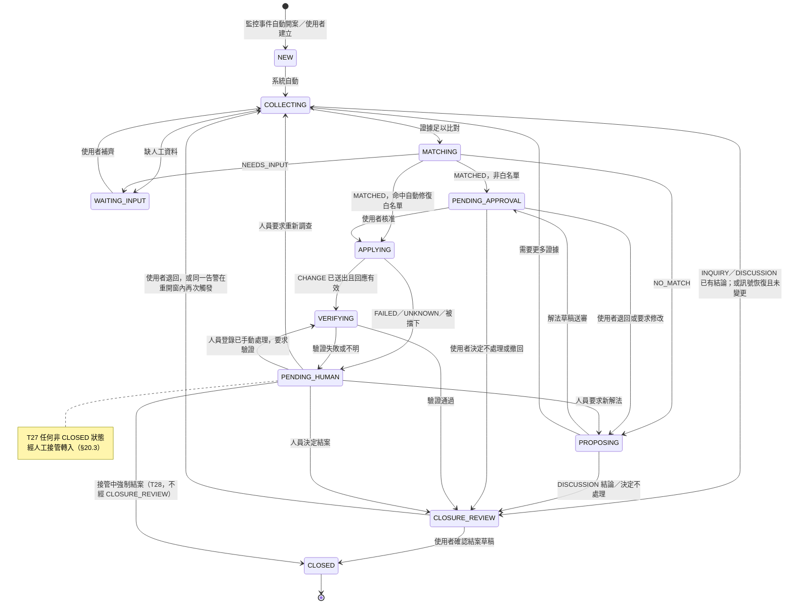
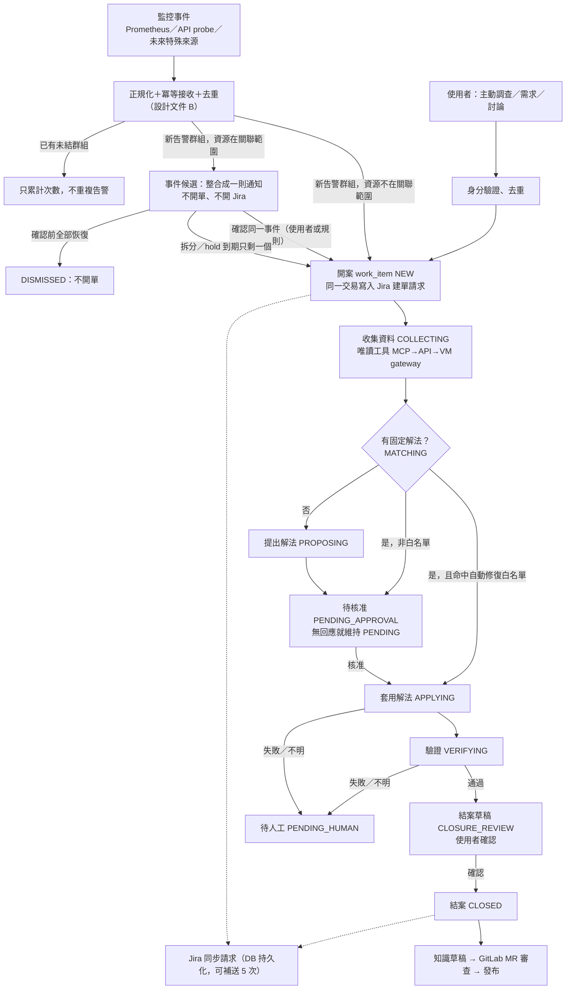
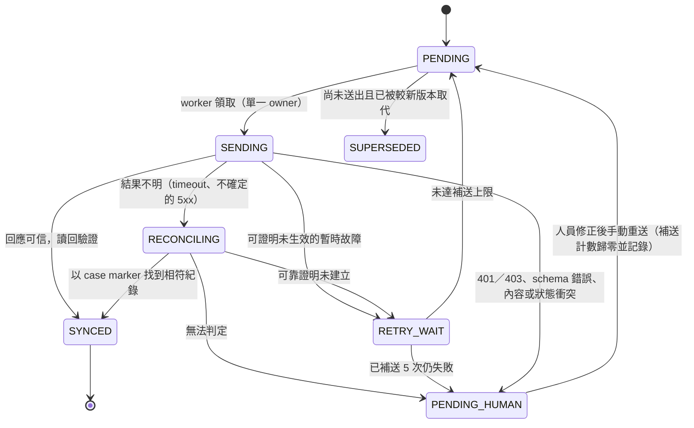

# AI DevOps 智慧維運平台：已對齊需求（目標版）

| 項目 | 內容 |
|---|---|
| 文件性質 | 對齊後的**目標需求**基準；SRS／SA／SD 0.54 依本文件改寫（舊 0.40～0.42 中衝突的條文已刪改，見附錄 A） |
| 依據 | 儲存庫 `lancehuang58/ai-devops-platform` commit `2661434` 的 `doc/specifications/` 三份規格書，加上使用者 2026-10 的 42 項決策（見 §0；U35～U38 依 2026-10-26 Web 介面需求，並沿用 commit `b8a23d4` 的管理登入 demo；U39～U42 依 2026-10-26「Qwen 不穩定時改用商用模型介入並強制結案」需求） |
| 搭配文件 | [`alert-event-and-dedup-design.md`](./alert-event-and-dedup-design.md)：監控事件格式、去重資料結構與流程 |
| 版本 | 第七版（2026-10-31）：納入 U46～U48（唯讀 AI 對話與 MCP，§22）。第六版（2026-10-26）：納入 U43～U45（平台 Web 改接公司 GitLab OIDC、YAML 服務目錄與秘密參考、監控模板與探測鏈，§21）。第五版（2026-10-26）：納入 U39～U42（商用模型人工接管、接管包、寫回與強制結案、只用訂閱方案，§20）；§16 新增 Q27～Q31 建議值待確認。第四版（2026-10-26）：納入 U35～U38（Web 介面、技術選型、並行推進與資源鎖，§17～§19）；§16 新增 Q22～Q26 建議值待確認。第三版（2026-10-26）：納入 U20～U34，所有待確認項目都已決定（§16）。第二版：納入 U14～U19；跨資源關聯改為「先整合成一則通知，確認是同一事件後才開單」 |
| 狀態 | 已確認（2026-10-26，使用者回覆「全部如建議」）。SRS／SA／SD 已依附錄 A 刪改並升為 0.50（本機分支 `docs/aligned-requirements`）。第四版 U35～U38 依使用者 2026-10-26 指示（Web 登入／清單／篩選／明細；前端採 Thymeleaf＋htmx）；Q22～Q26 為建議值，尚待使用者確認；SRS／SA／SD 隨之升為 0.51。第五版 U39～U42 依使用者 2026-10-26 需求（Qwen 不穩定、服務停擺時，人工改用商用模型處理後強制結案）與可行性評估（§20.1）；Q27～Q31 為建議值，尚待使用者確認；SRS／SA／SD 隨之升為 0.52。第六版 U43～U45 依使用者 2026-10-26 需求（平台登入改為公司 GitLab OAuth、服務與整合設定改為 YAML、監控依模板探測並依通道失敗才降級）；SRS／SA／SD 隨之升為 0.53 |
| EIP 引用 | 《企業集成模式》中譯本，格式為「模式名（節號，書頁）」 |

---

## 0. 本次已確認的使用者決策

| # | 決策 | 在本文落實的位置 |
|---|---|---|
| U1 | 既有監控（Prometheus、既有 API endpoint）列為一級事件來源 | §5 |
| U2 | 特殊入口的監控之後陸續加入，需可擴充 | §5.1 監控來源／Connector 模型 |
| U3 | 保留「使用者要求主動調查」入口 | §6 |
| U4 | 服務故障後**繼續監控** endpoint，但**不持續發出警報**；要能偵測恢復 | §5.4、設計文件 B |
| U5 | Jira 不穩：每次同步請求存 DB；失敗後補送最多 5 次，仍失敗即停止、轉人工 | §10 |
| U6 | 偵測到的事件**自動建立 ticket**；不再逐案詢問是否建立紀錄 | §4、§10 |
| U7 | 工作項目分為事故、需求、問題討論等；能用**一套狀態**就用一套 | §2、§3 |
| U8 | 不再分「現行 v1／下一期」，直接寫目標流程：收集資料 → 調查是否有固定解法 → 否 → 提出解法 → 解法過審 → 套用解法 → 驗證 → 結案 | §4 |
| U9 | 團隊預先定義自動修復案例；符合者可主動執行、不需核准；其他一律需核准 | §7 |
| U10 | 核准沒人回應就維持 PENDING（不自動拒絕、不升級） | §8 |
| U11 | 結案草稿要先給使用者看過並確認，才可結案 | §9 |
| U12 | 先忽略「使用者自建 bot／多 bot」需求（不設 bot_id） | §1.3 |
| U13 | 目前不限制權限、不區分角色；移除以角色為基礎的規則 | §12.2 |
| U14 | Qwen 不可用時，只暫停 AI 步驟（分析、提案、摘要）；偵測、去重、開案、Jira、唯讀監控，以及已核准計畫與白名單自動修復**照常執行**（原 Q1） | §13.4 |
| U15 | 緊急應變不另設「略過核准」通道：kill switch＋平台外手動處理後登錄 `MANUAL_ACTION`＋任何人可立即核准（原 Q2） | §8.4 |
| U16 | 自動修復頻率：每個告警群組最多 1 次；同一資源 24 小時內最多 3 次；超過改走核准（原 Q5） | §7.1 |
| U17 | 抖動：30 分鐘內 FIRING↔RESOLVED 切換 ≥ 3 次為 FLAPPING；抖動中要穩定 15 分鐘才判定恢復；重開窗 30 分鐘（原 Q13） | §5.4、設計文件 B §4.4～4.5 |
| U18 | 跨資源關聯：**相關告警先整合成一則通知，不開單、不開 Jira；確認是同一事件後才開一張單**（原 Q12，與原建議不同） | §5.5、設計文件 B §5 |
| U19 | 非功能需求採 §14 建議值（原 Q11） | §14 |
| U20 | 純問答 INQUIRY 預設**不開 Jira**，只存平台；轉型為 INCIDENT 或勾選「需要追蹤」時才建 Jira。監控事件、INCIDENT、REQUIREMENT、DISCUSSION 一律開 Jira（原 Q3） | §6、§10 |
| U21 | 待核准與待結案的提醒：每個工作日 09:30（Asia/Taipei）在原頻道提醒一次；不升級、不換人、不自動拒絕（原 Q4） | §8.2、§9 |
| U22 | 申請人可以核准自己的提案；畫面標示「自行核准」並記錄（原 Q6） | §8.1 |
| U23 | 故障期間維持原監控 interval；interval < 60 秒時放寬到 60 秒，判定恢復後回到原頻率（原 Q7） | §5.4 |
| U24 | Jira 補送：首次失敗後**補送 5 次**（共 6 次呼叫）；間隔 1m／5m／15m／1h／4h＋20% jitter；不設總期限（原 Q8） | §10.3 |
| U25 | 每案 Confluence 報告保留（D04），但降為可選目的地，`record_policy` 可關閉；知識以 GitLab 為準（原 Q9） | §10.5 |
| U26 | 全域 kill switch：任何已驗證使用者可解除，需填理由；系統自動設定的 hold，須核心恢復 READY 後才可解除（原 Q10） | §13.2 |
| U27 | 維護時段 `maintenance_window`：期間仍接收、去重並記錄，但不開案、不通知；結束時仍 FIRING 才開案。案件結案時群組仍 FIRING，預設建立 24 小時 FINGERPRINT 靜默（原 Q14） | §5.4、設計文件 B §4.7 |
| U28 | raw evidence：所有已驗證使用者可在 Web 受控頁面查看，每次存取都稽核；Teams 與 Jira 只顯示安全投影；秘密在任何情況都不顯示（原 Q15） | §12.2 |
| U29 | 同一未結群組嚴重度升高時通知一次並更新 Jira 優先級；降級不通知（原 Q16） | §5.4 |
| U30 | 「同一事件」確認者：任何已驗證使用者可確認、拆分、移出；系統只在規則 `auto_confirm=true` 且證據 E1～E3 全部成立時自動確認；新規則預設 `auto_confirm=false`；系統不自動拆分（原 Q17） | §5.5、設計文件 B §5.5 |
| U31 | 事件候選一直沒人確認：維持待確認、不開單；每 30 分鐘在原頻道提醒；Web 看板顯示等待時間（原 Q18；不採「30 分鐘後自動開單」替代方案） | §5.5 |
| U32 | 關聯參數：hold 60 秒；收集窗 10 分鐘；影響範圍深度 2；通知更新節流 30 秒；提醒 30 分鐘；確認後新成員「可能相關」提示 10 分鐘（原 Q19） | 設計文件 B §5.11 |
| U33 | 確認前所有成員都恢復：穩定超過重開窗（30 分鐘）後轉 `DISMISSED`，不開單、不開 Jira；Web 提供「補開單」（原 Q20） | §5.5 |
| U34 | 首批關聯規則：`storage-deps`、`db-deps`，沿 SD-05 `DEPENDS_ON`，都先設 `auto_confirm=false`，運作穩定後再逐條開啟（原 Q21） | 設計文件 B §5.11 |
| U35 | Web 介面：已驗證使用者以公司帳號密碼登入；看到進行中的工作項目及各自目前的 WorkItemStatus；可依系統（服務）、時間區間、狀態篩選並分頁；點選看明細（告警內容、調查資料、解法、核准紀錄、結案草稿、時間軸）；不分角色，所有登入者看到相同內容 | §17 |
| U36 | 技術選型：Spring Boot 生態系（使用者已定）；PostgreSQL＋Flyway；Spring Data JPA（清單篩選用 Specification）；Spring Security 表單登入＋伺服器端 session（帳密以 LDAP bind 驗證，之後可選 OIDC 接 Keycloak／AD）；前端 Thymeleaf＋htmx 與 App 同一部署（使用者選定，不採 React／Vue SPA） | §18 |
| U37 | 並行推進：多個工作項目同時推進；worker 數量可配置；等待核准、使用者補資料、Qwen 回應或 VERIFY 取樣間隔時保存狀態並釋放 worker | §19.1～§19.2 |
| U38 | 資源鎖：同一目標資源同時只允許一個工作項目在 APPLYING／VERIFYING 持有變更權；其他資源不受影響；後到者標 `blocked_reason=RESOURCE_LOCK_WAIT` 排隊，等待上限到期轉 PENDING_HUMAN；租約過期但可能仍有在途命令時不自動放行 | §19.3～§19.5 |
| U39 | 商用模型人工接管：Qwen 不穩定或服務停擺時，使用者可以把任何未結案的工作項目手動「接管」，改用商用模型（例如 Codex CLI、Claude Code）在平台外處理；**只能由人**在 Web 明細頁或 API 觸發，平台不自動切換；平台記錄接管者、時間、工具與模型（`work_activity` kind=`TAKEOVER`）；接管後取消該案排隊中的 AI 工作，Qwen 恢復也不自動接回 | §20.1～§20.3 |
| U40 | 接管包：平台匯出單一接管包（告警、已收集的調查資料、目前狀態與歷程、已提出的解法、相關白名單與規則）；匯出前在伺服器端遮罩密碼、token、金鑰與內部秘密；每次產生與下載都寫稽核 | §20.4 |
| U41 | 寫回與強制結案：操作者經 Web／API 寫回摘要、根因、已執行處置與驗證證據後，可強制結案，`closure_reason=FORCED_BY_COMMERCIAL_MODEL`，因為是人觸發所以**不經結案草稿確認**（U11 的例外）；經平台執行的修改仍受核准、白名單、資源鎖與 kill switch 規則約束；平台外的手動動作由操作者負責，並須寫在寫回內容中 | §20.5～§20.8 |
| U42 | 只用訂閱方案：商用模型只用個人訂閱（ChatGPT Plus／Pro、Claude Pro／Max），**不用 API key**，因此平台不經 LiteLLM 呼叫商用模型，也不發機器憑證給 CLI 回呼；訂閱條款以個人、互動使用為主，不能做成無人值守的後端；有用量上限；導入前要重新確認供應商條款與公司資料政策 | §20.1、§20.9 |
| U43 | 平台 Web 登入改為公司自建 GitLab 的 OIDC authorization code（scopes `openid profile email`）。GitLab 本身已接 LDAP，平台不再做 LDAP bind，也不把 GitLab 群組變成角色；任何通過驗證的使用者看到相同內容。Client id／secret 與 GitLab base URL 來自設定。登入後回到原本請求的深連結 | §12.2、§17.1、§18、§21.1 |
| U44 | 受管服務與整合服務都寫在 YAML，以型別化的 `@ConfigurationProperties` 載入。秘密不得寫死在檔案，只能寫 `${NAME}` 這種環境變數／Kubernetes Secret 參考。啟動時檢查，缺欄位、解不出來的參考、未知 template type、重複 id 都立刻失敗；日誌不得出現秘密值 | §12.1、§21.2 |
| U45 | 每種服務類型有監控模板（預設探測、間隔、門檻）；每個實例提供 id、type、environment、URL、憑證參考與覆寫。探測順序固定為 endpoint → MCP server → API → VM。VM 經名為 Glove 的 SSH-tool MCP server 查狀態。只有通道本身失敗才換下一層；通道回報服務不健康就立刻告警、不再往下。全部通道都失敗才判定服務 down／unknown，單上帶每一層原因。較高通道失敗但較低通道健康時，只發一則不重複的「監控通道降級」通知、不開事故單。結果記得出自哪個通道、為何 fallback，並進入既有標準告警與去重（source 例 `probe`）。這條順序只用於監控，變更執行仍不自動換路徑 | §5.1、§12.1、§21.3 |

---

## 1. 目標與範圍

### 1.1 目標

1. 同時監控多個受管服務的狀態；異常被偵測時**自動開案、自動開 Jira ticket**，並自動展開調查。
   - 例外：可能由同一個上游故障引起的一批告警，先整合成**一則通知**；確認是同一事件後才開**一張**單（U18，§5.5）。
2. 以單一流程處理所有工作項目：收集資料 → 找固定解法 →（無）提出解法 → 過審 → 套用 → 驗證 → 結案草稿確認 → 結案。
3. 團隊預先定義的「自動修復白名單」案例可免核准自動執行；其餘變更一律需人員核准。
4. 每案的過程、證據、核准、執行與結果都可稽核；Jira 是可補送的外部投影，平台 DB 是權威紀錄。
5. 結案後把可重用經驗沉澱為知識（GitLab MR 審查後發布），讓下一次能命中「固定解法」。

### 1.2 受管服務範圍（沿用）

PostgreSQL、MariaDB、Jenkins、GitLab、Jira、Confluence、Nexus、Harbor、Graylog、Rancher、VM 管理、Grafana 等。各服務能力（查詢、變更、健康檢查）**依方案逐步接入**；未接入的能力標示 disabled，不視為平台故障。

### 1.3 不在範圍內（本版明確排除）

| 項目 | 處理 |
|---|---|
| 使用者自建 bot、多 bot 協作、bot registry／bot_id | 忽略（U12）。架構維持單一對外 Bot＋中央流程；不為多 bot 預留資料欄位 |
| 角色／權限分級（ADMIN／NORMAL_USER） | 本版不實作（U13）。只保留「已驗證身分」這一層 |
| 依「現行 v1／下一期」分期的需求寫法 | 移除（U8）。交付排程另由開發計畫管理，不寫進需求 |
| AI 自行發布正式知識或可執行方案 | 仍不允許。AI 只產草稿，人員審查後才發布 |

---

## 2. 工作項目類型

所有工作項目共用同一張主表 `work_item`、同一套狀態機（§3），以 `item_type` 區分。

| item_type | 中文 | 典型來源 | 會走到的流程階段 |
|---|---|---|---|
| `INCIDENT` | 事故：系統異常、設定錯誤、服務失效、效能異常、log 過大、儲存不回應等 | 監控事件自動開案（§5）；使用者回報；調查中確認有異常的 `INQUIRY` 轉型 | 全流程 |
| `REQUIREMENT` | 需求：建立或修改系統需求，例如建 Jenkins pipeline、建 DB table、開測試 DB 帳號、計畫性變更 | 使用者在 Teams／Web 提出；標準申請表單 | 全流程。「固定解法」就是已發布的申請模板 |
| `DISCUSSION` | 問題討論：需要分析、比較方案、做決策，但**不必然**要變更系統 | 使用者發起 | 收集資料 → 提出結論或建議 → 結案草稿 → 結案；需要變更時轉成 `REQUIREMENT` 或 `INCIDENT` 的子項 |
| `INQUIRY` | 主動調查／查詢：使用者要求平台主動檢查某服務或回答問題 | 使用者發起（U3） | 收集資料 → 結案草稿 → 結案；發現異常時轉型為 `INCIDENT`，接續全流程 |

規則：

- 類型轉換（例如 `INQUIRY` → `INCIDENT`）保留同一個 work_item ID 與完整歷史，記錄 `ITEM_TYPE_CHANGED` 事件與理由；不另開新案。
- 一個 work_item 可關聯多個資源（零到多個服務 labels），也可以有父子關係（`parent_item_id`），例如一個 DISCUSSION 衍生兩個 REQUIREMENT。
- 「等」字預留：新類型只要能映射到同一狀態機，就加 enum 值即可，不新增狀態機。若某類型需要本狀態機以外的狀態，必須先回到需求確認。

---

## 3. 統一狀態機

### 3.1 決策：工作項目只用一套狀態機

**結論：** 事故、需求、問題討論、主動調查共用一套 `WorkItemStatus`。舊文件的 `RequestStatus`（SA-04.1）、`IncidentStatus`（SA-04.3）、`Case status`（SA-11.4）三套合併為一。

**理由：**

1. 四種類型走的是同一條業務主線（U8），差別只在「哪些階段會跳過」。這種差別用「依類型限制的轉換規則（guard）」就能表達，不需要多套狀態。
2. 舊的三套狀態語意重疊（INVESTIGATING／ACTIVE、AWAITING_DECISION／WAITING_APPROVAL、RESOLVED／COMPLETED），而且分別掛在 `issue`、`work_request`、`case_record` 三張表上，導致同一件事有三個狀態來源，Jira 映射也要配三套。
3. 合併後 Jira workflow 映射只需一套（§10.4），報表與看板也只看一個欄位。

**保留為獨立生命週期的「非工作項目」實體**：它們描述的是工作項目底下的另一種東西，不是工作項目本身的狀態，所以不併入：

| 實體 | 狀態 | 為何不併入 |
|---|---|---|
| 命令執行 `command_execution` | 沿用 SA-04.4 `CommandExecutionStatus` 與 SA-03.3 `CommandResult` | 一個工作項目可有多次執行；執行層有派送許可、逾時查核等專屬語意 |
| 外部同步 `external_sync_request` | §10.2 `SyncStatus` | 一個工作項目在 Jira 與其他目的地各有多筆同步，且失敗與業務結果無關 |
| 告警群組 `alert_group` | 見設計文件 B §3 | 描述監控訊號的開啟／恢復／抖動，可在工作項目結案前恢復 |
| 事件候選 `incident_candidate` | HOLDING／AWAITING_CONFIRMATION／RELEASED_SINGLE／CONFIRMED／SPLIT／DISMISSED／ENDED（設計文件 B §5.3） | 是「開單之前」的實體：收集可能相關的告警群組、等待確認；確認後最多產生一個工作項目，本身不是工作項目的狀態（U7 仍只有一套工作項目狀態） |
| 核准 `approval` | PENDING／APPROVED／REJECTED／WITHDRAWN／SUPERSEDED | 一個工作項目可有多個提案、多次核准 |
| 知識草稿 | 沿用 DRAFT／REVIEW／PUBLISHED／EXPIRED／WITHDRAWN／SUPERSEDED | 知識的生命週期長於單一案件 |

### 3.2 狀態定義

| 狀態 | 中文 | 意義 |
|---|---|---|
| `NEW` | 已建立 | 已開案、取得編號、Jira 建單請求已寫入 DB（還沒送成也沒關係） |
| `COLLECTING` | 收集資料 | 以已發布的唯讀能力（MCP → API → VM gateway）收集證據；需要模型時呼叫 Qwen 分析 |
| `WAITING_INPUT` | 待補資料 | 必要資訊只有人能提供（需求欄位、討論結論、目標不明確）；等待中不派送任何變更 |
| `MATCHING` | 查找固定解法 | 依證據比對已發布方案、申請模板、知識庫，結果為 MATCHED／NEEDS_INPUT／NO_MATCH |
| `PROPOSING` | 提出解法 | 沒有固定解法時，AI 或人員擬定解法草稿；DISCUSSION 在此產出結論或建議 |
| `PENDING_APPROVAL` | 待核准 | 解法（固定解法實例或新解法）等人核准；**沒人回應就一直停在這裡**（U10） |
| `APPLYING` | 套用解法 | 依核准過的計畫，或自動修復白名單規則，經中央 Dispatcher 派送 CHANGE |
| `VERIFYING` | 驗證 | 執行方案明列的 VERIFY，並視需要觀察一段時間（舊 OBSERVING 併入此狀態） |
| `PENDING_HUMAN` | 待人工 | 失敗、PARTIAL、UNKNOWN、外部衝突，或系統無法自行判斷；平台不自動續跑 |
| `CLOSURE_REVIEW` | 結案草稿待確認 | 平台產生結案草稿，等使用者看過並確認（U11）；沒人回應就一直停在這裡 |
| `CLOSED` | 已結案 | 終態，必填 `closure_reason` |

`closure_reason`：`RESOLVED`（已解決）、`SELF_RECOVERED`（自行恢復，未套用變更）、`FULFILLED`（需求完成）、`CONCLUDED`（討論或調查已有結論）、`FALSE_POSITIVE`（誤報）、`DUPLICATE`（重複，需填 `duplicate_of`）、`WITHDRAWN`（撤回或取消）、`WONT_FIX`（決定不處理）、`FORCED_BY_COMMERCIAL_MODEL`（人工改用商用模型接管後強制結案，**不經** CLOSURE_REVIEW，§20.7）。舊的 `CANCELLED` 狀態改為 `CLOSED + WITHDRAWN`，同樣要經過結案確認。

輔助欄位（不是狀態）：`blocked_reason`（例如 `LLM_UNAVAILABLE`、`KILL_SWITCH`、`RESOURCE_HOLD`、`RESOURCE_LOCK_WAIT`（等待資源鎖，§19.4）、`JIRA_SYNC_PENDING`，用於顯示「卡在哪裡」，不改變狀態）、`signal_state`（關聯告警群組目前是 FIRING／RECOVERED／FLAPPING）、`record_completeness`（外部紀錄是否齊全）、`active_takeover_id`（人工接管中時指向 `manual_takeover`，§20；Web 顯示「人工接管中」）。

### 3.3 狀態圖

### 3.4 轉換表

| # | 從 | 到 | 觸發者 | 條件與副作用 |
|---|---|---|---|---|
| T01 | — | NEW | 系統／使用者 | 監控事件經去重後為新群組且資源不在關聯範圍內；或事件候選被確認為同一事件、拆分、hold 到期只剩一個成員（設計文件 B §5）；或使用者建立；同一交易寫入 work_item、case_event、Jira 建單同步請求 |
| T02 | NEW | COLLECTING | 系統 | 自動開始；**不需人工啟動調查**（取代 SA-04.3「自動發現先 PENDING_HUMAN」） |
| T03 | COLLECTING | WAITING_INPUT | 系統 | 必要欄位、目標或範圍只有人能提供 |
| T04 | WAITING_INPUT | COLLECTING | 使用者 | 補齊資料；一律重新驗證 |
| T05 | COLLECTING | MATCHING | 系統 | 證據達到方案比對的最低要求 |
| T06 | COLLECTING | CLOSURE_REVIEW | 系統 | INQUIRY／DISCUSSION 已產出答案或結論；或 INCIDENT 的訊號已恢復、平台未套用任何變更（草稿原因 `SELF_RECOVERED`，見 §5.4） |
| T07 | MATCHING | WAITING_INPUT | 系統 | NEEDS_INPUT：多候選或缺參數 |
| T08 | MATCHING | PENDING_APPROVAL | 系統 | MATCHED，且不符合任何啟用中的自動修復規則；產生計畫實例與預覽 |
| T09 | MATCHING | APPLYING | 系統 | MATCHED **且**符合啟用中的自動修復規則（§7），並通過全部派送前檢查；授權來源記為 `AUTO_REMEDIATION_RULE` |
| T10 | MATCHING | PROPOSING | 系統 | NO_MATCH |
| T11 | PROPOSING | PENDING_APPROVAL | 系統／使用者 | 解法草稿完成：可執行部分必須能落到已發布命令（見 §8.3） |
| T12 | PROPOSING | CLOSURE_REVIEW | 系統／使用者 | DISCUSSION 結論完成；或決定不處理（WONT_FIX） |
| T13 | PROPOSING | COLLECTING | 系統／使用者 | 需要補充證據 |
| T14 | PENDING_APPROVAL | APPLYING | 使用者 | 核准；伺服器重新驗證計畫 hash、資源基準、kill switch、resource_hold |
| T15 | PENDING_APPROVAL | PROPOSING | 使用者 | 退回或要求修改；舊提案改為 SUPERSEDED |
| T16 | PENDING_APPROVAL | CLOSURE_REVIEW | 使用者 | 不處理或撤回 |
| — | PENDING_APPROVAL | （不變） | 無人回應 | **無逾時轉換**；只允許提醒（§8.2） |
| T17 | APPLYING | VERIFYING | 系統 | CHANGE 已送出且回應有效 |
| T18 | APPLYING | PENDING_HUMAN | 系統 | FAILED、PARTIAL、UNKNOWN、BLOCKED_*、資源鎖等待逾時（§19.4）；CHANGE 不重送。D02 一次逾時查核在 APPLYING 內完成 |
| T19 | VERIFYING | CLOSURE_REVIEW | 系統 | VERIFY 通過（含觀察期）；產生結案草稿 |
| T20 | VERIFYING | PENDING_HUMAN | 系統 | 驗證失敗或結果不明 |
| T21 | PENDING_HUMAN | COLLECTING | 使用者 | 要求重新調查；舊執行結果不覆寫 |
| T22 | PENDING_HUMAN | PROPOSING | 使用者 | 要求新解法 |
| T23 | PENDING_HUMAN | VERIFYING | 使用者 | 登錄已在平台外手動處理（`MANUAL_ACTION` 事件），要求平台驗證 |
| T24 | PENDING_HUMAN | CLOSURE_REVIEW | 使用者 | 決定結案（含 FALSE_POSITIVE／DUPLICATE／WONT_FIX） |
| T25 | CLOSURE_REVIEW | CLOSED | 使用者 | 確認結案草稿（可先修改草稿；確認時鎖定該版本） |
| T26 | CLOSURE_REVIEW | COLLECTING | 使用者／系統 | 使用者退回；或關聯告警在重開窗內再次 FIRING（系統，見設計文件 B §4.5） |
| T27 | 任何非 CLOSED 狀態（PENDING_HUMAN 除外） | PENDING_HUMAN | 使用者 | 人工接管（U39，§20.3）：寫 `manual_takeover`、`work_activity`（TAKEOVER）；取消排隊中的 AI 工作；可能已派送的命令不中斷、依 §19.5 處理。已在 PENDING_HUMAN 時接管只記錄、不轉換 |
| T28 | 接管中的任何非 CLOSED 狀態 | CLOSED | 使用者 | 強制結案（U41，§20.7）：已有寫回、沒有可能已派送且未終態的執行；`closure_reason=FORCED_BY_COMMERCIAL_MODEL`；以寫回產生並鎖定一版結案草稿，**不經 CLOSURE_REVIEW** |
| — | 任何非終態 | （不變）＋`blocked_reason` | 系統 | kill switch、resource_hold、LLM 不可用時只標記卡住原因，不改狀態、不丟資料 |

類型限制：

| item_type | 不允許的狀態 |
|---|---|
| INCIDENT、REQUIREMENT | 無限制 |
| DISCUSSION | `APPLYING`、`VERIFYING`（需要變更時另開子項） |
| INQUIRY | `MATCHING` 以後的狀態；需要時先轉型為 INCIDENT（T05 前執行 `ITEM_TYPE_CHANGED`） |

所有轉換以 `row_version` 做樂觀鎖；同一 work_item 的轉換序列化；每次轉換寫一筆 `case_event`（只追加，`event_id` 冪等）。這相當於 EIP 的過程管理器（7.12，p.219）：由 work_item 保存流程狀態，決定下一步。

### 3.5 資料表合併

| 舊表（文件位置） | 新表 | 處理 |
|---|---|---|
| `issue`（SD-04.1）、`work_request`（SD-04.1）、`case_record`（SD-14.2） | `work_item` | 合併。欄位：`item_id`（UUID）、`item_no`（單一序列，例如 `OPS-0000001234`；類型不寫進編號，因為類型可以轉換）、`item_type`、`status`、`closure_reason`、`title`、`requestor_principal_id`、`source_kind`（MONITOR／USER／SCHEDULE）、`environment`、`resource_refs`、`parent_item_id`、`duplicate_of`、`blocked_reason`、`signal_state`、`record_completeness`、`current_report_version`、`created_at`、`updated_at`（任何欄位或關聯異動時更新，供 Web 清單排序，§17）、`status_changed_at`（進入目前狀態的時間）、`row_version` |
| `case_work`（SD-14.2） | `work_activity` | 保留為工作項目底下的活動紀錄（調查、比對、提案、套用），`mode` 改為 `activity_kind`；**不再有自己的狀態機**，只有 started／finished 與結果 |
| `issue_label` | `work_item_label` | 改名 |
| `state_transition`（SD-04.1）中屬於工作項目的部分 | `case_event`（type=`STATE_CHANGED`） | 工作項目狀態歷史只記在 case_event；`state_transition` 只保留給執行層實體 |
| `admin_authorization`（SD-04.1）、`approval`（SD-14.2） | `approval` | 合併；去掉角色欄位；`authorization_source` 改為 `USER_APPROVAL`／`AUTO_REMEDIATION_RULE`／`APPROVED_SCHEDULE`／`READ_ONLY`／`SYSTEM_RECORD_POLICY`／`TIMEOUT_CHECK` |
| `publication_decision`（SD-04.1） | — | 刪除，歷史資料轉成 case_event 備查（U6：不再逐案同意） |
| `external_sync_request`（SD-04.1）、`record_outbox`／`record_attempt`／`record_obligation`（SD-14.7） | `external_sync_request`＋`external_sync_attempt`＋`external_mapping` | 合併成一套同步機制（§10） |
| `role_config`／`principal_role`（SD-04.1、SD-03.2） | `principal`（只有身分，沒有角色） | 角色欄位移除（U13） |
| `investigation`（SD-04.1） | `work_activity`（kind=INVESTIGATION）＋`evidence_record` | 合併 |
| 新增 | `alert_delivery`、`alert_receipt`、`alert_group`、`alert_group_event`、`work_item_alert_group`、`notification_outbox`、`alert_silence`、`correlation_rule`、`correlation_scope`、`incident_candidate`、`incident_candidate_key`、`incident_candidate_member`、`notification_message`、`monitor_check_state`、`monitor_source`、`monitor_check`、`auto_remediation_rule`、`execution_hold`（擴充 manual 欄位）、`closure_draft` | 見 §5、§7、§9、§13 與設計文件 B |
| 新增（第四版） | `work_task`（DB 工作佇列）、`resource_lock`、`resource_lock_waiter` | 見 §19、SD-18 |
| 新增（第五版） | `manual_takeover`、`takeover_package`、`takeover_writeback`；`work_item` 加 `active_takeover_id`；`work_task.status` 加 `CANCELLED` | 見 §20、SD-19 |

沿用、不改：`solution_definition`、`execution_plan`、`plan_step`、`command_definition`、`command_execution`、`execution_attempt`、`execution_outbox`、`execution_resolution`、`timeout_check`、`evidence_record`、`resource_catalog` 與 SD-05 的五組資源表、`resource_hold`、`app_core_health`、`health_profile`／`health_sample`、知識相關表。

---

## 4. 端到端流程

| 步驟 | 使用者流程用語 | 平台行為 | 主要約束 |
|---|---|---|---|
| 1 | 偵測／受理 | 監控事件自動開案；關聯範圍內的告警先整合成一則通知，確認是同一事件後開一案（§5.5）；使用者從 Teams／Web 建立 | 開案與 Jira 建單請求在同一 DB 交易（事務性客戶端 10.4，p.356）；Jira 失敗不阻擋開案；候選確認前不開 Jira、不自動修復 |
| 2 | 收集資料 | 自動調查，先強制查詢知識庫，再依範圍與預算呼叫唯讀工具 | 只用已發布的 QUERY；不直接 SSH；外部內容一律當資料，不當指令 |
| 3 | 調查是否有固定解法 | 比對已發布 solution／模板／知識 | 比對依據是可檢查的條件，不是模型自述的信心 |
| 4 | 否 → 提出解法 | AI 擬定解法草稿與理由；人員可修改 | 可執行步驟只能引用已發布命令；沒有對應命令時，只能是人工步驟說明 |
| 5 | 解法過審 | 使用者核准完整計畫（一次核准全部步驟） | 無回應時維持 PENDING；核准綁定計畫 hash |
| 5′ | 白名單 | 命中自動修復規則時跳過核准 | 仍受 kill switch、resource_hold、單一派送、VERIFY 約束 |
| 6 | 套用解法 | 中央 Dispatcher 派送，每個 CHANGE 只送一次 | 失敗不重送、不回滾、不換通道；只有 D02 一次逾時唯讀查核 |
| 7 | 驗證 | 依方案的 VERIFY 判定效果 | CHANGE 被接受不等於成功 |
| 8 | 結案 | 產生結案草稿，使用者確認後結案；更新 Jira 與知識庫 | 草稿確認前不結案 |

---

## 5. 監控來源與告警

### 5.1 監控來源／Connector 模型（U1、U2）

監控來源一律以「通道適配器」（4.8，p.85）接入，轉成平台的**標準告警事件**（規範數據模型 8.7，p.249）。新增來源只需新增 adapter 與 normalizer（規範器 8.6，p.247），不改去重或開案邏輯。

| source_type | 接入方式 | 狀態 |
|---|---|---|
| `PROMETHEUS_ALERTMANAGER` | Alertmanager webhook（push）→ 平台接收 endpoint | 一級來源 |
| `PROMETHEUS_QUERY` | 平台定期執行 PromQL（pull），例如補查或沒有 alert rule 的指標 | 一級來源 |
| `HTTP_ENDPOINT_PROBE` | 平台定期呼叫既有 API／health endpoint，依 predicate 判定 | 一級來源 |
| `PLATFORM_HEALTH_PROFILE` | 沿用 SD-08.5 health profile 的服務健康檢查 | 沿用 |
| `CUSTOM_CONNECTOR` | 特殊入口（例如 Graylog 查詢、Jenkins queue、GitLab runner、VM gateway 唯讀 action），日後逐一加入 | 擴充點 |
| `USER_REPORT` | 使用者回報的異常，也走同一格式，方便和監控事件合併 | 一級來源 |

`monitor_source`（每個來源實例一筆）：`source_id`、`source_type`、`display_name`、`endpoint_ref`、`credential_ref`、`auth_scheme`、`normalizer_ref@version`、`resource_mapping_rule_ref`、`enabled`、`config_version`、`health_status`。

`monitor_check`（pull 類型的每一項檢查）：`check_id`、`source_id`、`resource_id`、`symptom_type`、`probe_spec`（HTTP method／path template／timeout，或 PromQL）、`success_predicate`、`interval_seconds`、`timeout_seconds`、`fail_threshold`（連續失敗幾次才 FIRING）、`recover_threshold`（連續成功幾次才 RECOVERED）、`severity`、`enabled`、`version`。

要求：

- 一個來源掛掉（例如 Alertmanager 失聯或 webhook 認證失敗）時，產生平台自身的 `MONITOR_SOURCE_UNAVAILABLE` 事件，同樣走去重，不阻擋其他來源。
- 「監控來源本身健康」和「受管服務健康」分開記錄，不可把來源失聯當成受管服務故障。
- 平台主動探測（U45）依 endpoint → MCP server → API → VM（Glove）固定順序。只有通道本身失敗（逾時、連線被拒、DNS、TLS、認證失敗、MCP server 不可用）才換下一層；通道有回應且服務不健康就立刻開案，不再往下探測。細節見 §21.3。這條順序只用於監控，不改變 §12.1 的變更執行路徑。
- 新增來源、check、mapping rule 都要版本化、可停用；未啟用不計入任何門檻。

### 5.2 標準告警事件

欄位、JSON Schema、Prometheus 與 API probe 範例、Alertmanager 欄位對照，見設計文件 B §1。

### 5.3 去重與開案

- 依 `(source_id, source_event_id)` 冪等接收（冪等接收者 10.11，p.389），重送只回原結果。
- 依 `fingerprint` 聚合到告警群組（聚合器 7.7，p.187）。同一 fingerprint 同時只有一個未結群組。
- **新群組，資源不在關聯範圍 → 自動開案（INCIDENT）＋ Jira 建單請求**（U6）。
- **新群組，資源在關聯範圍 → 先進事件候選，整合成一則通知；確認後才開案**（U18，§5.5）。
- **已有未結群組 → 累計 `occurrence_count`、更新 `last_seen_at`，不再開案、不再告警**（U4）。
- 併發下以 DB 唯一約束與 upsert 確保「一個 fingerprint 只開一案」。
- 併發下也保證「一個事件候選最多開一案」、「一個告警群組只屬於一個案件」（設計文件 B §4.8、§5.6；PostgreSQL 實測見 B §7.1）。

### 5.4 故障後持續監控、不持續告警（U4）

1. 群組 FIRING 期間，**pull 類型 check 照常執行**（interval < 60 秒時，故障期間放寬到 60 秒，U23），結果寫入 `health_sample`，並累計到 `alert_group.occurrence_count`；**不發通知、不開新案、不重複寫 Jira 評論**。
2. Alertmanager 的 `repeat_interval` 重送也只累計次數。
3. 偵測到恢復（Alertmanager `resolved`，或 probe 連續成功達 `recover_threshold`）時，群組進入 RECOVERED，**只通知一次**，並在案件寫入 `SIGNAL_RECOVERED` 事件。
4. 恢復對案件的影響：
   - 案件還在 COLLECTING／MATCHING／PROPOSING／WAITING_INPUT（尚未變更）：自動產生 `SELF_RECOVERED` 結案草稿並轉 CLOSURE_REVIEW（T06）。仍需使用者確認（U11）。
   - 案件在 PENDING_APPROVAL：提案保持 PENDING，案件加註「訊號已恢復」，由使用者決定撤回或繼續。**不自動撤回**（U10）。
   - 案件在 APPLYING／VERIFYING：恢復訊號只當證據，不中斷執行，也不代替 VERIFY。
5. 抖動（flapping）與重開窗（U17）：30 分鐘內 FIRING↔RESOLVED 切換 ≥ 3 次就標為 FLAPPING，期間不再發恢復／重發通知；抖動中的群組要連續穩定 15 分鐘才判定恢復（未抖動時收到 RESOLVED 就判定恢復）；恢復後 30 分鐘內再 FIRING，重開原群組與原案件，不開新案。細節見設計文件 B §4.4、§4.5。
6. 嚴重度升高（例如 WARNING → CRITICAL）時通知一次並更新 Jira 優先級；降級不通知（U29）。
7. 維護時段 `maintenance_window`：期間仍接收、去重並記錄，但不開案、不通知；結束時仍 FIRING 才開案（U27）。
8. 取代舊規則「目標故障後該資源的業務檢查／排程停止」（SD-08.4、SA-07.2）：**監控用的唯讀檢查不停**；停止的是**變更類工作**（resource_hold、execution_hold 照舊）。

### 5.5 跨資源關聯：先整合通知，確認後才開單（U18）

情境：一台儲存故障，掛在上面的 VM 與服務同時告警。如果每個告警各開一張單，會一次湧出幾十張 Jira；但如果系統自己猜「這些是同一件事」直接合併，猜錯就會漏處理。因此：

1. **整合成一則通知，不開單。** 新告警群組的資源若落在某條關聯規則的影響範圍（`correlation_scope`），不直接開案，而是加入同一個「事件候選」（`incident_candidate`，以「規則＋環境＋上游資源」為鍵）。第一個成員到時**立刻**發出一則 Teams 通知；之後的成員只更新同一則通知（成員數、清單、上游狀態），不另發訊息，最多每 30 秒更新一次。
2. **單一告警不被延誤太久。** 候選有 60 秒 hold；hold 到期時如果只有一個成員，就照一般流程開案（`RELEASED_SINGLE`）。之後若有第二個成員加入，回到「待確認」，不另開第二張單。
3. **確認是同一事件後才開一張單。** 兩個以上成員時，候選進入「待確認」。確認後在同一交易開**一個**案件與**一張** Jira，所有成員連到這個案件；確認後才到的相關告警自動併入（通知上可「移出」）。
4. **誰可以確認。** 任何使用者在通知或 Web 上按「確認同一事件」。系統只有在規則設定 `auto_confirm=true`，且證據成立（上游資源本身也在告警、其他成員都在它的影響範圍、時間相近）時才自動確認。細節見 U30。
5. **不是同一件事。** 使用者可「拆分」（挑出部分成員各自開案）或「全部獨立」（每個成員各開一案）。系統不會自動拆分。
6. **確認前全部恢復。** 所有成員恢復並穩定超過重開窗，候選轉 `DISMISSED`，不開單、不開 Jira，只留紀錄；Web 上可「補開單」（U33）。
7. **確認前的限制。** 候選還沒變成案件之前，不會自動修復、不會開 Jira；AI 可以先做唯讀的初步調查，結果附在通知上。
8. **一直沒人確認。** 維持待確認、每 30 分鐘在原頻道提醒，不自動開單（U31）。
9. 候選是「開單前」的實體，不是工作項目的新狀態，所以 U7 的單一狀態機不變。資料結構、併發控制與實測結果見設計文件 B §5、§7.1。EIP：聚合器（7.7，p.187）、關聯標識符（5.7，p.107）、過程管理器（7.12，p.219）。

---

## 6. 使用者主動調查（U3）

- 入口：Teams 對話、Web。使用者可指定服務、環境、時間窗與問題描述。
- 建立 `INQUIRY` 工作項目，走 COLLECTING；預設**只存平台、不開 Jira**。轉型為 INCIDENT，或使用者勾選「需要追蹤」時，才產生 Jira 建單同步請求（U20）。
- 調查中發現異常時，系統建議轉型為 INCIDENT，並產生 `USER_REPORT` 標準告警事件走去重：
  - 若已有相同 fingerprint 的未結群組，INQUIRY 標記 `DUPLICATE` 並連到既有 INCIDENT（仍要結案草稿確認）。
  - 否則 INQUIRY 轉型為 INCIDENT，保留同一 ID。
- 調查可用的工具、範圍與預算沿用 SA-10 ADAPTIVE_READ／COMMON_QUERY_SAFE；只能唯讀。

---

## 7. 自動修復白名單（U9）

### 7.1 規則

團隊預先定義 `auto_remediation_rule`。只有同時符合以下條件時才可免核准執行：

1. 案件在 MATCHING 得到 `MATCHED`，命中的 `solution_id@version` 已發布且未停用；
2. 啟用中的規則條件全部符合：`source_type`、`symptom_type`、resource selector（資源類型、環境、指定資源）、severity 範圍、必要證據謂詞；
3. 規則的頻率限制未超過（U16）：每個告警群組最多自動執行 1 次；同一資源 24 小時內最多 3 次；超過就改走核准；
4. 全域與目標 kill switch（§13.2）未啟動；`resource_hold` 無衝突；核心健康 READY；
5. 派送前檢查（基準狀態、互斥、單一派送許可）全部通過。

`auto_remediation_rule` 欄位：`rule_id`、`version`、`name`、`solution_ref`（`solution_id@version`）、`match`（上述條件，JSON）、`environments`、`max_runs_per_group`（預設 1）、`max_runs_per_resource_window`（預設 3）、`window_seconds`（預設 86400）、`cooldown_seconds`、`require_verify=true`（固定，不可關）、`enabled`、`published_by`、`published_at`、`valid_until`、`change_note`。

### 7.2 約束

- 未列入白名單的情況，**一律需要核准**，包括：白名單方案用在不同環境、規則已過期，或超過頻率限制。
- 自動執行失敗、PARTIAL、UNKNOWN → PENDING_HUMAN，**不重試、不換方案、不升級成其他自動規則**。
- 同一告警群組在未結期間重複觸發，**不會再次自動修復**（`max_runs_per_group`）。
- 自動執行完成後照常 VERIFY → CLOSURE_REVIEW，結案仍要使用者確認（U11）。
- 規則的新增、修改、停用都要版本化並留下 case_event／audit；修改後舊版本不再命中。
- 取代舊規則：SA-03.3「故障事件自動修復停用」、SA-04.5 `APPROVED_RULE`「不含故障自動修復」、SA-07.6、SA-08.7、SA-08.11「自動告警命中已知方案也不自動修復」。

---

## 8. 核准

### 8.1 誰可以核准

- 目前不分角色（U13）：任何已通過 LDAP 驗證並完成 Teams 帳號連結的使用者都可以核准。
- 仍保存核准者身分、時間、核准的計畫版本與 hash、看到的預覽內容。
- 申請人可以核准自己的提案；畫面標示「自行核准」，並記錄在 approval 與 case_event（U22）。

### 8.2 PENDING 行為（U10）

- 核准請求沒人回應時，案件停在 `PENDING_APPROVAL`，approval 維持 `PENDING`：**不自動拒絕、不逾時失效、不升級**。
- 提醒：每個工作日 09:30（Asia/Taipei）在原頻道提醒一次；Web 看板顯示等待時間（U21）。
- 取代 SD-14.3「核准預設 10 分鐘」。但「核准有效期」改由**核准當下的重新驗證**確保安全：
  - 核准時重新讀取 canonical plan、比對 hash、重新取得目標基準狀態；基準已變就轉 `BLOCKED_STATE_CHANGED`，提案改為 SUPERSEDED，回 PROPOSING。
  - 方案或命令版本已停用，核准也無效。
- 核准後應立即排入派送；核准與派送之間仍做 SA-02.5 的全部派送前檢查。

### 8.3 解法內容限制（沿用）

- 一次核准涵蓋整份計畫的所有子命令與預定分支；不另設逐步核准。
- AI 提出的新解法：可執行步驟只能引用已發布命令與參數 schema；需要未發布命令的步驟只能標示為人工步驟，由人員在平台外執行並登錄 `MANUAL_ACTION`。
- 核准後修改目標或參數，產生新版本並重新核准；修改步驟、順序、分支或驗證規則，需先發布新的方案定義。
- 新解法若要變成「固定解法」，走知識／方案審查發布流程（§11），不能因單次核准而自動固化。

### 8.4 緊急應變（U15）

不另設「略過核准」的緊急通道。緊急時的做法：

1. **先止血**：任何人都可以啟動全域或目標 kill switch（§13.2），阻擋後續的自動修復與派送。
2. **平台外手動處理**：人員直接處理後，回平台登錄 `MANUAL_ACTION`（做了什麼、何時、在哪個資源）；案件從 PENDING_HUMAN 進入 VERIFYING（T23）。平台負責驗證、紀錄、Jira 更新與結案草稿。
3. **需要平台執行時**：照一般流程提案，任何已驗證使用者都可以立即核准（U13 不分角色，所以不會卡在找不到 ADMIN）。

---

## 9. 結案草稿（U11）

- 進入 CLOSURE_REVIEW 時，平台產生 `closure_draft`：`draft_id`、`item_id`、`version`、摘要（現象、影響範圍與時間、根因或「根因未確認」、已執行的處置與結果、驗證證據、剩餘風險、後續建議）、建議的 `closure_reason`、建議的知識沉澱項目、`evidence_refs`、產生者（AI 或模板）、`created_at`。
- 草稿以 REPORT_SAFE 投影呈現，不含秘密與 raw。
- 使用者可以：**確認**（T25，鎖定該版本並結案）、**修改後確認**（產生新版本後確認）、**退回**（T26，回 COLLECTING 並寫理由）。
- 沒人確認時一直停在 CLOSURE_REVIEW（與 §8.2 一致，可提醒）。
- 唯一例外：人工接管後的強制結案（T28，§20.7）不經 CLOSURE_REVIEW；平台以寫回內容產生一版草稿並由操作者在結案時鎖定，產生者記為 `MANUAL_TAKEOVER`。
- LLM 不可用時，以固定模板只用已存證據產生草稿，不阻擋結案確認。
- 結案後：觸發 Jira 狀態同步請求；若草稿勾選知識沉澱，就建立知識草稿（§11）。

---

## 10. Jira 同步與補送（U5、U6）

### 10.1 原則

- 平台 DB 是權威；Jira 是投影。**每案自動建立 Jira ticket**，不再逐案詢問（移除 `publication_decision`）。
- 每次需要寫 Jira（建單、更新內容、狀態轉換、評論）都先在同一業務交易寫入一筆 `external_sync_request`（保證交付；與 EIP 事務性客戶端 10.4，p.356 的作法一致），再由獨立 `RecordSyncWorker` 送出。
- Jira 故障**不阻擋**開案、調查、核准與維運執行；只影響 `record_completeness`。
- 補送只重建安全投影，**不呼叫模型、不呼叫維運 Dispatcher**。

### 10.2 同步請求狀態

### 10.3 補送規則

| 項目 | 規則 |
|---|---|
| 補送上限 | 首次送出失敗後，**最多自動補送 5 次**（總共最多 6 次呼叫）；仍失敗就停止，轉 PENDING_HUMAN 並通知一次（U5、U24）；不設總期限 |
| 間隔 | 預設 1 分、5 分、15 分、1 小時、4 小時，加 20% jitter；有 `Retry-After` 時優先遵守（U24） |
| 不重複建單 | 每筆建單帶穩定 case marker（例如 Jira label 或欄位 `ops-item-<item_id>`）；結果不明時先 RECONCILING 查詢，不直接再 POST。查核每輪最多 1 次，不計入 5 次補送 |
| 順序 | 同一 work_item＋目的地依序處理；尚未送出的舊內容更新可合併成最新版本，但狀態轉換不可跳過 |
| 不可自動補送 | 401／403、欄位 schema 錯誤、Jira 端被人改成未預期狀態、版本衝突 → 直接 PENDING_HUMAN |
| 持久化 | `external_sync_request`：`request_id`、`item_id`、`destination`（JIRA／其他）、`operation`（CREATE／UPDATE_FIELDS／TRANSITION／COMMENT）、`payload_hash`、`desired_version`、`status`、`retry_count`、`max_retries=5`、`next_attempt_at`、`last_error_class`、`dedup_key` UNIQUE、`row_version`；每次呼叫寫一筆 `external_sync_attempt` |
| 重啟 | worker 重啟後可恢復 SENDING 中的請求，先 RECONCILING 再決定；與維運 `execution_outbox` 不同（維運命令重啟後不重播） |
| 顯示 | UI 分開顯示業務結果與 Jira 同步狀態；Jira 未同步不影響「已驗證成功」的事實 |

這解決舊文件互相矛盾的地方：D03／SA-04.6／SD-14.7 允許補送，SA-08.4／SD-04.1／SD-04.3 卻寫「無自動重試、一律人工」。以本節為準。

### 10.4 Jira 狀態映射

單一狀態機只需一套映射（建議語意；實際 transition ID 依公司 workflow 配置，未配置就不轉換）：

| WorkItemStatus | Jira 建議狀態 |
|---|---|
| NEW、COLLECTING、MATCHING | 待處理／調查中 |
| WAITING_INPUT | 待補資料 |
| PROPOSING、PENDING_APPROVAL | 待審核 |
| APPLYING、VERIFYING | 處理中 |
| PENDING_HUMAN | 待人工 |
| CLOSURE_REVIEW | 待結案確認 |
| CLOSED | 已結案（resolution 對應 closure_reason；`FORCED_BY_COMMERCIAL_MODEL` 建議對應「完成」並加標籤 `forced-close`，留言附寫回摘要，§20.7） |

Jira webhook 只記錄外部觀測，不反向改平台狀態，也不觸發維運。

### 10.5 Confluence／文件平台

沿用 D04「每案一份報告」的做法，改用同一套 `external_sync_request` 機制與同一補送上限。Confluence 報告是可選目的地：`record_policy` 可以關閉；知識一律以 GitLab 為準（U25）。

---

## 11. 知識庫

沿用並保留：

- 三種來源分開：`FORMAL_KNOWLEDGE`（GitLab repo，經 MR 審查發布）、`HISTORICAL_CASE`（平台 DB 案件）、`LIVE_OBSERVATION`（工具即時資料）。
- 首次呼叫診斷模型前，**程式強制**先做知識檢索並保存檢索紀錄；模型不能決定略過。
- AI 只能建立草稿或 MR；merge／發布由人員執行。含可執行能力的知識，要先完成方案測試（ST）並發布 solution。
- 狀態 DRAFT／REVIEW／PUBLISHED／EXPIRED／WITHDRAWN／SUPERSEDED；撤回或到期後，依賴它的提案與自動修復規則不再命中。
- 結案後的沉澱：結案草稿勾選的項目建立知識草稿，關聯 `source_item_ids` 與證據；相似知識查重後以新版本更新，不重複建立。
- 新解法經過實際驗證並發布為 solution 後，可再由團隊決定是否加入自動修復白名單（§7）。發布 solution 與加入白名單是兩個分開的動作。

---

## 12. 安全

### 12.1 保留的安全邊界

| 邊界 | 要求 |
|---|---|
| 接入路由 | 每個能力發布時固定一條路徑：MCP → API → 公司 VM gateway；執行失敗**不自動換路徑**。監控探測的通道順序（U45）是另一件事，不得拿來當作變更執行的自動換路 |
| SSH | Bot／Qwen 不直接 SSH、不持有 SSH 私鑰、不接受任意 shell；只呼叫 VM gateway 已登錄的 action。監控的最後一層 VM 狀態也只經名為 Glove 的 SSH-tool MCP server（U45），平台不持有該金鑰、不開 shell |
| 命令 | 只執行已發布的 command／solution；模型不得生成任意 SQL／shell／API 呼叫；`CommandType` 由命令目錄決定 |
| 單一派送 | 每個 CHANGE 只有一次派送許可；失敗不重送、不回滾、不補償；D02 只允許一次逾時唯讀查核 |
| 秘密 | 憑證只存 secret reference；SecretFilter／OutputGuard 雙重檢查；秘密不進模型、Jira、知識、log |
| 證據不可變 | raw 原文保留，遮罩投影不得覆寫 raw；報告修訂保留舊版 |
| 提示注入 | log、工具回應、知識文件、告警 annotation 都是資料；不能修改規則、授權或觸發額外步驟 |
| Jira／文件 | API token；只寫安全投影；不能透過紀錄 worker 操作維運系統 |
| 外部模型 | 預設停用；啟用時逐案建立 grant（目的、資料清單、期限、預算），只外送 EXTERNAL_EXPORT_SAFE。人工接管的接管包（§20.4）也算外送：使用同一套 grant（目的 `MANUAL_TAKEOVER`）與投影，供應商須先經公司核准（Q27） |
| 監控接收端 | webhook 驗證（bearer token／basic auth／mTLS 擇一，依來源設定）、payload 大小限制、速率限制；不合法的訊息進入無效訊息紀錄（非法消息通道 4.5，p.77），不丟棄也不開案 |

### 12.2 移除角色區分（U13）

- 身分：platform Web 以公司自建 GitLab 的 OIDC authorization code 登入（U43，scopes `openid profile email`）；GitLab 本身接 LDAP，平台不做 LDAP bind，也不採用 GitLab 群組當角色。demo profile 仍是本地 mock 表單，不是正式身分。Teams 帳號連結保留給 Teams 入口。只有一種已驗證使用者。
- 移除：ADMIN／NORMAL_USER、SA-01.1 權限矩陣、role_config、「NORMAL_USER 不可核准」、「ADMIN-only」等規則（清單見附錄 A）。
- 原本 ADMIN-only、現在**改為所有已驗證使用者可操作，但每次都要寫稽核**的動作：raw evidence 檢視、核准變更、方案／規則／monitor source 設定、resource_hold／execution_hold 解除、外部模型 grant、知識審查發布。
- 未來要重新加入角色時，以「動作權限清單＋principal 對應」加回，不影響狀態機與資料表結構（這是保留的擴充點，不是本版需求）。

---

## 13. 稽核與可觀測性

### 13.1 稽核

- 所有狀態轉換、核准、規則命中、派送、驗證、hold 設定與解除、設定變更、raw 存取、外部同步都寫只追加的 `case_event`／audit log（消息歷史 11.5，p.402；消息存儲庫 11.6，p.405）。
- 每筆紀錄帶 `correlation_id`（= work_item_id）與 `causation_id`，可以從告警一路追到 Jira 與知識（關聯標識符 5.7，p.107）。
- 告警的原始 payload 保存在 `alert_receipt`，標準化事件與原始資料可以互相對照。

### 13.2 Kill switch（execution_hold）

| 範圍 | 效果 | 誰可設定／解除 |
|---|---|---|
| `GLOBAL` | 停止所有**新的** CHANGE 派送（含自動修復與已核准待派送的計畫）；監控、去重、開案、調查（唯讀）、Jira 同步照常 | 任何已驗證使用者，**手動一鍵啟動**；系統在核心失效時也會自動啟動 |
| `TARGET` | 停止指定資源的新 CHANGE | 同上；系統在 UNKNOWN／PARTIAL 時自動設定 |
| `AUTO_REMEDIATION` | 只停用自動修復白名單，核准流程照常 | 同上 |

- 手動全域停止：Teams 指令與 Web 按鈕都要提供；啟動時填寫原因，寫入 `execution_hold(scope, reason, set_by, set_at, stop_version)`。
- 已送出的 CHANGE 不會被收回；只會阻擋下一個步驟。
- 解除需要填寫理由；解除後**不重新排入**被擋下的舊計畫，需要重新核准或重新命中規則（沿用「恢復不續跑」）。任何已驗證使用者都可以解除，不要求不同人；系統自動設定的 hold（例如核心健康不通過），必須核心恢復 READY 後才可解除（U26）。
- 控制入口集中在平台的管理 API（控制總線 11.2，p.396）。

### 13.3 可觀測性指標（初版）

告警接收量、去重率、新群組數、開案延遲（收到事件 → work_item 建立）、Jira 同步延遲與 PENDING_HUMAN 數、待核准數與等待時間、自動修復命中與成功率、各狀態停留時間、monitor source 健康、被抑制的事件數。

### 13.4 核心健康門檻（調整）

沿用 SD-07.7／SD-08.4 的 core check，但**分成兩級**。Qwen 不可用時（U14），只暫停 AI 分析、AI 提案、AI 摘要，案件標 `blocked_reason=LLM_UNAVAILABLE`，Qwen 恢復後自動續做（人工接管中或已強制結案的案件除外，§20.3）；其他能力照常。平台不會因 Qwen 不可用自動改用其他模型；人工接管（U39）是使用者逐案啟動的逃生口，不是平台的備援：

| 能力 | 必要核心 |
|---|---|
| 監控接收、去重、開案、Jira 同步 | DB、稽核寫入 |
| 唯讀調查（工具） | 上列＋身分、遮罩、派送控制 |
| AI 分析、提案草稿、結案摘要 | 上列＋Qwen |
| CHANGE 派送（含自動修復） | 上列＋互斥、憑證、execution_hold 檢查；**不需要 Qwen**：已核准計畫與白名單自動修復照常執行，因為比對與驗證都是確定性的程式邏輯（U14） |

---

## 14. 非功能需求

以下數值已確認採用（U19）；仍做成可配置。

| 編號 | 項目 | 目標值（U19） |
|---|---|---|
| NFR-A1 | 受管監控目標數 | 200 個 check、20 個監控來源 |
| NFR-A2 | 告警接收量 | 持續 20 events/s、尖峰 200 events/s（持續 1 分鐘）不遺失 |
| NFR-A3 | 偵測到開案／通知延遲 | 從收到 webhook 或 probe 判定 FIRING 起算，P95，不含 Jira：不在關聯範圍的資源 ≤ 30 秒開案；在關聯範圍的資源 ≤ 30 秒發出整合通知；hold 到期只有單一成員時 ≤ hold（預設 60 秒）＋30 秒開案；多成員候選在確認後 ≤ 30 秒開案（確認前依 U18 不開案） |
| NFR-A4 | 開案到 Jira 建單 | Jira 正常時 P95 ≤ 2 分鐘 |
| NFR-A5 | 接收端可用性 | 99.5%／月；平台停機期間由 Alertmanager 重送，平台恢復後以冪等接收處理 |
| NFR-A6 | 去重正確性 | 同一 fingerprint 未結期間重複開案 = 0（併發測試） |
| NFR-A7 | 安全 | 未授權變更 = 0、秘密外洩 = 0、重複 CHANGE = 0、UNKNOWN 誤報成功 = 0（沿用） |
| NFR-A8 | 資料保存 | alert_receipt 原始 payload 30 天；work_item／case_event／approval／執行紀錄 3 年；health_sample 明細 14 天、彙總 1 年 |
| NFR-A9 | RPO／RTO | RPO 15 分鐘、RTO 4 小時（從備份還原時兩種 outbox 都先 hold，人工核對） |
| NFR-A10 | 規模演進 | 不要求 Kafka／RabbitMQ／Redis；PostgreSQL 單庫＋DB worker；超過 NFR-A2 時再評估 |
| NFR-A11 | Web 回應（建議值，Q26） | work_item 累計 10 萬筆時：清單（預設篩選、每頁 50 筆）P95 ≤ 1 秒；明細首屏 P95 ≤ 2 秒；Qwen、Jira 故障不影響 Web 查閱 |
| NFR-A12 | 並行推進（U37） | 等待中的工作項目不佔 worker；worker 數量可配置（預設值見 §19.2，Q25）；單一工作項目卡住不影響其他工作項目 |

---

## 15. 舊文件中仍然有效、直接沿用的內容

- 技術基準：Java 21、Spring Boot 4.1、Spring AI、Gradle 六角形多模組模組化單體（SD-15）；PostgreSQL 為參考 DB；不以 Kafka／RabbitMQ／Redis 為前提。
- 單一對外 Bot（Teams 主要入口）＋Web 管理稽核介面（Web 檢視見 §17）；LDAP 認證、Teams 帳號連結、去重鍵與 canonical plan 讀回（SD-14.3 中非角色的部分）。
- MCP → API → VM gateway 路由、無直接 SSH（SD-02.1～02.3）。
- 方案與執行模型：solution_definition／execution_plan／plan_step／command_execution／attempt；CommandType、CommandResult、CommandExecutionStatus（SA-03.3、SA-04.4）。
- 單一派送六步、資源互斥、resource_hold、execution_hold、恢復不續跑（SD-07.3～07.6）。
- D02 一次逾時唯讀查核（SD-14.2）。
- 證據不可變與遮罩投影、SecretFilter／OutputGuard、提示注入防護（SD-03.3～03.4，去掉角色部分）。
- 健康檢查分層與 health profile 契約（SD-08.1～08.5；調整見 §5.4、§13.4）。
- 知識 schema、GitLab MR 發布、強制檢索（SD-14.4）。
- 標準申請表單與模板（SD-14.6，改為所有使用者可提交與核准）。
- MQ／ST 兩個驗證模組與「stub 不算通過」原則（SD-11、SD-14.9）。

---

## 16. 待確認

第三版時沒有待確認項目（2026-10-26 使用者回覆「全部如建議」，原 Q1～Q21 全部轉為 §0 的決策，對照如下）。第四版新增 Q22～Q26：表內「建議」已先寫進 §17～§19 與 SRS／SA／SD 0.51，使用者確認或改選後轉為 U 決策。第五版新增 Q27～Q31（人工接管，§20），建議同樣已先寫進 §20 與 0.52。

| 編號 | 問題 | 建議 | 替代方案 |
|---|---|---|---|
| Q22 | 從 Teams 連結開明細頁、尚未登入時，登入後要回到哪裡 | 回到原本要看的同站頁面（只接受本 App 內部路徑，不接受外部網址）；直接開登入頁才進清單 | 沿用 demo：一律進首頁，使用者再自己點 |
| Q23 | Web 是否也提供核准、結案確認、補資料、PENDING_HUMAN 後續操作按鈕 | 提供；與 Teams 共用相同 use case、身分與 canonical plan 讀回，每次操作寫稽核 | 本版 Web 只檢視，操作仍在 Teams |
| Q24 | 資源鎖等待上限 | 30 分鐘，可配置；到期轉 PENDING_HUMAN 並通知，不自動重排 | 不設上限，一直排隊（只在 Web 顯示等待時間） |
| Q25 | worker 預設值；SD-01.10 原「修改方案 worker 上限 1」等於全平台一次只修一個資源 | 修改 worker 預設 2、唯讀 worker 4、流程推進 worker 8、Qwen 並行 4，全部可配置；同一資源仍由資源鎖保證只有一個 | 維持修改 worker 1（資源鎖只在調大後才有實益） |
| Q26 | Web 回應時間目標（NFR-A11） | 10 萬筆時清單 P95 ≤ 1 秒、明細 P95 ≤ 2 秒 | 不設數值，只做壓測紀錄 |
| Q27 | 公司是否核准把遮罩後的接管包交給訂閱制商用模型的供應商；可用哪些工具 | 法務／資安確認供應商條款與資料政策前，功能預設停用（`takeover.enabled=false`）；核准後以 allowlist 列出工具（例如 `CODEX_CLI`、`CLAUDE_CODE`） | 只允許在網頁版對話貼上摘要，不允許能執行指令的 CLI |
| Q28 | 接管包裡的內部 hostname、IP、內部 URL 要不要遮罩 | 預設換成同一包內一致的別名（`res-…`）；對照只在平台 Web 明細顯示，不放進接管包 | 依 export policy 保留真名（操作者較好對照，但真名會到供應商） |
| Q29 | 強制結案時關聯告警仍在 FIRING，是否允許 | 允許，但畫面警示並要求勾選「告警仍在觸發，我確認結案」，寫入稽核；之後再 FIRING 依設計文件 B §4.5 處理 | FIRING 時不允許強制結案 |
| Q30 | Web 是否提供接管相關操作（接管、產生／下載接管包、寫回、強制結案、結束接管） | 提供：不論 Q23 結果，這五個操作都放在明細頁（POST＋CSRF＋稽核），與 API 共用同一 use case | 本版只做 API，Web 只顯示接管狀態與寫回內容 |
| Q31 | 接管中由人或商用模型提出、經平台執行的計畫，能不能走自動修復白名單 | 不能；一律 PENDING_APPROVAL 核准（可自行核准，U22） | 計畫與已發布方案完全相同且符合白名單條件時，允許走白名單 |

| 原編號 | 決策 | 原編號 | 決策 | 原編號 | 決策 |
|---|---|---|---|---|---|
| Q1 | U14 | Q8 | U24 | Q15 | U28 |
| Q2 | U15 | Q9 | U25 | Q16 | U29 |
| Q3 | U20 | Q10 | U26 | Q17 | U30 |
| Q4 | U21 | Q11 | U19 | Q18 | U31 |
| Q5 | U16 | Q12 | U18 | Q19 | U32 |
| Q6 | U22 | Q13 | U17 | Q20 | U33 |
| Q7 | U23 | Q14 | U27 | Q21 | U34 |

所有數值仍做成可配置。

---

## 17. Web 介面（U35）

### 17.1 範圍

- 已驗證使用者以公司 GitLab 登入（OIDC authorization code，U43）；登入後回到原本請求的深連結，直接開登入頁時進入工作項目清單。未登入不能看清單、明細或任何工作項目資料。
- 不分角色（U13）：所有登入者看到相同的清單、明細與安全投影。raw evidence 仍只在受控頁面檢視、每次稽核（U28）；秘密任何情況都不顯示。
- 本項定義「看」：清單、篩選、明細與時間軸。已決定的其他 Web 操作（事件候選確認與補開單 U31、U33，kill switch §13.2，raw 檢視 U28）沿用同一介面與登入；Web 是否也提供核准與結案確認按鈕見 Q23。
- Teams 通知裡的工作項目連結可以直接開明細頁；未登入先登入（登入後回到哪裡見 Q22）。
- Web 與 Teams 讀同一份資料，不另建「Web 專用」狀態；畫面上的狀態就是 WorkItemStatus（§3.2）加 `blocked_reason`。

### 17.2 清單與篩選

| 項目 | 規則 |
|---|---|
| 預設 | 只列進行中（status ≠ CLOSED），依最後更新時間新到舊 |
| 顯示欄位 | item_no、title、item_type、WorkItemStatus（中文名＋代碼）、`blocked_reason`（有才顯示，例如「等待資源鎖」）、相關服務、環境、signal_state、建立時間、最後更新時間、在目前狀態已停留多久 |
| 系統篩選 | 「系統」＝工作項目的服務標籤（`work_item_label`，SA-05.1）；可多選，語意為「含任一」（ANY）；另可選「未分類」（UNCLASSIFIED）與「確認無服務」（NONE）。不以服務名稱字串比對 |
| 時間篩選 | 起訖時間；以 Asia/Taipei 輸入與顯示，以 UTC 保存與比較；可選依「建立時間」或「最後更新時間」 |
| 狀態篩選 | WorkItemStatus 多選；勾選「含已結案」才列 CLOSED |
| 其他條件 | item_type、關鍵字（item_no／title）可選 |
| 分頁 | 每頁 20／50／100，預設 50；排序：最後更新時間或建立時間；同一服務多標籤不造成重複列 |
| 更新 | 清單每 15 秒自動重新整理目前這一頁（可關閉）；不使用 WebSocket |

### 17.3 明細

| 區塊 | 內容 |
|---|---|
| 基本資料 | item_no、類型、WorkItemStatus、`blocked_reason`、資源、服務、環境、signal_state、Jira 連結與同步狀態（record_completeness） |
| 告警內容 | 關聯告警群組（alert_key、severity、occurrence_count、首次／最後發生、signal_state）與標準事件的安全投影；原始 payload 走 raw 受控頁並稽核 |
| 調查資料 | work_activity（INVESTIGATION／MATCHING）摘要、證據清單（安全投影）、引用的知識與版本、已排除原因 |
| 解法 | 提案／execution_plan 各版本、步驟與預覽、計畫 hash、是否命中白名單、執行結果與 VERIFY 結果 |
| 核准紀錄 | 核准者、時間、self_approved（畫面標「自行核准」）、authorization_source、綁定的 plan 版本與 hash；待核准時顯示已等待時間 |
| 結案草稿 | closure_draft 各版本、確認／退回者、時間與原因 |
| 時間軸 | case_event（狀態變更、核准、hold、raw 檢視等）與 work_activity（開始／結束）合併，依發生時間排序 |
| 資源鎖 | 正在持有或等待的資源鎖：資源、持有的工作項目、排第幾位、等待期限（§19.4） |

## 18. 技術選型（U36）

Spring Boot 生態系由使用者指定；其餘依本平台架構（模組化單體、PostgreSQL 單庫＋DB worker、無訊息中介，NFR-A10）選擇。

| 層 | 選擇 | 理由 |
|---|---|---|
| 語言／框架 | Java 21、Spring Boot 4.1（沿用 SD-15） | 已定 |
| 資料庫 | PostgreSQL（版本依 SD-14.8） | 唯一索引與部分唯一索引做去重（設計文件 B）；JSONB 保存原始 payload；`SELECT … FOR UPDATE SKIP LOCKED` 做多 worker 佇列；交易內條件更新做發送許可 |
| Schema 版本 | Flyway | 版本化 SQL migration，可審查、可重放；由部署身分執行，App runtime 不持有 DDL 權限，Hibernate 只做 `validate` |
| 資料存取 | Spring Data JPA（Hibernate）；清單篩選用 Specification＋分頁 | 與 Spring 生態一致；條件組合簡單。需要複雜報表 SQL 時再評估 jOOQ，不同時引入兩套 |
| 登入 | platform profile：Spring Security OAuth2 Client，對可設定的 GitLab base URL 做 OIDC authorization code（scopes `openid profile email`）＋伺服器端 session（U43）。demo profile 仍是表單登入 | GitLab 已接 LDAP，平台不再做 LDAP bind，也不把群組變成角色；深連結在登入後回到原請求。demo 的 filter chain 仍沿用 `b8a23d4`，與正式登入分開 |
| 前端 | Thymeleaf＋htmx，與 App 同一部署 | 使用者選定；伺服器端渲染、局部更新清單與明細區塊，不需獨立前端 build；htmx 檔案放 App 靜態資源，不用 CDN |
| 測試 | Testcontainers PostgreSQL 做整合測試 | H2 不支援部分索引與 JSONB，不能代表 PostgreSQL 行為；H2 只留給 demo profile |
| 不引入 | Kafka／RabbitMQ／Redis、React／Vue SPA、獨立 read DB | NFR-A10；使用者選定前端；清單直接查主庫 |

## 19. 並行推進與資源鎖（U37、U38）

### 19.1 原則

- 每個工作項目獨立推進；不同工作項目可以同時處在不同狀態、由不同 worker 處理。
- 同一工作項目同一時間只有一個步驟在處理（單一進行中的佇列任務＋`row_version` 樂觀鎖），兩個 worker 不會同時推進同一張單。
- 推進由 DB 佇列 `work_task` 驅動：多個 worker 以 `SELECT … FOR UPDATE SKIP LOCKED` 競爭領取（競爭消費者 10.7，p.370）；WorkItemCoordinator 仍是唯一決定下一步的地方（過程管理器 7.12，p.219）。
- 程序重啟：只做內部判斷、不派送命令的任務（例如重算下一步、產生固定摘要）可以重新排入；可能已派送 QUERY／VERIFY／CHANGE 的任務不接續，依 SD-07.5 轉人工。

### 19.2 等待時不佔 worker

| 等待中 | 保存的狀態 | 何時喚醒 |
|---|---|---|
| 核准（PENDING_APPROVAL） | 提案版本、canonical plan | 使用者核准或退回（無逾時，U10） |
| 補資料（WAITING_INPUT） | 缺少的欄位、追問內容 | 使用者回覆 |
| Qwen 回應 | AI 請求紀錄；Qwen 呼叫在獨立的並行上限內執行 | 回應寫回後排入下一步；Qwen 不可用標 `LLM_UNAVAILABLE`（U14） |
| 結案確認（CLOSURE_REVIEW） | 草稿版本 | 使用者確認或退回 |
| 資源鎖（§19.4） | 排隊紀錄 | 鎖釋放時依順序喚醒 |
| VERIFY 取樣間隔 | 下次取樣時間 | 時間到 |

worker 數量全部可配置。建議預設（Q25）：流程推進 8、唯讀 QUERY／VERIFY 4、修改（CHANGE）2、Qwen 並行 4、Jira／文件同步 2。

### 19.3 資源鎖

- 範圍：方案的整份影響資源集合（SD-07.3），以標準 `resource_id` 為鍵，不用服務名稱、hostname 或 IP。
- 期間：進入 APPLYING、派送前取得；持有到 VERIFYING 結束且結果已可靠保存。結果 UNKNOWN／PARTIAL 或可能仍有在途效果時，不直接放掉，而是轉成 resource_hold（§13.2）。
- 全有或全無：多個資源依 `resource_id` 排序在同一交易一次取得；拿不到全部就一個都不拿，改為排隊。不會出現「各拿一半互等」的死鎖。
- 不影響其他資源：不同資源的工作項目各自進 APPLYING。唯讀調查、QUERY、監控與健康檢查不受資源鎖限制。
- 用 DB 表 `resource_lock`，不用 PostgreSQL advisory lock：鎖要跨越多次交易與外部呼叫、要在 Web 看得到誰持有、重啟後還在；advisory lock 綁在 DB 連線上，連線一斷就自動釋放，可能在舊命令還在跑時放行第二個變更。

### 19.4 第二張單在等什麼

- 已核准（或命中白名單）的第二張單照常進 APPLYING，但根執行停在 QUEUED；工作項目標 `blocked_reason=RESOURCE_LOCK_WAIT`，不改狀態、不佔 worker。Web 顯示「等待資源鎖：由 OPS-… 持有，排第 N 位」。
- 依到達順序（FIFO）；多資源的單要在每個資源上都輪到才取得，避免一直被插隊。
- 取得鎖後一律重做派送前檢查（基準、kill switch、resource_hold）：若第一張單已經修好，可能得到 `SKIPPED_ALREADY_APPLIED` 或 `BLOCKED_STATE_CHANGED`，依 SA-01.2 既有規則處理，不硬做。
- 等待上限（建議 30 分鐘，Q24）：到期仍未取得 → 根執行 CANCELLED（可證明未派送），工作項目經 T18 轉 PENDING_HUMAN 並通知；不自動重排。
- 核准無逾時（U10）不受影響：排隊是核准之後的事；等待期間資源出現 resource_hold 或 TARGET kill switch，照 §13.2 擋下。

### 19.5 逾時與失效的鎖

- 鎖有租約（建議 2 分鐘，每 30 秒續約），由持有它的 App 執行個體與 owner epoch 續約；這個租約只用來發現「持有者可能已不在」，不是自動放行的計時器。
- 租約過期時依持有執行的狀態決定：
  - 持有的執行已是終態且結果已保存 → 系統自動釋放，喚醒下一位。
  - 持有的執行還沒取得任何 CHANGE 發送許可（QUEUED／PRECHECKING）→ 釋放；該執行 CANCELLED，工作項目轉 PENDING_HUMAN。
  - 其他（可能已派送、RUNNING、VERIFYING 中斷）→ 不釋放成「可用」：轉成 resource_hold（origin=SYSTEM），持有的工作項目轉 PENDING_HUMAN 並通知；排隊者繼續等到上限。由使用者查明後依 §13.2 解除（SD-07.3、SD-07.5）。
- 持有時間超過方案總期限加寬限：只告警並在 Web 標示，不強制釋放。

---

## 20. 商用模型人工接管與強制結案（U39～U42）

### 20.1 可行性評估

結論：**可行，但只做成人工逃生口，不做成平台的模型備援。** 平台本身不呼叫商用模型，只負責匯出接管包、記錄接管、接收寫回與強制結案；沿用既有的遮罩投影、case_event 稽核、結案草稿與 Jira 同步，新增三張表與兩個轉換（T27、T28）。

| 面向 | 評估 |
|---|---|
| 技術 | 可行，改動集中：新增 `manual_takeover`、`takeover_package`、`takeover_writeback`；狀態機加 T27（接管 → PENDING_HUMAN）、T28（強制結案）；`work_task` 可取消。其餘流程與 U14 不變 |
| 條款（主要風險） | 訂閱方案（ChatGPT Plus／Pro、Claude Pro／Max）的條款以個人、互動使用為主：不能讓平台以程式代替人呼叫、不能做成無人值守的後端、不能共用帳號。導入前由法務／資安重新確認當時的供應商條款（Q27） |
| 資料外送 | 接管包經操作者交給商用模型供應商，等同外部模型外送：只含 EXTERNAL_EXPORT_SAFE 投影，且供應商須經公司核准（§12.1） |
| 額度 | 訂閱有用量上限與速率限制，故障高峰時可能用完；不能當 SLA，Qwen 仍是主要模型 |
| 責任 | 平台外由操作者或其 CLI 做的事，平台無法控制、也無法驗證，由操作者負責並寫進寫回 |
| 與 U14 的關係 | U14 不變：Qwen 不可用時只暫停 AI 步驟，偵測、開案、Jira、已核准計畫與白名單自動修復**照常執行**。接管是使用者逐案額外選擇的手段 |

### 20.2 觸發與範圍

- 只能由人觸發：Web 明細頁「改由商用模型接管」或 `POST /api/v1/work-items/{itemId}/takeover`。平台不會因 Qwen 失敗、逾時或 `LLM_UNAVAILABLE` 自動接管或自動外送。
- 任何非 CLOSED 狀態都可以接管；最常見的是卡在 Qwen 的案件（`blocked_reason=LLM_UNAVAILABLE`，多半在 COLLECTING、MATCHING、PROPOSING，或 CLOSURE_REVIEW 產生摘要時）。
- 必填：工具（可配置清單，例如 `CODEX_CLI`、`CLAUDE_CODE`、`CHATGPT_WEB`、`CLAUDE_WEB`、`OTHER`，Q27）、模型名稱（自由文字，填操作者實際使用的模型）、接管原因。
- 同一工作項目同時只有一筆進行中的接管；另一位使用者可以「改由我接手」，前一筆標 `HANDED_OVER`。
- 接管不影響 kill switch 與 resource_hold（§13.2）。
- 入口與其他控制命令一樣集中在平台的管理 API（控制總線 11.2，p.396）。

### 20.3 接管時平台做的事（同一交易）

1. 寫 `manual_takeover`（ACTIVE：接管者、時間、工具、模型、原因、來源狀態）、`work_activity`（kind=`TAKEOVER`，started）、case_event `TAKEOVER_STARTED`。
2. 狀態：不在 PENDING_HUMAN 時經 T27 轉 PENDING_HUMAN；已在 PENDING_HUMAN 時不轉換。清除 `blocked_reason=LLM_UNAVAILABLE`，設定 `active_takeover_id`。
3. 取消該案排隊中的工作：READY 的 `work_task` 改 `CANCELLED`（VERIFY_SAMPLE 例外，見第 5 點）。已送出的 Qwen 呼叫不中斷，回應到達時只存成證據並標 `IGNORED_AFTER_TAKEOVER`，不推進流程。
4. 待決事項：尚未決定的 `approval` 改 SUPERSEDED（不能再核准舊提案）；CLOSURE_REVIEW 中的草稿保留供參考，結案時改由寫回產生新版本。
5. 修改中的案件（APPLYING／VERIFYING）：
   - 根執行還沒取得任何 CHANGE 發送許可（QUEUED、PRECHECKING、等待資源鎖）→ 根執行 CANCELLED、`resource_lock_waiter` 改 CANCELLED、已持有的鎖釋放。
   - 可能已派送（RUNNING、D02 查核中）→ 不中斷、不重送，也不派送下一個步驟；回應照常保存。鎖依既有規則：結果可靠保存且沒有在途效果才釋放，否則轉 resource_hold（§19.5、SD-07.3）。
   - VERIFYING 中已排定的 VERIFY 取樣照原規格跑完並保存（唯讀），但不再觸發 T19／T20；跑完後依 §19.3 釋放或轉 hold。
6. Qwen 恢復：接管中或已強制結案的案件不自動續做（§13.4）。結束接管（§20.8）後，也要使用者以 T21／T22 明確要求，平台才再用 Qwen。

### 20.4 接管包

- 產生：接管後由使用者按「產生接管包」；伺服器端組裝、遮罩、存檔後才提供下載（消息存儲庫 11.6，p.405）。每次產生是新版本，不覆寫舊版。
- 格式：一個 zip：

| 檔案 | 內容 |
|---|---|
| `README.md` | 案件摘要、目前狀態、操作者須知（平台外動作自負、寫回格式）、給 CLI 的建議提示詞 |
| `item.json` | item_no、類型、狀態、blocked_reason 歷程、signal_state、環境、資源（遮罩後） |
| `alerts.json` | 關聯告警群組與標準化事件（安全投影，不含 raw payload） |
| `timeline.json` | case_event 與 work_activity（安全投影） |
| `evidence/` | 已收集的調查證據，EXTERNAL_EXPORT_SAFE 投影，每筆附 evidence_id |
| `proposals.json` | 已提出的解法、計畫實例、核准紀錄、執行與驗證結果 |
| `rules.json` | 與本案資源有關的已發布 solution／command 目錄，以及自動修復白名單規則與條件（U9、U16） |
| `writeback-template.json` | 寫回格式（§20.5），操作者可直接填寫後上傳 |
| `manifest.json` | package_id、版本、產生者與時間、每個檔案的 SHA-256、遮罩政策版本、遮罩統計、被排除的項目數 |

- 遮罩規則：在伺服器端執行，SecretFilter／OutputGuard 之上再套 EXTERNAL_EXPORT_SAFE allowlist（只輸出 allowlist 列出的欄位）：

| 類別 | 處理 |
|---|---|
| 密碼、token、API key、Cookie、session ID、JWT、私鑰與憑證內容、`Authorization` 標頭 | 換成 `[REDACTED:<類別>]`，不保留長度或前後綴 |
| 連線字串、帶帳密的 URL（`user:pass@`）、參數名含 `token`／`key`／`secret`／`password` 的值 | 帳密與值換成 `[REDACTED]`，保留協定與主機（主機依下一列） |
| 內部 hostname、IP、內部 URL | 依 export policy；建議預設換成同一包內一致的別名 `res-<短碼>`，對照表不放進包內（Q28） |
| secret reference、Vault 路徑、內部憑證名稱 | 換成 `[SECRET_REF]` |
| 人員帳號、email、Teams ID | 換成 `user-<短碼>`；操作者本人保留 |
| raw evidence、聊天全文、其他案件資料 | 不輸出 |
| 偵測器無法確定的高風險片段 | 整段排除，manifest 記錄排除數量與 evidence_id |

- 任何遮罩元件失效就拒絕產生，不回退原文（§12.1、SD-03.3）。
- 授權：每次產生視為一次外送，使用 §12.1 的外部模型 grant（目的 `MANUAL_TAKEOVER`、資料清單、期限）；供應商未核准時不能產生（Q27）。
- 稽核：產生（`TAKEOVER_PACKAGE_CREATED`，含 hash 與遮罩統計）與每次下載（`TAKEOVER_PACKAGE_DOWNLOADED`，誰、何時、來源 IP）都寫 case_event。下載連結綁 session、一次性、15 分鐘有效。

### 20.5 平台外處理與寫回

- 操作者在自己的機器、用自己的訂閱帳號執行 CLI：非互動（例如 `codex exec`、`claude -p`）或互動模式都可以。建議用唯讀或規劃模式，讓模型只分析不動手（實際參數依工具版本確認）。
- 平台不提供 API key、不經 LiteLLM、不發機器 token 給 CLI 回呼（U42）；寫回一律由已登入的人在 Web 或 API（session＋CSRF）送出。
- 寫回（`takeover_writeback`，可多版）：

| 欄位 | 必填 |
|---|---|
| 摘要 | 是 |
| 根因（或勾選「根因未確認」） | 是 |
| 已執行的處置：每筆標 `PLATFORM`（引用 execution_id）或 `OFF_PLATFORM`（目標、時間、執行者、內容、結果） | 是（沒有就填「無」） |
| 驗證證據：說明＋附件、截圖或指令輸出 | 是 |
| 使用的工具、模型、接管包版本 | 是（預設帶入） |
| 剩餘風險、後續建議、是否建立知識草稿 | 否 |
| 「平台外動作由我負責」確認 | 有 `OFF_PLATFORM` 時必勾 |

- 寫回的文字與附件先經 SecretFilter，再存成 `evidence_record`（origin=`MANUAL_TAKEOVER`，視為低信任資料）；每筆 `OFF_PLATFORM` 另寫 `MANUAL_ACTION` 事件（同 U15）。
- 商用模型的輸出只是資料，不能直接變成平台命令。

### 20.6 接管中經平台執行修改

- 要平台執行修改時，接管者經 T22 送出計畫：只能引用已發布的 command／solution（§8.3），來源記為 `MANUAL_TAKEOVER`；T11 → PENDING_APPROVAL，照常核准（可自行核准，U22）、取得資源鎖、檢查 kill switch 與派送前條件。
- 接管中提出的計畫不走自動修復白名單（建議，Q31）。
- 執行與驗證後照常 T19（CLOSURE_REVIEW）或 T20（PENDING_HUMAN）；接管仍為 ACTIVE，可在任一狀態強制結案（T28）。
- 接管中不提供 T21（重新調查需要 Qwen）；要回平台流程請先結束接管。

### 20.7 強制結案

- 條件：接管 ACTIVE；至少一版寫回；該案沒有可能已派送且未終態的執行（否則按鈕停用並說明原因）；使用者再次確認（輸入 item_no）。
- T28（同一交易）：狀態 → CLOSED、`closure_reason=FORCED_BY_COMMERCIAL_MODEL`；以最新寫回產生並鎖定一版 `closure_draft`（產生者 `MANUAL_TAKEOVER`、確認者＝操作者），**不經 CLOSURE_REVIEW**；`manual_takeover` → CLOSED；`work_activity`（TAKEOVER）finished；剩餘 READY 任務 CANCELLED；寫 case_event `FORCE_CLOSED`。
- 關聯告警仍 FIRING：建議允許，但須勾選確認並寫稽核（Q29）。
- resource_hold 與 kill switch 不因結案清除，仍依 §13.2 另行解除。
- Jira：照常送狀態同步（§10.4）；Confluence 報告照 `record_policy`。
- 知識：可依寫回建立知識草稿，標記來源為商用模型接管，須照 §11 審查才發布。
- 結案後同一群組再 FIRING：依設計文件 B §4.5（重開窗內重開，窗外新開）。

### 20.8 結束接管（不結案）

「結束接管」：`manual_takeover` → RELEASED、`work_activity` finished、寫 case_event `TAKEOVER_RELEASED`；狀態維持 PENDING_HUMAN，之後依 T21～T24 照常處理。

### 20.9 Web 與 API

- 採 Web 例外（建議，Q30）：不論 Q23 結果，明細頁都新增「人工接管」區塊，提供接管／接手、產生與下載接管包、寫回、強制結案、結束接管五個操作；全部以 POST＋CSRF 送出，與 API 共用同一 use case、Idempotency-Key 與 `row_version` 檢查，每次操作寫稽核。
- API（session＋CSRF，SD-01.7）：`POST …/takeover`、`POST …/takeover/packages`、`GET …/takeover/packages/{version}/download`、`POST …/takeover/writebacks`、`POST …/force-close`、`POST …/takeover/release`，路徑前綴 `/api/v1/work-items/{itemId}`。
- 不提供給 CLI 自動呼叫的長效 token；這是刻意的：避免把訂閱方案變成無人值守的後端（U42）。

### 20.10 稽核與指標

- case_event：`TAKEOVER_STARTED`、`TAKEOVER_HANDED_OVER`、`TAKEOVER_PACKAGE_CREATED`、`TAKEOVER_PACKAGE_DOWNLOADED`、`TAKEOVER_WRITEBACK_SUBMITTED`、`FORCE_CLOSED`、`TAKEOVER_RELEASED`。
- 指標（加到 §13.3）：接管次數（依原因、工具）、接管時長、強制結案比例、強制結案後 7 天內重開比例、接管包遮罩排除數。

---

## 21. GitLab 登入、服務目錄與監控探測鏈（U43～U45）

### 21.1 平台登入（U43）

- 正式 `platform` profile 的 Web 登入是公司自建 GitLab 的 OIDC authorization code。GitLab base URL 可設定；discovery 使用該 URL 的 `/.well-known/openid-configuration`。scopes 固定 `openid`、`profile`、`email`。
- Client id 與 client secret 只從設定讀取，檔案裡寫環境參考，不寫字面值。
- GitLab 群組、scope 或其他 claim 都不變成應用角色。通過驗證的使用者一律是同一種已驗證使用者（U13），看到相同的清單與明細。
- 未登入者打開深連結時，登入完成後回到該請求；直接開登入頁才進 `/work-items`。
- `demo` profile 仍用本地 mock 表單，供管理頁示範，不是正式身分來源。
- 測試使用行程內的 mock OIDC provider。不連真的 GitLab。

### 21.2 服務目錄（U44）

- 受管服務（GitLab、Jenkins、Rancher、VM、Nexus、Harbor、MariaDB、Postgres 等）與整合服務（Jira、Teams、LiteLLM／Qwen、GitLab OAuth、MCP server）寫在同一份 YAML。
- 載入結果是型別化的 `@ConfigurationProperties`（prefix `platform.services`）。範例檔是 `config/platform-services.yml`：每種服務類型一個 template，並附 2～3 個實例。
- 秘密欄位只能是 `${NAME}`（名稱為大寫英數與底線）。字面密碼、token、client secret 在啟動時拒絕。
- 參考先經目錄規則檢查，再向行程環境（含 Kubernetes Secret 注入的環境變數）解析。缺欄位、解不出來的參考、未知 template type、未知 probe 名稱、重複 id 都讓行程起不來。
- 設定物件的文字形式與錯誤訊息只含參考名稱，不含秘密值。

### 21.3 監控模板與探測鏈（U45）

模板定義該類型的預設探測通道、間隔與門檻。實例提供 `id`、`type`、`environment`、URL、憑證參考，並可覆寫通道、間隔與門檻。實例的 `type` 必須對到一個 template。

探測只依這個順序，略過沒有設定的通道：

1. endpoint
2. MCP server
3. API
4. VM，經名為 Glove 的 SSH-tool MCP server 查該 VM 狀態

規則：

- 依序嘗試。只有目前通道本身失敗才換下一層。通道失敗包含逾時、連線被拒、DNS、TLS、認證失敗、MCP server 不可用。
- 通道有回應且判定服務不健康：這是服務故障。立刻產生標準告警（`SERVICE_UNAVAILABLE`），不再探測更低的通道。
- 已設定的通道全部失敗：服務判定為 down／unknown，產生一筆 `HEALTH_CHECK_FAILED` 告警。摘要帶每一層的失敗原因。
- 較高通道失敗，但較低通道顯示服務健康：不開事故單。另發一則「監控通道降級」通知。去重鍵為 `channel-degraded:{instanceId}:{失敗通道}`，相同鍵不重複發送。
- 第一個通道就健康：不開案、不通知。
- 每次嘗試寫入 `probe_result`（通道、判定、原因）。有開案時，把同一段原因寫進 `work_activity` 與 `case_event`。
- 事故進入既有標準告警與 fingerprint 去重，`source_id` 為 `probe`。重複探測只累計次數，不開第二張單。

監控探測的 fallback 不是變更執行的換路。§12.1 的「MCP → API → VM gateway，執行失敗不自動換路徑」維持不變。Glove 只回答 VM 狀態；平台不保存 SSH 私鑰、不開 shell。

MCP、API、endpoint 與 Glove 都在 port 後面。測試注入 fake，不打外網。正式行程預設的通道 adapter 回報「尚未設定」，因此在接上真實 client 之前不啟用週期探測（`platform.monitoring.enabled=false`）。

---

## 附錄 A：舊文件應移除或修改的條文清單

圖例：**刪除**＝整段移除；**修改**＝保留主旨、改寫內容；**取代**＝由本文件某節取代。文件代號：SRS＝`DevOps_智慧維運應用需求規格書_草案.md`，SA＝`DevOps_智慧維運應用系統分析規格書_草案.md`，SD＝`DevOps_智慧維運應用系統設計規格書_草案.md`。

| # | 文件 | 位置 | 處置 | 原因 |
|---|---|---|---|---|
| 1 | SRS | 文件定位（第 7 行） | 修改 | 版本交叉引用不一致（寫 SD 0.40，實際 SD 標頭為 0.42）；改指向本對齊版 |
| 2 | SRS | SRS-01 | 修改 | 「已知變更須經 DevOps ADMIN 確認」→ 改為任一已驗證使用者核准，加上白名單自動修復（U9、U13） |
| 3 | SRS | SRS-02 分期表 P0～P3、「後續獨立立項：多 Bot、未知解法自動執行」 | 刪除 | U8 不分期；U12 忽略多 bot；白名單自動修復已納入目標需求 |
| 4 | SRS | SRS-03 角色表（ADMIN／NORMAL_USER） | 刪除 | U13 |
| 5 | SRS | FR-04、FR-24 | 修改 | ADMIN 確認、NORMAL_USER 送審 ADMIN 核准 → 任一使用者核准；無回應維持 PENDING |
| 6 | SRS | FR-08（raw 僅 ADMIN） | 修改 | 改為所有已驗證使用者受控檢視並稽核（U28） |
| 7 | SRS | FR-15 | 修改 | 保留每案 Jira；Confluence 依 U25；改成「偵測事件自動開票」 |
| 8 | SRS | FR-25 | 修改 | 「ADMIN 每案啟動外部模型」→ 使用者每案啟動 grant |
| 9 | SRS | FR-31 | 修改 | 有界補送改為「DB 持久化＋補送 5 次後停止」（U5、§10.3） |
| 10 | SRS | 缺少的需求 | 新增 | 外部監控接入、去重、持續監控不告警、主動調查、白名單、結案草稿確認、手動全域停止（§5～§9、§13.2） |
| 11 | SRS | AC-01、AC-03 | 修改 | 角色相關的驗收條件移除 |
| 12 | SRS | SRS-08「11 項政策均已確認」 | 修改 | 改為「政策以已對齊需求 §0 的 U1～U34 為準」 |
| 13 | SRS | SRS-08 ENV-10（保存／容量／RPO／RTO 待填） | 取代 | §14（U19） |
| 14 | SRS | SRS-10 D03 | 修改 | 補送次數改為 U5 的定義 |
| 15 | SRS | SRS-10 D05、D08 | 修改 | 去掉 ADMIN／NORMAL_USER 分工 |
| 16 | SA | 文件定位第 7、9、11 行的歷史決策 banner | 刪除 | 歷史說明與現行規則混雜；歷史改放版本紀錄 |
| 17 | SA | SA-01.1 權限矩陣（EVIDENCE_READ_RAW、CHANGE_CONFIRM_EXECUTE、CONFIG_MANAGE、ROLE_CONFIG_MANAGE、SCHEDULE_MANAGE、INCIDENT_MANAGE、RECORD_POLICY_MANAGE、EXTERNAL_ASSIST_START、KNOWLEDGE_REVIEW_PUBLISH 皆 ADMIN-only） | 刪除 | U13；改由 §12.2 的「全部可操作＋稽核」取代 |
| 18 | SA | SA-01.2 角色表與「故障事件不觸發修復」 | 修改 | U13、U9 |
| 19 | SA | SA-01.3 單一 Bot 與未來多 Bot 邊界 | 修改 | 保留單一 Bot，刪除多 bot 預留（U12） |
| 20 | SA | SA-02.3 Jenkins 刪除流程「ADMIN 且目標唯一？」 | 修改 | 改為「已驗證且目標唯一」；保留為一個 solution 範例 |
| 21 | SA | SA-02.4 「P0…；P1 起…」與「調查轉修復須 ADMIN 另建變更 work」 | 修改 | U8：同一案件內 COLLECTING → MATCHING／PROPOSING 連續進行 |
| 22 | SA | SA-02.5 流程圖「向 admin 展示…」、「user 不能進入修改確認流程」 | 修改 | 改為使用者核准；保留派送前檢查 |
| 23 | SA | SA-03.2 第 2 點「發現服務異常時…交人工；不自動啟動 Qwen 調查、命中規則修復」 | 刪除 | U6、U8、U9：偵測後自動開案、自動調查 |
| 24 | SA | SA-03.2 第 5 點（User RBAC 與 admin 確認） | 修改 | U13 |
| 25 | SA | SA-03.3「故障事件自動修復停用」、「服務異常事件一律先轉人工，不再自動觸發」 | 修改 | U9 白名單 |
| 26 | SA | SA-03.5 Admin 一次確認完整修改方案（標題與 user 限制） | 修改 | 保留「一次核准整份計畫」，去掉角色 |
| 27 | SA | SA-03.9 最後一點「告警只記錄並轉人工，不自動修復」 | 修改 | U9 |
| 28 | SA | SA-04.1 RequestType／RequestStatus | 刪除 | 併入 §3 WorkItemStatus＋item_type |
| 29 | SA | SA-04.1／SA-04.7 中「Qwen 不可用即核心門檻不通過」（約第 384、560 行） | 修改 | U14（§13.4） |
| 30 | SA | SA-04.3 IncidentStatus、IncidentClosureReason 與轉換表（含「自動發現異常則先 PENDING_HUMAN」、「RESOLVED→CLOSED 由 admin」） | 刪除 | 併入 §3；closure_reason 擴充 |
| 31 | SA | SA-04.5 AuthorizationSource（`ADMIN_CONFIRMATION`、`APPROVED_RULE` 不含故障自動修復、`PUBLICATION_DECISION`） | 修改 | 改為 USER_APPROVAL、AUTO_REMEDIATION_RULE；刪除 PUBLICATION_DECISION |
| 32 | SA | SA-04.6 ExternalSyncStatus 與「舊 ExternalPublicationDecision 僅保留歷史」 | 修改 | 對齊 §10.2；刪除歷史決策說明 |
| 33 | SA | SA-05 資訊關係表「報告依角色投影；外部寫入需各別同意」 | 刪除 | U6、U13 |
| 34 | SA | SA-05.3 ADMIN／NORMAL 視圖 | 修改 | 單一視圖（安全投影）＋受控 raw 頁面 |
| 35 | SA | SA-06.1 去重／聚合／抑制原則 | 修改 | 保留原則，具體規則改引用設計文件 B |
| 36 | SA | SA-06.5「事故自動修復停用」 | 修改 | U9；「重複告警只追加／關聯紀錄」保留 |
| 37 | SA | SA-07.1「特定 App 反應變慢…不進行開放式瓶頸探索或提出新解法」 | 修改 | 與 D01（允許新解法建議）矛盾；依 U8 可提出解法 |
| 38 | SA | SA-07.1 對 SD-09.3 待填項的說法 | 修改 | 與 SRS-08「全部已確認」不一致；統一以已對齊需求 §0 為準 |
| 39 | SA | SA-07.2「故障目標後續檢查／排程也維持人工限制」 | 刪除 | U4：監控用唯讀檢查持續執行 |
| 40 | SA | SA-07.6 流程圖與「自動發現故障即使命中已知修正方案，也只記錄事件並轉人工」 | 取代 | §4、§7 |
| 41 | SA | SA-07.3「由 ADMIN 一次確認；NORMAL_USER 不能核准」 | 修改 | U13 |
| 42 | SA | SA-08.3「已同意建立兩項外部紀錄時」 | 修改 | 不再需要同意（U6） |
| 43 | SA | SA-08.4「發布未決定或不建立時不派送；任何同步異常皆 PENDING_HUMAN，狀態機不存在自動 RETRY_WAIT／RECONCILING 路徑」 | 刪除 | 與 D03 矛盾；以 §10 為準 |
| 44 | SA | SA-08.5 Qwen 中斷全域停止的驗收 | 修改 | U14（§13.4） |
| 45 | SA | SA-08.6 raw 僅 ADMIN、normal 遮罩的驗收 | 修改 | U28 |
| 46 | SA | SA-08.7「事件命中已發布修復規則仍只留事件並轉人工」與角色驗收 | 修改 | U9、U13 |
| 47 | SA | SA-08.10 Qwen 全域停止驗收 | 修改 | U14（§13.4） |
| 48 | SA | SA-08.11 最後一點「自動告警命中已知方案也不自動修復」 | 修改 | U9 |
| 49 | SA | SA-08.12 LDAP／角色驗收（NORMAL_USER 拒絕等） | 修改 | U13 |
| 50 | SA | SA-11.1「兩角色不變」與分期 | 修改 | U8、U13 |
| 51 | SA | SA-11.2 UC 的 ADMIN 角色、「調查提出修復後，由 ADMIN 明確建立新的 FIXED_CHANGE work」 | 修改 | 同一案件連續流程 |
| 52 | SA | SA-11.4 Case status（OPEN／ACTIVE／WAITING_INPUT／WAITING_APPROVAL／RESOLVED／PENDING_HUMAN） | 刪除 | 併入 §3 |
| 53 | SA | SA-11.5、SA-11.6 ADMIN 核准標準申請、啟動外部模型 | 修改 | U13 |
| 54 | SD | 文件定位第 7～15 行的歷史 banner；第 19 行「本版依 SRS／SA 0.40」與標頭 0.42 不一致 | 修改 | 版本與交叉引用統一 |
| 55 | SD | SD-01.1 RoleConfigService 兩角色 | 修改 | U13 |
| 56 | SD | SD-01.2 多 Bot 未來保留說明 | 修改 | U12 |
| 57 | SD | SD-01.3「多 Bot 委派及未知解法自動執行仍未開放」、SD-01.12 P0～P3 分期 | 修改 | U8、U9、U12 |
| 58 | SD | SD-02.1「資料維護僅 ADMIN」 | 修改 | U13 |
| 59 | SD | SD-03.1、SD-03.2 角色規則與 role_config 範例 | 修改 | 保留 LDAP 與 session 規則；刪除角色 |
| 60 | SD | SD-03.3 RAW_ADMIN 稽核入口 | 修改 | U28 |
| 61 | SD | SD-04.1 `issue`、`work_request` | 取代 | 併入 `work_item`（§3.5） |
| 62 | SD | SD-04.1 `publication_decision` | 刪除 | U6 |
| 63 | SD | SD-04.1 `external_sync_request`「無退避時間或自動重試」 | 修改 | 與 SD-14.7 矛盾；以 §10.3 為準 |
| 64 | SD | SD-04.1 `admin_authorization`、`role_config`／`principal_role` | 修改 | 合併為 `approval`；principal 不帶角色 |
| 65 | SD | SD-04.2 REQ-／INC- 分開取號、「Confluence 同意發布後保存 page ID」 | 修改 | 單一序列 `item_no`（類型可轉換）；不再需要同意 |
| 66 | SD | SD-04.3「已同意的 Jira 建單」、「外部同意有效…」、「寫入／查重失敗一律人工」、篩選「待決定、不建立、已同意待同步」 | 刪除 | U5、U6 |
| 67 | SD | SD-04.5「確認者…發布決策者分別記錄」、RBAC 依 SA-01 | 修改 | 刪除發布決策者；不依角色 |
| 68 | SD | SD-07.2 Admin 確認列「user 核准提交直接拒絕」 | 修改 | U13 |
| 69 | SD | SD-07.7、SD-08.4 CORE_QWEN「全域停止，包含尚未發出的 VERIFY」、CORE_AUTHORIZATION「至少有一位有效設定的 ADMIN」 | 修改 | U14（§13.4）；不分角色後 CORE_AUTHORIZATION 改為「身分服務可用」 |
| 70 | SD | SD-07.6／SD-07.8 hold 由 admin 解除、沒有手動設定入口 | 修改 | §13.2 手動全域停止與解除 |
| 71 | SD | SD-08.4 末段「目標服務故障後，該資源的業務檢查／排程停止」 | 刪除 | U4 |
| 72 | SD | SD-08.5 health profile 清單只有平台主動檢查 | 修改 | 加入 monitor_source／monitor_check（§5.1）與外部 Prometheus 來源 |
| 73 | SD | SD-09.3「調查與變更操作須分權」、「Qwen 不可用時關閉所有 QUERY／VERIFY／CHANGE」 | 修改 | U13、U14 |
| 74 | SD | SD-10.1「LDAP 與 RBAC」、「Raw／遮罩」、「後續模組（多 Bot／未知解法自動執行列未來）」 | 修改 | U12、U13、U28 |
| 75 | SD | SD-10.2 R02、R03、R08、R12、R13、R18 | 修改 | 角色、Qwen 全域停止、多 Bot、RequestStatus 等已被取代 |
| 76 | SD | SD-14.1 case 模組「管理三模式」 | 修改 | 改為單一狀態機＋work_activity |
| 77 | SD | SD-14.2 `case_record`、`case_work` | 取代 | 併入 work_item／work_activity |
| 78 | SD | SD-14.3 role_policy、「核准預設 10 分鐘」 | 修改 | U13；U10（無逾時，核准時重新驗證） |
| 79 | SD | SD-14.5 ADMIN 每案 grant | 修改 | U13 |
| 80 | SD | SD-14.6 NORMAL_USER／ADMIN 標準申請分工 | 修改 | U13 |
| 81 | SD | SD-14.7「5 次寫入嘗試（含首次）、總期限 24 小時」與 record_* 四表 | 修改 | U5、U24；表格依 §3.5 合併 |
| 82 | SD | SD-14.7 D10 Jira 映射（OPEN／ACTIVE／WAITING_APPROVAL…） | 修改 | 改用 §10.4 單一映射 |
| 83 | SD | SD-14.9 測試 fixture A01 ADMIN／N01 NORMAL_USER 及相關案例 | 修改 | U13；新增去重、白名單、結案確認測試 |
| 84 | SD | SD-14.10 「D08 ADMIN 逐案啟動」、「14 待確認：已決定政策轉已確認」 | 修改 | U13；政策以已對齊需求 §0 為準 |
| 85 | SD | SD-01.10「修改方案 worker 上限 1」 | 修改 | U37、U38：改為可配置，同一資源由資源鎖保證互斥（建議預設 2，Q25） |
| 86 | 程式 | `web` 模組 `SecurityConfiguration` 依 `config/roles.yml` 拒絕沒有角色的帳號；`ManagementWebSecurityConfiguration` 只在 `demo` profile | 修改 | U13、U35：登入只看 LDAP 驗證與登入範圍，不查角色；Web 登入 chain 改為正式設定（SD-17.3） |
| 87 | SA | SA-08.2、SA-11.6「Qwen 不可用時不以外部模型當 fallback」 | 修改 | U39：平台自動 fallback 仍禁止；補上使用者逐案、平台外的商用模型人工接管（§20） |
| 88 | SD | SD-14.5 `ExternalAssistGrant` 目的與「不以 external provider 為技術 fallback」 | 修改 | U39、U40：grant 新增目的 `MANUAL_TAKEOVER`（接管包外送）；仍不自動 fallback |
| 89 | SRS | FR-25、D08「不以核心／Qwen 故障作 fallback」 | 修改 | U39：補人工接管例外 |

合計 **89 項**：刪除 14 項、取代 4 項、修改 70 項、新增 1 項（第四版新增 85、86 兩項；第五版新增 87～89 三項）。主題分布大致為：角色／權限 約 30 項、狀態機與資料表合併 約 10 項、逐案同意與 Jira 補送矛盾 約 10 項、Qwen 全域停止 6 項、故障後停止監控與禁止自動修復 約 12 項、分期／多 bot／版本與 banner 約 12 項。

## 附錄 B：EIP 模式對照

| 平台元件 | EIP 模式（中譯本節號，書頁） |
|---|---|
| Alertmanager webhook／probe adapter | 通道適配器（4.8，p.85） |
| 標準告警事件格式 | 規範數據模型（8.7，p.249）、事件消息（5.4，p.100）、格式指示符（5.10，p.118，對應 `schemaVersion`） |
| 各來源轉標準格式 | 規範器（8.6，p.247）、消息轉換器（3.6，p.57） |
| 用資源目錄補齊 resource identity | 內容擴充器（8.3，p.236） |
| `(source, sourceEventId)` 冪等接收 | 冪等接收者（10.11，p.389） |
| 告警群組、次數累計 | 聚合器（7.7，p.187） |
| 事件候選：收集相關告警群組、整合成一則通知 | 聚合器（7.7，p.187）、關聯標識符（5.7，p.107，關聯鍵 `rule_id:environment:root_resource_id`） |
| 事件候選的確認、拆分、hold 到期、提醒 | 過程管理器（7.12，p.219） |
| 不合法 payload 保存但不處理 | 非法消息通道（4.5，p.77） |
| Jira 補送超限轉人工 | 死文字通道（4.6，p.80）的人工處理佇列概念 |
| 開案＋同步請求同一交易 | 事務性客戶端（10.4，p.356）、可靠傳輸（4.7，p.82） |
| work_item 狀態機與下一步決策 | 過程管理器（7.12，p.219） |
| 依 item_type／規則決定流向 | 基於內容的路由器（7.2，p.158） |
| correlation_id／causation_id | 關聯標識符（5.7，p.107） |
| case_event、稽核 | 消息歷史（11.5，p.402）、消息存儲庫（11.6，p.405） |
| kill switch、管理 API | 控制總線（11.2，p.396） |
| `work_task` 佇列，多個 worker 以 SKIP LOCKED 領取（§19.1） | 競爭消費者（10.7，p.370） |
| 人工接管、結束接管、強制結案命令（§20.2、§20.7） | 控制總線（11.2，p.396） |
| 接管包：遮罩後存檔、版本化、可重複下載並稽核（§20.4） | 消息存儲庫（11.6，p.405） |
| 等待核准／補資料／Qwen 時保存狀態、事件到達才喚醒（§19.2） | 過程管理器（7.12，p.219） |
| 監控來源自我檢查（合成探測） | 測試消息（11.8，p.416） |

## 22. 唯讀 AI 對話（第七版，2026-10-31）

| 決策 | 已確認範圍 |
|---|---|
| U46 | 在 platform GitLab 登入後提供 Thymeleaf＋本地 htmx 對話頁，session 保存有限歷史與清除功能。 |
| U47 | 用可載入的需求分析 SKILL.md 先分類 incident／requirement／discussion、辨識服務目錄目標，再規劃資料蒐集與回覆診斷。 |
| U48 | Spring AI 2.x 接 Qwen OpenAI 相容端點；預設 `qwen-flash 3.8` 保留但未獲官方精確 id 證實；秘密只用 `${NAME}`。真正 MCP client/server 僅提供唯讀工具；部署者可配置其他唯讀 MCP（如 Glove），不允許模型執行 shell 或修復，既有白名單、核准與資源鎖政策不變。 |

本節對應 SRS／SA／SD 0.54；不宣稱已完成真實模型、公司 Glove 或 Docker 整合驗收。
